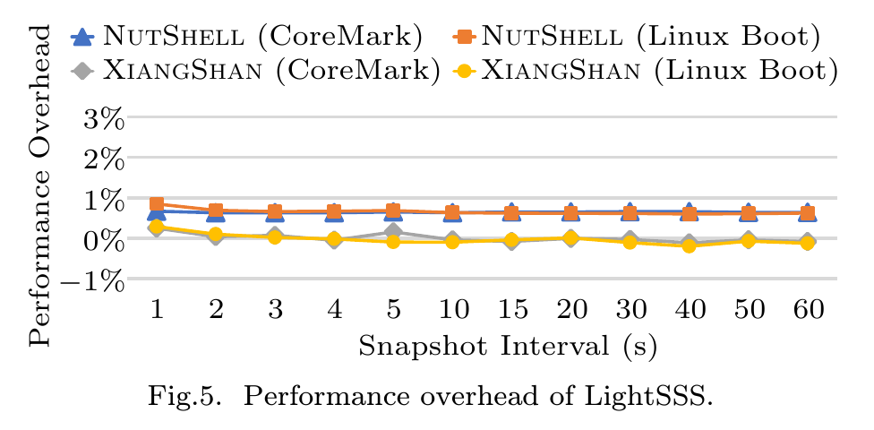

# Functional Verification for Agile Processor Development: A Case for Workflow Integration

[英文原文 PDF](./paper.pdf) · [中文译文 PDF](./paper-zh.pdf)

## 2 背景

### 2.3 基于仿真的动态验证

在[6 差分验证 · MINJIE 论文阅读 · Kyle](https://kyle0401.github.io/papers/xiangshan-agile-methodology/#chapter-11)跑过的短程序里，`sub t2, t1, t0` 在 `0x8000000c` 提交。NutShell 报告写入 `t2=2`，NEMU 算出 `t2=3`。这就是图 2 的**协同仿真**：给待测设计和参考模型同一个程序，在对应的指令提交处检查架构结果。比较之前，DiffTest 得先知道**哪条指令已经提交**。

假设验证代码靠**固定**的 Verilog 层级和信号名取得提交信息。重构流水线后，信号的位置或名字一变，原来的接线就可能**失效**。论文 §4.4 的做法是把**信息探针**接在设计内部，用固定含义的字段报告有效提交、PC、指令编码等信息。设计者可以随流水线结构**调整探针的接线**，**DiffTest 仍然按同一套字段读取**。 [论文 §4.4，第 9 页](https://jcst.ict.ac.cn/fileup/1000-9000/PDF/JCST-2023-4-2-3285-737.pdf#page=9)

DiffTest 收到一条提交记录时，可以先看两个字段：

- **`valid`** 表示这次有没有一条有效的提交记录。`valid=1`，DiffTest 才处理这条记录。
- **`pc`** 表示提交的是哪条指令。在差分验证实践里，`0x8000000c` 就是那条 `sub` 的地址。

现在回头看源码，**只看 `valid` 这一行就够了**。实验用的顺序版从写回单元取信号。乱序版从 ROB 取信号，等 ROB 确认指令可以退休，也就是可以正式提交，再报 `valid=1`。两种核把判断留在各自的设计里，DiffTest 读到的字段含义是一样的。这就是这里说的**信息探针**。

实验用的顺序版 NutShell 在写回单元接入 `DiffInstrCommit`，`valid` 来自 `io.in.valid`。同一份源码的乱序版在 ROB 接入同类探针，`valid` 取自退休条件。可以打开下面两处，对照 `valid` 和 `pc` 的赋值。 [顺序版 WBU (line 48)](https://github.com/OSCPU/NutShell/blob/041f694965728ea183a0622daa1734002bf4621e/src/main/scala/nutcore/backend/seq/WBU.scala#L48) · [乱序版 ROB (line 500)](https://github.com/OSCPU/NutShell/blob/041f694965728ea183a0622daa1734002bf4621e/src/main/scala/nutcore/backend/ooo/ROB.scala#L500)

## 4 设计

### 4.2 基于差异规则的敏捷验证（DRAV）

对齐了提交，为什么还可能误报？

论文用**异步外部中断**举例。假设 `t0` 起初是 `0`，下一条指令是 `addi t0, t0, 1`，而且规范允许在这条指令前后两个边界响应这次中断。

| 模型              | 何时进入中断处理程序 | 刚进入时的 `t0` |
| ----------------- | -------------------- | --------------- |
| 待测处理器（DUT） | 提交 `addi` 之后     | `1`             |
| 参考模型（REF）   | 执行 `addi` 之前     | `0`             |

两边的 `addi` 语义都正确，直接比较 `t0` 却会报错。**DRAV（基于差异规则的敏捷验证）**的思路是，用差异规则描述规范允许的行为，再用 DUT 的**运行时信**息帮助参考模型**在同一个合法边界响应中断**。对齐后，`t0` 仍然由参考模型自己计算。

### 4.3 面向 RISC-V 处理器的 DRAV

#### 4.3.1 **推测式虚拟地址转换**

同一条 `load`，为什么一边缺页、一边读成功？

想起 **Store Buffer**。修改页表项的 `store` 已经提交时，硬件页表遍历仍可能看到旧值。论文用这个时间差解释了一次差分不一致。

假设操作系统把一个页表项（PTE）从**无效**改成**有效且可读**，随后执行 `load`，中间还没有执行覆盖该地址的 `SFENCE.VMA`。

| 谁执行 `load` | 看到的页表项       | 结果       |
| ------------- | ------------------ | ---------- |
| DUT           | 旧项，页面无效     | 触发读缺页 |
| REF           | 新项，页面有效可读 | 读成功     |

RISC-V 在这个条件下允许使用旧项或新项。DRAV 把 **DUT 在这条 `load` 上触发了缺页**作为运行时提示。在差异规则允许时，REF 也走缺页路径，随后继续比较架构状态。**运行时提示说明发生了什么，差异规则决定何时可以接受。** [RISC-V 特权架构规范，`SFENCE.VMA`](https://docs.riscv.org/reference/isa/_attachments/riscv-privileged.pdf) · [论文 §4.3.1](https://jcst.ict.ac.cn/fileup/1000-9000/PDF/JCST-2023-4-2-3285-737.pdf#page=8)

#### 4.3.2 **缓存层次结构与多核场景**

双核读到不同的值：

假设共享变量 `x` 起初是 `0`。**核 0 写入 `x = 7`，核 1 随后读到 `7`。** 但核 1 对应的参考模型只模拟核 1，自身的内存里还保存着 `0`。于是 DiffTest 看到了一个差异：**DUT 读到 `7`，REF 读到 `0`。**

论文的做法是查 **Global Memory（GM）**。它记录 DUT 中进入缓存层级的写入。DiffTest 查 `x` 对应的地址，核实另一核的写入能否解释这次读到的 `7`。如果写入记录支持这个结果，就把 `7` 同步到参考模型的内存和这条 `load` 的目标寄存器，再接着比较。

把以上两例放在一起看：**缺页例子查的是「旧页表项还能不能用」，双核例子查的是「读到的值有没有写入记录支持」。** 这就是差异规则在做的判断。

#### 4.3.3 **更多非确定性来源**

前面几个例子都必须等程序跑起来才能判断。这一节用 `satp.PPN` 举了一个不同的例子。这个字段保存**根页表的物理页号**，不同处理器可以支持不同的页号范围。假设某款 DUT 只实现了这个字段的**低若干位**，写入的高位会被**屏蔽**。给这款 DUT 配参考模型时，就可以提前配好同样的写入掩码。这叫**静态差异规则**。 [论文 §4.3.3、表 1](https://jcst.ict.ac.cn/fileup/1000-9000/PDF/JCST-2023-4-2-3285-737.pdf#page=8) · [RISC-V 特权架构规范](https://docs.riscv.org/reference/isa/priv/supervisor.html)

**动态差异规则**要用到本次执行的信息。比如，双核例子里核 1 读到 `7`，DiffTest 要在仿真运行到这条 `load` 时，查另一核有没有写过这个地址。判断是哪一类规则，可以问一句：**做判断所需的信息，启动仿真时就知道，还是要等那条指令跑出来？**

### 4.4 信息探针

我们在第二章背景的Chisel 里看过 `DiffInstrCommit`。这次往下追一层，看 **PC 和指令编码怎么从硬件仿真送到检查器**。[6 差分验证 · MINJIE 论文阅读 · Kyle](https://kyle0401.github.io/papers/xiangshan-agile-methodology/#chapter-11)编译 NutShell 生成的两个文件里就有这条路径。

1. **Verilog 侧**调用 `v_difftest_InstrCommit(...)`，把 `io_pc` 和 `io_instr` 作为参数传出去。 [生成的 Verilog (line 91)](https://github.com/Kyle0401/Kyle0401.github.io/blob/main/papers/functional-verification/assets/DiffExtInstrCommit.v#L91)
2. **C++ 侧**接到参数，写入这次提交记录的 `packet->pc` 和 `packet->instr`。 [生成的 C++ (line 264)](https://github.com/Kyle0401/Kyle0401.github.io/blob/main/papers/functional-verification/assets/difftest-dpic.cpp#L264)

这样，在旧日志里看到的 `pc 0x8000000c` 和 `inst 405303b3` 就有了来处。**探针让检查器知道 DUT 提交了哪条指令，检查器再用这条提交记录做比对。**

### 4.5 测试生成

XFUZZ：覆盖率怎样影响下一轮测试？

[6 差分验证 · MINJIE 论文阅读 · Kyle](https://kyle0401.github.io/papers/xiangshan-agile-methodology/#chapter-11)做 NutShell 实验时，测试程序是我们事先写好的。XFUZZ 把**处理器的初始内存内容**当作输入，从已有测试用例出发，修改输入并运行仿真。遇到能**带来新覆盖的用例**，就可以把它作为**后续变异的种子**。运行过程中，DiffTest 继续比对 DUT 和参考模型，仿真也会监测硬件断言。 [论文 §4.5，英文 PDF 第 9–10 页](https://jcst.ict.ac.cn/fileup/1000-9000/PDF/JCST-2023-4-2-3285-737.pdf#page=9)

手推一轮覆盖反馈

借用在 UCAgent 学过的 **bin**。这里用一个例子，把 `addi` 的立即数分成「正数」和「负数」两个 bin。假设每个用例开始时 `t0 = 8`，已有种子命中了「正数」。

| 本轮试的指令      | 正确的写回值 | 有没有新增覆盖       |
| ----------------- | ------------ | -------------------- |
| `addi t2, t0, 2`  | `10`         | 无，仍命中「正数」   |
| `addi t2, t0, -1` | `7`          | 有，首次命中「负数」 |

按这套覆盖指标，第二个用例值得留下，因为它打开了一个还没测过的输入类别。假如 DUT 对它写回 `6`，**首次命中「负数」**和**DiffTest 报 `6 ≠ 7`**会同时发生。一个结果告诉你这次测到了哪里，另一个结果告诉你这次算得对不对。

论文实际收集了两类覆盖。**功能覆盖**包括**指令覆盖**和**指令立即数覆盖**，来自译码器。**代码覆盖**包括多**路选择器（MUX）覆盖**和**控制寄存器覆盖**，用于观察内部逻辑。图 4 下半部分的反馈箭头，就是把这些观测送回 XFUZZ，影响接下来选哪些用例继续变异。 [论文图 4](https://jcst.ict.ac.cn/fileup/1000-9000/PDF/JCST-2023-4-2-3285-737.pdf#page=6) · [论文 §4.5](https://jcst.ict.ac.cn/fileup/1000-9000/PDF/JCST-2023-4-2-3285-737.pdf#page=10)

### 4.6 故障分析

LightSSS：出错后，从快照重放

LightSSS 解决的是**怎么拿到报错前的波形**。论文里，香山开启波形记录后，仿真速度降到平时的约 **8.5%**。因此，主进程平时继续跑仿真，定期通过 Linux 的 `fork()` 留下快照子进程。子进程停在快照处等待，主进程和子进程通过写时复制（COW）共享未修改的内存页。DiffTest 报错后，主进程唤醒保留的快照，让它从当时的仿真状态继续跑，同时记录波形。 [论文 §4.6，英文 PDF 第 10–11 页](https://jcst.ict.ac.cn/fileup/1000-9000/PDF/JCST-2023-4-2-3285-737.pdf#page=10)

实操：重放之前的 NutShell 实验

复用[6 差分验证 · MINJIE 论文阅读 · Kyle](https://kyle0401.github.io/papers/xiangshan-agile-methodology/#chapter-11)的减法测试。原有仿真器的构建没启用波形，所以我用同一份 RTL 单独构建了支持 FST 波形的版本。日志里能看到完整顺序：

1. **主进程报错。** `sub` 写入 `t2=2`，NEMU 算出 `3`。 [首次差分报告 (line 44)](https://github.com/Kyle0401/Kyle0401.github.io/blob/main/papers/functional-verification/assets/nutshell-sub-replay.txt#L44)
2. **快照子进程被唤醒。** 它继续仿真，并打开波形记录。 [重放启动日志 (line 45)](https://github.com/Kyle0401/Kyle0401.github.io/blob/main/papers/functional-verification/assets/nutshell-sub-replay.txt#L45)
3. **子进程再次报出相同的差异。** 生成的 FST 波形也已验证可读取。 [重放差分报告 (line 84)](https://github.com/Kyle0401/Kyle0401.github.io/blob/main/papers/functional-verification/assets/nutshell-sub-replay.txt#L84) · [重放波形 FST](./assets/nutshell-sub-replay.fst)

这个短程序的快照很早，重放覆盖了几乎整个测试。论文里仿真跑了很久才出错的场景，才体现出近期快照能省掉多少重跑时间。

## 5 评估

### 5.1 面向 RISC-V 处理器的 DiffTest

同一套 DiffTest，怎么接两种处理器？

看**表 2** 的三行。数字统计的是论文所用配置里**实例化了多少个探针**。

| 探针                         | 单核 NutShell | 双核香山 |
| ---------------------------- | ------------- | -------- |
| `ArchEvent`，异常与中断      | 1             | 2        |
| `InstrCommitEvent`，指令提交 | 1             | 12       |
| `RefillEvent`，缓存填充      | 0             | 4        |

最值得看的是 **提交探针的 `1` 和 `12`**。NutShell 每拍最多报告一条提交。双核香山每个核有 6 个提交槽，两个核合计 12 个。比如某一拍一个核只提交了 3 条，就只有 3 个槽报告有效事件。这正好接上我们背景中看的 `valid`。

在编译过的 NutShell 里对照一下：

打开生成的 C++ 头文件，可以看到 **`DifftestInstrCommit commit[1]`**。这个 `1` 就对应表里的一个提交槽。再看缓存填充检查器，它由 `CONFIG_DIFFTEST_REFILLEVENT` 控制。我的 NutShell 构建没有生成这个宏，因此编译时会跳过这段检查。**接入新处理器时，设计端提供已有探针和实例数，检查器据此启用对应规则。** [NutShell 生成的状态结构 (line 107)](https://github.com/Kyle0401/Kyle0401.github.io/blob/main/papers/functional-verification/assets/difftest-state.h#L107) · [缓存填充检查器 (line 20)](https://github.com/OSCPU/difftest/blob/261b4413184c901fa45bb3387f8c40a702d56ebd/src/test/csrc/difftest/checkers/refill.cpp#L20)

### 5.2 模糊测试的有效性

XFUZZ 实验里的 33 和 18 怎么读？

**33 个是 NutShell 的功能缺陷，18 个是参考模型的功能缺陷。** 在这次对照实验中，这两组都是 XFUZZ 发现、HWFP 漏掉的问题。表 3 从 **33 个 NutShell 缺陷**中选了 13 个代表案例，涵盖算术、CSR 操作和访问控制。

两个工具主要区别在于**用什么覆盖率指导下一轮测试**。HWFP 观察生成的仿真器跑过哪些 **C++ 分支**。XFUZZ 则直接观察硬件相关的覆盖指标，包括译码器见过的指令和立即数，以及 MUX 和控制寄存器的覆盖。这组结果展示了整套硬件覆盖反馈在这次实验里的价值。要量化其中某一项指标的贡献，还需要逐项改变反馈指标做对照。

**用[6 差分验证 · MINJIE 论文阅读 · Kyle](https://kyle0401.github.io/papers/xiangshan-agile-methodology/#chapter-11)重放的日志练习怎么判定哪一边错。** NutShell 写回 `2`，NEMU 给出 `3`。我们用指令语义独立核对，`sub` 在这个输入下应当得到 `8 − 5 = 3`，所以能把问题归到 NutShell。论文里的 **18 个参考模型缺陷**提醒我们，遇到陌生的差异时，两边的结果都需要按规范核对。

### 5.3 快照效率

LightSSS 平时保存快照有多贵？

**论文测试的四组配置里，快照开销都低于 1%。** 图 5 的横轴是每隔多少秒保存一次快照，纵轴是相对普通 RTL 仿真的性能开销。四条线对应 NutShell 和香山分别运行 CoreMark、启动 Linux。最高点是橙线最左侧，NutShell 启动 Linux、每秒保存一次快照，开销约 **0.85%**（按图估读）。香山的两条线在 **0%** 附近小幅波动。



把图里的 **低于 1%** 和前一节的 **8.5%** 放回各自的场景。前者是**平时保留快照多付出的开销**。后者是香山**持续开启波形记录时，剩下的仿真速度**。我之前跑的 NutShell 实验展示了这两步怎么接起来：**主进程先报差分错误，子进程醒来才开始录波形。** [论文 §4.6](https://jcst.ict.ac.cn/fileup/1000-9000/PDF/JCST-2023-4-2-3285-737.pdf#page=10) · [NutShell 重放日志 (line 45)](https://github.com/Kyle0401/Kyle0401.github.io/blob/main/papers/functional-verification/assets/nutshell-sub-replay.txt#L45)

**手算一下快照间隔的影响。** 假设仿真跑到第 98 秒时发现错误，保留最近两份快照，并从其中较早的一份重放。每 **5 秒**保存一次，手里是第 90、95 秒的快照，要重走从第 90 秒到第 98 秒的进度。每 **30 秒**保存一次，手里是第 60、90 秒的快照，重放要从第 60 秒开始。**间隔越长，图 5 测到的日常开销仍然很小，但一次报错后可能要重走更长一段。** 带波形重放实际要花多久，需要单独计时。

### 5.4 **案例研究**

从一次数据不一致，追到 L2 的 MSHR

这是在[论文与资料 · MINJIE 论文阅读 · Kyle](https://kyle0401.github.io/papers/xiangshan-agile-methodology/)读过的双核香山 Redis 案例。这次把注意力放在**每一步证据能把问题缩小到哪里**。仿真运行超过 **168 小时**、累计约 **30 亿个模拟周期**时，DiffTest 发现 DUT 的读值和 Global Memory 的记录不一致。这就是 §4.3.2 讲过的多核差异规则在实际调试中的用法。

| 作者看了什么                | 问题缩小到哪里                                               |
| --------------------------- | ------------------------------------------------------------ |
| **DiffTest 报告**           | 确认发生了数据不一致。                                       |
| **ChiselDB 的缓存事务记录** | 对同一个缓存块，L2 从 L3 收到正确数据，后来却给 L1 返回了错误数据。于是重点查 L2。 |
| **LightSSS 重放得到的波形** | 看到 L2 内部逐拍的信号，定位到 MSHR 对重叠事务的处理。       |

LightSSS 从**倒数第二份快照**重放，花约 **3 分钟**录下最后 **30,800 个周期**的波形。这个时间衡量的是**取得波形**这一步。作者在重放期间就能同时查事务记录。

**用 NutShell 波形走一遍同样的读法。** 我从重放 FST 里读到，在波形时间戳 **535**，提交探针有效，`PC = 0x8000000c`，指令编码是 `0x405303b3`（`sub`），目标寄存器 `x7` 的写回值已经是 `2`。差分日志说 `t2` 不一致，波形则把这个结果落到了**哪条指令、哪一次提交**。香山案例也是这样追，只是作者接着沿**缓存事务**往前查，找到了错误数据开始出现的位置。 [NutShell 重放波形](./assets/nutshell-sub-replay.fst) · [对应提交日志 (line 60)](https://github.com/Kyle0401/Kyle0401.github.io/blob/main/papers/functional-verification/assets/nutshell-sub-replay.txt#L60)

## 6 **讨论与相关工作**

跑得更快和测得更深，是两个问题

**跑得更快**，回答的是同样的时间里能执行多少仿真周期。作者把 FPGA 加速协同仿真列为后续方向。**测得更深**，回答的是测试能触达哪些行为、能发现什么问题。这里作者讨论了形式验证、基于性质的测试和覆盖率引导的测试生成，也指出处理器专用知识可以提高测试的针对性，同时会影响工具的通用性。

## 7 结论

为什么叫「工作流集成」？

作者提出两条原则。**协作式任务委派**是让掌握信息的一端负责把它提供出来，例如处理器设计端用探针报告指令提交。**动态信息交换**是让一次仿真产生的信息直接影响下一步，例如覆盖反馈改变 XFUZZ 接下来选哪些种子，DiffTest 的异常报告触发 LightSSS 重放。


# 实践

## 8.1 从提交探针追到 DiffTest 报告

本节对应论文 §4.4 和 §5.1。实验环境是 WSL Ubuntu，使用单核顺序版 NutShell 的 Verilator RTL 仿真和 NEMU 参考库。先沿源码追踪一条指令如何提交，再用原来的减法小程序核对日志。 [论文 §4.4](https://jcst.ict.ac.cn/fileup/1000-9000/PDF/JCST-2023-4-2-3285-737.pdf#page=9) · [论文 §5.1、表 2](https://jcst.ict.ac.cn/fileup/1000-9000/PDF/JCST-2023-4-2-3285-737.pdf#page=11) · [实验版本](./assets/practice/01-DiffTest/build-manifest.json)

1. **Chisel 端。** 顺序版的 `backend/seq/WBU.scala` 实例化 `DiffInstrCommit`，将 `valid` 接到这里的 `io.in.valid`，并传出 PC、指令编码和目标寄存器。乱序版在 `backend/ooo/ROB.scala` 根据退休条件报告提交。错误路径上的 `sub` 即使已经算完，也会在冲刷时被丢弃，因此不会作为有效提交推进参考模型。
2. **Verilog 到 C++。** 生成的 `DummyDPICWrapper_InstrCommit.sv` 用 `io_valid & control_enable & ~reset` 生成 `enable`。`DiffExtInstrCommit.v` 在时钟上升沿且 `enable` 有效时调用 DPI-C 的 `v_difftest_InstrCommit(...)`。生成的 `difftest-dpic.cpp` 将 `io_pc`、`io_instr` 放进相应提交槽的 `packet->pc`、`packet->instr`。单核顺序版的 `difftest-state.h` 里是 `DifftestInstrCommit commit[1]`。写回值通过 `commit_data[1]` 传递，日志把它和 PC、指令、目的寄存器放在同一行供核对。
3. **跑同一份程序。** `t1=8`，`t0=5`，在 PC `0x8000000c` 执行 `sub t2, t1, t0`。尾部放四条 `nop` 后结束。正常版通过差分并以 `GOOD TRAP` 退出（退出码 `0`）。故障版仅在生成的 `SUB` RTL 中翻转结果最低位，DiffTest 捕获 `t2` 不一致（退出码 `1`）。手算 `8−5=3`，与 NEMU 的参考值一致。 [测试镜像](./assets/practice/01-DiffTest/registers-drain.bin) · [正常日志](./assets/practice/01-DiffTest/good.txt) · [故障日志](./assets/practice/01-DiffTest/subfault.txt) · [差分报告](./assets/practice/01-DiffTest/report.json)

```text
[03] commit pc 000000008000000c inst 405303b3 wen 1 dst 07 data 0000000000000002 idx 000 <--
t2 different at pc = 0x0080000014, right = 0x0000000000000003, wrong = 0x0000000000000002
```

第一行的 `0x8000000c` 是实际写错的 `sub` 的提交地址。第二行的 `0x80000014` 是检查器报告差异时使用的 DUT 上下文地址。定位写错的指令时，回到提交记录核对 PC、目标寄存器和写回数据。

已有环境的复跑入口如下。该目录含已构建的两版 NutShell 仿真器和 NEMU 参考库。后面的实验也沿用这里的 `$minjie` 路径。

```bash
minjie="${MINJIE_DIR:?请先设置 MinJie 实验目录}"
python3 "$minjie/difftest_demo.py"
```

## 8.2 LightSSS 快照重放与 FST 波形

复用同一个减法教学故障，观察差分报错如何触发重放。第一次只给原有仿真器加 `--enable-fork`，主进程报错后子进程确实被唤醒，但日志提示 `Waveform not supported`。检查构建配置发现原仿真器未启用 trace，于是在 WSL 的独立构建目录中复用故障版生成的 RTL 和 DPI-C 文件，用 `EMU_TRACE=fst` 重建，再用 `--enable-fork` 跑同一镜像和 NEMU 参考库。 [论文 §4.6](https://jcst.ict.ac.cn/fileup/1000-9000/PDF/JCST-2023-4-2-3285-737.pdf#page=10)

重新构建时，在原工作区加载 `nutshell_env.sh`。`build_dir` 指向已复制 `rtl/` 和 `generated-src/` 的独立构建目录。使用的构建命令如下。

```bash
make -C "$NOOP_HOME/difftest" emu BUILD_DIR="$build_dir" \
  EMU_TRACE=fst RTL_SUFFIX=sv WITH_CHISELDB=0 WITH_CONSTANTIN=0 \
  NO_ZSTD_COMPRESSION=1 -j6
```

| 重放日志位置 | 观察到的结果 |
| --- | --- |
| 第 20、44 行 | 主进程提交 `sub`，`x7` 写入 `2`。DiffTest 报告 NEMU 为 `3`、NutShell 为 `2`。 |
| 第 45–46 行 | 保留的快照子进程被唤醒，开始记录 FST。 |
| 第 60、84 行 | 子进程重新提交同一条 `sub`，再次报告同一个 `t2` 差异。 |

在 FST 的时间戳 `535`，`commit.dpic.enable=1`，提交 PC 为 `0x8000000c`，指令字为 `0x405303b3`，目的寄存器为 `x7`，对应的 `commit_data` 为 `2`。波形和提交日志在这几项上吻合。 [主进程及重放日志](./assets/nutshell-sub-replay.txt) · [原始 FST 波形](./assets/nutshell-sub-replay.fst)

本地短程序的快照很早，重放覆盖了几乎整个测试。论文 §5.4 的双核香山 Redis 案例在超过 168 小时的仿真中发现异常，从倒数第二份快照带波形重放最后约 30,800 个模拟周期，耗时约 3 分钟。这两个时间分别对应论文中的首次发现和带波形重放。 [论文 §5.4](https://jcst.ict.ac.cn/fileup/1000-9000/PDF/JCST-2023-4-2-3285-737.pdf#page=13)

在已有的 FST 仿真器仍在原 WSL 构建目录时，可以用以下命令复跑。波形写到该构建目录的 `build/` 下，预期 DiffTest 捕获教学故障并返回 `1`。

```bash
lightsss="${LIGHTSSS_BUILD_DIR:?请先设置 LightSSS 的 WSL 构建目录}"
NOOP_HOME="$lightsss" "$lightsss/build/emu" \
  -i "$minjie/results/difftest-learning/registers-drain.bin" \
  --diff "$minjie/NEMU-ref/build/riscv64-nemu-interpreter-so" \
  --ram-size 128MB -C 5000 -I 64 -b 0 -e 0 --enable-fork
```

## 8.3 用 `addi` 教学分箱练习覆盖反馈

继续用前面的正常 NutShell 仿真器和 NEMU 参考库。脚本生成四份固定镜像，每份先设置 `t0=8`，再在 `0x80000008` 执行 `addi t2, t0, imm`，最后经过四条 `nop` 和结束指令。开启 `--dump-commit-trace`，按 PC 选取实际提交的目标指令，将指令字高 12 位按有符号数解码，再归入正数、零、负数三个教学分箱。DiffTest 检查 DUT 和参考模型是否一致，脚本还单独核对 `x7` 写回是否等于 `8 + imm`。通过两项检查且首次命中新分箱的输入才进入种子集。 [覆盖反馈原理，论文 §4.5](https://jcst.ict.ac.cn/fileup/1000-9000/PDF/JCST-2023-4-2-3285-737.pdf#page=9)

| 立即数 | 实际写回 `t2` | 教学分箱 | 累计覆盖 | 种子决策 |
| ---: | ---: | --- | ---: | --- |
| `+1` | 9 | 正数 | 1/3 | 初始种子 |
| `+2` | 10 | 正数 | 1/3 | 该分箱已经命中 |
| `0` | 8 | 零 | 2/3 | 保留，首次命中零 |
| `−1` | 7 | 负数 | 3/3 | 保留，首次命中负数 |

例如 `+1` 的提交记录里，`inst 00128393` 的立即数是 `0x001`，`wen 1 dst 07 data ...0009` 表示向 `t2` 写回 `9`。四个程序均通过 DiffTest，最终种子为 **`+1`、`0`、`−1`**。 `+2` 写回检查也通过了，但它和 `+1` 属于同一个教学分箱。 [结果报告](./assets/practice/03-ADDI/report.json) · [提交日志 `+1`](./assets/practice/03-ADDI/plus-1.txt) · [`+2`](./assets/practice/03-ADDI/plus-2.txt) · [`0`](./assets/practice/03-ADDI/zero.txt) · [`−1`](./assets/practice/03-ADDI/minus-1.txt)

固定镜像归档为 [`+1`](./assets/practice/03-ADDI/plus-1.bin)、[`+2`](./assets/practice/03-ADDI/plus-2.bin)、[`0`](./assets/practice/03-ADDI/zero.bin)、[`−1`](./assets/practice/03-ADDI/minus-1.bin)。原工作区的脚本会重新生成镜像、运行并输出新的报告。

```bash
python3 "$minjie/addi_coverage_demo.py"
```

## 8.4 用官方 XFUZZ 测量实际 MUX 覆盖

使用 XFUZZ 官方文档推荐的 FuzzingNutShell 示例，在独立 WSL 目录中按固定源码归档构建。NutShell 示例固定在 `a8ff113`，配套 DiffTest `abfdcdf`、XFUZZ `901d963`、LibAFL `a98805b`。用 Mill 0.11.8 生成插入 MUX 探针的 RTL，再将 Rust 生成的 `libfuzzer.a` 链接进 Verilator 仿真器 `build/fuzzer`。公开示例的版本可以逐项核对，2023 年 §5.2 的完整实验版本仍未确认。 [官方说明](https://github.com/OpenXiangShan/xfuzz#coverage-instrumentation-for-chisel-designs) · [示例源码](https://github.com/poemonsense/FuzzingNutShell/tree/a8ff113cd6161bb5809480d167fdf5200bfdafd8) · [源码版本](./assets/practice/04-XFUZZ/source-versions.txt) · [归档校验值](./assets/practice/04-XFUZZ/source-archives.sha256)

以下构建命令在已配置 Java、Mill、Rust 和 Verilator 的 FuzzingNutShell 目录执行。`ccover/` 及其 LibAFL 依赖使用该示例固定的版本。 [Rust 构建日志](./assets/practice/04-XFUZZ/xfuzz-build.txt) · [RTL 生成日志](./assets/practice/04-XFUZZ/rtl-build.txt) · [仿真器构建日志](./assets/practice/04-XFUZZ/simulator-build.txt) · [Cargo 依赖锁定文件](./assets/practice/04-XFUZZ/xfuzz-Cargo.lock)

```bash
export NOOP_HOME="$PWD"
export NUTSHELL_HOME="$PWD"
export XFUZZ_HOME="$PWD/ccover"
(cd ccover && cargo build --release)
make sim-verilog CORE=inorder BOARD=sim FIRRTL_COVER=mux -j2
make emu CORE=inorder BOARD=sim XFUZZ=1 FIRRTL_COVER=mux NO_ZSTD_COMPRESSION=1 -j6
```

首次启动使用示例附带的 NEMU。旧库缺少这版 DiffTest 要求的 `difftest_display` 符号，仿真在加载参考库时退出。改用前面 MinJie 实验已验证的 NEMU `af9d4ce` 后，通过了四个固定用例。覆盖类型选 `firrtl.mux`，使用固定输入模式和仿真随机种子 `0`。先单跑 `+1`，再按 `+1`、重复 `+1`、`+2`、`0`、`−1` 的顺序运行，最后在新的进程里重复整组。 [首次启动失败日志](./assets/practice/04-XFUZZ/bundled-nemu-failure.txt) · [实际运行版本](./assets/practice/04-XFUZZ/runtime-versions.txt) · [官方固定输入入口](https://github.com/OpenXiangShan/xfuzz/blob/901d963680c8e53115ac0e8b1e09039699bb6885/src/lib.rs)

```text
[02] commit pc 0000000080000008 inst 00128393 wen 1 dst 07 data 0000000000000009 idx 000
COVERAGE: mux, 1410, 634, 634
Total Coverage:       44.965%
```

`+1` 单跑日志里，提交记录确认 `t2=9`，`COVERAGE` 的三个数字分别是可计数的 MUX 覆盖点总数、本次命中数、累计命中数。Rust 端同时报告累计百分比。整组结果如下。 [单跑 `+1` 日志](./assets/practice/04-XFUZZ/plus-1.txt)

| 输入 | 实际写回 `t2` | 单次命中 | 累计命中 | 新增点 |
| --- | ---: | ---: | ---: | ---: |
| `+1` | 9 | 634 | 634/1410 | 634 |
| 重复 `+1` | 9 | 634 | 634/1410 | 0 |
| `+2` | 10 | 634 | 634/1410 | 0 |
| `0` | 8 | 634 | 634/1410 | 0 |
| `−1` | 7 | 644 | 644/1410 | 10 |

整组最终为 **644/1410（45.674%）**，同配置复跑的写回值和覆盖计数一致。教学分箱把 `0` 单独列为一个输入类别，所以它新增一个分箱。这里计数的是整个短程序运行期间发生过翻转的 MUX 选择条件，`0` 没有增添新的命中。`−1` 在这组输入中增加 10 个 MUX 覆盖点，日志给出的是计数，尚未定位这些点分别对应哪些电路。本地结果来自固定输入回放，论文 §5.2 评估的是自动生成测试。 [序列日志](./assets/practice/04-XFUZZ/sequence.txt) · [复跑日志](./assets/practice/04-XFUZZ/sequence-repeat.txt) · [结果报告](./assets/practice/04-XFUZZ/report.json) · [MUX 覆盖实现](https://github.com/OpenXiangShan/xfuzz/blob/901d963680c8e53115ac0e8b1e09039699bb6885/instrumentation/src/xfuzz/MuxCoverTransform.scala)

已有 WSL 环境使用下面的入口。脚本先单跑 `+1`，再跑两遍完整序列，将输入镜像放在 `--` 后的仿真参数之前。仿真端使用 `-s 0`、`-b 0 -e 5000`、`-C 5000 -I 64`、`--ram-size 128MB` 和 `--dump-commit-trace`。公开日志首行保留了 `fuzzer` 的调用参数，本机路径用目录变量表示。 [实际复跑命令](./assets/practice/04-XFUZZ/replay-command.txt)

```bash
xfuzz_lab="${XFUZZ_LAB_DIR:?请先设置 XFUZZ 实验目录}"
demo="${XFUZZ_DEMO_DIR:?请先设置已构建的 FuzzingNutShell 目录}"
python3 "$xfuzz_lab/run_fixed_addi.py" "$demo"
```
