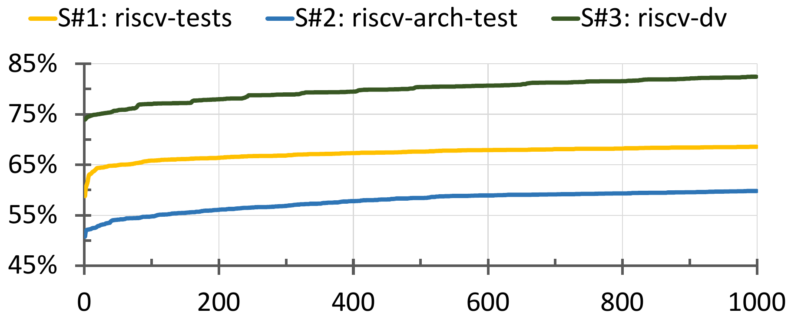
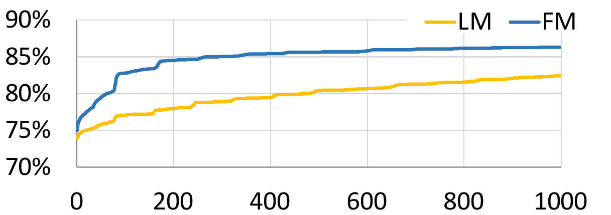

# **PathFuzz: Broadening Fuzzing Horizons with Footprint Memory for CPUs**

[英文原文 PDF](./paper.pdf) · [中文译文 PDF](./paper-zh.pdf)

## 1 先看种子把覆盖率带到了哪里

在[6 差分验证 · MINJIE 论文阅读 · Kyle](https://kyle0401.github.io/papers/xiangshan-agile-methodology/#chapter-11)已经用 NutShell 和 NEMU 做过差分验证。那次追的是「这条 `sub` 的结果有没有算对？」这篇往前追一步：**测试用例从哪里来，后续生成的用例又覆盖了多少新行为？** [DAC 2024 论文介绍](https://61dac.conference-program.com/presentation/?id=RESEARCH419&sess=sess136)



**种子（seed）就是一开始手里已有的测试用例。图 1 的三条线用了三组不同的种子。横轴是后续生成的变异输入数量，最右边的 `1000` 代表 100 万个输入。纵轴是翻转覆盖率（toggle coverage）**，衡量受监测的硬件信号有多少翻转项被观察到。

先算黄色的 `riscv-tests`。只运行原始种子时，覆盖率是 **56.0%**。后续测试增加了 **12.6 个百分点**，所以最终是 **68.6%**。读这张图时，起点回答「手里的种子已经做到哪」，增量回答「后续测试又推进了多少」。下表的起点和增量取自图旁正文。

| 种子来源               | 初始覆盖率 | 后续增加      |
| ---------------------- | ---------- | ------------- |
| 黄色 `riscv-tests`     | 56.0%      | 12.6 个百分点 |
| 蓝色 `riscv-arch-test` | 44.2%      | 15.7 个百分点 |
| 绿色 `riscv-dv`        | 72.6%      | 9.9 个百分点  |

## 2 足迹内存怎么排列字节？

**§3.1 Footprint Memory**中论文的做法是，按**每个地址第一次被访问的顺序**，把当时读到的字节排成一列。

我们手算一次。假设内存有四个字节，每次只读一个字节。

| 地址     | `0x10` | `0x11` | `0x12` | `0x13` |
| -------- | ------ | ------ | ------ | ------ |
| 初始字节 | `A1`   | `B2`   | `C3`   | `D4`   |

假设实际读取顺序是 **`0x12 → 0x10 → 0x12`**。

- **线性内存（LM）**按地址排，得到 `A1 B2 C3 D4`。
- **足迹内存（FM）**按首次访问排。先读 `0x12`，记下 `C3`。再读 `0x10`，记下 `A1`。最后又读 `0x12`，这次仍读到 `C3`，但这个地址已经记过了。所以足迹是 **`C3 A1`**。

这条路径发出了 **3 次读取**，首次访问了 **2 个不同地址**，因此足迹只收进 **2 个字节**。原来四字节的输入里，这两个字节就是这次执行实际用到的部分。

## 3 反过来用足迹重放读取

现在只给足迹 **`D4 A1 B2`**，由执行过程依次提出读取请求。每遇到一个新地址，就取足迹里的下一个字节，并记住这个地址分到了什么。在这个只读例子里，再次访问同一地址时，直接返回之前分配的字节。

| 读取请求 | 怎么取值                   | 返回值 |
| -------- | -------------------------- | ------ |
| `0x13`   | 第一次见到，取第 1 个字节  | `D4`   |
| `0x10`   | 第一次见到，取第 2 个字节  | `A1`   |
| `0x13`   | 读回已经分给 `0x13` 的字节 | `D4`   |
| `0x11`   | 第一次见到，取第 3 个字节  | `B2`   |

仔细看第三行。**足迹的读取位置只在遇到新地址时才前进。** 所以第三次请求处理完，`B2` 仍然是下一个可以分配的字节。给定原来的请求顺序，三个足迹字节就能重放出四次读取结果。

**现在只换读取顺序。** 足迹还是 `D4 A1 B2`，请求改成 `0x10 → 0x11 → 0x10 → 0x13`。

两次的返回序列都是 `D4 A1 D4 B2`，但把值按地址列出来，就能看到区别。

## 4 为什么种子库按地址保存？

| 地址   | 先读 `0x13` | 先读 `0x10` |
| ------ | ----------- | ----------- |
| `0x10` | `A1`        | `D4`        |
| `0x11` | `B2`        | `A1`        |
| `0x13` | `D4`        | `B2`        |

两次用的都是同一串足迹 `D4 A1 B2`。**足迹规定字节按什么顺序发出去，执行决定每个字节发给哪个地址。** 线性格式则把**地址和值绑在一起**。例如，把右边那列保存下来，以后只要读 `0x13`，在这个只读例子里就会拿到 `B2`，无论它是第几个被读到的。

这就是论文 **§3.2**给出的设计理由。种子可能在后续多轮测试中复用，也可能交给不同的 CPU 设计。PathFuzz **用线性格式保存种子，在测试过程中使用足迹格式**，每轮前后做格式转换。这样，种子库保留的是明确的地址和值，足迹则可以按**当轮**的访问顺序组织数据。

**再走一遍转换。** 把表格右边那列当作已经保存的线性种子，按 `0x13 → 0x10 → 0x13 → 0x11` 读取。重新记录出来的足迹**是 `B2 D4 A1`**。

> [!TIP]
>
> **种子库就是每轮测试的起点。** PathFuzz 从库里选一份线性种子，先根据一次执行记录把它转成足迹。等到**运行本轮的候选用例**时，仿真器手里就已经有一串足迹字节了。
>
> 看论文图 2 和 §3.2，可以把过程读成这样：
>
> **从库里选线性种子 → 根据执行记录生成足迹 → 用足迹生成并运行候选用例 → 值得保留的用例转回线性格式入库**
>
> 也可以直接拿线性种子来测，论文 §4.1 就把这种做法作为对照。作者多做一次转换，是因为**原种子里有很多字节，这条执行路径根本用不到**。假如线性种子有 100 个字节，记录时只访问了其中 10 个，那么生成的足迹就集中在这 10 个字节上。这样，生成新用例时，改动更容易落到程序实际会读到的地方。
>
> 用跑过 NutShell 仿真的经验来理解：**给仿真器一份输入，启动仿真，CPU 就会执行指令、发出访存请求。**「执行记录」是观察这次仿真里发生了什么。「运行候选用例」是换一份待测输入，再启动一次仿真。
>
> 执行记录是什么？
>
> 假设我们给仿真器的初始内存是 `0x13 = D4`、`0x10 = A1`。程序跑起来以后，先读 `0x13`，再读 `0x10`。我们在仿真过程中观察到：
>
> | 第几次读 | CPU 要读的地址 | 读到的字节 |
> | -------- | -------------- | ---------- |
> | 第 1 次  | `0x13`         | `D4`       |
> | 第 2 次  | `0x10`         | `A1`       |
>
> 这两行就是这个例子里的**执行记录**。初始内存告诉你「每个地址放了什么」，执行记录告诉你「程序先后读了什么」。PathFuzz 按首次访问的顺序收下字节，得到足迹 **`D4 A1`**。
>
> 运行候选用例是什么？
>
> 假设我们想试试把足迹的第一个字节改成 `E5`，得到 **`E5 A1`**。这份准备拿去试的新输入，就叫**候选用例**。把它交给仿真器跑一遍，就是**运行候选用例**。如果程序这次仍然先读 `0x13`、再读 `0x10`，两次就会分别拿到 `E5` 和 `A1`。跑完以后，再看执行结果和覆盖反馈。
>
> 换句话说，**第一次跑原始种子，是为了看程序用到了哪些字节；第二次跑新的输入，是为了看字节改了以后会发生什么。** 这两步分别对应论文 §3.1 的足迹记录和图 2 中候选输入交给 DUT 执行的过程。

## 5 怎么从长程序里取出一段当种子？

 **§3.3 Enriching Seed Corpus**：假设一个程序先初始化，再进入计算阶段。作者想把计算阶段用作测试种子，需要同时处理两个问题：**从哪里开始执行，以及要带上哪些内存字节。**

1. **架构检查点解决起点问题。** 在计算阶段开始前保存程序状态，例如接下来要执行的位置、寄存器和内存状态。恢复后可以直接从这个位置继续，省掉前面的初始化。这也就是在 [3 利用 MINJIE 平台实现敏捷工作流程 · MINJIE 论文阅读 · Kyle](https://kyle0401.github.io/papers/xiangshan-agile-methodology/#section-4-17) 学过的检查点。
2. **足迹内存缩小种子。** 从检查点开始执行目标片段，按**首次**访问顺序记录用到的内存字节。一份线性检查点可能带着大量内存内容，而这一小段执行只用到了其中一部分。§3.3 就是用这段访问足迹把种子缩小。

## 6 **实验** **#1**：足迹内存

**图 3(c)**，配合 **§4.1** 一起读。这里作者拿同一组 `riscv-dv` 种子做对照，看换一种输入表示后，Rocket 的翻转覆盖率能多增加多少。

> [!TIP]
>
> **翻转覆盖率（toggle coverage）看的是：仿真跑起来以后，受监测的硬件信号里，有多少位发生了预期统计的 `0 → 1`、`1 → 0` 变化。** 每一位的两个方向可以分别记账。 [Accellera UCIS 标准 §6.5.5](https://www.accellera.org/images/downloads/standards/ucis/UCIS_Version_1.0_Final_June-2012.pdf)
>
> 假设我们只监测一个两位信号 `s[1:0]`，波形是 **`00 → 01 → 00 → 10`**。按翻转方向分别计分：
>
> | 监测的位    | `0 → 1` | `1 → 0` |
> | ----------- | ------- | ------- |
> | 低位 `s[0]` | 命中    | 命中    |
> | 高位 `s[1]` | 命中    | 待命中  |
>
> 两位各有两个方向，一共 **4 项**，这段波形命中了 **3 项**，所以是 **75%**。低位来回翻得再多，覆盖率也还是 75%。下一拍如果是 `00`，高位就补上了 `1 → 0`，覆盖率达到 **100%**。
>
> 留意一下，补完以后，整个波形也只出现过 `00`、`01`、`10`。如果你想验证两位同时为 `1` 时电路会怎么工作，就要专门测 `11` 并检查输出。**翻转覆盖率按位统计，功能测试可以检查多位组合及其结果。**
>
> 所以回到 **PathFuzz 图 3(c)**，蓝线往上走，表示继续测试时，Rocket 又有一些原先没观察到的信号翻转被观察到了。判断这些执行的结果是否正确，则靠 DUT 与参考模型的差分检查。



这次用**正文报告的覆盖率增量**来算。黄色的线性内存（LM）增加了 **9.9 个百分点**，蓝色的足迹内存（FM）增加了 **12.7 个百分点**。

- 用减法，`12.7 − 9.9 = 2.8`，所以 **FM 多增加了 2.8 个百分点**。
- 用除法，`12.7 ÷ 9.9 ≈ 1.28`，所以 **FM 新增的覆盖率是 LM 的 1.28 倍**。

## 7 为什么换成足迹内存，覆盖率会涨得更多？

图 3(c) 看的是**覆盖率增加了多少**。再看**图 3(f) 和 3(i)**。作者沿用同一组 `riscv-dv` 种子，检查两个更直接的问题：**给进来的数据有多少没用上？CPU 要数据时，又有多少次拿不到？** 下表是 §4.1 正文报告的平均值。

| 指标                                 | 线性内存 LM | 足迹内存 FM |
| ------------------------------------ | ----------- | ----------- |
| 图 3(f) 输入中没有被访问的字节比例   | 96.8%       | 76.3%       |
| 图 3(i) 每个用例的输入越界访存请求数 | 60.3 次     | 9.3 次      |

**第一行从输入看。** 在线性格式下，平均每 100 个输入字节，大约只有 **3 个**被这次执行用到。换成足迹格式后，大约有 **24 个**被用到。这样，改动更容易落在执行实际会访问的字节上。

**第二行从 CPU 看。** 这里的「越界」指的是**当前测试输入无法为这次内存请求提供数据**。这种请求从平均每个用例约 **60 次**降到了约 **9 次**。联系之前的手算：足迹里的下一个字节可以在执行时分配给新访问到的地址，线性格式中的字节则已经和地址绑定。

> [!TIP]
>
> **同一串足迹在不同的执行里，确实可能分配到不同地址。** 但在**同一轮执行**里，一个字节分配到某个地址后，后续读取就按这个地址取值。动态分配发生在仿真器给地址填入**初始内容**的时候。
>
> 拿两个字节 `D4 A1` 举例。假设程序这次按 `0x10 → 0x13 → 0x10` 读取，三次都是单字节读，中间没有写入。
>
> | 测试输入                               | 这三次读会发生什么？                                         |
> | -------------------------------------- | ------------------------------------------------------------ |
> | 线性内存把 `D4 A1` 放在 `0x10`、`0x11` | 第一次读到 `D4`。第二次要读 `0x13`，原输入没给这个地址准备字节。 |
> | 足迹内存依次提供 `D4 A1`               | 先把 `D4` 分给 `0x10`，再把 `A1` 分给 `0x13`。第三次回到 `0x10`，还是读到 `D4`。 |
>
> **它的意义就在第二次读。** 当执行走到一个原输入没覆盖的地址时，只要足迹里还有可用字节，这次访存就仍能用上测试输入里的数据。这也是图 3(i) 里输入越界请求减少的原因。 [DAC 2024 论文简介](https://61dac.conference-program.com/presentation/?id=RESEARCH419&sess=sess136)
>
> 「乱套」在 **DUT 和 REF 各自按访问顺序分配**时确实会发生。比如 REF 如果先读 `0x13`，自己从头取足迹就会把 `D4` 分给它，而 DUT 给的是 `A1`。所以 **PathFuzz 由 DUT 首次访问时确定地址和值，再把这份输入数据按地址同步给 REF**。这样，两边只要读到 `0x13`，拿到的初始值就是同一个 `A1`，差分比较才有意义。这个细节在§3.2 的最后一段。

还有一个容易卡住的地方：**为什么 FM 仍有 76.3% 的字节没用上？** 足迹来自原来那次执行，生成新用例后，程序可能走出**更短的路径**。比如原来依次读 10 个新字节，新用例只读了 4 个就结束，余下 6 个字节自然还留在足迹里。这两张图说明，**足迹格式让输入和实际访存更匹配，即使执行路径会随用例变化。**

## 8 换一批起始种子，最终能覆盖多少？

**§4.2**，对照第 4 页的**表 1**。4.1中用同一组种子比较两种输入格式。这次，两组都用足迹内存（FM），作者把来自 **SPEC CPU2006** 的种子库扩大了。这里用到的就是本文第五节中讲过的办法：从大型程序的检查点开始执行，取一段执行的足迹作为种子。

| 种子组 | 开始时已有的种子              | 后续生成的变异输入 | Rocket 最终翻转覆盖率 |
| ------ | ----------------------------- | ------------------ | --------------------- |
| S#5    | 55 个                         | 100 万个           | 93.1%                 |
| S#6    | 1,090 个，包含 S#5 的全部种子 | 100 万个           | 95.3%                 |

**55 和 1,090 数的是起点，100 万数的是从这些起点出发生成的新用例。** 后续生成量相同，S#6 的最终翻转覆盖率高了 **`95.3 − 93.1 = 2.2` 个百分点**。摘要里说的「超过 95%」，对应的就是 **S#6 在 Rocket 上得到的 95.3% 最终翻转覆盖率**。

这里给的是两组的**终点**。如果还想知道这 2.2 个百分点有多少来自扩充后的种子本身、有多少来自后续生成的用例，就要再看两组**仅运行原始种子时的覆盖率**。§4.2 报告的是最终值，所以这一步可以确定的是：在相同的输入生成预算下，较大的种子库把最终覆盖率推得更高。

## 9 表 2 的「检出率」怎么读？

先读 **§4.3 和表 2**。作者报告了 **4 个长期存在的缺陷**，其中 **3 个在被测的 Rocket，1 个在参考模型 Spike**。这和[6 差分验证 · MINJIE 论文阅读 · Kyle](https://kyle0401.github.io/papers/xiangshan-agile-methodology/#chapter-11)做过的 NutShell 差分验证接上了：DiffTest 先报告两边的行为哪里不一致，接着再按指令规范判断哪一边出了问题。参考模型也可能是需要修复的那一边。

先只读 **B#1 这一行**。两列都用 `riscv-dv` 种子，每种配置重复 **16 次**。

| B#1                   | 线性内存 LM | 足迹内存 FM |
| --------------------- | ----------- | ----------- |
| 16 次实验中检出的次数 | 6 次        | 11 次       |
| 检出率                | 37.50%      | 68.75%      |
| 表中报告的检出时间    | 17 分 43 秒 | 3 分 50 秒  |

`68.75%` 就是 **`11 ÷ 16`**。这里的 **16 数的是整轮实验**，每轮会跑很多输入。按这行数据，FM 在这组实验里**更经常检出 B#1，报告的检出时间也更短**。正文提到的「不到 15 分钟」用的是**最佳情况**口径，表 2 则保留了不同配置各自的结果。

读到 NutShell 和香山时，再留意作者用的是 **issues**。论文说这两款处理器上发现了数十个不同的问题，发表时还在与开发方确认。这些问题在文中的确认进度和表 2 的四个缺陷不同。

## 10 论文最后的 `67×` 在比什么？

看论文的 **§5 和 §6**。§4.2 给每组 **100 万个变异输入**，比较谁的最终覆盖率更高。§5 换了一个问法：**都达到 93.1% 的 Rocket 翻转覆盖率，各要花多久？**

| 种子组                | 达到 93.1% 时执行的变异输入 | 用时         |
| --------------------- | --------------------------- | ------------ |
| S#5，55 个起始种子    | 100 万个                    | 约 14 小时   |
| S#6，1,090 个起始种子 | 不到 9,000 个               | 约 12.5 分钟 |

把 14 小时换成 840 分钟，`840 ÷ 12.5 ≈ 67`。所以，**`67×` 是这两组达到同一个覆盖率目标时的用时之比**。S#6 什么时候达到 93.1%，和它跑完 100 万个输入后最终达到 95.3%，是同一组实验里的两个读数。

这也解释了作者为什么把**种子选择**列为后续研究方向。即使用同样的足迹格式、从同一个 SPEC CPU2006 基准套件取种子，选进库里的执行片段也会影响测试多快达到目标。另一条后续方向是提高 RTL 仿真速度，让同样的时间里能跑更多测试。

# 实践

这次实践先用两个 Python 小实验弄清足迹字节如何分配、DUT 和 REF 如何对齐输入，再用真实的 Rocket RTL 仿真器与 Spike 参考模型完成固定用例的记录和重放。

## 11.1 用 Python 记录并重放足迹

[footprint_demo.py](./assets/footprint_demo.py) 把四个字节放在线性内存中，地址 `0x10` 至 `0x13` 分别对应 `A1 B2 C3 D4`。`record_footprint()` 用 `seen` 判断某个地址是否首次出现，按首次访问顺序追加对应字节。`replay_footprint()` 在遇到新地址时取下一个足迹字节，并将地址和值记入 `assigned`。重复读取直接从 `assigned` 取值，足迹游标 `consumed` 保持原位。

把下载的实践源码放在同一目录，在该目录中打开 PowerShell 并运行。

```powershell
python .\footprint_demo.py
```

| 对照组 | 读取轨迹 | 输入足迹 | 线性读取 | 足迹重放 | 未用字节 | 一致 |
| --- | --- | --- | --- | --- | ---: | --- |
| 原轨迹 | `0x12 → 0x10 → 0x12 → 0x13` | `C3 A1 D4` | `C3 A1 C3 D4` | `C3 A1 C3 D4` | 0 | `True` |
| 短轨迹 | `0x12 → 0x10 → 0x12` | `C3 A1 D4` | `C3 A1 C3` | `C3 A1 C3` | 1 | `True` |
| 重排后沿用旧足迹 | `0x10 → 0x12 → 0x12 → 0x13` | `C3 A1 D4` | `A1 C3 C3 D4` | `C3 A1 A1 D4` | 0 | `False` |
| 重排后重新记录 | `0x10 → 0x12 → 0x12 → 0x13` | `A1 C3 D4` | `A1 C3 C3 D4` | `A1 C3 C3 D4` | 0 | `True` |

短轨迹省去了最后一次对 `0x13` 的读取，所以 `D4` 留在足迹里，未用比例为 `1 ÷ 3 ≈ 33.3%`。重排轨迹仍首次访问了三个地址，旧足迹恰好全部用完，但首个字节 `C3` 被分给了 `0x10`，而线性内存中这个地址存的是 `A1`。按新轨迹重新记录后，前两个足迹字节换位，重放值与线性读取再次一致。这对应论文 §3.1 的首次访问规则，也说明为什么 §3.2 用线性格式保存可复用的种子。

## 11.2 用 Python 演示 DUT 与 REF 的输入同步

[difftest_input_demo.py](./assets/difftest_input_demo.py) 复用上一节的 `replay_footprint()`。DUT 按 `0x12 → 0x10` 读取，REF 按 `0x10 → 0x12` 读取。两边用同一串 `C3 A1`，先观察各自独立分配的结果，再让 REF 按地址读取 DUT 已经确定的值。在同一源码目录中运行。

```powershell
python .\difftest_input_demo.py
```

| 地址 | DUT | REF 独立分配 | REF 按地址同步 |
| --- | --- | --- | --- |
| `0x10` | `A1` | `C3` | `A1` |
| `0x12` | `C3` | `A1` | `C3` |
| 与 DUT 的地址和值一致 | | `False` | `True` |

第一次读 `0x10` 时，独立重放的 REF 会取到足迹的首字节 `C3`。同步后，REF 从 DUT 提供的地址映射读到 `A1`。Python 演示先完成 DUT 的两次读取，再复制这份映射。论文 §3.2 的实际做法是在 DUT 首次访问时按需同步，让后续差分检查使用一致的按地址输入。

## 11.3 在 Rocket、Spike 和 DiffTest 上记录并重放

本次使用 WSL Ubuntu 工具链构建仿真器和参考库。Rocket、OpenXiangShan DiffTest 和 Spike 分别锁定在 `5cb18e8`、`8236292` 和 `4daa8ed`。Rocket 启用 `REF=Spike`，Spike 参考库按 `CPU=ROCKET_CHIP` 构建。

- [smoke.S](./assets/smoke.S) 是固定的 RV64I 自检程序。它执行 `8 − 5`，把结果写入 `t2`，并在自检通过后触发仿真器的结束指令。
- [smoke.ld](./assets/smoke.ld) 指定链接地址 `0x80000000`。构建时从链接后的 ELF 提取代码段，得到 `smoke.bin`。
- [run_rocket_spike.sh](./assets/run_rocket_spike.sh) 的 `record` 用 `--dump-footprints` 从线性镜像记录足迹。`replay` 用 `--as-footprints` 读取同一份足迹，核对文件校验值和两次减法提交。两步都加载 Spike 参考库。

本例需要在 WSL Ubuntu 中准备支持 Spike 的 Rocket + DiffTest 仿真器和对应的 Spike 参考库。脚本在 `~/pathfuzz-rocket-spike-lab/` 下查找这些工具和已经构建的 `smoke.bin`。进入实践源码所在目录后运行。

```bash
runner=./run_rocket_spike.sh
bash "$runner" record
```

记录成功后，复制终端中 `Replay command:` 后面的命令执行。重放命令的目录参数就是刚打印的 `Record directory`。这里用 `RESULT_DIR` 表示本次记录目录。

```bash
bash "$runner" replay "$RESULT_DIR"
```

本次记录目录位于 `~/pathfuzz-rocket-spike-lab/results/run-*/`，其中 `linear.log` 保存线性运行日志，`footprint.bin` 和 `footprint.sha256` 保存足迹及其校验值，`replay-*/replay.log` 保存重放日志。终端关键输出如下：

```text
Linear SUB: commit pc 0000000080000008 inst 406283b3 wen 1 dst 07 data 0000000000000003
Linear run: Spike DiffTest enabled, HIT GOOD TRAP
Replay SUB: commit pc 0000000080000008 inst 406283b3 wen 1 dst 07 data 0000000000000003
Replay run: Spike DiffTest enabled, HIT GOOD TRAP
PASS: Spike checked both runs, the SUB writebacks match, and the recorded footprint is unchanged.
```

`wen 1 dst 07` 表示 `sub` 写回了 `x7`（`t2`），`data ...0003` 是写回值。两次仿真都在 `0x80000018` 报出 `HIT GOOD TRAP`，重放前后的足迹校验值一致。

本次 `smoke.bin` 为 **32 字节**，`footprint.bin` 为 **64 字节**。核对文件内容后，足迹前 32 字节与镜像完全一致，后 32 字节全为零。这与 Rocket 的指令缓存按 **64 字节**补充一条缓存行，以及 DiffTest 在仿真内存接口上按首次访问的 **8 字节内存字**记录的机制一致。镜像末尾之后的零也随读取进入了足迹。实验验证了固定用例记录足迹后可以重放，并在 Spike 差分检查中得到相同的提交结果。

## 11.4 比较 4 KiB 线性镜像与足迹大小

上一节的 32 字节减法镜像整段都随一次取指被读入。这次把线性镜像扩大到 **4 KiB**，让程序的指令留在首条缓存行，只读另外两条单独的数据缓存行。A 位于 `0x80000400`，初始值为 `0x11`。B 位于 `0x80000800`，初始值为 `0x22`。两次读取之间有 `fence rw,rw`，便于核对实际的访问顺序。

[footprint_lab.S](./assets/footprint_lab.S) 用同一份源码生成 `A → B` 和 `B → A` 两种顺序。[run_footprint_lab.py](./assets/run_footprint_lab.py) 编译镜像，控制 Rocket 和 Spike 的运行，并从提交日志提取两条 `ld` 的写回值。

本例沿用上一节的 WSL 仿真环境，并用 `riscv64-unknown-elf-` 工具链在运行时构建固定镜像。在实践源码所在目录中运行。

```bash
runner=./run_footprint_lab.py
python3 "$runner" size
```

| 用例 | 读取顺序 | A 的读值 | B 的读值 | Spike DiffTest |
| --- | --- | --- | --- | --- |
| `ab-linear`，线性镜像记录 | A → B | `0x11` | `0x22` | `PASS` |
| `ab-replay`，原样重放 | A → B | `0x11` | `0x22` | `PASS` |

线性镜像 `ab.bin` 有 **4,096 字节**，足迹 `ab.footprint.bin` 只有 **192 字节**，少了 **3,904 字节**。足迹由三条 64 字节缓存行组成，一条是指令，两条分别是 A、B。原样重放时，两条 `ld` 的写回与线性运行一致。这组固定用例说明，镜像里未被访问的区域可以从足迹中省掉。

本次结果在 `~/pathfuzz-rocket-spike-lab/results/footprint-size-*/`，可查看 `sizes.txt`、`summary.tsv`、`ab-linear.log` 和 `ab-replay.log`。

## 11.5 改变首次访问顺序后比较读值

第二组把访问顺序改成 **B → A**，保留两个数据地址及其在原镜像中的初始值。脚本先从新线性镜像记录一份完整足迹。之后用同样的 B → A 指令做两次重放，一次搭配上一节的旧数据足迹，一次用新顺序记录的完整足迹。旧数据组合的**指令行来自新足迹，数据行沿用旧足迹**。

重新做实验时，在 `size` 结束后复制 `Order command:` 后面的整条命令。这里用 `RESULT_DIR` 表示 `size` 本次生成的结果目录。

```bash
python3 "$runner" order "$RESULT_DIR"
```

| 用例 | 读取顺序 | A 的读值 | B 的读值 | Spike DiffTest |
| --- | --- | --- | --- | --- |
| `ba-linear`，新顺序的线性基线 | B → A | `0x11` | `0x22` | `PASS` |
| `ba-old-data`，沿用旧数据足迹 | B → A | `0x22` | `0x11` | `PASS` |
| `ba-fresh`，使用新记录的完整足迹 | B → A | `0x11` | `0x22` | `PASS` |

看 `ba-old-data.log`。首先提交的是读 B 的 `ld t3, 0(t1)`，写回 `0x11`，随后读 A 的 `ld t2, 0(t0)` 写回 `0x22`。旧数据足迹按 A → B 排列，新程序先访问 B，所以 B 先拿到了旧足迹中原属于 A 的数据行。按新顺序重新记录后，数据行按 B → A 排列，两个地址的读值与线性基线一致。用 `--dump-linearized` 导出的恢复镜像也确认了这两种地址和值的对应关系。

三次差分检查都通过，因为 Spike 接收到的是 DUT **在当次运行中确定的地址和值**。因此 `PASS` 说明两者对当前输入的执行结果一致。要判断是否保留了原镜像的地址和值，本次还单独比较了两条加载指令的写回和恢复镜像。

本次结果在 `footprint-size-*/order-*/`，其中 `summary.tsv` 汇总了三组结果，`ba-old-data.linearized.bin` 和 `ba-fresh.linearized.bin` 可按地址对照。
