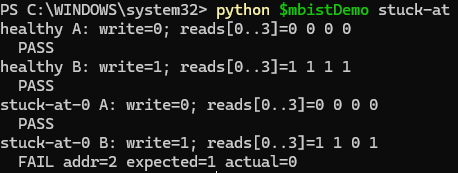
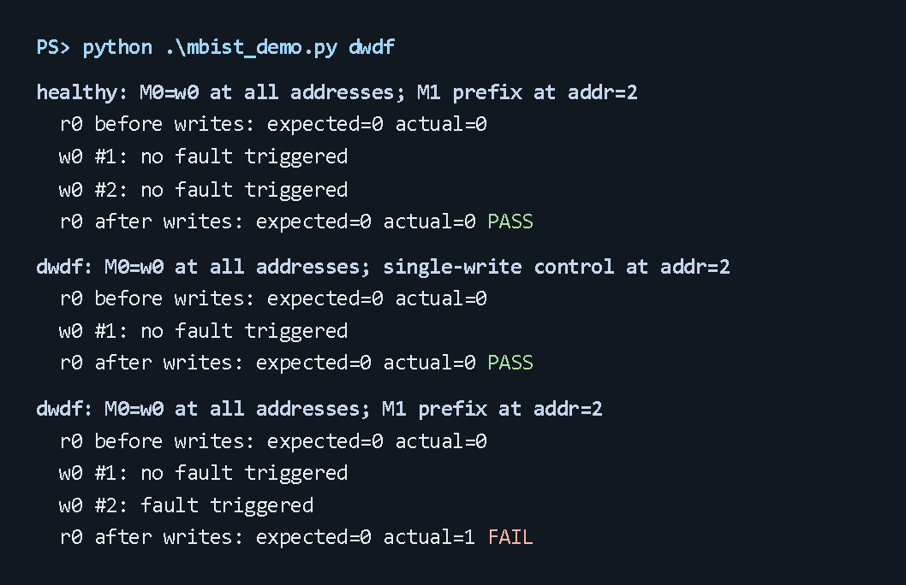

# Structured DFT Development Approach for Chisel-Based High Performance RISC-V Processors

DiffTest 用参考模型检查指令提交是否符合预期。即使 RTL 仿真通过，同一份设计制造出来的某颗芯片，仍可能有一个 SRAM 位写入 `1` 后读出 `0`。**DFT（可测试性设计）**就是**在设计时加入测试电路**，让这类缺陷能**在生产测试中**被发现。**MBIST（存储器内建自测试）** 会按规定顺序写入 SRAM，再把读回值与期望值比较。

> [!TIP]
>
> **仿真验证**检查的是设计模型怎样工作。**生产测试**把写入和读回的动作做在实际芯片上，检查每颗成品的表现。
>
> 工程师会在**设计芯片时**就考虑怎么测。比如给片内存储器留一条测试通路，让测试电路能写入数据、读回数据，再报告测试结果。**在设计阶段就让芯片具备这种可测试性，就是 DFT（Design for Test，可测试性设计）。**
>
> **写入 → 读回 → 比较**，如果交给芯片内部的测试电路来做，就叫 **MBIST（存储器内建自测试）**。「内建」说的就是这套测试电路在芯片里。

 香山原本就用 Chisel 开发处理器。这篇论文接下来要解决的问题，就是怎么把 **DFT 这项设计工作**接进香山已有的开发流程。 [论文原文 §I.B](https://talks-pubs.xiangshan.cc/publications/itcasia2023-chiseldft.pdf#page=1)

## 1 论文图 1

找两条路线里的**综合**。上面的 Gate Flow 先综合，再在门级集成 DFT。下面的 RTL Flow 先集成一部分测试逻辑，得到可仿真的 DFT RTL，再综合。南湖把共享总线接口的设计又往前移了一步，直接用 Chisel 描述。 [原文图 1、§III.B](https://talks-pubs.xiangshan.cc/publications/itcasia2023-chiseldft.pdf#page=2)

### 1.1 扫描链（Scan Chain）

扫描模式下，多个可扫描触发器串成一条移位链。测试设备可以从**扫描输入端**逐位装入测试数据，也可以从**扫描输出端**逐位读出内部状态，并和期望结果比较。

```
扫描输入 → A → B → C → 扫描输出
```

**每打一拍，所有触发器同时更新，数据只前进一级。** `A` 接收扫描输入，`B` 接收拍前的 `A`，`C` 接收拍前的 `B`，拍前的 `C` 则从输出端移出。

例如，初始状态是 `A=1、B=1、C=0`，扫描输入连续给 `0`。打三拍后，原有数据按 `C → B → A` 的顺序移出，依次读到 `0、1、1`。

> [!TIP]
>
> **扫描**就是在测试时，把芯片内部的一些触发器连成移位链，让外部能一拍一拍地**放入测试值、取出结果**。 `扫描输入 → A → B → C → 扫描输出`。**扫描数据**就是这条链上移入、移出的那些 `0` 和 `1`。
>
> 举个例子，假设电路正常工作时，`C` 会记录 `A AND B` 的结果。一次扫描测试分三步：
>
> 1. **移入**：沿扫描链送入测试数据，把 `A` 设为 `1`、`B` 设为 `0`。
> 2. **捕获**：切回功能模式打一拍，让 `C` 记下电路算出的结果。这里期望是 `0`。
> 3. **移出**：切回扫描模式，把 `C` 记下的值沿链移出来。若读到 `1`，就发现实际结果和预期对不上。

### 1.2 综合

RTL 描述「`y` 等于 `a` 和 `b` 做与运算的结果」。综合工具可以把它变成一个与门，输入接 `a`、`b`，输出接 `y`。综合的产物叫**门级网表**，它记录用了哪些逻辑门、触发器，以及它们怎么连。

```
RTL ──综合──→ 门级网表
```

### 1.3 上半条路线

先看上方标着 **DFT Gate Flow** 的路线。从 `Func RTL`（功能 RTL）出发，经过 `Synthesis`（综合），到达 `Func Gate netlist`（功能电路的门级网表）。

### 1.4 下半条路线

看下方的 **DFT RTL Flow**。这里先把 MBIST 等测试逻辑接入功能 RTL，得到 `DFT RTL`，然后才去综合。`DFT RTL` 可以理解为**已经带有这部分测试逻辑的 RTL**

## 2 论文图2

**图 2** 是雁栖湖的 DFT 架构。

### 2.1 **MBIST 控制器**和它要测的**存储器**。

**先看图 2 的下半部分**。找左边的 `MBIST CTRL` 和右边成叠的存储器。左边的 **`MBIST CTRL`** 发起写入和读回，右边的存储器执行这些请求。

### 2.2 扫描链的结果从哪儿出去？

再看图 2 右上方的 **`INT EDT`**。实际芯片里有很多条1.1中这样的扫描链。`EDT` 电路会把送入芯片的测试数据展开给多条链，再把多条链移出的结果压缩后送出去。这样就能用较少的外部引脚连接许多条扫描链。

> [!TIP]
>
> **EDT（Embedded Deterministic Test，嵌入式确定性测试）是一种扫描测试的数据压缩技术**。它让芯片外的测试机用少量通道，同时测试芯片内的多条扫描链。  [EDT 原始论文](https://ieee-ceda.org/media/embedded-deterministic-test)
>
> EDT 在扫描链前后各加一块电路：
>
> ```
> 测试机 → 展开输入数据 → 多条扫描链 → 压缩输出结果 → 测试机
> ```
>
> 举个简化的例子，假设芯片内有四条扫描链。输入侧可以把较少的外部通道送来的数据展开，同时送给四条链。输出侧把四条链移出来的结果压缩后送回。**测试机收到的是压缩结果，并拿它和预期的压缩结果比较。** 这就是「读出扫描链结果」在经过 EDT 时的具体含义。 [Siemens 扫描压缩说明](https://blogs.sw.siemens.com/xcelerator-academy/2024/01/30/enhance-test-time-and-quality-with-tessent-hybrid-testkompress-logicbis/)

## 3 南湖中基于 **Chisel** 的灵活 **XS-SharedBus** 接口

XS-SharedBus 是什么？

它是南湖给 **MBIST 存储器自测**用的一套共用线路和选路电路，让同一个测试接口可以访问多块 SRAM。简化成两块来看：

```
MBIST 控制器
     │
     │ 共用测试线路
     ├── SRAM 0
     └── SRAM 1
```

假设控制器先发出「读 `SRAM 0` 的地址 `2`」，再发出「读 `SRAM 1` 的地址 `2`」。**两次请求都经过前面那段共用线路**。请求里的**阵列编号**决定这次哪块 SRAM 执行读操作，**阵列内地址**决定读它的哪个位置。选中的 SRAM 再通过测试接口返回数据。

### 3.1 为什么要拆成多个测试节点？

实践1里，SRAM 每个地址存 **1 位**。现在想象一块更宽的 SRAM，每个地址存 **512 位**。这里说的「宽」，就是指**同一个地址里有多少位数据**。

论文把南湖共享测试接口的数据宽度限制在 **256 位**。碰到更宽的 SRAM，就要把**同一个地址的数据分成几份**，每份对应一个**测试节点**。图 3 的代码就在计算要分几份。 [原文 §III.B 与图 3](https://talks-pubs.xiangshan.cc/publications/itcasia2023-chiseldft.pdf#page=3)

### 3.2 代码怎么选每份的宽度？

图 3 先按单个 `way` 计算。`dw` 是这个 `way` 的数据位宽，`mw` 是每个 MBIST 测试节点可处理的最大位宽，论文中设为 `256` 位。

先看图 3 的第 ②、③ 行。`validDivisors` 筛出**能把原位宽整除、又不超过 `256` 位**的候选宽度。能整除，就能把数据分成一样宽的几份。接着，代码用 `validDivisors.max` 选最大的候选宽度，因为**每份越宽，所需的节点越少**。原位宽除以选中的宽度，就得到等宽拆分所需的节点数。

第 ④ 行再算一个**按容量所需的最少节点数**，也就是把 `dw ÷ mw` 向上取整。这种方案允许各节点承载的有效位数不同，只要能覆盖全部数据，且每个节点的位宽都在上限以内。

第 ⑤ 行比较两个方案。**如果等宽拆分所需的节点数超过最少节点数的 `4` 倍，就选最少节点方案。** 其余情况保留等宽方案。`4` 是代码里设定的取舍系数。

| 单个 `way` 的位宽 | 等宽方案                                                     | 按容量所需的最少节点数                       | 最终选择                          |
| ----------------- | ------------------------------------------------------------ | -------------------------------------------- | --------------------------------- |
| `640` 位          | 每份 `160` 位，共 `4` 个节点                                 | `3` 个                                       | `4` 没超过 `3 × 4`，保留等宽方案  |
| `257` 位          | `257` 是质数，符合上限的等宽拆法只有每份 `1` 位，共 `257` 个节点 | `2` 个，例如分别承载 `129` 和 `128` 个有效位 | `257` 超过 `2 × 4`，选 `2` 个节点 |

最后，代码返回**每个 `way` 的节点数**和**所有 `way` 的节点总数**。 [论文图 3](https://talks-pubs.xiangshan.cc/publications/itcasia2023-chiseldft.pdf#page=3)

### 3.3 两条测试路径怎样共用流水级？

图 3 算的是**一块**较宽的存储器要拆成几个测试节点。现在看图 4，看 **MBIST 请求要经过哪些流水级才能到达存储器**。

MBIST 请求要把阵列编号、阵列内地址和读写使能送到目标 SRAM。SRAM 较多、连线较长时，选路逻辑和布线延迟会占用一拍的时间预算。**流水级用寄存器在时钟边沿暂存请求，下一拍再把它送往下一级。**

> [!TIP]
>
> 用简化时序举例。时钟周期是 `10 ns`，直接传递需要 `12 ns`，请求赶不上第一个 `10 ns` 的采样边沿。如果加一级寄存器后两段各需 `6 ns`，中间寄存器在 `10 ns` 存下请求，SRAM 在 `20 ns` 接收请求。每段都能在各自的一拍内走完，整条请求则用两拍传完。

**红框是 MBIST 接口，棕框是传递请求的流水级，蓝框是存储器。**

- **接法 ①**：从红框出来就分成两条路。上、下两块存储器各自经过一个棕框。
- **接法 ②**：从红框出来先经过**同一个棕框**，然后才分成两条路。

接法 ② 中，上面的存储器走 **接口 → `level 2` → `level 1` → SRAM**，下面的存储器走 **接口 → `level 2` → SRAM**。两条路径共用的就是第一个棕框 `level 2`。 [原文图 4](https://talks-pubs.xiangshan.cc/publications/itcasia2023-chiseldft.pdf#page=3)

### 3.4 改一个 `level`，为什么接法就变了？

存储器的 `level` 是 `0`。Chisel 创建一个流水级时，会把**已创建、仍待连接且层级比自己低**的节点接到它下面。图 4 里第一个流水级先创建，设为 `level 1`。

- **接法 ①**：第二个流水级也设为 `level 1`。两个同级流水级各自接入一组存储器，形成并列的支路。
- **接法 ②**：第二个流水级设为 `level 2`。它把已建好的 `level 1` 流水级和另一组待连接的存储器接到下面，形成一条经过两级的支路和一条只经过一级的支路。

### 3.5 一次 MBIST 读请求怎样往返？

以「读 `SRAM 1` 的地址 `2`」为例。阵列编号决定去哪块 SRAM，阵列内地址决定访问该 SRAM 的哪个位置。

1. **保存请求。** 流水级接收请求时，用 `arrayReg` 存下阵列编号 `1`，同时用其他寄存器保存地址和读使能。 [请求寄存器源码](https://github.com/OpenXiangShan/HuanCun/blob/ef97b9e1d43b4d098fb108f717e31dedb88d3269/src/main/scala/huancun/mbist/MBISTPipeline.scala#L314-L334)
2. **让目标 SRAM 执行读操作。** `nodeSelected` 检查每条支路包含的阵列编号。命中的 `SRAM 1` 收到 `re = 1`，另一条支路的 `re` 为 `0`。 [阵列选择与读使能源码](https://github.com/OpenXiangShan/HuanCun/blob/ef97b9e1d43b4d098fb108f717e31dedb88d3269/src/main/scala/huancun/mbist/MBISTPipeline.scala#L334-L374)
3. **沿共用通路送回读值。** `rdata` 是 SRAM 的读回值，`dout` 是支路实际送去合并的值。`Mux` 让选中的支路送回 `rdata`，其余支路送 `0`。同一级随后对这些 `dout` 做按位或。 [支路返回值源码](https://github.com/OpenXiangShan/HuanCun/blob/ef97b9e1d43b4d098fb108f717e31dedb88d3269/src/main/scala/huancun/mbist/MBISTPipeline.scala#L367-L380) · [合并源码](https://github.com/OpenXiangShan/HuanCun/blob/ef97b9e1d43b4d098fb108f717e31dedb88d3269/src/main/scala/huancun/mbist/MBISTPipeline.scala#L334-L341)

例如，`SRAM 1` 这次读出 `1010`，`SRAM 0` 的 `rdata` 还留着上次的 `1111`。由于本次选中的是 `SRAM 1`，两条支路实际送去合并的值分别为 `0000` 和 `1010`，最后返回 `0000 | 1010 = 1010`。

### 3.6 测试工具怎么知道 SRAM 的编号？

前面的例子里，我们直接给了阵列编号。但真正接入 MBIST 控制器时，**EDA 工具得先知道哪块 SRAM 对应哪个编号**。南湖在用 Chisel 生成电路时，会把这种对应关系写到 CSV，也就是一份用逗号分列的文本表格。 [原文第 3 页图 5](https://talks-pubs.xiangshan.cc/publications/itcasia2023-chiseldft.pdf#page=3)

先看图 5 下半部分的两个字段。`SRAM Name` 是存储器的名字，`SRAM array` 是它的测试节点编号。举个例子，一行里写着 `SRAM Name = dcache_data`，`SRAM array = 5`。

再看图 5 的上半部分。这里的 **`INTF Array`** 描述的是**整个接口用几位信号传阵列编号**。下半部分的 **`SRAM array`** 记录的是**某个测试节点实际分到的编号**。 [原文第 3 页图 5](https://talks-pubs.xiangshan.cc/publications/itcasia2023-chiseldft.pdf#page=3)

比如 `INTF Array = 3`，就是用 `3` 位来传编号。刚才 `dcache_data` 的编号是 `5`，发请求时就把它编码成三位二进制 `101`。

### 3.7 CSV 是怎么生成的？

图 6 最后一行把 `intfInfo` 写进 CSV。`intfInfo` 就是 **Chisel 这次生成电路时算出的接口信息**，包括前面看的阵列编号位宽。完整源码接着把每个 SRAM 的名字和测试节点编号也写进去。这样，重新生成电路时，CSV 里的映射也会随这次设计一起更新。 [原文图 6](https://talks-pubs.xiangshan.cc/publications/itcasia2023-chiseldft.pdf#page=3) · [CSV 生成源码](https://github.com/OpenXiangShan/HuanCun/blob/ef97b9e1d43b4d098fb108f717e31dedb88d3269/src/main/scala/huancun/mbist/MBISTPipeline.scala#L233-L252)

### 3.8 导出的 CSV 怎么交给 EDA 工具？

先看图 7 上方的箭头 **`CSV → memory cluster TCD`**。CSV 记录了接口和 SRAM 的对应关系。论文用转换脚本把这些信息写成 **TCD**，也就是 EDA 工具能读取的测试接口描述。 [原文第 3 页图 7](https://talks-pubs.xiangshan.cc/publications/itcasia2023-chiseldft.pdf#page=3)

接着找到下方的 **`MBIST RTL`** 方框。左边的 **RTL** 是 Chisel 生成的电路，里面已经有共享测试接口。上面的 **TCD** 是给 EDA 工具读的说明，告诉它通过这个接口可以测哪些 SRAM，以及各自对应哪个阵列编号。工具根据这份说明，把 MBIST 控制器接到已有的接口上，得到 **`MBIST RTL`**。

### 3.9 两条线为什么汇到 `MBIST RTL`？

左边的 **RTL** 是 Chisel 生成的电路，里面已经有共享测试接口。上面的 **TCD** 是给 EDA 工具读的说明，告诉它通过这个接口可以测哪些 SRAM，以及各自对应哪个阵列编号。工具根据这份说明，把 MBIST 控制器接到已有的接口上，得到 **`MBIST RTL`**。 [原文第 3 页图 7](https://talks-pubs.xiangshan.cc/publications/itcasia2023-chiseldft.pdf#page=3)

再往右看，`MBIST RTL` 经过综合，才得到 `SYN NETLIST`（门级网表）。**按这个顺序判断，它对应图 1 下方的 `DFT RTL Flow`**

## 4 南湖中的 **March SLD** 算法

### 4.1 为什么有些故障要连续写两次？

还用我们测过的 SRAM 地址 `2`。这次**假设**它一开始存的是 `0`，并且有这样一种故障：

- 第一次写 `0`，它仍然存 `0`。
- 紧接着往**同一个地址**再写一次 `0`，它反而变成 `1`。

这种故障要在特定的操作顺序下才会出现，所以叫**动态故障**。这是论文里的一个 `dWDF` 例子。 [论文 §III.C、图 8–10](https://talks-pubs.xiangshan.cc/publications/itcasia2023-chiseldft.pdf#page=4)

### 4.2 March SLD 的前四步

打开图 8，先看 `M1` 开头的四个操作。到这时，上一阶段 `M0` 已经把每个地址都写成了 `0`。 [原文第 4 页图 8](https://talks-pubs.xiangshan.cc/publications/itcasia2023-chiseldft.pdf#page=4)

> [!TIP]
>
> **`M0` 是初始化。** 图 8 里，`M0` 括号内只有一个 `w0`。March 算法会把括号里的操作在**每个地址**上做一遍，所以这里就是把整块 SRAM 逐地址写成 `0`。这一轮写完，才进入 `M1`

```
r0 → w0 → w0 → r0
```

`w0` 是**写入 `0`**。`r0` 是**读回数据，并检查它是否为 `0`**。这四步都在同一个地址上做。按照刚才的故障设定，第二次 `w0` 会让这个存储位翻成 `1`。

### 4.3 图 8 括号前的箭头是什么意思？

`M1` 开头有一个 **`↑`**，表示按**地址从小到大**测。以四地址 SRAM 为例，先在地址 `0` 做完括号里的**整串操作**，再到地址 `1` 重做整串，依次测到地址 `3`。我们刚才看的 `r0 → w0 → w0 → r0`，是每个地址上那串操作的开头。

### 4.4怎么在仿真里模拟一个已知故障？

要验证 March SLD 能不能查出刚才那个故障，作者在仿真里加了一个 **`FAULT INJECT`（故障注入模块）**。它观察 SRAM 的地址和读写操作。当同一个地址上连续两次写 `0`、满足我们刚才讲的触发条件时，它会让随后的读回呈现故障值 `1`。这样就能检查，测试流程遇到这个已知故障时会不会报错。 [原文第 4 页图 9](https://talks-pubs.xiangshan.cc/publications/itcasia2023-chiseldft.pdf#page=4)

### 4.5 图 10 在波形上找出报错的位置

打开图 10，先看**最上面那组 `dWDF` 波形**。论文在地址 `13` 演示这个故障。找到倒数第二行的 **`QB`**，它显示读回的数据。图里标出的 `1`，就是我们手算时第四步 `r0` 读到的错误值，期望值是 `0`。`QB` 读出错误值 `1` 后，**`BIST_GO` 从高变低**，表示这次自测失败。

## 5 南湖中的层次化 **DFT** 集成优化

### 5.1 多个核心怎么共用扫描测试线路？

还记得雁栖湖图 2 里的 `INT EDT` 吗？它把送进来的测试数据展开给**一个核心内部**的多条扫描链。到了多核芯片，还有一个问题：**芯片外的测试引脚有限，怎么把扫描数据送到各个核心？**

南湖用 **SSN（流式扫描网络）**，让**多个核心共用一条扫描数据通路**。看图 11 左侧的 `ssn_bus_in`，顺着线找到 `SSH`。可以先把 `SSH` 理解成核心和共享通路之间的接口，它接收本核需要的测试数据，再交给 `INT EDT`。

### 5.2 扫描结果可以在芯片里比较

回想实践2中的 SRAM 实验，比较器拿实际读值和期望值做比较。SSN 的**片上比较**也是这个思路。多个相同的核心可以**共用同一份**扫描测试数据和期望值，各自在芯片内**比较自己的扫描结果**，再报告通过或失败。这样就能一起测多个核心，也减少了送回芯片外的数据。

### 5.3 南湖把哪一步提前到了 Chisel？

看图 12。红箭头 **`Sharedbus circuit included`** 指向 **Chisel**。这表示共享测试总线的电路已经写进 Chisel，生成 `Func RTL` 时就带上了这套接口。接下来，EDA 工具还能像图 7 那样，利用 TCD 提供的映射把 MBIST 控制器接到这个接口上。

把它和图 4 对上。**如果要把第二个流水级从 `level 1` 改成 `level 2`**，要在 **Chisel 源码**里改 `level`，然后重新生成 RTL。

## 6 实验结果

### 6.1 香山的层次化 **DFT** 实践

#### 6.1.1 加了 DFT，面积多了多少？

先看图 13 的**红色百分比**。每组蓝柱是加入 DFT 前的面积，橙柱是加入后的面积。红色百分比表示**新增面积占原面积的多少**。 [原文第 5 页图 13](https://talks-pubs.xiangshan.cc/publications/itcasia2023-chiseldft.pdf#page=5)

举个例子，原面积是 `100`，加入 DFT 后变成 `120`，新增面积就是 `20`。用新增的 `20` 除以原来的 `100`，面积增长率就是 `20%`。

#### 6.1.2 `XSTile` 和 `XSTop` 分别是哪一层？

- **`XSTile` 是单核模块**。在论文的南湖配置里，每个 `XSTile` 包含一个处理器核心，以及这个核心自己的 L2 缓存。 [南湖 `XSTile` 源码](https://github.com/OpenXiangShan/XiangShan/blob/f0d8a1cf543c113433ff98140b6d77055d930deb/src/main/scala/xiangshan/XSTile.scala#L78-L91)
- **`XSTop` 是系统顶层模块**。论文里的双核南湖在这一层接入两个 `XSTile`，并通过片上互连把它们接到共享的 L3 缓存。 [南湖 `XSTop` 源码](https://github.com/OpenXiangShan/XiangShan/blob/f0d8a1cf543c113433ff98140b6d77055d930deb/src/main/scala/top/Top.scala#L43-L110)

回到图 13，**`12.7%` 是南湖 `XSTile` 那组的 DFT 面积增长率，`3.4%` 是 `XSTop` 那组的增长率**。两组各用自己的蓝柱做分母。源码能确认模块的包含关系，论文没有细列 `XSTop` 这组面积是否汇总了两个 `XSTile`。

#### 6.1.3 绿色的 `46.6%` 怎么读？

沿着绿箭头看，它连的是**两根橙柱**：雁栖湖加完 DFT 后的面积 `7.66`，和南湖 `XSTile` 加完 DFT 后的面积 `4.09`。以雁栖湖为基准，`(7.66 − 4.09) ÷ 7.66 ≈ 46.6%`。这是两个设计加完 DFT 后的面积差，两者的工艺也从 `28 nm` 变成了 `14 nm`。

#### 6.1.4 为什么南湖的 MBIST 测得更久？

先看表 III  **`MBIST test time`** 这一行。雁栖湖是 **`4.37 ms`**，南湖是 **`17.86 ms`**。论文指出，共享总线让同一组里的存储器轮流测，串行测试会增加耗时。 [原文第 5 页表 III](https://talks-pubs.xiangshan.cc/publications/itcasia2023-chiseldft.pdf#page=5)

举个例子，两块 SRAM 各要测 `2 ms`。如果能同时测，`2 ms` 就能测完两块。如果它们共用一条测试通路，得先测完第一块再测第二块，合计就要 `4 ms`。这就是**共用测试通路带来的时间代价**。

#### 6.1.5 逻辑扫描省了多少时间？

现在找 **`SA+TR test time`** 这一行。`SA` 和 `TR` 分别是逻辑电路的固定型故障测试和转换型故障测试，两项合在一起，雁栖湖用了 **`434.41 ms`**，南湖用了 **`281.40 ms`**。论文把耗时下降归因于扫描移位频率从 `48 MHz` 提高到 `100 MHz`，以及引入我们刚读过的 SSN。 [原文第 5 页表 III](https://talks-pubs.xiangshan.cc/publications/itcasia2023-chiseldft.pdf#page=5)

逻辑扫描省了 **`434.41 − 281.40 = 153.01 ms`**。抵掉 MBIST 多花的 `13.49 ms`，合计仍少用 **`139.52 ms`**。

#### 6.1.6 March SLD 的 `100%` 覆盖了什么？

看表 IV 的 `Coverage` 一列。March SL 是 `79.14%`，March SLE 是 `97.0%`，March SLD 是 `100%`。读这些数时，先找它们的**分母**。这里统计的是论文纳入比较的 SRAM 故障，包括作者研究的静态故障、连接故障和动态故障。实践跑过的 `dWDF` 就是其中一个动态故障例子。

#### 6.1.7  `65N` 是什么意思？

再看 `Complexity` 一列。**`N` 是被测存储器的地址数**。March SLD 的 `65N` 表示完整测试序列一共做 `65 × N` 次读写操作。回想图 8，括号里每加一个操作，就要在每个地址上多做一次，也就是多 `N` 次。 [论文图 8](https://talks-pubs.xiangshan.cc/publications/itcasia2023-chiseldft.pdf#page=4) · [表 IV](https://talks-pubs.xiangshan.cc/publications/itcasia2023-chiseldft.pdf#page=5)

#### 6.1.8 多做读写，要多加多少电路？

想想实践做过的两次 `w0`。第二次写 `0` 可以**复用第一次的写入电路**，只是控制器多发了一次写请求。这样就能区分表里的两列。`Complexity` 记测试要执行多少次读写，`Area` 记测试电路综合后的面积。

从 March SLE 换成 March SLD，操作量从 `49N` 增到 `65N`，而表里的面积从 `14,724,015` 增到 `14,724,430`，只增加了 `415`。按表中显示的精度，两者的功耗数值相同。

### 6.2 众核香山处理器推荐的扫描测试集成方案

#### 6.2.1 引脚够不够，决定能同时测几个簇

论文的多核实验里，**一个簇就是一组双核南湖**。先看图 14 底部的 `I/O`，它代表芯片对外的测试引脚。这张图采用**引脚复用**：同一组引脚可以切换去测不同的簇。如果两个簇都需要独占一组引脚，就要有两组引脚才能同时开测。 [论文 §IV.B、图 14](https://talks-pubs.xiangshan.cc/publications/itcasia2023-chiseldft.pdf#page=6)

#### 6.2.2 总线串着接，多个簇也能一起测

看图 15，底部的 `I/O` 接到一条贯穿多个簇的 **SSN 总线**。每个簇通过自己的 `SSH` 接收扫描数据。对于相同的簇，**同一份测试数据和期望值可以发给多个簇**，各簇在芯片内各自做扫描和比较。总线沿着各簇串接，测试可以在多个簇内并行进行。

#### 6.2.3 两组扫描测试分别测哪里？

表 V 的两组都覆盖 `CLUSTER0–CLUSTER7`，区别在于**电路的测试范围**。按分层扫描测试的术语，`I` 是内部模式，`E` 是外部模式。外部模式用模块边界上的测试电路来检查模块之间的连线。 [论文表 V](https://talks-pubs.xiangshan.cc/publications/itcasia2023-chiseldft.pdf#page=5) · [Siemens 分层测试说明](https://blogs.sw.siemens.com/tessent/2019/09/24/employing-a-hierarchical-methodology-for-soc-testing/)

- **第 1 组 `XSTop(I) + XSTile(E)`** 测顶层逻辑和顶层到 `XSTile` 的连接。
- **第 2 组 `XSTile(I)`** 测 `XSTile` 内部的逻辑。

#### 6.2.4 从 1 个簇扩到 8 个簇，多花多久？

看表 VI 最右边的 `TOTAL`。**8 个簇的逻辑扫描测试合计 `283.4 ms`，单簇是 `281.4 ms`**，只多了 `2.0 ms`。多个相同的簇可以共用扫描测试数据，并在片上各自比较结果。论文把多出的 `2.0 ms` 归因于多簇扫描网络为了满足时序而增加的流水级。 [论文第 6 页表 VI](https://talks-pubs.xiangshan.cc/publications/itcasia2023-chiseldft.pdf#page=6)

## 7 结论

### 7.1 覆盖率提高后，量产时少漏掉多少坏芯片？

翻到第 6 页的结论。作者提到还要收集 **DPPM** 的数据。这里可以把 DPPM 理解成**每百万颗芯片中有多少颗存在缺陷**。如果关心出厂漏检，就要跟踪那些通过筛选、后来被发现有缺陷的芯片。 [论文第 6 页结论](https://talks-pubs.xiangshan.cc/publications/itcasia2023-chiseldft.pdf#page=6)

表 IV 的 `100%` 回答的是「纳入比较的故障模型，March SLD 能检出多少」。作者把对实际芯片 DPPM 的影响留给后续数据来验证。

### 7.2  为什么南湖愿意接受 MBIST 变慢？

回到表 III。南湖把 **MBIST 控制器从 `17` 个减到 `8` 个**，代价是部分 SRAM 得轮流测，MBIST 多花了 `13.49 ms`。与此同时，南湖提高扫描移位频率并引入 SSN，逻辑扫描省下了 `153.01 ms`。这样，两项加起来的基本测试总耗时仍缩短了 `31.8%`。 [论文第 5 页表 III](https://talks-pubs.xiangshan.cc/publications/itcasia2023-chiseldft.pdf#page=5)

### 7.3 三项改动分别解决了什么？

| 改动                    | 解决的问题                                                   |
| ----------------------- | ------------------------------------------------------------ |
| **Chisel 共享测试接口** | 让多块 SRAM 共用 MBIST 接口。阵列如何编号、流水级如何连接，由 Chisel 按配置生成，接口与 SRAM 的映射再导出给 EDA 工具。 |
| **March SLD**           | 用特定的读写顺序触发并检出动态故障。实践跑过的例子里，第二次写 `0` **触发**故障，随后的读回比较才**检出**故障。表 IV 的 `100%` 对应论文纳入比较的故障范围。 |
| **SSN**                 | 让多个相同的簇共用扫描数据，并在各簇内比较结果。论文报告从 `1` 簇扩到 `8` 簇，逻辑扫描耗时只从 `281.4 ms` 增到 `283.4 ms`。 |


# 实践

## 1 测坏位demo

下载 [mbist_demo.py](./assets/mbist_demo.py)。模型有四个地址，每个地址存一位。故障模型的地址 `2` 固定为 `0`。先预测 A 组全写 `0`、B 组全写 `1` 时，哪组能发现它。在 PowerShell 进入脚本所在目录后运行下面的命令。

```powershell
$mbistDemo = '.\mbist_demo.py'
python $mbistDemo stuck-at
```

对照跑出的结果。健康模型两组都通过。故障模型 A 组也通过，因为坏位读出的 `0` 正好等于期望值。B 组读到 `1 1 0 1`，所以只有地址 `2` 报出 `expected=1 actual=0`。



## 2  区分故障触发和检出

用同一个 [mbist_demo.py](./assets/mbist_demo.py) 跑一遍图 10 对应的四步。论文波形观察的是地址 `13`，我们的四地址模型继续用地址 `2`。在脚本所在目录的 PowerShell 里运行下面的命令。

```powershell
python .\mbist_demo.py dwdf
```

得到：



最后一组里，**故障触发和检出发生在不同的操作上**。

- **`w0 #2: fault triggered`**：第二次写 `0` 触发了故障，地址 `2` 的存储位翻成 `1`。
- **`r0 after writes: expected=0 actual=1 FAIL`**：随后读回，比较器发现期望 `0`、实际 `1`，这时才检出故障。

前两组是对照。健康模型写两次仍然通过，故障模型写一次也通过。只有**故障模型连续写两次**才报错。这就在四地址 Python 模型里复现了图 10 最上方那组 `dWDF` 波形展示的现象。
