# UCAgent: An End-to-End Agent for Block-Level Functional Verification

[阅读论文 PDF（英文原文，16 页）](./paper.pdf)

[阅读中文全译 PDF](./paper-zh.pdf)

这篇论文想完成的工作是：**给定一个硬件模块和它的功能规格，让大模型借助工具，组织并执行验证，最后留下测试代码和验证结果。**

题目 **UCAgent: An End-to-End Agent for Block-Level Functional Verification**，可以译为：**UCAgent：面向模块级功能验证的端到端智能体**

里面几个词，需要分别理解。

**Block-Level，指验证对象是一个硬件模块。**

例如，单独拿出一个整数除法器，检查它有没有正确完成除法。论文涉及的模块还包括 UART、浮点运算单元等。

| 比较内容   | 之前学习的整核 DiffTest | 本篇的模块级验证           |
| ---------- | ----------------------- | -------------------------- |
| 待验证对象 | 处理器核心              | 除法器、UART 等模块        |
| 输入举例   | 程序及运行中的事件      | 操作数、控制信号、接口请求 |
| 检查依据   | ISA 语义及相应差异规则  | 模块的功能与接口规格       |

两种验证可以配合使用。模块级验证能更直接地控制某些边界情况，也更容易观察局部行为。

**Functional Verification，就是检查实现是否满足功能规格。**

这里有两个需要区分的东西：

- **规格（Specification，常写作 Spec）**：规定模块应该做什么。
- **待测设计（Design Under Test，简称 DUT）**：我们实际要检查的硬件实现，通常以 RTL 代码提供。

用一个简化的除法器例子说明。假设规格规定：模块接受一次请求，计算整数除法，输出商和余数；计算完成时发出完成信号。

我们输入：

```
被除数：17
除数：5
```

预期结果是：

```
商：3
余数：2
```

验证环境需要把输入送给 DUT，推进仿真，再读取输出并检查。对于这个例子，还需要检查规格要求的完成信号。

所以，**功能验证既关心运算结果，也关心规格要求的接口行为和周期关系。**这里讨论的周期关系，例如“什么时候接受请求、什么时候表示完成”，与芯片能否达到某个物理主频是不同的问题。

**End-to-End，描述的是它覆盖了多长的验证流程。**

刚才我们很容易说出 `17 ÷ 5` 的预期结果。但要验证一个实际模块，还需要做许多工作：

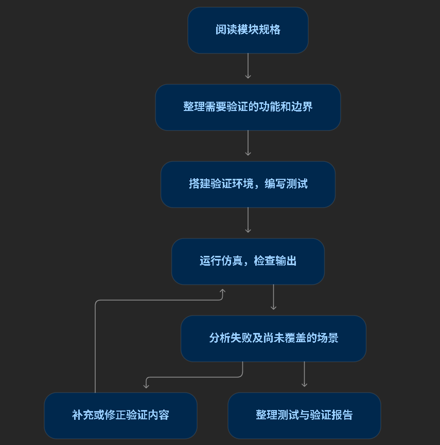

这里的“验证环境”，可以先理解成一套**给硬件送输入、推进仿真、读取输出并检查结果的程序**。

UCAgent 的目标，是**让大模型参与并组织上述连续工作**。题目中的 **Agent，智能体**，在这里会调用工具、生成文件、执行测试，并根据执行反馈继续工作。

需要分清两类反馈：

- 验证环境或测试代码有问题，需要修正这些验证内容。
- DUT 的行为违反规格，需要保留失败证据并报告设计问题。

“端到端”描述自动化覆盖的流程范围。实际使用时，仍需要准备 DUT、规格和可运行的工具环境；规格是否完整、检查规则是否正确，也需要认真审查。

摘要随后提出了三个支撑机制：**Python 验证环境、带阶段检查的细分工作流，以及保持产物对应关系的 VCLM 标签机制**。

## 1 引言

这一部分解释：让大模型完成整套验证，困难在哪里。

作者先介绍已有研究：有的让大模型生成断言，有的生成测试环境，有的根据覆盖率补充测试。这些工作已经能帮助完成部分任务，但要把多个环节**连续组织起来**，还存在三个困难。

**第一个困难：生成的验证代码可能有错。**

例如，我们让大模型用 SystemVerilog 编写除法器测试，它需要正确处理信号、时钟、等待和结果检查。生成的代码可能存在**语法错误**，也可能虽然能运行，却在错误的周期读取结果。

论文把原因之一归于训练数据：相比 Python，硬件描述语言的代码数据较少，大模型对这些语言的掌握也相对有限。

这对应 UCAgent 后面采用 Python 验证环境的动机。具体怎样用 Python 操作硬件，在 §2.1 再展开。

**第二个困难：长流程中的遗漏会传递到后面。**

用前面的完成信号举例。假设规格明确要求发出完成信号，但大模型整理功能清单时，只保留了“检查商和余数”。

之后便可能发生：

```
功能清单漏掉完成信号
        ↓
验证计划没有对应检查项
        ↓
测试只检查商和余数
        ↓
测试全部通过，但完成信号的问题没有被发现
```

后面的代码即使忠实执行了这份计划，也继承了前面的遗漏。

论文还指出，不同模块需要不同的验证环境。简单算术模块和需要复杂外部交互的模块，不能总套用同一种简略流程。因此，作者希望把**任务细分**，并在**各阶段检查产物**。

**第三个困难：规格、覆盖模型和测试之间容易失去对应关系。**

图 1 给了一个具体例子。先看原图：

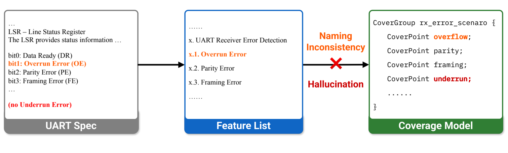

我们从左向右读。

**左边灰框是 UART Spec，即 UART 的规格。**

UART 是串行通信模块。这里先关注接收端，以及一个叫 **LSR（Line Status Register，线路状态寄存器）** 的寄存器。它的各个位用于表示不同状态。

图中列出了：

| 位                   | 含义           |
| -------------------- | -------------- |
| bit 0：Data Ready    | 有接收到的数据 |
| bit 1：Overrun Error | 接收溢出错误   |
| bit 2：Parity Error  | 奇偶校验错误   |
| bit 3：Framing Error | 帧格式错误     |

其中，**Overrun** 可以先理解为：接收缓冲已经无法接纳新到达的数据。至于怎样置位、怎样清除，要看具体模块规格。

图中还特意注明：**这份规格没有定义 Underrun Error。**

**中间蓝框是 Feature List，即从规格整理出来的功能清单。**

大模型把接收错误检测整理为：

```
UART 接收错误检测
    Overrun Error
    Parity Error
    Framing Error
```

目前这些名称还能够与左边对应。

**右边绿框是 Coverage Model，即覆盖模型。**

这里先把它理解为：**用来记录哪些验证场景已经被测试触及的一套分类和统计规则。**

例如，可以设置一个覆盖点，记录测试是否制造过接收溢出的情形。

但图中的转换出现了两处问题：

- **橙色部分：`overrun` 被改成了 `overflow`。** 两个词意思接近，但名称变了，后续工具就难以通过精确名称确认：这个覆盖点对应规格里的哪一项。这里揭示的是产物之间的对应问题。
- **红色部分：凭空增加了 `underrun`。** 这份规格没有定义该场景，生成的覆盖模型却把它列为验证目标。它缺少规格依据。

因此，图 1 展示的是：**大模型生成的验证目标已经偏离原始规格。** 图中还没有展示 DUT 的实际运行结果，不能据此判断硬件存在缺陷。

这里还需要区分两个概念：

| 内容           | 回答的问题                         |
| -------------- | ---------------------------------- |
| 覆盖点         | 某个场景是否被触及？               |
| 断言或结果检查 | 发生这个场景时，行为是否符合规格？ |

比如，“制造过接收溢出场景”与“接收溢出时正确设置了错误状态”，就需要分别考虑。统计场景和检查行为承担不同任务。

后面介绍的 **VCLM**，就是作者为维持这些产物之间的对应关系提出的机制。

## 2 **设计概览**

这部分理解：**Python 怎样与被测硬件交互。**

先看图 2：

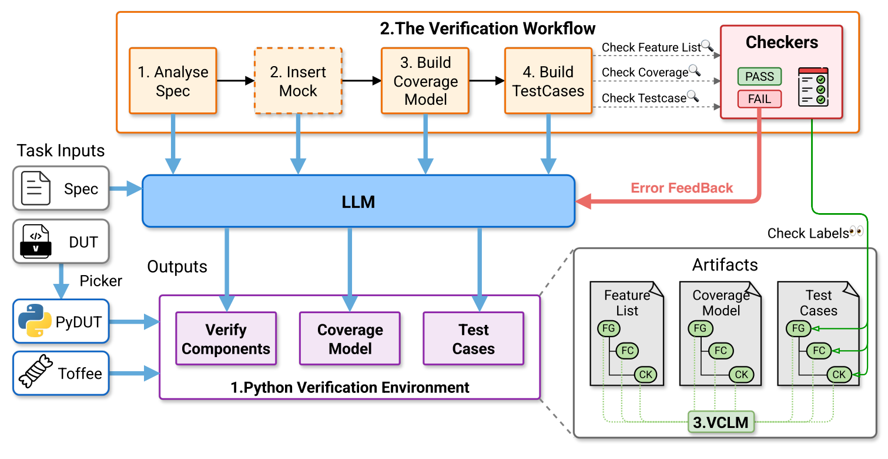

这张图包含多个关系，我们按区域读。

- **下方紫框：Python 验证环境。** 提供操作 DUT、组织验证组件、编写覆盖模型和测试的基础。
- **上方橙框：验证工作流。** 安排分析规格、构建覆盖模型、编写测试等任务，并检查各阶段产物。
- **右下灰框：VCLM。** 通过统一标签，帮助检查功能清单、覆盖模型和测试之间的对应关系。

它们分别回应上一轮的三个困难：代码生成、长流程执行，以及跨阶段一致性。这一轮先看紫框及其左侧。

**从左边的 DUT → Picker → PyDUT 开始。**

DUT 是我们要验证的 RTL 设计。例如，一份用 Verilog 描述的除法器，其中包含端口、寄存器和计算逻辑。

为了让 Python 测试能够操作它，论文采用了 **Picker**。Picker 将 RTL 设计导出、封装成高级语言可以调用的形式；面向 Python 导出的包，在这里称为 **PyDUT**。

可以这样理解这几个名字：

| 名称   | 在这里负责什么                              |
| ------ | ------------------------------------------- |
| DUT    | 被验证的硬件设计                            |
| Picker | 将设计导出并封装为可调用的软件包            |
| PyDUT  | 向 Python 暴露 DUT 的信号访问和仿真操作接口 |

PyDUT 背后连接着 **RTL 仿真模型**。这个模型在电脑上执行 RTL 描述的电路逻辑，产生被测设计的实际行为。

**“纯 Python 验证环境”指的是验证程序使用 Python。** DUT 仍然可以由 Verilog／SystemVerilog 描述，底层仍需要仿真工具。

因此，整个过程可以分成两部分：

```
准备时：
RTL 设计 → Picker 导出、封装 → PyDUT

运行时：
Python 测试 → PyDUT 接口 → 底层 RTL 仿真模型
                                ↓
Python 测试 ← 读取输出信号 ← DUT 的仿真结果
```

**再看左下角的 Toffee。**

有了 PyDUT，我们具备了操作 DUT 的接口。但组织完整测试还需要处理一系列事情：怎样统一管理相关信号、怎样发送请求、怎样等待计算完成，以及怎样组织多项检查。

**Toffee 是建立在这些基础之上的 Python 验证框架，提供更高层的抽象和组织能力。**

论文强调，它能把时钟控制等硬件交互封装成较简单的**接口**，减少编写测试时需要直接处理的底层仿真调度细节。模块要求的复位、握手和采样规则，仍需要正确理解并使用。

**用除法器走一遍，职责就比较清楚了。**

假设我们检查 `17 ÷ 5`：

1. Python 测试通过 PyDUT，把 `17`、`5` 和相关控制信号送给 DUT。
2. 按模块接口规则启动运算，并推进仿真。
3. 等到**完成信号**有效，读取实际的商和余数。
4. 按规格得到**预期值**：商为 `3`，余数为 `2`。
5. 测试中的检查代码比较实际值与预期值。

这里有两个来源：**实际结果来自 DUT 的 RTL 仿真；预期结果依据规格确定。**

后面我们会编写 Python 参考模型来计算预期值。它与 PyDUT 承担不同任务：参考模型表达应该得到什么，PyDUT 让我们观察被测实现实际做了什么。

**最后看图中间的 LLM，以及右上的 Checkers。**

LLM 根据任务生成验证组件、覆盖模型和测试等产物，图中蓝色向下箭头表示这些输出。

右上的阶段检查器则检查这些产物是否满足相应要求；失败时，通过红色箭头把错误反馈给 LLM，促使它修正验证内容。检查器也可以调用测试，但它给出的阶段 `PASS`，仍不能解释为“已经证明 DUT 没有错误”。

### 2.1 **Python** **验证环境**

论文说，验证环境把时钟控制等硬件交互封装成较简单的接口。下面用**加法器**看看这些接口具体做什么。

这一轮关注四个动作：**写入输入 → 推进仿真 → 读取输出 → 检查结果**

**先认识加法器的端口。**

我们使用**带进位输入**的（二进制）加法器，其运算是： a+b+cin 

| 端口     | 相对于 DUT 的方向 | 含义                |
| -------- | ----------------- | ------------------- |
| `a`、`b` | 输入              | 两个加数            |
| `cin`    | 输入              | 输入进位，取 0 或 1 |
| `sum`    | 输出              | 和的结果位          |
| `cout`   | 输出              | 输出进位            |

“输入、输出”以 **DUT 为中心**：测试程序给输入端口赋值，再读取输出端口。

例如：

```
a = 2，b = 3，cin = 1
```

按规格，预期得到 `sum=6`、`cout=0`。这些小数值没有产生输出进位。

### 2.2 验证工作流

论文主文将流程细分成 **31 个阶段**。这一轮先看它们归属的四类工作：

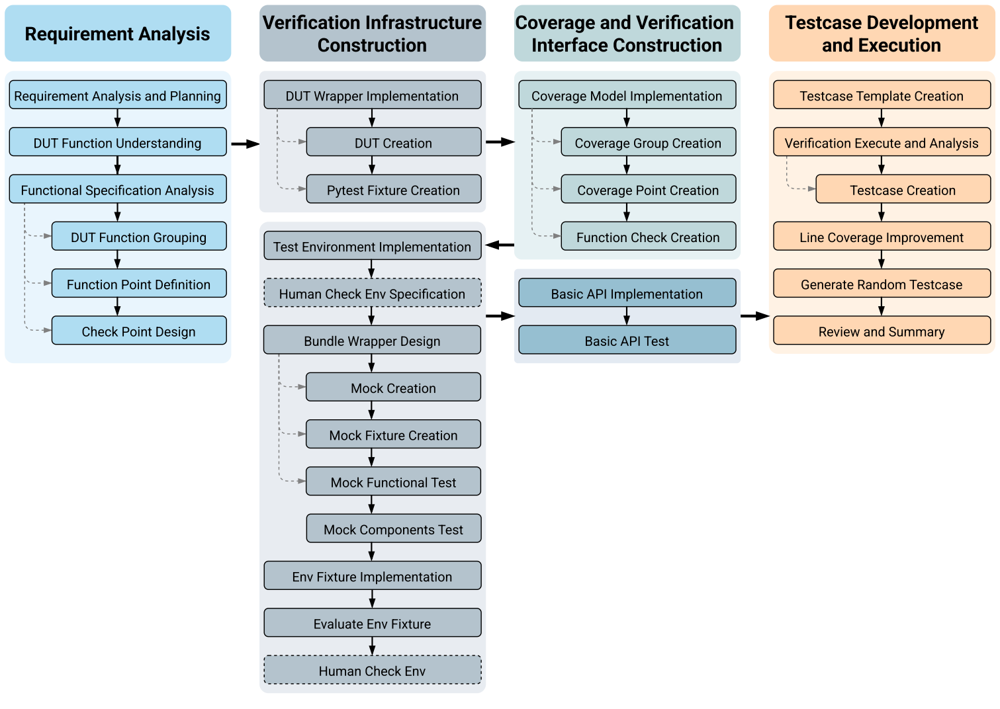

**这四列，可以与实践2、3对应起来。**

| 图中的工作类别         | 要完成什么                       | 实践2、3                                   |
| ---------------------- | -------------------------------- | ------------------------------------------ |
| 需求分析               | 从规格整理功能、边界和检查目标   | 确认 `sum` 应为 64 位，`cout` 表示输出进位 |
| 验证基础设施构建       | 准备可操作 DUT 的环境和组件      | 导出 PyDUT，连接 Bundle，编写 Agent        |
| 覆盖模型与验证接口构建 | 建立覆盖项、检查规则和可调用操作 | 定义四个 bin，组织加法操作与结果比较       |
| 测试用例开发与执行     | 生成输入、运行、分析并补充测试   | 从五例补到七例，查看失败和未覆盖项         |

图中有跨列箭头，例如第三列的 **Function Check Creation** 指向第二列的 **Test Environment Implementation**，说明这些任务需要按依赖衔接。

另外，图注说的是：**虚线边框的阶段默认跳过**，例如两个人工检查阶段。灰色虚线箭头还连接着许多实线框，不能把这些实线框都理解成默认跳过。

第二列的 **Mock** 是给**有外部交互依赖**的 DUT 准备的**替代组件**，后面遇到相应模块时再具体展开。

**这一节最重要的新增机制，是每个阶段都有明确产物，并接受检查。**

每个阶段都需要明确：

- **输入**：依据哪些材料开展工作。
- **产物**：这个阶段应该交付什么。
- **检查条件**：怎样判断产物是否满足要求。

例如，覆盖建模阶段要交付能够执行的覆盖定义；规格分析阶段要交付符合规定结构的文档。

阶段推进机制可以画成下图：

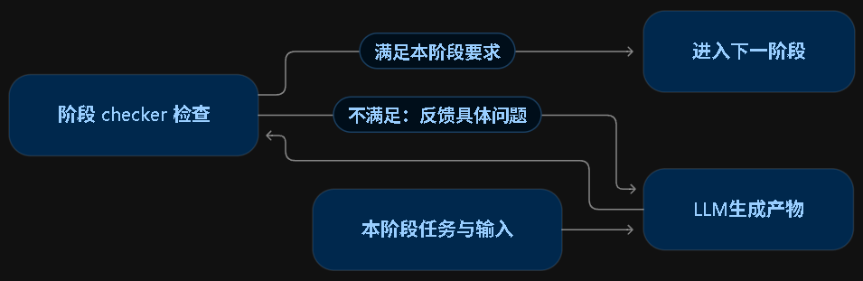

这样，前一阶段的遗漏就有机会在继续传递之前被发现、修正。

**这里的 checker，与实践中的 DUT 结果比较，检查对象有所不同。**

实践中比较 `sum`、`cout`，检查的是**某次**运算行为。阶段 checker 检查的是**本阶段的交付物是否符合要求**；它也可以通过**编译、运行测试等方式辅助判断**。

它能挡住哪些问题，取决于**实际实现了哪些检查规则**。一次阶段检查通过，表示产物满足了这些条件，**不能直接解释为 DUT 已没有缺陷**。

用我们的实践设一个**假设的阶段要求**：覆盖建模阶段必须保留约定的四个 bin，checker 会检查四项是否齐全。

### 2.3 **验证一致性标注机制**（VCLM）

**VCLM 给检查目标分配稳定的标签，让不同阶段的产物使用同一套身份。**

例如，功能清单写“两个加数都是最大值”，覆盖模型写 `both_max`，测试又叫 `maximum_pair`。人可以理解它们的关系，程序还需要明确的对应规则。

VCLM 使用三层标签：

| 层级   | 原文名称            | 表示什么             |
| ------ | ------------------- | -------------------- |
| **FG** | Function Group      | 顶层功能组           |
| **FC** | Function Checkpoint | 组内的具体功能       |
| **CK** | Check Point         | 要覆盖的具体检查条件 |

**用我们的加法器设计一份标签清单：**

```
FG-ARITHMETIC：算术功能
└── FC-ADD：整数加法
    ├── CK-NEITHER-MAX：两个加数都不等于 MAX
    ├── CK-ONLY-A-MAX：只有 a 等于 MAX
    ├── CK-ONLY-B-MAX：只有 b 等于 MAX
    └── CK-BOTH-MAX：两个加数都等于 MAX
```

原文图 6 将三层标签分别用于：

- **FG → CoverGroup**：覆盖组。
- **FC → CoverPoint**：覆盖点。
- **CK → Bin**：具体场景分箱。

所以，一个检查目标还带着父子关系。例如：

```
FG-ARITHMETIC / FC-ADD / CK-BOTH-MAX
```

**同一个目标，要贯穿多个产物。**

以 `CK-BOTH-MAX` 为例：

| 产物           | 应保留的对应关系                               |
| -------------- | ---------------------------------------------- |
| 规格／功能清单 | 说明这个标签对应“两个加数均为 MAX”的检查条件   |
| 覆盖模型       | 使用相应标签，定义实际输入满足条件时如何命中   |
| 测试代码       | 声明关联这个检查点，并施加相应输入、检查输出   |
| 结果报告       | 记录它是否命中、关联哪个测试，以及是否出现失败 |

实现相应规则后，checker 就能对比这些产物：

- 规格有、覆盖模型没有：**缺项**。
- 覆盖模型有、规格没有：**出现了没有依据的新增项或命名错误**。
- 标签存在，但所属 FG／FC 不一致：**层级关系需要核对**。

这让前面“检查有没有漏掉 `both_max`”的要求，有了明确、可提取的标识。

**但标签对应完整，还需要检查实际行为。** 标签不能替代正确的输入、采样条件和结果比较；最初的功能清单如果遗漏了要求，后面的产物也可能一起遗漏。

## 3 UCAgent的实现

图 3 回答“有哪些工作要做”；图 4 进一步说明“由哪些软件模块组织和执行这些工作”。

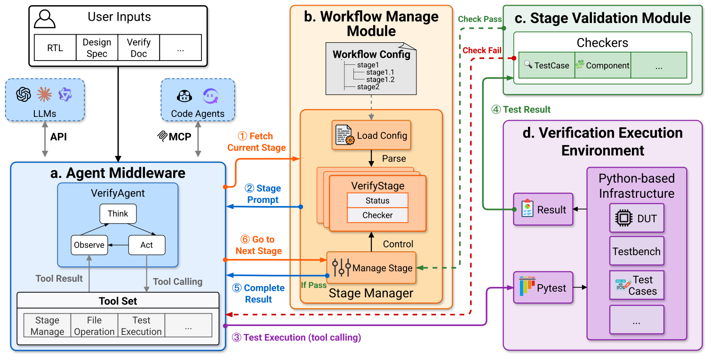

**先认清四个区域的职责。**

| 区域        | 模块                                             | 主要职责                           |
| ----------- | ------------------------------------------------ | ---------------------------------- |
| **a，蓝色** | Agent Middleware，中间件                         | 组织模型交互、任务上下文和工具调用 |
| **b，橙色** | Workflow Management，工作流管理                  | 维护当前阶段，控制阶段推进         |
| **c，绿色** | Stage Validation，阶段验证                       | 根据规则检查当前阶段的交付物       |
| **d，紫色** | Verification Execution Environment，验证执行环境 | 执行测试和 RTL 仿真，产生实际结果  |

实践1~4中已经涉及了 **d 中的 Python／PyDUT／Toffee 部分，以及 c 的一些简单的检查规则例子**。图中的 VerifyAgent、StageManager 暂时还没有在实践中启动。

### 3.1 **智能体中间件**

**这一轮重点理解左侧蓝框：模型怎样通过工具开展工作。**

蓝框里的 **VerifyAgent** 会根据当前任务和已有结果，选择下一步动作。它与实践2中的 `AdderAgent` 分工不同：`AdderAgent` 执行我们写好的信号驱动逻辑；VerifyAgent 则需要**组织文件操作、测试执行和阶段管理**等动作。

> [!TIP]
>
> **`AdderAgent` 属于区域 d「验证执行环境」**，具体是 Python testbench 中的驱动组件。

图中画了一个循环：

```
Observe：取得当前信息和工具反馈
    ↓
Think：决定下一步做什么
    ↓
Act：发出工具调用
    ↓
工具执行并返回结果
    ↓
继续 Observe
```

论文使用 **ReAct** 方式组织这个循环。比如，模型读到“两个 CK 未命中”，可以选择检查测试文件、补充输入，再调用工具运行测试。

**工具执行产生可观察的反馈，模型再据此选择后续动作。** DUT 的实际输出仍由仿真环境产生。

再看图中的编号，可以分成三段理解：

- **①、②：取得任务。** 中间件向工作流管理器获取当前阶段，管理器返回相应的任务提示。
- **③、④：执行并检查。** 中间件调用测试执行工具；执行环境产生结果，阶段验证模块据此检查。
- **⑤、⑥：返回判断并申请推进。** 管理器向中间件返回完成判断结果，中间件再请求进入下一阶段；推进受到检查结果约束。

这些编号概括**模块间的交互**，具体工具接口后面再看图 5。

**这里存在两个不同层次的判断。**

模型通过工具完成**一次操作**，例如成功读取文件、运行测试或生成报告。阶段验证还要判断：**这些操作之后，整个阶段要求的产物是否已经满足条件。**

用实践中的练习设想一次自动处理过程：

1. 模型运行基础五例，得到“DUT 检查全部通过，但规定 CK 只命中 2/4”。
2. 阶段验证指出两项尚未命中。
3. 模型根据反馈补充两组输入，再运行、检查。
4. 达到本阶段要求后，工作流管理器才允许推进。

这就是中间件、执行环境、检查器和管理器之间的配合。

### 3.2 **工作流管理模块**

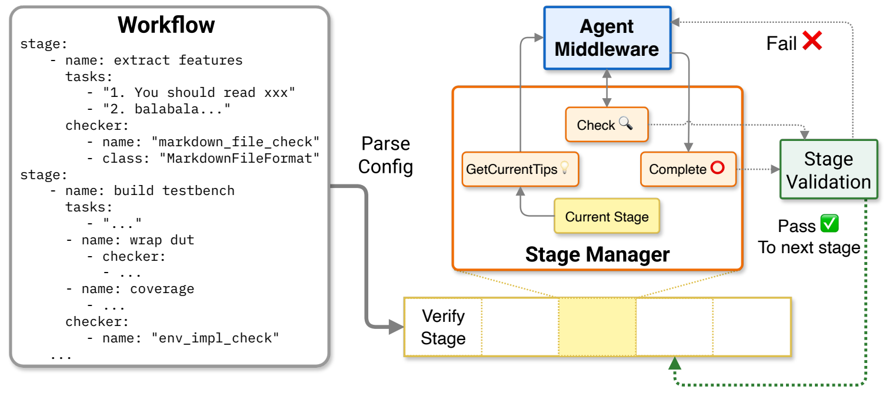

**先看左边：阶段由配置文件定义。**

论文使用 **YAML 格式**描述工作流。可以把 YAML 理解为一种保存**结构化配置**的文本格式。

一个阶段需要说明：

- 阶段**名称**；
- 模型要完成的**任务**；
- **应输出**哪些文件或产物；
- 绑定哪些 **checker**；
- 是否包含**子阶段**。

图左侧展示的是这些字段及其嵌套关系的示意。

**这些配置会被组织成两类对象。**

| 名称           | 职责                                               |
| -------------- | -------------------------------------------------- |
| `VerifyStage`  | 表示一个阶段，保存任务说明、目标产物和对应的检查器 |
| `StageManager` | 管理多个阶段，跟踪当前进度，处理阶段切换请求       |

例如，一个 `VerifyStage` 可以描述“建立覆盖模型，并保留规定的四个 CK”。执行任务的仍是模型与工具；`StageManager` 负责管理**当前正在做哪项任务，以及能否推进。**

**再看图中的三个工具接口。**

这些是 UCAgent 暴露给模型调用的**工具名**，后续启动框架时会实际使用：

| 工具             | 主要作用                             |
| ---------------- | ------------------------------------ |
| `GetCurrentTips` | 获取当前阶段的任务上下文             |
| `Check`          | 触发阶段检查，取得检查结果           |
| `Complete`       | 请求完成当前阶段；满足检查约束时推进 |

`Complete` 代表一项**需要验证的完成请求**。管理器要按照阶段要求处理它。

用实践3中的覆盖练习设想一次交互：

1. 模型取得当前任务：四个规定 CK 都需要命中。
2. 模型编写并运行测试，得到报告。
3. 检查结果指出还有两个 CK 未命中，模型根据反馈补充测试。
4. 满足要求后，模型请求完成阶段，管理器按约束允许推进。

这是帮助理解职责的交互例子。论文没有要求必须先单独调用一次 `Check`，才能调用 `Complete`；它强调的是：**推进必须受阶段检查约束。**

**管理器还会保存流程进度。**

论文说明，每次阶段切换时，会把**进度及执行统计**写入状态文件，例如失败次数和耗时。这既支持**中断后继续工作**，也能帮助开发者识别**哪些阶段反复重试**，需要进一步细分。

这里恢复的是**验证任务的进度**；DUT 内部寄存器或仿真进程状态的保存**属于另一层问题**。

### 3.3 **阶段验证模块**

**阶段验证模块可以组合不同的检查器。**

论文提供检查器**基类**，允许针对不同阶段**扩展**规则，并支持**三种检查方式**：

| 检查方式         | 可以做什么                                                   |
| ---------------- | ------------------------------------------------------------ |
| **代码自动检查** | 检查文档格式、编译环境、标签关系、覆盖模型和报告，也可以运行独立测试 |
| **LLM 复核**     | 辅助审阅规格描述与实现是否对应，但仍可能误判                 |
| **人工判断**     | 由工程师复核关键产物，决定是否允许继续                       |

**具体在哪个阶段使用哪种方式，由配置决定。** 启用人工介入 checker 时，流程会等待工程师审查。

实践4中的vclm_check.py (line 39)，就属于代码检查：它提取标签路径，再比较缺失项和额外项。

**图 6 则展示了检查目标如何贯穿各个产物。**

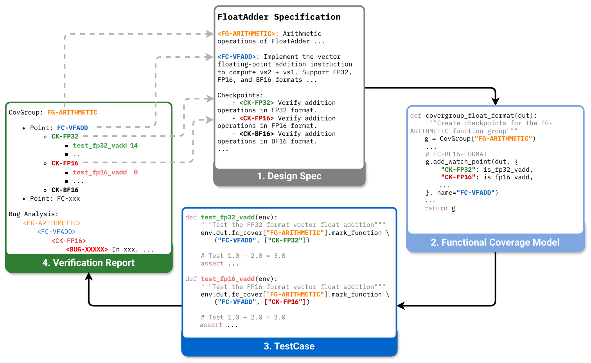

这次换成了**浮点加法**示例。先沿着这一条路径看：

```
FG-ARITHMETIC → FC-VFADD → CK-FP16
算术功能组       向量浮点加法     FP16 格式下的检查
```

按图中编号读：

1. **规格**：定义这个功能与检查条件。
2. **覆盖模型**：使用对应的 FG、FC、CK，分别命名覆盖组、覆盖点和 bin。
3. **测试代码**：**关联**检查点，施加输入，并检查输出。
4. **验证报告**：按相同标签组织测试信息；错误分析也可以沿标签回指相关目标。

这就是标签带来的**可追踪性**：报告中出现某个检查点的问题，可以继续寻找它对应的规格、覆盖定义和测试。

**检查器的能力，取决于它具体检查了什么。**

例如，标签检查通过，可以确认规定标签及其层级关系没有缺失；但它还没有检查 bin 的**判定条件是否写对**。

这类问题也可以通过**代码检查处理**：为判定条件设计独立测试，或者结合规格开展复核。**关键是把相应规则真正加入检查**，而不能仅凭一个笼统的 PASS 推断所有要求都已满足。

### 3.4 **基于** **Python** **的验证执行环境**

这一节讲的是，测试运行之后，UCAgent 怎样利用结果决定下一步补测什么。

论文先让 LLM 用 Toffee 封装 PyDUT，再为封装后的操作写**基础测试**。就像我们先用 `2+3+1` 检查 `agent.add()` 能否把输入送进 DUT、推进仿真并读回预期输出。这种小规模检查叫**冒烟测试**。论文将反复失败的功能标记为潜在硬件缺陷，后续仍需排查驱动、预期值和 RTL，才能确定根因。

基础环境就绪后，LLM 建立覆盖模型并编写测试。论文用 **Pytest 运行 Python 测试**，测试通过 Toffee 操作 PyDUT，实际输出由 RTL 仿真产生。执行环境随后汇总三种信息。

| 指标         | 回答的问题                                              | 加法器实践中的对应结果      |
| ------------ | ------------------------------------------------------- | --------------------------- |
| 测试通过情况 | 已运行的用例中，有多少通过了结果检查？                  | 基础五例全部通过            |
| 功能覆盖率   | 预先定义的场景中，有多少被实际触及？                    | 基础五例只命中 `2/4` 个 bin |
| 代码覆盖率   | 纳入统计的 RTL 代码结构中，有哪些在仿真中被执行或触及？ | 本地练习未采集              |

实践3中直接运行 Python 脚本，手动查看 `MISS` 后补上了两组输入。论文把这一步交给 Agent：**执行环境把报告送回模型，模型根据未命中的条件补写测试，再次运行和检查。** 最后，系统汇总测试结果、覆盖数据和验证产物。实践3中已经亲自走过这个反馈过程的手动版本。

## 4评估

### 4.1 **实验设置**

### 4.2 **总体验证效果**

这一轮只研究一个问题：**三个模型都达到 100% 功能覆盖率，是否说明验证效果相同？**

在作者报告的实验中，三个模型对 IntegerDivider 都取得了 100% 功能覆盖率。我们把这句话与图中的数字一起读。

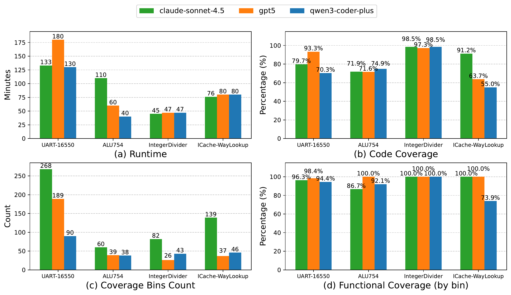

图比较密，先只看每个子图中 **IntegerDivider** 的三根柱子：

| 模型              | 工作流时间 | 代码覆盖率 | Bin 数量 | 功能覆盖率 |
| ----------------- | ---------- | ---------- | -------- | ---------- |
| Claude Sonnet 4.5 | 45 分钟    | 98.5%      | 82       | 100%       |
| GPT-5             | 47 分钟    | 97.3%      | 26       | 100%       |
| Qwen3-Coder-Plus  | 47 分钟    | 98.5%      | 43       | 100%       |

这里最值得注意的是：**最后一列相同，前一列却不同。**

将三个百分比展开，就是：

```
Claude：82 个 bin 命中 / 定义了 82 个 bin
GPT-5： 26 个 bin 命中 / 定义了 26 个 bin
Qwen：  43 个 bin 命中 / 定义了 43 个 bin
```

可以把它们理解为三份检查清单：各自清单上的项目都被触及了，但清单内容未必相同。因此，读功能覆盖率时，必须连着看图 **7(c) 的数量**和 **7(d) 的百分比**。

进一步说，**82 个 bin 也不能直接证明比 26 个更充分**。更多条目可能来自更细的拆分，也可能存在重复。我们还要检查：

- 是否覆盖了规格中的重要行为和边界；
- 每个 bin 的采样条件是否符合它的含义；
- 测试是否对实际输出进行了正确的行为检查。

这与实践6直接对应：实践中完整运行的 **67/67 CK 全部命中**，同时仍检出了 `MIN / MIN` 的余数错误。场景发生与行为正确，仍然是两项证据。

另外，图 7 的汇总数字无法告诉我们，论文当年的测试是否包含这组 `MIN / MIN` 输入；不能据此推断作者当时遗漏了这个缺陷。

### 4.3 **分阶段执行分析**

这一轮只讲清：**图里的“失败次数”究竟统计什么。**

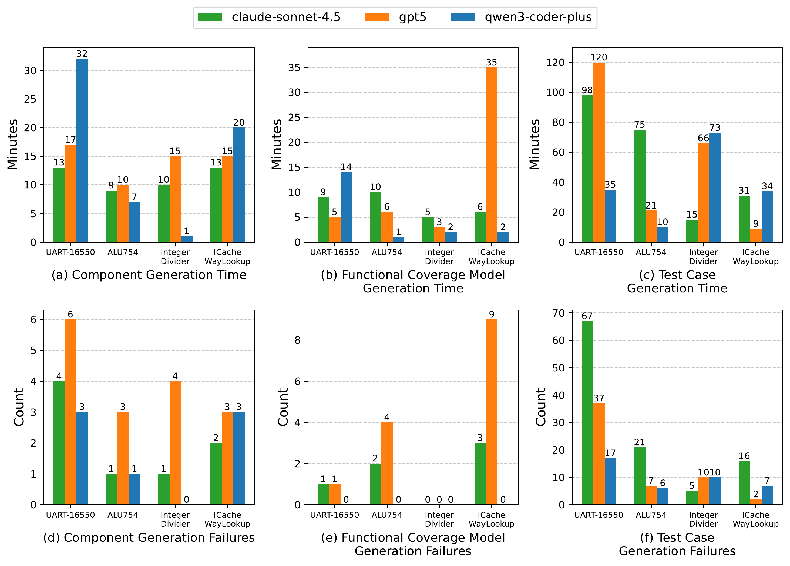

图中每列对应一种工作：组件生成、功能覆盖模型生成、测试用例生成。上排统计**时间**，下排统计**失败次数**。我们先把 **IntegerDivider 的下排数字**抽出来：

| 模型              | 组件生成失败 | 覆盖模型生成失败 | 测试生成失败 |
| ----------------- | ------------ | ---------------- | ------------ |
| Claude Sonnet 4.5 | 1 次         | 0 次             | 5 次         |
| GPT-5             | 4 次         | 0 次             | 10 次        |
| Qwen3-Coder-Plus  | 0 次         | 0 次             | 10 次        |

> [!TIP]
>
> 这里的“组件”指的是：**组成 Python 验证环境、能够被多个测试反复使用的基础代码。**它们属于测试平台（testbench）。
>
> 论文在 **第 5 页 §2.2、图 3** 中列出了这些准备工作，包括 DUT 创建、fixture、信号封装和可选的 Mock 环境。
>
> 对照实践6中UCAgent生成的 [IntegerDivider_api.py (line 40)](https://github.com/Kyle0401/Kyle0401.github.io/blob/main/papers/ucagent/references/IntegerDivider_api.py#L40)，就很具体了：
>
> | 基础组件        | 本次代码                       | 负责什么                                         |
> | --------------- | ------------------------------ | ------------------------------------------------ |
> | DUT 创建函数    | `create_dut()`，第 40 行       | 创建仿真实例，绑定时钟，设置波形与覆盖数据路径   |
> | Pytest fixture  | `dut()`，第 65 行              | 为每项测试准备独立 DUT，结束后保存统计并释放资源 |
> | 信号封装 Bundle | `IntegerDividerPins`，第 95 行 | 把 `valid`、`done` 等名字连接到实际 RTL 端口     |
> | 验证环境 Env    | `IntegerDividerEnv`，第 119 行 | 组织 DUT 和引脚，提供复位、推进时钟等操作        |
>
> 其中 **fixture** 可以理解为“测试开始前准备好、结束后收拾好”的机制。
>
> 对于**依赖外部存储器或总线响应**的模块，还可能生成 **Mock 组件**，用简化模型**提供这些外部响应**。我们的除法器实验没有启用这部分。
>
> 再和“测试用例”对比一下：
>
> - **基础组件**解决：怎样创建除法器、连接端口、复位、推进时钟和读取结果。
> - **测试用例**解决：这次输入什么、预期是什么、实际结果是否符合预期。例如检查 `17 / 5`，或者检查 `MIN / MIN` 的余数。
>
> 已经学过的 **Bundle 端口连接**，就是这类基础组件中的一项。先把这些基础代码搭好，后续许多测试就能共用同一个可靠的验证环境。

这里的失败，指**生成过程中的迭代失败记录**，不能直接当作硬件缺陷数量。同一个问题可能反复触发检查失败。

为什么测试生成容易返工？作者解释，**有效测试**需要同时满足：strict syntactic correctness, functional assertions, and targeted coverage annotations

也就是：**代码能够正确执行、功能断言合理、目标覆盖关联正确。**

结合实践内容就容易理解了：

- 之前故意把加法器预期值增加 1，断言失败来自错误预期。
- 覆盖标签写齐了，但目标输入没有实际发生，覆盖要求仍不满足。
- 这次 `MIN / MIN` 的余数不符，经独立计算、驱动和波形核对，才确认属于 DUT 缺陷。

所以，看到一次失败后，必须根据诊断判断问题在哪里。图 8 没有列出每次失败的具体归因。

论文还举了一个例子：Claude 在 UART-16550 的测试生成中经历 **67 次迭代失败**，最终仍完成验证收敛。作者借此说明，checker 的**反馈**可以支持持续修正。这里也不能把 67 次失败写成“发现了 67 个硬件 bug”。

### 4.4 案例研究

#### 4.4.1 **IntegerDivider** **验证（领域知识边界）**

作者报告：在这次实验中，Qwen3-Coder-Plus 对 **最小负数除以 −1** 的边界反复生成错误预期；Claude Sonnet 4.5 和 GPT-5 则识别并覆盖了这个边界。

这里的关键结论是：

> absolute verification completeness remains bounded by the base model’s domain knowledge

意思是：**验证完整性仍受到基础模型领域知识的限制。**框架能够组织工作、检查产物、反馈失败，但生成正确预期仍需要掌握对应的硬件规范。

> [!TIP]
>
> **不一定是规范没给全。规范明确，确定了“正确答案是什么”；模型仍可能在读取、理解或编写预期代码时出错。**这里说的是论文中 Qwen 的历史运行，不能直接归因为我们没有提供好规范。
>
> 这条规则确实明确：有符号除法溢出时，商等于被除数，余数为 0。对 RV32，就是 `MIN / −1 → 商 MIN、余数 0`。[RISC-V 官方规范](https://docs.riscv.org/reference/isa/v20240411/unpriv/m-st-ext.html)
>
> 从生成过程看，可能出错的环节有：
>
> | 环节     | 可能的问题                                           |
> | -------- | ---------------------------------------------------- |
> | 获取规则 | 相关条款没有提供，或模型没有实际读到                 |
> | 理解规则 | 读到了，但遗漏了溢出特例，套用了普通运算规则         |
> | 编写预期 | 理解基本正确，却在位宽、补码编码或取整方式上写错代码 |
>
> **这些是可能原因，论文没有给出足够记录来确定究竟是哪一个。**
>
> 具体来说，论文第 10 页 §4.1 列出的输入是提示模板、模块文档、Verilog 和对应 Scala 文件，没有说明是否把完整 ISA 或这条规定放进了当次上下文。第 13 页只报告模型反复生成错误预期，没有公布每次失败的完整提示和代码。作者将其解释为领域知识边界，并在第 14 页承认，框架缺少动态知识注入等系统补偿机制。
>
> **对于我的实验，这条关键规则并不缺失。**提供的 [README 特殊情况处理 (line 479)](https://github.com/Kyle0401/Kyle0401.github.io/blob/main/papers/ucagent/references/README.md?plain=1#L479) 已写明溢出余数为 0、商返回被除数；我亲自运行的 `signed_overflow` 商、余数检查也已经通过。最后发现的 `MIN / MIN` 是另一个 RTL 实现问题。
>
> 实际提高可靠性，需要把**相关规范条款、明确的边界输入输出、独立参考模型检查**连接起来。即使提供整本规范，也仍要验证模型是否把关键规则正确落实到了测试中。

以 32 位有符号数为例：

```
最小负数 MIN = −2147483648
数学上的 MIN / −1 = +2147483648
```

这个正数超出了 32 位有符号范围。RISC-V 对此明确规定：**商返回 MIN，余数返回 0**。对应位模式为：

```
商：0x80000000
余数：0x00000000
```

这是 ISA 规定的溢出结果。[RISC-V 官方除法规范](https://docs.riscv.org/reference/isa/v20240411/unpriv/m-st-ext.html)

我的实践中运行的 `run_divider_boundaries.sh` 中，`signed_overflow` 检查的正是这个边界，并且已经通过。

现在把论文案例与我实践发现的缺陷分开：

| 案例         | 输入        | 暴露的问题                   |
| ------------ | ----------- | ---------------------------- |
| 论文 §4.4.1  | `MIN / −1`  | 某模型反复生成错误的测试预期 |
| 你的本机实验 | `MIN / MIN` | 预期余数为 0，RTL 实际返回 1 |

**前者说明需要核对模型的领域知识，后者有独立驱动和波形支持，属于 DUT 实现错误。**

因此，验证时既要检查 DUT，也要核对“裁判”——参考模型和断言。标签关联正确、程序可以执行，都不能替代对预期结果的规范核对。

#### 4.4.2 **LaneFAdd** **验证（自动化缺陷发现）**

**LaneFAdd**，这是一个向量浮点加法模块。作者使用 Claude Sonnet 4.5 驱动 UCAgent，报告发现：

> three previously undiscovered boundary-condition bugs

即 **3 个此前未知的边界条件缺陷**，涉及 FP16、BF16 浮点格式下的特殊值处理。

这里有两项成果：一是测试检出了错误；二是借助 VCLM，把失败**追踪**到对应的**功能和检查点**，方便开发者定位。

联系学过的标签，可以这样理解：

```
测试失败 → 找到关联的功能与检查点 → 回查对应行为 → 定位问题
```

这一小节没有展开三个缺陷各自的完整输入、波形和修复补丁，所以我们目前只能讲清作者报告的发现与追踪能力。

#### 4.4.3 **PageTableWalker** **验证（人机协同适用性）**

**PageTableWalker**，也就是页表遍历模块。论文给出的代码规模为 **155,408 行**，并明确写道：

> could not complete the verification task using the default workflow

即：**默认工作流未能完成这项验证任务。**

随后，作者采用 **human-in-the-loop——人工参与的验证策略**，报告在 **8 小时内达到预期验证结果**。这 8 小时属于人工参与策略下的结果；该段没有细列人的具体操作和全部验收指标。

两个案例的证据可以这样整理：

| 案例            | 作者展示的能力或边界                             |
| --------------- | ------------------------------------------------ |
| LaneFAdd        | 自动发现真实缺陷，并追踪到功能和检查点           |
| PageTableWalker | 大型模块需要人工参与策略，默认工作流存在适用边界 |

因此，读“端到端验证”时，要分别考察**流程覆盖了哪些工作**和**哪些环节需要人工参与**。

## 5 讨论

作者把 UCAgent 的效果归纳为四项机制的协作。

| 机制            | 解决什么问题                                 | 联系实践                                           |
| --------------- | -------------------------------------------- | -------------------------------------------------- |
| Python 验证环境 | 降低生成和组织测试程序的难度                 | Python 经 PyDUT 驱动真实 RTL 仿真，Toffee 封装测试 |
| Checker         | 判断产物是否满足已规定的要求，并反馈失败原因 | Check 未通过时，根据诊断修正                       |
| 可配置工作流    | 把验证组织成有顺序、有完成条件的阶段         | StageManager 管理阶段推进                          |
| VCLM            | 保持规格、覆盖、测试和结果之间的关联         | FG／FC／CK 标签支持追踪                            |

把它们串起来，就是：**模型生成产物，工具执行检查，反馈推动修改，阶段条件控制推进，标签保留追踪关系。**

随后，§5.2 列出四项局限：

- **大型设计仍需要人工工程工作**，包括层次化配置和模块分解。
- **测试生成重试较多**，复杂场景可能耗时很长。
- **正确性受模型领域知识限制**，目前缺少系统性的动态知识补偿机制。
- **工作流由专家预先定义**，模型自主动态拆分整个任务仍是未来方向。

最后一点的原文是：

> statically predefined by human experts

所以，“可配置”表示可以调整流程配置；模型在当前阶段根据反馈改测试、换工具、重试，也不等于它已经能自主设计整个阶段结构。

再把实验中的覆盖率说精确一点：**本机生成的算术 CK 不只检查输入条件，还要求有效完成且结果符合预期。**但一个较宽的 CK 可以被**多组输入**触发——其中某组正确输入使它命中，并不能保证同类所有输入都正确。因此，`67/67` 与 `MIN/MIN` 的逐笔断言失败仍可并存。

> [!TIP]
>
> **针对本机这类算术 CK，在同一次覆盖统计中，只要有一次采样满足它的完整条件，就算命中。**但必须是符合该 CK 要求的输入，不能随便找一组算对的输入。注释 1
>
> 例如 `CK-POWER-MIN-DIVISOR`，在[实际覆盖定义 (line 23)](https://github.com/Kyle0401/Kyle0401.github.io/blob/main/papers/ucagent/references/IntegerDivider_function_coverage_def.py#L23)中要求：
>
> - 除数位模式是 `0x80000000`；
> - 不处于复位或 flush，且 `done=1`；
> - 实际输出等于参考结果。
>
> 看两笔**有符号余数运算**：
>
> | 输入        | 预期余数 | 实际余数 | 本次能否使该 CK 命中 |
> | ----------- | -------- | -------- | -------------------- |
> | `0 / MIN`   | 0        | 0        | 能                   |
> | `MIN / MIN` | 0        | 1        | 不能，同时断言失败   |
>
> 第一笔已经使 CK 命中，第二笔失败也**不会撤销之前的命中记录**；测试仍会保留这笔 FAIL。
>
> 因此，这个 CK 表示“**至少有一次**满足定义的证据”，并没有要求“所有以 MIN 为除数的输入都算对”。
>
> 如果希望覆盖报告单独反映 `MIN / MIN` 的余数边界，就需要再定义一个专门针对它的 CK。按当前原始 RTL 的结果，这个更具体的 CK 应当未命中。

# 实践

## 1  Picker:通过 PyDUT 操作二进制加法器

下面根据 [Picker 官方入门教程](https://github.com/XS-MLVP/picker/blob/master/doc/zh/tutorials/first-dut.md) 整理。它是配套教学代码，论文没有列出这段程序；我们先读懂，导出 PyDUT 后再实际运行。

```python
from Adder import DUTAdder

dut = DUTAdder()

try:
    dut.a.value = 2
    dut.b.value = 3
    dut.cin.value = 1

    dut.Step(1)

    actual_sum = dut.sum.value
    actual_cout = dut.cout.value
    print("sum =", actual_sum, "cout =", actual_cout)

    assert actual_sum == 6
    assert actual_cout == 0
finally:
    dut.Finish()
```

我们按执行顺序看。

**第一步，创建一个 DUT 仿真实例。**

```
dut = DUTAdder()
```

`DUTAdder` 是导出的 Python 包提供的类。调用它，就创建了一个可以操作的加法器仿真模型，后续用变量 `dut` 访问这个实例。

**第二步，写输入信号。**

```
dut.a.value = 2
```

可以逐层读成：

```
dut       这个仿真实例
.a        它的 a 端口
.value    端口的数值
= 2       将数值设置为 2
```

后两行同理，分别设置 `b` 和 `cin`。这里的 Python 赋值操作，最终会作用于 DUT 的输入信号。

**第三步，让仿真模型处理这些输入。**

```
dut.Step(1)
```

在这个示例里，它提交输入并推进仿真，使输出得到更新。写完输入后，应按接口要求推进仿真，再读取结果。

这里有一个容易混淆的地方：**这个加法器是组合电路，没有时钟端口。**

组合电路的输出由当前输入决定；仿真工具需要执行相应计算，才能把更新后的输出提供给测试。因此，这里的 `Step(1)` 应理解为一次仿真推进，不能直接叫作“运行一个硬件时钟周期”。

后面验证带寄存器的除法器时，还需要配置和驱动时钟，让内部状态随着时钟变化。那时我们再具体讨论周期。

**第四步，读取实际输出并检查。**

```
actual_sum = dut.sum.value
```

这行读取的是 **RTL 仿真产生的实际输出**。变量名 `actual_sum` 表示“实际的和”。

随后：

```
assert actual_sum == 6
```

`==` 表示比较是否相等。`assert` 要求这个条件成立；条件不成立，Python 就会报出断言失败。

所以，打印与检查承担不同任务：

- `print(...)`：把实际结果显示出来，供人查看。
- `assert ...`：按预期自动判断，发现不一致就报告失败。

最后的 `try`／`finally` 可以先理解为一种收尾安排：无论断言通过还是执行中出现异常，都会调用 `dut.Finish()` 结束仿真。

这一组输入通过，只说明我们完成了这一次检查。其他输入、进位和位宽边界，还需要各自的测试。

Picker 和 Verilator环境配置完成之后，打开默认的 **Ubuntu** 终端，先运行：

```
cd /mnt/f/CodexHome/.chatgpt-projects/g-p-6ab4da66a07c8191bed9dbf08f3d102a/practice/ucagent

bash run_adder.sh
```

得到:

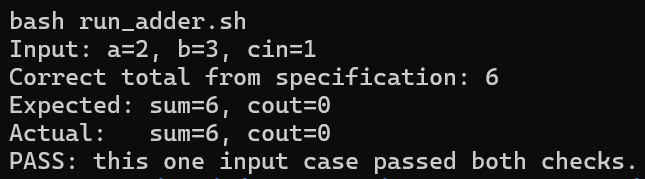

这表示 Python 已成功驱动 RTL 仿真，并完成了这组输入的结果检查。

接着运行：

```
bash run_adder.sh --wrong-expected
```

它保持输入不变，**故意将预期值从 `6` 改为 `7`**。

得到：

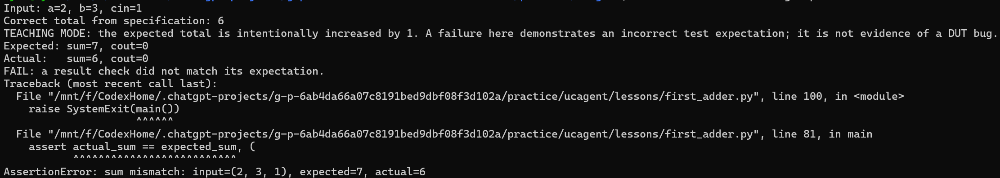

后面还会出现 `AssertionError`。这是本次练习刻意制造的测试错误，与我们刚才讨论的情况一致。

测试代码：

```python
#!/usr/bin/env python3
"""Run one Adder check, or deliberately use an incorrect expected result.

Requires Python 3.11 and an already exported and built Picker Adder package.
The --package-parent directory must contain the importable Adder package.
"""

import argparse
from pathlib import Path
import sys


def main() -> int:
    parser = argparse.ArgumentParser(description=__doc__)
    parser.add_argument(
        "--package-parent",
        type=Path,
        required=True,
        help="Parent directory of the exported and built Adder package.",
    )
    parser.add_argument(
        "--wrong-expected",
        action="store_true",
        help="Intentionally expect one more than the correct result (exit 1).",
    )
    args = parser.parse_args()

    package_parent = args.package_parent.expanduser().resolve()
    if not package_parent.is_dir():
        parser.error(
            f"Package parent does not exist: {package_parent}. "
            "Export and build the Adder package first."
        )

    sys.path.insert(0, str(package_parent))
    try:
        from Adder import DUTAdder
    except (ImportError, OSError):
        print(
            "Could not import the exported Adder package. Check that "
            "--package-parent points to its parent, the package has been "
            "built, and the matching Python environment is active. "
            "The original import error follows.",
            file=sys.stderr,
            flush=True,
        )
        raise

    # The official Adder specification has a default WIDTH of 64.
    width = 64
    a, b, cin = 2, 3, 1
    correct_total = a + b + cin
    expected_total = correct_total + (1 if args.wrong_expected else 0)
    expected_sum = expected_total & ((1 << width) - 1)
    expected_cout = expected_total >> width

    dut = DUTAdder()
    try:
        dut.a.value = a
        dut.b.value = b
        dut.cin.value = cin
        dut.Step(1)

        actual_sum = int(dut.sum.value)
        actual_cout = int(dut.cout.value)

        print(f"Input: a={a}, b={b}, cin={cin}", flush=True)
        print(f"Correct total from specification: {correct_total}", flush=True)
        if args.wrong_expected:
            print(
                "TEACHING MODE: the expected total is intentionally increased "
                "by 1. A failure here demonstrates an incorrect test "
                "expectation; it is not evidence of a DUT bug.",
                flush=True,
            )
        print(
            f"Expected: sum={expected_sum}, cout={expected_cout}", flush=True
        )
        print(f"Actual:   sum={actual_sum}, cout={actual_cout}", flush=True)

        assert actual_sum == expected_sum, (
            f"sum mismatch: input=({a}, {b}, {cin}), "
            f"expected={expected_sum}, actual={actual_sum}"
        )
        assert actual_cout == expected_cout, (
            f"cout mismatch: input=({a}, {b}, {cin}), "
            f"expected={expected_cout}, actual={actual_cout}"
        )
        print("PASS: this one input case passed both checks.", flush=True)
    except AssertionError:
        print("FAIL: a result check did not match its expectation.", flush=True)
        raise
    finally:
        dut.Finish()

    return 0


if __name__ == "__main__":
    raise SystemExit(main())

```

接下来检查**进位和位宽边界**。先用较小的数字理解规则。

假设加法器的 `sum` 只有 **4 位**，完整结果拆为：低 4 位交给 `sum`，更高的一位交给 `cout`。

| 运算     | 完整结果       | `sum`（4 位） | `cout` |
| -------- | -------------- | ------------- | ------ |
| `7 + 1`  | 二进制 `01000` | `1000`，即 8  | 0      |
| `15 + 1` | 二进制 `10000` | `0000`，即 0  | 1      |

因此，**`sum=0` 本身不能说明加法结果错误，还需要同时检查 `cout`。**

我们的模块按规格是 64 位，规则相同：`sum` 保存低 64 位，`cout` 保存输出进位。

增加并实际运行五组测试。在原来的 Ubuntu 目录执行：

```
bash run_adder_boundaries.sh
```

会依次检查零值、小数值、单独输入进位，以及两项边界情况。实测为：

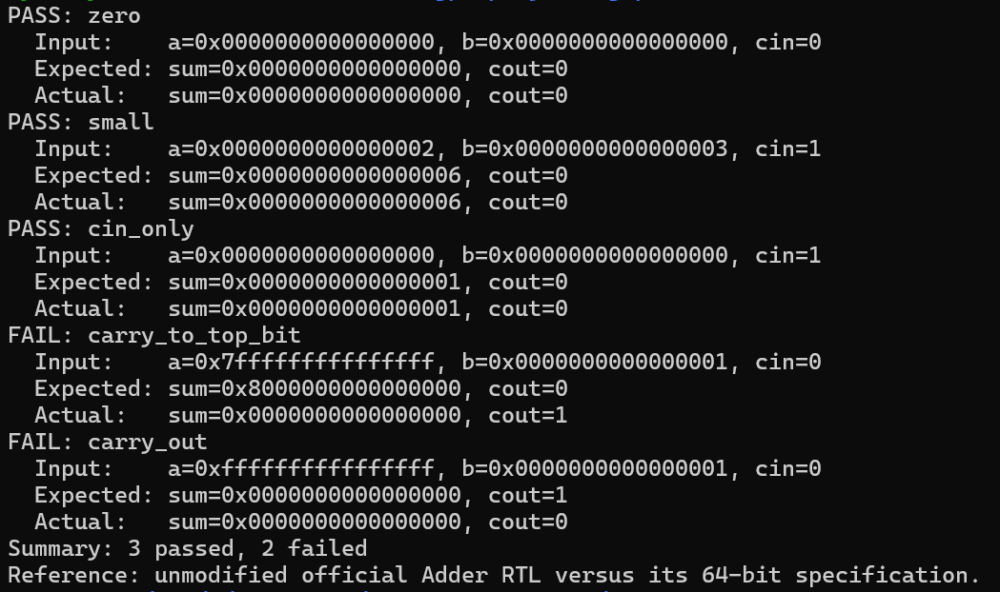

重点看两项失败，`cin` 均为 0：

| 输入             | 按规格预期         | 实际输出        |
| ---------------- | ------------------ | --------------- |
| \((2^{63}-1)+1\) | `sum=2^63, cout=0` | `sum=0, cout=1` |
| \((2^{64}-1)+1\) | `sum=0, cout=1`    | `sum=0, cout=0` |

**本轮预期按规格正确计算，失败对应官方示例原有的位宽问题。**

Adder.v：

```verilog

// A verilog 64-bit full adder with carry in and carry out

module Adder #(
    parameter WIDTH = 64
) (
    input [WIDTH-1:0] a,
    input [WIDTH-1:0] b,
    input cin,
    output [WIDTH-2:0] sum,
    output cout
);

assign {cout, sum}  = a + b + cin;

endmodule

```

可以在Adder.v 第 10 行 (line 10)看到：

```verilog
output [WIDTH-2:0] sum,
```

代入 `WIDTH=64`，得到 `[62:0]`。下标包含两端，因此实际位数是： 62-0+1=63 

规格要求 `sum` 为 64 位，这里却少了一位。于是，本应属于 `sum` 的最高结果位落到了 `cout`，真正的输出进位也无法正确保留。

之前的 `2+3+1=6` 只用到低几位，所以能够通过；新增的边界输入才触及了这个问题。

修改这一行，并重新编译：

```diff
-    output [WIDTH-2:0] sum,
+    output [WIDTH-1:0] sum,
```

当 `WIDTH=64` 时，`sum` 现在有 64 位，加上 `cout` 的一位，可以容纳完整的 65 位结果。

**使用相同的五组输入和预期值，实测对比如下：**

| 版本     | 通过 | 失败 |
| -------- | ---- | ---- |
| 原版     | 3    | 2    |
| 修复副本 | 5    | 0    |

在当前 Ubuntu 目录运行：

```
bash run_adder_fixed.sh
```

得到：

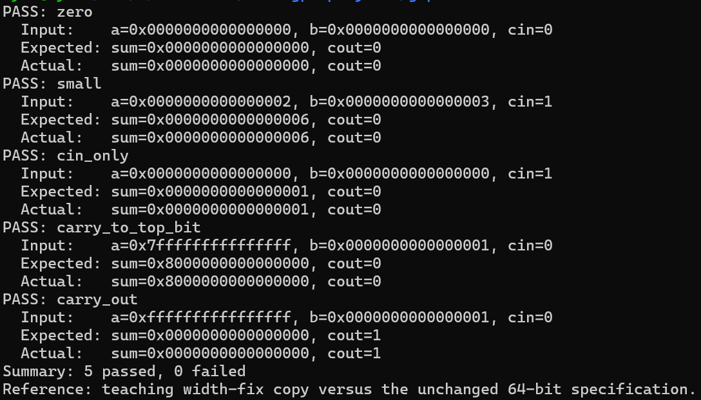

这种**修改后重新运行已有测试**的做法，叫作**回归测试**。这次既检查两项边界问题是否修好，也检查原先通过的三项是否仍然通过。

至此，完成了一轮验证实践：**按规格写预期 → 运行测试 → 暴露边界问题 → 定位位宽错误 → 修复副本 → 回归检查。**

## 2 Toffee

论文将 Toffee 放在 PyDUT 之上，用它提供更高层的验证抽象。先理解其中两个：**Bundle 和 Agent**。

先回看已经运行过的代码：

```python
dut.a.value = a
dut.b.value = b
dut.cin.value = cin
dut.Step(1)

actual_sum = int(dut.sum.value)
actual_cout = int(dut.cout.value)
```

无论检查零值、小数值还是进位边界，都会执行这组操作。我们希望把它组织成一个可以反复调用的“执行一次加法”操作。

**Bundle 负责描述和连接一组信号。**

对于加法器，我们关心：

```
输入：a、b、cin
输出：sum、cout
```

Toffee 的 Bundle 把这些信号**组织成一个接口**，并与 PyDUT 的实际端口连接。验证代码就可以**通过这个接口访问信号**。

例如，验证环境内部统一使用名字 `a`，而某个 DUT 的实际端口叫 `io_a`，连接时就建立：

```
验证接口中的 a  ←→  DUT 的 io_a
```

这里改变的是软件访问方式，硬件端口的功能仍由 RTL 定义。**Bundle 本身不执行加法，也不会自动推进仿真。**

**Agent 负责组织这个接口上的操作。**

在我们使用的 Toffee Legacy 接口中，可以为 Agent 编写一个加法驱动方法。调用它时，依次完成：

```
接收 a、b、cin
      ↓
通过 Bundle 写入输入
      ↓
推进仿真
      ↓
读取 sum、cout
      ↓
返回实际结果
```

后面的测试便可以专注于选择输入，例如“这次检查零值”“这次检查最高位进位”，把具体的信号操作交给**同一个驱动方法**。[Toffee 官方加法器示例](https://github.com/XS-MLVP/toffee/blob/master/README.md)

注意，**这里的 Agent 是一个执行 Python 驱动逻辑的验证组件。** 论文中 UCAgent 的 AI Agent 则使用大模型进行分析和工具调用；它可以编写这些验证组件。

**预期值计算仍然有自己的职责。**

原来的参考计算是：

```
total = a + b + cin
expected_sum = total & ((1 << 64) - 1)
expected_cout = total >> 64
```

采用 Toffee 后，这些规则仍然依据规格编写。整体关系可以画成下面的示意：

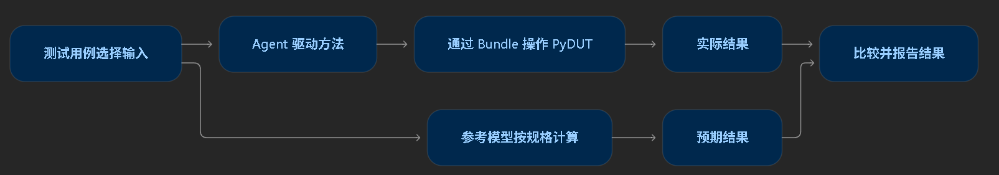

这样，测试输入、信号操作和参考计算各自有明确的位置。后面更换 DUT 接口或增加测试时，也更容易找到需要修改的部分。

后续代码会沿用固定 UCAgent 版本依赖的 Toffee Legacy 接口；官方新版已重构，两套 API 需要区分。[UCAgent 依赖清单](https://github.com/XS-MLVP/UCAgent/blob/123e02896fd80290c1d1888613a24daed4627461/requirements.txt)、[Toffee 版本说明](https://github.com/XS-MLVP/toffee#toffee-legacy)

完整Toffee程序：

```python
#!/usr/bin/env python3
"""用 Toffee Legacy 的 Bundle 和 Agent 运行相同的五项加法器检查。"""

import argparse
from importlib.metadata import version
import json
from pathlib import Path
import sys

import toffee
from toffee import Agent, Bundle, Signals, driver_method

from adder_boundaries import CASES, MASK, WIDTH
from toffee_legacy_adapter import LegacyAdderView


class AdderBundle(Bundle):
    # 声明逻辑接口；bind(dut) 时与实际同名端口连接。
    a, b, cin, sum, cout = Signals(5)


class AdderAgent(Agent):
    @driver_method()
    async def add(self, a, b, cin):
        self.bundle.a.value = a
        self.bundle.b.value = b
        self.bundle.cin.value = cin
        await self.bundle.step()
        return int(self.bundle.sum.value), int(self.bundle.cout.value)


async def run_cases(dut_class, variant):
    # DUT、Bundle、Agent 在 Toffee 管理的事件循环中创建。
    dut = LegacyAdderView(dut_class())
    bundle = AdderBundle().bind(dut)
    agent = AdderAgent(bundle)
    toffee.start_clock(dut)
    results = []
    for name, a, b, cin in CASES:
        # 保留原有的独立规格参考计算，本课暂不引入 Model 类。
        total = a + b + cin
        expected_sum, expected_cout = total & MASK, total >> WIDTH
        actual_sum, actual_cout = await agent.add(a, b, cin)
        passed = (actual_sum, actual_cout) == (expected_sum, expected_cout)
        results.append({
            'name': name,
            'input': {'a': a, 'b': b, 'cin': cin},
            'expected': {'sum': expected_sum, 'cout': expected_cout},
            'actual': {'sum': actual_sum, 'cout': actual_cout},
            'passed': passed,
        })
        print(f"{'PASS' if passed else 'FAIL'}: {name}", flush=True)
        print(f"  Expected: sum=0x{expected_sum:016x}, cout={expected_cout}", flush=True)
        print(f"  Actual:   sum=0x{actual_sum:016x}, cout={actual_cout}", flush=True)
    failed = sum(not result['passed'] for result in results)
    print(f"Summary: {len(results) - failed} passed, {failed} failed", flush=True)
    print(f"Execution: Toffee Legacy Bundle + Agent; variant={variant}", flush=True)
    return {'variant': variant, 'spec_width': WIDTH, 'toffee_version': version('pytoffee'),
            'results': results, 'passed': len(results) - failed, 'failed': failed}


def main():
    parser = argparse.ArgumentParser(description=__doc__)
    parser.add_argument('--package-parent', type=Path, required=True)
    parser.add_argument('--variant', choices=('original', 'fixed'), required=True)
    parser.add_argument('--report', type=Path)
    args = parser.parse_args()
    package_parent = args.package_parent.expanduser().resolve()
    if not package_parent.is_dir():
        parser.error(f'导出包目录不存在：{package_parent}')
    sys.path.insert(0, str(package_parent))
    from Adder import DUTAdder
    toffee.setup_logging(toffee.WARNING)
    instances = []

    def create_dut():
        dut = DUTAdder()
        instances.append(dut)
        return dut

    try:
        report = toffee.run(run_cases(create_dut, args.variant))
    finally:
        # Toffee 的循环已退出，再结束仿真；异常时也执行收尾。
        for dut in instances:
            dut.Finish()
    if args.report:
        args.report.parent.mkdir(parents=True, exist_ok=True)
        args.report.write_text(json.dumps(report, indent=2) + '\n', encoding='utf-8')
    return 1 if report['failed'] else 0


if __name__ == '__main__':
    raise SystemExit(main())

```

先看`class AdderBundle(Bundle)`和`class AdderAgent(Agent)`

**第一部分定义接口，第二部分定义一次加法操作。**

`class AdderBundle(Bundle)` 定义了一种**接口类型**，沿用 Toffee 的 Bundle 能力。`Signals(5)` 声明五个逻辑信号，**5 表示信号数量，位宽由连接的 DUT 端口决定。**

创建并连接它时，程序使用：

```python
bundle = AdderBundle().bind(dut)
agent = AdderAgent(bundle)
```

之后，`self.bundle` 就是**交给这个 Agent 的接口**。你熟悉的信号读写操作，现在都通过它执行。`@driver_method()` 则告诉 Toffee：下面这个方法是一项**驱动操作**。[官方 Legacy 加法器示例](https://github.com/XS-MLVP/toffee/blob/master/README.md)

> [!TIP]
>
> 这是 Python 的**装饰器（decorator）语法**。这里的 `driver_method` 是 Toffee **提供的函数**，用于把下面的方法包装成框架管理的驱动方法。
>
> 例如：
>
> ```
> @driver_method()
> async def add(self, a, b, cin):
>     # 写输入、等待仿真、读取输出
>     ...
> ```
>
> 可以理解为 Python 帮我们完成了下面的操作：
>
> ```
> # 先定义原始方法
> async def add(self, a, b, cin):
>     ...
> 
> # 再用装饰器加工这个方法
> decorate = driver_method()
> add = decorate(add)
> ```
>
> 这里有一个新的 Python 概念：**函数本身也可以作为参数传给另一个函数。**
>
> 所以上面两行分别表示：
>
> 1. `driver_method()`：取得一个装饰器函数。
> 2. `decorate(add)`：把刚定义的 `add` 方法交给它，取得包装后的方法，并继续使用名字 `add`。
>
> **在 Toffee 中，这层包装具体负责什么？**
>
> [实际源码](https://github.com/XS-MLVP/toffee/blob/f57dd6ffc295b9b8bad3e3b3ce040b8a849f5c91/toffee/agent.py)中它主要做两件事：
>
> - 给方法**添加标记**，让 `Agent` 初始化时能识别它，并建立对应的**驱动组件**。
> - 包装方法的**调用**，让后续执行经过 Toffee 的驱动处理流程。
>
> 于是，之后执行：
>
> ```
> actual_sum, actual_cout = await agent.add(a, b, cin)
> ```
>
> 时，会**通过这层包装运行驱动操作**。**具体怎样写入输入、等待仿真和读取输出，仍由我们写在 `add()` 里的代码决定。**
>
> 装饰器在**定义方法时完成包装**；加法驱动操作是在之后调用 `agent.add(...)` 时执行的。

**这次新增的重点是 `async` 和 `await`。**

- `async def`：定义一个可以在执行过程中暂停、等待的协程函数。

  > [!TIP]
  >
  > **协程函数是一种可以在等待某个操作时暂停，等操作完成后再继续执行的函数，用 `async def` 定义。** 暂停时，参数、局部变量和执行位置都会保留下来。

- `await self.bundle.step()`：等待仿真推进事件，之后再继续读取输出。

- `await agent.add(...)`：执行并等待这次加法驱动完成，取得返回的实际结果。

因此，测试中可以这样取得结果：

```
actual_sum, actual_cout = await agent.add(a, b, cin)
```

这一行内部完成了：

```
写入三个输入
    → 等待框架推进仿真
    → 读取两个输出
    → 返回实际结果
```

完整程序用 `toffee.start_clock(dut)` 启动后台推进循环，由它调用 PyDUT 的 `Step(1)`。**这个组合加法器仍然没有时钟端口；这里讨论的是软件仿真的推进。**

返回结果后，程序继续使用之前的规格公式计算预期值并比较。本轮只是换了驱动操作的组织方式，五组输入和判断规则保持一致。

在当前 Ubuntu 目录运行：

```
bash run_toffee_adder.sh
```

最后看到：

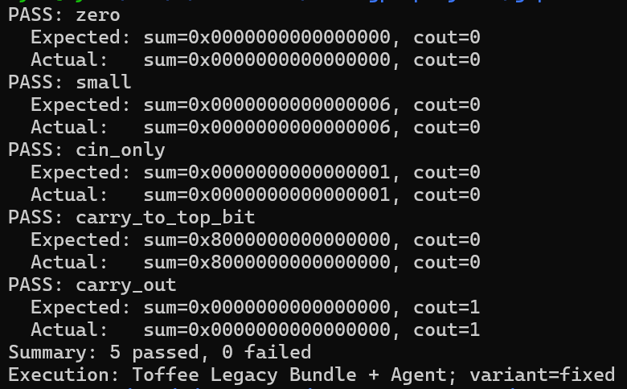

原版通过 Toffee 运行时，仍然是三项通过、两项失败，说明那些边界问题仍能被检查出来。

## 3  Toffee功能覆盖

toffee_coverage.py ：

```python
#!/usr/bin/env python3
"""使用 Toffee 功能覆盖统计两加数是否达到规格最大值的四类组合。"""

import argparse
import json
from pathlib import Path
import sys

import toffee
from toffee.funcov import CovGroup

from adder_boundaries import CASES, MASK, WIDTH
from toffee_adder import AdderAgent, AdderBundle
from toffee_legacy_adapter import LegacyAdderView


EXTRA_CASES = (
    ('only_b_max', 1, MASK, 0),
    ('both_max', MASK, MASK, 1),
)


def make_coverage(bundle):
    # 四个 bin 构成按输入属性划分的场景，不是按测试名或 PASS 结果计数。
    group = CovGroup('operand_max_combinations', disable_sample_when_point_hinted=False)
    group.add_cover_point(
        (bundle.a, bundle.b),
        {
            'neither_max': lambda pins: pins[0].value != MASK and pins[1].value != MASK,
            'only_a_max': lambda pins: pins[0].value == MASK and pins[1].value != MASK,
            'only_b_max': lambda pins: pins[0].value != MASK and pins[1].value == MASK,
            'both_max': lambda pins: pins[0].value == MASK and pins[1].value == MASK,
        },
        name='max_operand_combination',
    )
    return group


async def run_cases(create_dut, variant, extended):
    dut = LegacyAdderView(create_dut())
    bundle = AdderBundle().bind(dut)
    agent = AdderAgent(bundle)
    group = make_coverage(bundle)
    toffee.start_clock(dut)
    cases = CASES + EXTRA_CASES if extended else CASES
    results = []
    for name, a, b, cin in cases:
        total = a + b + cin
        expected = {'sum': total & MASK, 'cout': total >> WIDTH}
        actual_sum, actual_cout = await agent.add(a, b, cin)
        # 输入保持稳定时采样；无论行为检查通过与否，都记录场景。
        group.sample()
        actual = {'sum': actual_sum, 'cout': actual_cout}
        passed = actual == expected
        results.append({'name': name, 'input': {'a': a, 'b': b, 'cin': cin},
                        'expected': expected, 'actual': actual, 'passed': passed})
        print(f"{'PASS' if passed else 'FAIL'}: {name}", flush=True)
        if not passed:
            print(f'  Expected: {expected}', flush=True)
            print(f'  Actual:   {actual}', flush=True)

    failed = sum(not result['passed'] for result in results)
    data = group.as_dict()
    hit_bins, total_bins = data['bin_num_hints'], data['bin_num_total']
    percentage = 100 * hit_bins / total_bins
    bins = data['points'][0]['bins']
    print(f"Summary: {len(results) - failed} passed, {failed} failed", flush=True)
    print(f'Functional coverage (operand maximum combinations only): '
          f'{hit_bins}/{total_bins} bins = {percentage:.1f}%', flush=True)
    for item in bins:
        print(f"  {'HIT' if item['hints'] else 'MISS'}: {item['name']} "
              f"(samples={item['hints']})", flush=True)
    print('Coverage records scenarios; result comparisons check correctness.', flush=True)
    return {
        'variant': variant, 'extended': extended, 'spec_width': WIDTH,
        'results': results, 'passed': len(results) - failed, 'failed': failed,
        'coverage': {'scope': 'operand maximum combinations only',
                     'covered_bins': hit_bins, 'total_bins': total_bins,
                     'percentage': percentage, 'bins': bins},
        'toffee_covgroup': data,
    }


def main():
    parser = argparse.ArgumentParser(description=__doc__)
    parser.add_argument('--package-parent', type=Path, required=True)
    parser.add_argument('--variant', choices=('original', 'fixed'), required=True)
    parser.add_argument('--extended', action='store_true', help='补入仅 b 为最大值、a/b 均为最大值两组输入')
    parser.add_argument('--report', type=Path)
    args = parser.parse_args()
    parent = args.package_parent.expanduser().resolve()
    if not parent.is_dir():
        parser.error(f'导出包目录不存在：{parent}')
    sys.path.insert(0, str(parent))
    from Adder import DUTAdder
    toffee.setup_logging(toffee.WARNING)
    instances = []

    def create_dut():
        dut = DUTAdder()
        instances.append(dut)
        return dut

    try:
        report = toffee.run(run_cases(create_dut, args.variant, args.extended))
    finally:
        for dut in instances:
            dut.Finish()
    if args.report:
        args.report.parent.mkdir(parents=True, exist_ok=True)
        args.report.write_text(json.dumps(report, indent=2) + '\n', encoding='utf-8')
    # 本课只报告覆盖缺口，不设覆盖率失败阈值；行为不符仍退出 1。
    return 1 if report['failed'] else 0


if __name__ == '__main__':
    raise SystemExit(main())

```

功能覆盖率——这些测试触及了哪些预先定义的场景。

这一轮围绕加法器的最大值定义场景。64 位无符号数的最大值是：
$$
MAX=2^{64}-1
$$
我们观察：**`a`、`b` 是否等于 MAX**。共有四种组合，每一类称为一个 **bin（覆盖分箱）**：

| bin           | 输入条件           | 原来的五项测试是否触及 |
| ------------- | ------------------ | ---------------------- |
| `neither_max` | 两个数都不等于 MAX | 是                     |
| `only_a_max`  | 只有 a 等于 MAX    | 是                     |
| `only_b_max`  | 只有 b 等于 MAX    | 否                     |
| `both_max`    | 两个数都等于 MAX   | 否                     |

因此，五项测试虽然全部通过，**这四个 bin 只命中了两个，本轮定义的 bin 覆盖率是 50%。**

其中，前四项测试都落在 `neither_max`。同一类命中四次，覆盖统计仍只算“这一类已经触及”。

**先运行已有五项测试的覆盖统计。**

在当前 Ubuntu 目录执行：

```
bash run_toffee_coverage.sh
```

输出为：

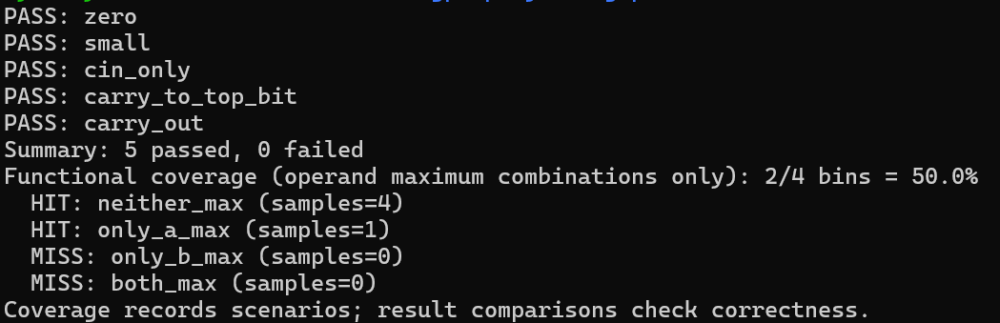

下面还会列出两个 `MISS`，指出尚未触及的类别。

程序48—54 行在加法操作完成后采样当前输入：

```
actual_sum, actual_cout = await agent.add(a, b, cin)
group.sample()
```

`sample()` 记录场景是否发生；之后的结果比较负责检查行为是否正确。这两项统计分别保留。[Toffee 官方覆盖示例](https://github.com/XS-MLVP/toffee/blob/f57dd6ffc295b9b8bad3e3b3ce040b8a849f5c91/example/adder/test_adder.py)

**根据这两个缺口，补充两组输入。**

| 新输入                | 要触及的 bin | 预期结果          |
| --------------------- | ------------ | ----------------- |
| `a=1, b=MAX, cin=0`   | `only_b_max` | `sum=0, cout=1`   |
| `a=MAX, b=MAX, cin=1` | `both_max`   | `sum=MAX, cout=1` |

运行扩展版本：

```
bash run_toffee_coverage.sh --extended
```

实测结果是：

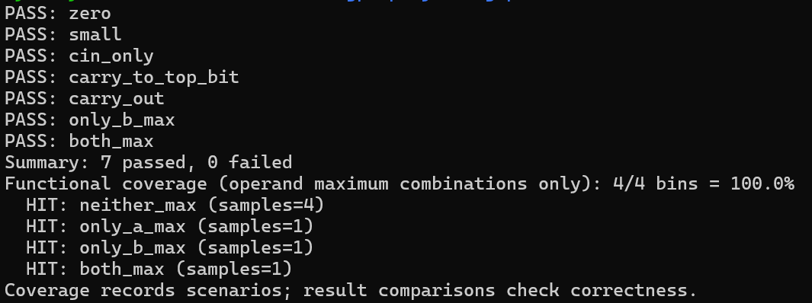

这里能看到一个完整过程：

**定义场景 → 运行并采样 → 查看未覆盖项 → 补充针对性测试 → 再次检查。**

还要准确理解这个 **100%**：它只说明上述四类都至少触及过一次。每一类内部仍有大量输入没有测试，`cin` 等其他条件也还没有进一步细分。

我也用原版加法器做了对照：同样能达到这四类的 **100% 覆盖率**，但结果检查是 **3 项通过、4 项失败**。场景被触及，仍需要检查其中的行为是否正确。

## 4 VCLM

这一轮已把标签接入实际代码:

```python
#!/usr/bin/env python3
"""VCLM 教学练习：分别检查标签结构、测试关联、采样命中和 DUT 输出。"""

import argparse
import json
from pathlib import Path
import sys

import toffee
from toffee.funcov import CovGroup

from adder_boundaries import CASES, MASK, WIDTH
from toffee_adder import AdderAgent, AdderBundle
from toffee_coverage import EXTRA_CASES
from toffee_legacy_adapter import LegacyAdderView
from vclm_check import check_labels, check_samples, check_test_links


FG = 'FG-ARITHMETIC'
FC = 'FC-ADD'
CK_BOTH = 'CK-BOTH-MAX'


def make_labelled_coverage(bundle, omit_both_max):
    group = CovGroup(FG, disable_sample_when_point_hinted=False)
    bins = {
        'CK-NEITHER-MAX': lambda pins: pins[0].value != MASK and pins[1].value != MASK,
        'CK-ONLY-A-MAX': lambda pins: pins[0].value == MASK and pins[1].value != MASK,
        'CK-ONLY-B-MAX': lambda pins: pins[0].value != MASK and pins[1].value == MASK,
        CK_BOTH: lambda pins: pins[0].value == MASK and pins[1].value == MASK,
    }
    if omit_both_max:
        del bins[CK_BOTH]
    group.add_cover_point((bundle.a, bundle.b), bins, name=FC)
    return group


async def test_adder_cases(agent, group, cases):
    results = []
    for name, a, b, cin in cases:
        total = a + b + cin
        expected = {'sum': total & MASK, 'cout': total >> WIDTH}
        actual_sum, actual_cout = await agent.add(a, b, cin)
        group.sample()
        actual = {'sum': actual_sum, 'cout': actual_cout}
        passed = actual == expected
        results.append({'name': name, 'input': {'a': a, 'b': b, 'cin': cin},
                        'expected': expected, 'actual': actual, 'passed': passed})
        print(f"{'PASS' if passed else 'FAIL'}: {name}", flush=True)
    return results


async def run_lesson(create_dut, spec, base_only, omit_both_max):
    dut = LegacyAdderView(create_dut())
    bundle = AdderBundle().bind(dut)
    agent = AdderAgent(bundle)
    group = make_labelled_coverage(bundle, omit_both_max)
    label_check = check_labels(spec, group.as_dict())
    print(f"Label structure: {'PASS' if label_check['passed'] else 'FAIL'}", flush=True)
    report = {'scope': spec['scope'], 'spec_width': WIDTH, 'label_check': label_check,
              'test_link_check': None, 'sample_check': None, 'results': [],
              'executed': False, 'passed': 0, 'failed': 0, 'lesson_passed': False,
              'base_only': base_only, 'omit_both_max': omit_both_max}
    if not label_check['passed']:
        for path in label_check['missing']:
            print(f'  Missing: {path}', flush=True)
        for path in label_check['extra']:
            print(f'  Extra: {path}', flush=True)
        print('DUT checks: NOT RUN (label structure rejected)', flush=True)
        print('Lesson result: FAIL', flush=True)
        report['toffee_covgroup'] = group.as_dict()
        return report

    # 这只是关联声明，既不发送输入，也不调用 sample()。
    group.mark_function(FC, test_adder_cases, bin_name=list(group.cover_point(FC)['bins']))
    link_check = check_test_links(spec, group.as_dict())
    report['test_link_check'] = link_check
    print(f"Test links: {'PASS' if link_check['passed'] else 'FAIL'}", flush=True)
    if not link_check['passed']:
        print('DUT checks: NOT RUN (test links rejected)', flush=True)
        print('Lesson result: FAIL', flush=True)
        report['toffee_covgroup'] = group.as_dict()
        return report

    toffee.start_clock(dut)
    cases = CASES if base_only else CASES + EXTRA_CASES
    results = await test_adder_cases(agent, group, cases)
    data = group.as_dict()
    sample_check = check_samples(spec, data)
    failed = sum(not result['passed'] for result in results)
    both = next(item for item in data['points'][0]['bins'] if item['name'] == CK_BOTH)
    associated = bool(data['points'][0]['functions'].get(CK_BOTH))
    print(f"DUT checks: {len(results) - failed} passed, {failed} failed", flush=True)
    print(f"Required CK sampling: {'PASS' if sample_check['passed'] else 'FAIL'} "
          f"({data['bin_num_hints']}/{data['bin_num_total']} hit)", flush=True)
    print(f"{CK_BOTH}: linked={'yes' if associated else 'no'}, sampled={both['hints']}", flush=True)
    for path in sample_check['unhit']:
        print(f'  Unhit: {path}', flush=True)
    lesson_passed = label_check['passed'] and link_check['passed'] and sample_check['passed'] and not failed
    print(f"Lesson result: {'PASS' if lesson_passed else 'FAIL'}", flush=True)
    report.update({'sample_check': sample_check, 'results': results, 'executed': True,
                   'passed': len(results) - failed, 'failed': failed,
                   'toffee_covgroup': data, 'lesson_passed': lesson_passed})
    return report


def main():
    parser = argparse.ArgumentParser(description=__doc__)
    parser.add_argument('--package-parent', type=Path, required=True)
    parser.add_argument('--spec', type=Path,
                        default=Path(__file__).resolve().parents[1] / 'notes/vclm-adder-spec.json')
    modes = parser.add_mutually_exclusive_group()
    modes.add_argument('--base-only', action='store_true', help='保留四项关联声明，只执行原有五组输入')
    modes.add_argument('--omit-both-max', action='store_true', help='故意从覆盖模型删去 CK-BOTH-MAX')
    parser.add_argument('--report', type=Path)
    args = parser.parse_args()
    parent = args.package_parent.expanduser().resolve()
    if not parent.is_dir():
        parser.error(f'导出包目录不存在：{parent}')
    spec = json.loads(args.spec.read_text(encoding='utf-8'))
    sys.path.insert(0, str(parent))
    from Adder import DUTAdder
    toffee.setup_logging(toffee.WARNING)
    instances = []

    def create_dut():
        dut = DUTAdder()
        instances.append(dut)
        return dut

    try:
        report = toffee.run(run_lesson(create_dut, spec, args.base_only, args.omit_both_max))
    finally:
        for dut in instances:
            dut.Finish()
    if args.report:
        args.report.parent.mkdir(parents=True, exist_ok=True)
        args.report.write_text(json.dumps(report, indent=2) + '\n', encoding='utf-8')
    return 0 if report['lesson_passed'] else 1


if __name__ == '__main__':
    raise SystemExit(main())

```

| 位置     | 操作                          | 含义                     |
| -------- | ----------------------------- | ------------------------ |
| 第 75 行 | `group.mark_function(...)`    | 声明测试函数关联哪些 CK  |
| 第 44 行 | `group.sample()`              | 根据当前输入记录实际命中 |
| 第 46 行 | `passed = actual == expected` | 检查实际输出是否符合预期 |

**关联声明本身不会发送输入，也不会增加命中计数。**

先在当前 Ubuntu 目录运行：

```
bash run_vclm_adder.sh --base-only
```

它保留四个 CK 的关联声明，但只运行原来的五组输入。实测输出是：

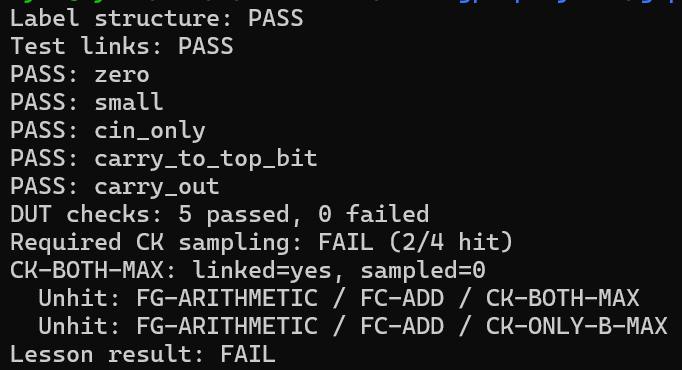

这里的 `linked=yes, sampled=0`，直接表示：测试函数声明自己关联这个检查点，但本次执行没有触及它的输入条件。

五项 DUT 检查都通过，最后仍然是 FAIL，因为**本轮的验收规则明确要求四个 CK 都实际命中**。上一轮的程序只报告覆盖缺口，没有设置这个验收条件。

然后运行完整七组输入：

```
bash run_vclm_adder.sh
```

实测输出变为：

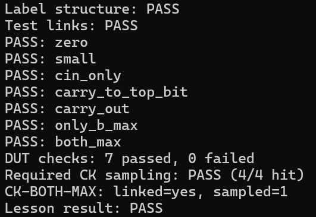

这次既有标签关联，也有实际采样命中，输出检查同样通过。

检查规则写在 vclm_check.py (line 39)这是我们用于理解论文思路的小型教学 checker：

```python
"""比较固定教学规格与 Toffee CovGroup.as_dict() 的 VCLM 标签。

这是本课程的小型教学检查器，不是 UCAgent 完整 checker 的复现。
标签完整、关联存在和采样命中是三个独立条件；这些检查不能证明
bin 条件、测试预期或 DUT 行为正确，也不能证明规格清单完备。
"""


def _spec_nodes(spec: dict) -> set[tuple[str, ...]]:
    nodes = set()
    for group_name, points in spec['groups'].items():
        nodes.add((group_name,))
        for point_name, checkpoints in points.items():
            nodes.add((group_name, point_name))
            for checkpoint in checkpoints:
                nodes.add((group_name, point_name, checkpoint))
    return nodes


def _spec_checkpoints(spec: dict) -> set[tuple[str, ...]]:
    return {path for path in _spec_nodes(spec) if len(path) == 3}


def _coverage_nodes(covgroup: dict) -> set[tuple[str, ...]]:
    group_name = covgroup['name']
    nodes = {(group_name,)}
    for point in covgroup['points']:
        point_name = point['name']
        nodes.add((group_name, point_name))
        for checkpoint in point['bins']:
            nodes.add((group_name, point_name, checkpoint['name']))
    return nodes


def _display(paths: set[tuple[str, ...]]) -> list[str]:
    return [' / '.join(path) for path in sorted(paths)]


def check_labels(spec: dict, covgroup_dict: dict) -> dict:
    """双向比较 FG、FG/FC、FG/FC/CK 的完整层级路径。"""
    required = _spec_nodes(spec)
    actual = _coverage_nodes(covgroup_dict)
    missing = _display(required - actual)
    extra = _display(actual - required)
    return {'passed': not missing and not extra, 'missing': missing, 'extra': extra}


def check_test_links(spec: dict, covgroup_dict: dict) -> dict:
    """检查每个规定 CK 有非空测试关联；不将关联声明当成实际执行。"""
    group_name = covgroup_dict['name']
    linked = {
        (group_name, point['name'], checkpoint)
        for point in covgroup_dict['points']
        for checkpoint, functions in point['functions'].items()
        if functions
    }
    missing = _display(_spec_checkpoints(spec) - linked)
    return {'passed': not missing, 'missing': missing}


def check_samples(spec: dict, covgroup_dict: dict) -> dict:
    """检查每个规定 CK 的实际采样计数是否大于零。"""
    group_name = covgroup_dict['name']
    hit = {
        (group_name, point['name'], checkpoint['name'])
        for point in covgroup_dict['points']
        for checkpoint in point['bins']
        if checkpoint['hints'] > 0
    }
    unhit = _display(_spec_checkpoints(spec) - hit)
    return {'passed': not unhit, 'unhit': unhit}

```

其要求依据[四项检查点清单](https://github.com/Kyle0401/Kyle0401.github.io/blob/main/papers/ucagent/references/vclm-adder-spec.json)，并不等同于 UCAgent 的全部检查机制：

```json
{
  "scope": "Four maximum-operand combinations only",
  "groups": {
    "FG-ARITHMETIC": {
      "FC-ADD": [
        "CK-NEITHER-MAX",
        "CK-ONLY-A-MAX",
        "CK-ONLY-B-MAX",
        "CK-BOTH-MAX"
      ]
    }
  }
}

```

## 5 IntegerDivider 

论文在英文 PDF 第 11 页表 1 中介绍了这个 RV32M 整数除法器，它的被除数、除数和结果均为 32 位。

先用：
$$
17 \div 5 = 3\text{，余数为 }2
$$
**这次需要通过时钟提交请求，再等待完成信号。** 在时钟上升沿，以下条件**同时**成立时，模块接受请求：

```
io_ready = 1    模块可以接受请求
io_valid = 1    测试程序提交了请求
io_flush = 0    本次请求没有被取消
```

脚本让 `io_valid` 有效一拍，然后撤销，运算期间保持操作数和模式稳定。

| 阶段   | `io_ready` | `io_done` | 测试程序的动作       |
| ------ | ---------- | --------- | -------------------- |
| 空闲   | 1          | 0         | 准备并提交请求       |
| 计算中 | 0          | 0         | 逐周期推进，等待完成 |
| 完成   | 0          | 1         | 读取 `io_result`     |

模块只有一个结果端口 `io_result`，由 `io_useRem` 选择内容。因此我们独立提交两次请求：

> [!TIP]
>
> **`useRem`** → **use remainder**，使用余数。

| 请求   | `io_useRem` | 预期结果 |
| ------ | ----------- | -------- |
| 求商   | 0           | 3        |
| 求余数 | 1           | 2        |

这两次都设置 `io_signed=0`，使用无符号运算。接口规则可以在UCAgent 官方仓库的说明中找到。[接口与时序说明 (line 53)](https://github.com/XS-MLVP/UCAgent/blob/123e02896fd80290c1d1888613a24daed4627461/examples/IntegerDivider/README.md)

在当前 Ubuntu 实验目录执行：

```
bash run_divider.sh
```

结果为：

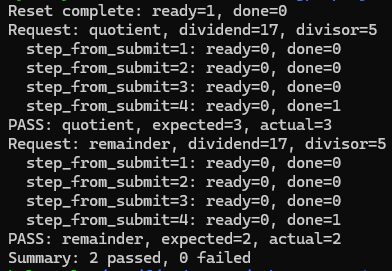

中间会逐周期打印 `ready` 和 `done`。本次实测，两次请求都在 `step_from_submit=4` 时观察到 `done=1`，脚本此时读取结果。

驱动代码先登记 `clk`，完成**复位**，再把输入送到端口并推进时钟。登记时钟后，`Step(1)` 推进一个完整周期。[驱动代码 (line 22)](https://github.com/Kyle0401/Kyle0401.github.io/blob/main/papers/ucagent/references/first_divider.py#L22)、[Picker 时钟接口说明](https://github.com/XS-MLVP/picker/blob/master/doc/zh/guides/simulation.md)

接下来设置 **`io_signed=1`**，检查正负数的四种组合。RISC-V 规定，有符号除法的商**向零截断**；余数非零时，与被除数同号。[RISC-V M 扩展规范](https://docs.riscv.org/reference/isa/v20260120/unpriv/m-st-ext.html)

| 被除数 | 除数 | 预期商 | 预期余数 |
| ------ | ---- | ------ | -------- |
| 17     | 5    | 3      | 2        |
| −17    | 5    | −3     | −2       |
| 17     | −5   | −3     | 2        |
| −17    | −5   | 3      | −2       |

例如，`-17 ÷ 5 = -3.4`，向零截断得到商 `-3`。余数根据下面的关系计算：
$$
余数=被除数-商\times除数
$$
所以：

 
$$
-17-(-3)\times5=-2
$$
**Python 的 `//` 使用向下取整**，因此 `-17 // 5` 得到 `-4`，`-17 % 5` 得到 `3`。写参考模型时，需要明确实现 RISC-V 的规则。[Python 运算说明](https://docs.python.org/3.11/reference/expressions.html#binary-arithmetic-operations)

普通除法的参考计算位于 [signed_divider.py 第 28 行 (line 28)](https://github.com/Kyle0401/Kyle0401.github.io/blob/main/papers/ucagent/references/signed_divider.py#L28)：

```
quotient = abs(dividend) // abs(divisor)
if (dividend < 0) != (divisor < 0):
    quotient = -quotient
remainder = dividend - quotient * divisor
```

它先计算商的绝对值，再根据两个操作数的符号决定正负，最后计算余数。

接口上传递的是 32 位位模式。例如 `-17` 编码为 `0xffffffef`。脚本设置 `io_signed=1`，并在输出日志时同时显示有符号数值和原始位模式。

在当前 Ubuntu 目录执行：

```
bash run_divider_signed.sh
```

四组输入各检查一次商和余数，共八项：

```
kyle@Kyle:/mnt/f/CodexHome/.chatgpt-projects/g-p-6ab4da66a07c8191bed9dbf08f3d102a/practice/ucagent$ bash run_divider_signed.sh
Reset complete: ready=1, done=0
Mode: signed 32-bit division (io_signed=1)
Operands: 17 / 5; bits=0x00000011/0x00000005
Request: quotient, dividend=17, divisor=5
  step_from_submit=1: ready=0, done=0
  step_from_submit=2: ready=0, done=0
  step_from_submit=3: ready=0, done=0
  step_from_submit=4: ready=0, done=1
PASS: DIV 17/5, expected=3, actual=3, bits=0x00000003
Request: remainder, dividend=17, divisor=5
  step_from_submit=1: ready=0, done=0
  step_from_submit=2: ready=0, done=0
  step_from_submit=3: ready=0, done=0
  step_from_submit=4: ready=0, done=1
PASS: REM 17/5, expected=2, actual=2, bits=0x00000002
Operands: -17 / 5; bits=0xffffffef/0x00000005
Request: quotient, dividend=-17, divisor=5
  step_from_submit=1: ready=0, done=0
  step_from_submit=2: ready=0, done=0
  step_from_submit=3: ready=0, done=0
  step_from_submit=4: ready=0, done=1
PASS: DIV -17/5, expected=-3, actual=-3, bits=0xfffffffd
Request: remainder, dividend=-17, divisor=5
  step_from_submit=1: ready=0, done=0
  step_from_submit=2: ready=0, done=0
  step_from_submit=3: ready=0, done=0
  step_from_submit=4: ready=0, done=1
PASS: REM -17/5, expected=-2, actual=-2, bits=0xfffffffe
Operands: 17 / -5; bits=0x00000011/0xfffffffb
Request: quotient, dividend=17, divisor=-5
  step_from_submit=1: ready=0, done=0
  step_from_submit=2: ready=0, done=0
  step_from_submit=3: ready=0, done=0
  step_from_submit=4: ready=0, done=1
PASS: DIV 17/-5, expected=-3, actual=-3, bits=0xfffffffd
Request: remainder, dividend=17, divisor=-5
  step_from_submit=1: ready=0, done=0
  step_from_submit=2: ready=0, done=0
  step_from_submit=3: ready=0, done=0
  step_from_submit=4: ready=0, done=1
PASS: REM 17/-5, expected=2, actual=2, bits=0x00000002
Operands: -17 / -5; bits=0xffffffef/0xfffffffb
Request: quotient, dividend=-17, divisor=-5
  step_from_submit=1: ready=0, done=0
  step_from_submit=2: ready=0, done=0
  step_from_submit=3: ready=0, done=0
  step_from_submit=4: ready=0, done=1
PASS: DIV -17/-5, expected=3, actual=3, bits=0x00000003
Request: remainder, dividend=-17, divisor=-5
  step_from_submit=1: ready=0, done=0
  step_from_submit=2: ready=0, done=0
  step_from_submit=3: ready=0, done=0
  step_from_submit=4: ready=0, done=1
PASS: REM -17/-5, expected=-2, actual=-2, bits=0xfffffffe
Summary: 8 passed, 0 failed
```

接下来检查**除零与有符号溢出**。RISC-V 对它们规定了明确的返回结果。

除数为 `0` 时，**商的所有位都置为 1，余数等于被除数**。32 位的 `0xffffffff` 按有符号数解释为 `−1`，按无符号数解释为 `4294967295`。

32 位最小负数是 `−2^31`。它除以 `−1` 的数学结果为 `2^31`，超出了有符号最大值。此时规范规定返回**商 `−2^31`、余数 `0`**。[RISC-V M 扩展边界规则](https://github.com/riscv/riscv-isa-manual/blob/main/src/unpriv/m-st-ext.adoc#L80)

本轮有四组输入，每组分别检查商和余数：

| 模式   | 输入              | 预期商       | 预期余数 |
| ------ | ----------------- | ------------ | -------- |
| 无符号 | `17 / 0`          | `0xffffffff` | 17       |
| 有符号 | `−17 / 0`         | −1           | −17      |
| 有符号 | `−2^31 / −1`      | −2^31        | 0        |
| 无符号 | `2^31 / (2^32−1)` | 0            | 2^31     |

最后两组使用相同的输入位模式 `0x80000000` 和 `0xffffffff`，通过 `io_signed` 选择不同的解释方式。

**这也是论文关注的边界。** 英文 PDF 第 13 页 §4.4.1 报告，作者实验中的 Qwen3-Coder-Plus 对最小负数除以 `−1` **反复生成错误预期**，作者据此讨论基础模型领域知识对验证完整性的限制。

将四组输入加入[边界检查程序 (line 13)](https://github.com/Kyle0401/Kyle0401.github.io/blob/main/papers/ucagent/references/divider_boundaries.py#L13)。在当前 Ubuntu 目录执行：

```
bash run_divider_boundaries.sh
```

得到：

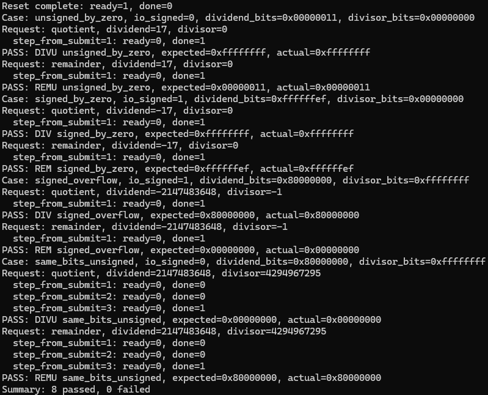

这次除零和溢出用例在第 **1** 个推进周期就观察到 `done=1`。驱动在提交后立即检查完成信号，因此能及时读取结果。

## 6 UCAgent

接下来让 UCAgent 验证上述IntegerDivider模块。

**UCAgent 提出了一个此前 18 项手写检查没有覆盖的边界问题，独立手写仿真已复现。** 在 32 位有符号模式下，令 `MIN = −2^31`，测试 `MIN / MIN`。商应为 `1`，余数应为 `0`，实际却返回了余数 `1`。[Agent 静态分析 (line 24)](https://github.com/Kyle0401/Kyle0401.github.io/blob/main/papers/ucagent/references/agent-static-analysis-snapshot.md?plain=1#L24)

> [!TIP]
>
> **在官方公开案例中检出了一个可复现的 RTL 缺陷。但目前还不能直接得出“新模型首次发现了论文作者没发现的错误”这个结论。**
>
> 核对后，可以分三层说明：
>
> 1. **与官方公开 RTL 是否相同：是。**
>    你的文件与官方提交 `123e02896fd8` 中的 `IntegerDivider.v` 逐字节一致。还确认它与 **2025 年 10 月首次加入仓库时的文件内容相同**。[本次使用版本](https://github.com/XS-MLVP/UCAgent/blob/123e02896fd80290c1d1888613a24daed4627461/examples/IntegerDivider/IntegerDivider.v)、[最早公开版本](https://github.com/XS-MLVP/UCAgent/blob/d4f4af92a11cce0eefeb1879eb4bf64e23b89f3f/examples/IntegerDivider/IntegerDivider.v)
> 2. **与论文当年实验的 RTL 是否完全相同：描述吻合，但还不能严格确认。**
>    论文表 1 写的是 **1024 行、RV32M、radix-4 SRT 除法器**，与我的文件吻合。不过，论文没有给出历史实验源码的提交号或文件哈希。正文也没有报告这次 `MIN / MIN` 的余数异常；这不等于能证明作者或其他人此前从未发现。
> 3. **是否因为换了更新模型才发现：目前无法单独归因。**
>    我们还更换了框架版本、提示与检查规则、工具环境等条件。论文给 IntegerDivider 提供了 Scala 源码，本次主要输入是 Verilog、README 和环境说明。因此，这不是“只更换模型”的对照实验。

在原 Ubuntu 实验目录运行这条命令，可以单独复现：

```
bash run_divider_boundaries.sh --min-self
```

得到：

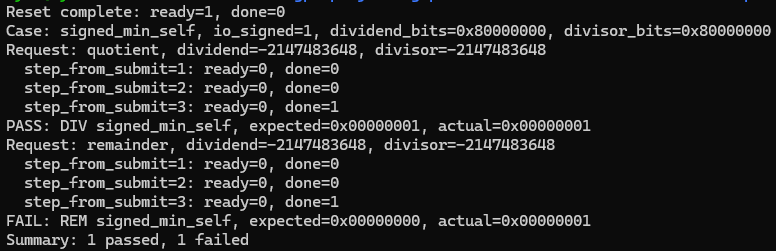

两次请求都在第 3 个推进周期观察到 `done=1`，测试在这个有效窗口读取结果。独立波形进一步显示，内部余数幅值原本为 `0`，负数符号恢复将它算成了 `12`，随后右移两位得到 `3`，再右移一位得到最终输出 `1`。这与 Agent 静态报告中指出的补偿量问题一致。[逐周期复现日志 (line 8)](https://github.com/Kyle0401/Kyle0401.github.io/blob/main/papers/ucagent/references/divider-min-self-reproduction.log#L8) · [内部波形记录](https://github.com/Kyle0401/Kyle0401.github.io/blob/main/papers/ucagent/references/divider-min-self-waveform-evidence.json)

真实 UCAgent 实验完成后发现了一项可复现的 RTL 缺陷。

| 项目         | 本机结果                                    |
| ------------ | ------------------------------------------- |
| 工作流       | 31 个阶段完成，3 个条目跳过                 |
| 完整测试重放 | 65 passed，1 failed，包含环境和参考模型自检 |
| 功能覆盖     | Agent 定义的 67/67 个 CK 均命中             |

> [!TIP]
>
> **这三个条目在启动时就被配置为跳过。**我这次沿用了固定版本的默认设置，没有开启它们。
>
> | 条目                          | 原本做什么                                                   | 为什么跳过                           |
> | ----------------------------- | ------------------------------------------------------------ | ------------------------------------ |
> | **8.1 人工检查 env 规格说明** | 由人工审阅测试环境的设计：提供哪些接口、怎样处理边界条件     | 上游默认 `SKIP_ENV_HUMAN_CHECK=true` |
> | **8.8 人工检查 env 实现质量** | 由人工检查驱动、采样等实现是否符合设计，以及代码质量         | 同一个开关，默认跳过                 |
> | **17 代码行覆盖率分析与提升** | 查看未覆盖的代码行，补充测试，再检查是否达到目标；默认目标是 90% | 上游直接设置了 `skip: true`          |
>
> 这里的 **env 是测试环境**，负责连接 DUT 端口、驱动输入、推进时钟和采样输出。前两项跳过的是专门的**人工审阅**环节；环境本身仍然完成了实现和自动自检。
>
> 第三项也要区分：**采集覆盖数据**与**根据未覆盖代码反复补充测试**是两项工作。本次采集了数据，但没有执行这个专门的覆盖率提升阶段。它是在启动时被关闭的，并非运行后因为覆盖率达标才跳过。
>
> 所以，这次结果应表述为：**完成了启用的 31 个阶段，另外 3 个按默认配置跳过。**两个人工审阅环节不能记作“检查通过”，后续独立复核也不能替代这项记录。

> [!NOTE]
>
> | 数字                      | 统计对象                               | 回答的问题                         |
> | ------------------------- | -------------------------------------- | ---------------------------------- |
> | **67 个 CK**              | 覆盖模型定义的检查点                   | 哪些场景需要触及？实际命中了哪些？ |
> | **66 个 pytest 测试实例** | 实际执行的测试，包括环境和参考模型自检 | 哪些测试执行后通过或失败？         |
>
> **测试与 CK 可以是多对多关系：一个测试可以关联多个 CK，同一个 CK 也可以被多个测试触及。**
>
> 本次就有一个具体例子：[test_power_boundaries() 第 41 行 (line 41)](https://github.com/Kyle0401/Kyle0401.github.io/blob/main/papers/ucagent/references/test_IntegerDivider_boundary.py#L41)关联了四个 CK：
>
> ```
> test_power_boundaries()           ← pytest 统计为一项测试
>     ├─ CK-POWER-DIVISOR
>     ├─ CK-POWER-NEIGHBORS
>     ├─ CK-POWER-SIGNED
>     └─ CK-POWER-MIN-DIVISOR
> ```
>
> 这个函数内部运行了多组输入。只要最后的断言失败，pytest 就将**整个测试实例计为 1 failed**；不会按四个 CK 分别计四次测试结果。
>
> 因此，本次两个结果应分别读成：
>
> - **65 passed、1 failed**：66 个测试实例中，65 个通过，1 个失败。
> - **67/67 CK 命中**：定义的 67 个检查点都记录到了对应场景。
>
> 其中，`MIN / MIN` 场景已经发生，所以对应 CK 可以命中；但它的余数算错了，所以包含它的测试仍然失败。**CK 命中数与测试通过数没有一一对应关系。**

失败输入是**两个最小负数相除**：

```
有符号运算：-2147483648 / -2147483648
预期：商 = 1，余数 = 0
实际：商 = 1，余数 = 1
```

因为 `被除数 = 商 × 除数 + 余数`，这里的余数应当为 **0**。独立手写驱动和波形检查也复现了错误。

具体程序在 [test_IntegerDivider_boundary.py 第 39 行 (line 39)](https://github.com/Kyle0401/Kyle0401.github.io/blob/main/papers/ucagent/references/test_IntegerDivider_boundary.py#L39)。可以沿着三处阅读：

1. **第 48—49 行**：构造包含 `MIN / MIN` 的输入组合。
2. **第 7—17 行**：分别取得参考模型的 `expected` 和 RTL 仿真的 `actual`，比较后收集错误。
3. **第 51 行**：`assert errors == []`。发现余数不符，因此断言失败。

这也把前面两个概念联系起来了：**覆盖命中说明场景发生过；结果比较才能判断该场景的行为是否正确。**所以 `67/67` 与 `1 failed` 可以同时出现。

工作流完成则表示验证产物、测试执行和缺陷报告已完成。本次 Agent 保留了失败断言，并交付了复现证据，因此验证任务可以完成，DUT 仍有待修复。
