# Towards Developing High Performance RISC-V Processors Using Agile Methodology

[英文原文 PDF](./paper.pdf) · [中文译文 PDF](./paper-zh.pdf)

## 1 摘要及验证基础

摘要开头指出了两项障碍：

1. **缺少支持复杂处理器敏捷开发的工具链和框架。** 做出一个设计之后，还需要把仿真、验证、性能评估和调试衔接起来。
2. **传统验证方法不够敏捷，成为开发瓶颈。** 设计可以频繁修改，但检查修改是否正确的过程，也必须跟上。

我们先抓住第二点。原文说：

> The conventional verification methods are less agile

这里的 *verification*，你可以先理解成：**检查处理器的行为是否符合规定。**

假设你修改了处理器，让它能同时执行更多指令。修改完成后，你需要得到两类反馈：

- **功能反馈**：程序的计算结果还正确吗？
- **性能反馈**：执行同样的任务，是否真的更快了？

如果改设计只花一天，检查和定位问题却花一周，那么每次尝试新设计，都要等待很久才能决定下一步。这里把“敏捷”先理解为：**每次做一个可检查的改动，尽快得到反馈，再据此继续修改。**

作者提出的 **MINJIE，就是支持这个过程的开发平台**，集成了设计、验证、性能建模和调试等工具；**香山则是用这个平台开发的处理器**。摘要中，作者用两代香山展示平台的用法和有效性。

比如，同一段程序、相同输入，预期计算结果是 `42`。两个处理器版本的时钟频率相同：

| 版本     | 实际计算结果 | 执行所需周期 |
| -------- | ------------ | ------------ |
| 修改前 A | 42           | 100          |
| 修改后 B | 43           | 80           |

**B 的计算结果不符合预期，功能检查失败了**，所以少用 20 个周期还不足以说明修改成功。A 输出了 `42`，也只能说明它**通过了这一次检查**，还不能保证它执行其他程序都正确。

例子里，`42` 是我们事先知道的答案。但真实程序可能执行几百万条指令，人工很难逐条计算。因此，可以让一个**参考模型（Reference Model，简称 REF）** 执行同样的程序，提供用于比较的行为。

理解两个角色：

- **DUT：待测设计**，也就是我们正在检查的处理器。
- **REF：参考模型**，按照指令集规定执行程序，作为比较依据。

例如，同一段加法程序，REF 算出 `42`，DUT 算出 `43`，我们就发现了不一致。这建立在参考模型适合这个测试、双方输入和初始状态一致的前提下。

参考模型和待测处理器的流水线结构和周期数可以不同。不过“只要最终输出相同”还不够。

我们现在讨论的是 **ISA（指令集）级功能验证**：检查处理器执行指令时，是否产生了指令集规定的效果。

原文第 **II-B 节**中，作者把这种检查所比较的结果定义为**架构状态（architectural states）**，举例包括通用寄存器和程序计数器 PC。它们比“程序最后打印了什么”包含更多信息。

例如，把 `r` 当作一个寄存器，程序依次执行：

```
第 1 条：r = 1
第 2 条：r = r + 1
第 3 条：r = 0
```

假设记录到：

| 检查位置    | REF 中的 r | DUT 中的 r |
| ----------- | ---------- | ---------- |
| 第 1 条之后 | 1          | 1          |
| 第 2 条之后 | 2          | 3          |
| 第 3 条之后 | 0          | 0          |

**最后都是 `0`，但 DUT 中途算错了，错误又被后面的赋值覆盖了。** 只检查最终结果，就会漏掉这个问题。

因此，一种基本做法是：**按程序执行进度对齐，在对应指令提交后比较架构状态。**“提交”先理解为这条指令的结果被正式确认生效。REF 和 DUT 到达这个位置所花的周期数可以不同。

## 2  引言与背景

抓住一个关键问题：**设计能快速生成新版本，验证怎样才能跟着变化？**

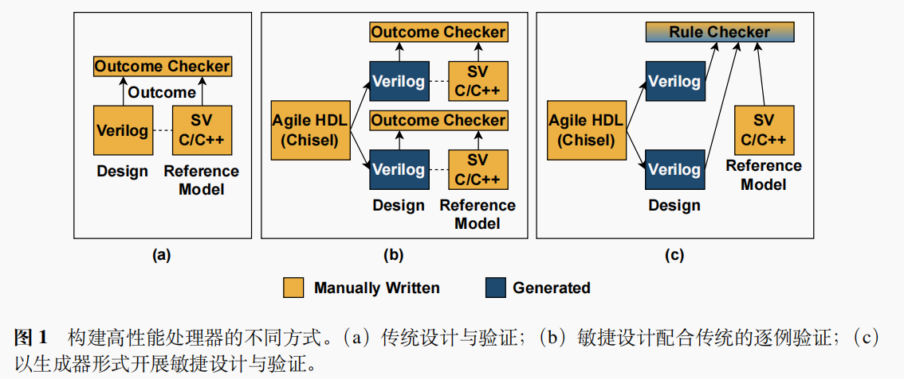

先看图例：**黄色代表人工编写，蓝色代表生成。** 三幅图展示了作者希望推动的变化。

**图 1(a)：围绕一个具体设计搭建验证。**

左边是工程师编写的 Verilog 设计，右边是用 SystemVerilog、C/C++ 等语言编写的参考模型，上方的检查器比较双方结果。

这种方式能够有效工作，但验证代码往往与这个设计的接口、内部组织和行为细节紧密相关。

**图 1(b)：设计生成变快，验证仍然逐个适配。**

这里出现了 Chisel：**编写一个能够生成硬件的程序，通过参数和结构变化，得到不同的 Verilog 电路。**

论文在 II-C 有一句关键表述：

> agile development encourages maintaining generators

意思是，敏捷开发鼓励维护能够产生不同设计实例的“生成器”。

问题随之出现：图中的一个 Chisel 设计可以生成多个 Verilog 版本，但右边的参考模型和检查代码仍需要分别适配。因此，**生成一个新设计很快，为它恢复可靠的验证环境却可能很慢。**

II-C中作者明确指出了两种负担：

- **行为适配**：不同实现的微架构细节可能导致不同的合法行为，REF 需要妥善处理这些差异。
- **接口适配**：上层 HDL 的小改动可能引起生成 Verilog 的明显变化，使原有验证连接或代码失效。

注意，这已经超出了前面练习的“找到第一个寄存器错误”：现在的问题是，**验证框架本身怎样经得住设计反复变化。**

**图 1(c)：让验证也具备复用和生成能力。**

右边可以看到，多个设计连接到同一个参考模型和规则检查器。作者希望做到：

- 用稳定的规范规则，处理不同设计允许存在的行为差异。（III-A：DRAV）
- 让验证所需的信息接口随设计生成，减少手工维护连接的工作。（III-B3：Information probes）

这两条分别引向后面的 **DRAV 方法**和 **DiffTest 的信息探针机制**。参考模型、规则仍需要工程师正确建立，自动生成主要帮助降低适配成本。

再看 **II-D、II-E**，作者把视野扩展到验证之后的反馈过程：

| 开发中的困难                                 | 对迭代的影响                     | 后文对应方法            |
| -------------------------------------------- | -------------------------------- | ----------------------- |
| 设计变化后，模型和验证接口需要适配           | 验证环境维护耗时                 | DRAV、DiffTest          |
| 为定位错误而记录大量波形、日志               | 仿真明显变慢                     | LightSSS                |
| 性能模型与真实 RTL 存在差距，而 RTL 评估又慢 | 难以及时判断设计修改是否值得保留 | NEMU 与检查点等评估流程 |

其中，论文报告：**在作者的香山实验中，开启波形和日志等调试信息，会使软件 RTL 仿真性能下降约 12 倍**。这是该实验的观察值。它解释了为什么“发现错误之后怎样高效调试”，也值得单独设计工具。

到这里，引言和背景的逻辑就接上了：**MINJIE 要缩短从修改设计，到获得可信反馈的整个过程。**

## 3 **利用** **MINJIE** **平台实现敏捷工作流程**

### 3.1 **基于差异规则的敏捷验证（DRAV）**

这一节要理解的是：**REF 给出的某一个结果，未必是规范允许的唯一结果。**

先读图 3 上方的两条路径。


理解这幅图，需要先认识三个概念：

- **PTE（页表项）**：记录地址映射、访问权限等信息。
- **TLB／页表遍历**：处理器查找虚拟地址对应的物理地址。
- **Store Retire 与 Store Complete**：存储指令已退役，和它的写入已对这里的地址翻译过程生效（内存中的 PTE 更新了，之前缓存的旧翻译信息仍可能保留），是不同的时间点。

论文讨论的是：**页表更新之后，尚未通过相应的 `sfence.vma` 建立地址翻译同步的场景。**

图中更新页表项的存储指令已经退役，但接下来可能有两种先后顺序：

| 路径   | 事件顺序                                      | 结果         |
| ------ | --------------------------------------------- | ------------ |
| 路径 1 | 页表更新生效 → 页表遍历看到新信息             | 指令正常执行 |
| 路径 2 | 页表遍历先取得旧的无效信息 → 页表更新随后生效 | 触发缺页异常 |

**两条路径在论文描述的条件下都可能合法。** 路径 2 中，**后来**的页表更新**不会自动**改写先前已经取得的翻译信息。

简单的 REF 往往没有 DUT 的存储队列（SQ）、推测性地址翻译等细节，可能直接走正常执行路径。因此：DUT 触发缺页异常，而 REF 没有触发，单凭这处不一致，不能立即认定 DUT 有错误。

这就是 III-A 开头例子要说明的**微架构依赖问题**。

> [!TIP]
>
> 页表是放在内存中的数据结构，记录“虚拟页映射到哪个物理页、具有什么访问权限”等信息。操作系统内核负责建立和修改这些映射，例如：
>
> - 程序第一次访问某个尚未分配物理页的虚拟地址，内核分配物理页并建立映射。
> - 写时复制发生时，内核分配、复制物理页，并修改相应映射。
> - 内核撤销映射或修改访问权限。
>
> 因此，普通程序写一个变量，通常是在写数据；**内核写页表项，则是在修改以后怎样访问这些数据的规则。**
>
> 论文这个例子可以先理解为：
>
> ```
> 旧页表项：V=0，映射无效
> 新页表项：V=1，指向已分配的物理页，并设置好所需权限
> ```
>
> **`sfence.vma` 用来同步页表更新与地址翻译。**
>
> 它是特权指令的汇编助记符，通常**由内核使用**。下面是示意性的 RISC-V 64 位汇编：
>
> ```
> sd         t0, 0(t1)     # 把新页表项写入 t1 指向的位置
> sfence.vma x0, x0        # 同步当前 hart 的地址翻译状态
> ```
>
> 其中，`t0` 放新页表项，`t1` 指向要修改的页表项。
>
> 你可以把第二条的作用理解为：**让之后的相关地址翻译正确衔接之前的页表更新，并使相关旧翻译缓存失效**。这里两个操作数都是 `x0`，覆盖当前 hart 的所有虚拟地址和地址空间。它作用于当前硬件线程，其他核需要另外协调。 [RISC-V 规范 §11.1.2.1](https://docs.riscv.org/reference/isa/v20260120/priv/supervisor.html)
>
> **再看 Store Retire 与 Store Complete。**
>
> | 图中的事件                     | 在这个例子中的含义                                           |
> | ------------------------------ | ------------------------------------------------------------ |
> | **Store Retire：存储指令退役** | 处理器正式确认这条存储指令（就是这条 Store 指令在指令层面的 Commit（提交／退役））；写请求仍可能留在存储队列或写缓冲中。 |
> | **Store Complete：存储完成**   | 页表写入已经对相关的页表内存读取可见。                       |
>
> 所以，**“这条写指令已经退役”和“页表遍历已经能从内存读到新值”之间，可以存在时间差。**

**接着读 III-A 右栏下部的公式。**

作者将 REF 表达为：
$$
R:S_P\times E\rightarrow 2^{S_P}
$$
这里最关键的是右端的
$$
2^{S_P}
$$
：它表示状态的**集合**。直观地说，规范可能**允许多个**后继状态。

因此，**验证目标**可以概括为：
$$
\text{DUT 实际得到的下一架构状态} \;\in\; \text{规范允许的后继状态集合}
$$
这句话是对论文公式的解释。工程实现通过 **diff-rules（差异规则）** 表达允许的行为，无须机械地枚举整个状态集合。

**再看图 3 的两条规则如何落地。**

图中明确列出：

1. **Rule (i)**：即使 REF 不触发缺页异常，DUT 也可以触发。
2. **Rule (ii)**：在对应执行进度上，DUT 与 REF 仍应具有一致的架构状态。

图中下半部分数据大致**从下往上流动**，上方的检查流程再**从左往右执行**：

```
DUT 内部信号
    ↓
探针采集：提交信息、异常信息、寄存器状态
    ↓
① 判断本次执行路径
    ├─ 异常处理 → ②
    └─ 正常执行 → ③
    ↓
④ 比较双方架构状态
    ├─ 一致 → 继续
    └─ 不一致 → ⑤ 报错
```

**先看最底部：Probe Definition，探针定义。**

例如：

```
class DifftestInstrCommit extends DifftestBaseModule(...)
```

这是 Chisel／Scala 代码，用于定义一种验证信息接口。你可以先把它理解为：“我要设计一种探针，用规定的格式，向验证框架报告指令提交信息。”

这里还只是定义探针类型，接下来要把具体探针放进 DUT，并接上真实信号。

**中间四个 Probe Instantiation，就是实例化并连接探针。**

| 探针              | 报告什么                             | 上方怎样使用                        |
| ----------------- | ------------------------------------ | ----------------------------------- |
| `InstrCommit`     | 哪些指令有效提交了                   | 决定正常情况下让 REF 执行多少条指令 |
| `ArchEvent`       | 发生了什么异常或中断                 | 决定是否走异常处理分支              |
| `CSRState`        | 控制与状态寄存器的值，例如 `mstatus` | 用于状态比较                        |
| `ArchIntRegState` | 架构整数寄存器的值                   | 用于状态比较                        |

看图中的异常探针：

```
val diff = Module(new DifftestArchEvent)
diff.io.cause := Mux(csr.exception.valid, causeNO, 0.U)
```

这两行可以这样读：

- `Module(new DifftestArchEvent)`：在设计中实例化一个异常事件探针。
- `:=`：把右侧信号连接到左侧。
- `Mux(条件, 值A, 值B)`：条件成立选 A，否则选 B。
- 因此，有有效异常时，探针的 `cause` 输出异常原因 `causeNO`。

**这一步是在报告 DUT 发生的事情，还没有控制 REF**。另外，完整接口需要异常有效性信息，不能只用 `cause` 是否为零判断有没有异常；图中省略了部分字段。

**接着看①：Execution Path Check，执行路径检查。**

这里已经进入仿真主机上的 C/C++ 验证程序：

> [!TIP]
>
> 这里的“仿真”指整套仿真验证过程。就我们当前讨论的软件 RTL 仿真而言，DUT 和 REF 都运行在仿真主机上。
>
> ```
> 你的电脑／服务器（仿真主机）
> │
> ├─ DUT 的 RTL 仿真模型
> │   模拟香山的流水线、ROB、TLB、Cache 等电路
> │          ↓ 探针报告提交、异常、寄存器等信息
> │
> ├─ DiffTest 验证程序
> │          ↕ 驱动 REF、比较双方状态
> │
> └─ REF：例如 NEMU
>     按照 RISC-V 指令集执行同一份测试程序
> ```

```
if (dut.event.exception)
    do_exception();                  // 转到②
else
    do_instr_commit(commit_num);      // 转到③

do_compare();                        // 然后进入④
```

解释：

- `dut.event.exception`：检查 DUT 报告的异常事件。
- 有异常，就执行异常处理流程。
- 没有异常，就按正常提交信息推进 REF。
- **最后的 `do_compare()` 在 `if/else` 外面，所以两条分支之后都要比较状态。**

这也是图中 Rule (i) 与 Rule (ii) 能同时成立的原因：允许特定的路径差异，协调之后仍然检查状态。

**没有异常时，走③：Normal REF Execution。**

```
ref->exec(commit_num);
```

这里：

- `ref` 表示验证框架中用于控制参考模型的接口。
- `->` 是 C/C++ 通过指针访问成员的语法。
- `exec(commit_num)` 表示让 REF 执行指定数量的指令。

例如，在这个无异常的简化情形中，DUT 本次提交了两条指令，框架便让 REF 执行对应的两条指令，然后比较双方状态。

这里的 `commit_num` 是**指令数量**，不是 REF 要运行多少个时钟周期。

**有异常时，走②：Page Fault Check。**

图中写的是：

```
if (is_pf(dut.event.exception))
    ref->exception_hint(cause);
```

先看第一句：

```
is_pf(...)
```

`pf` 是 page fault，即缺页异常。这句话是在判断：**DUT 报告的异常是不是这里要处理的缺页异常。**

然后才调用：

```
ref->exception_hint(cause);
```

把它翻译成人话就是：“REF，DUT 在这里遇到了原因是 `cause` 的缺页异常。对于论文允许的这类执行差异，请据此处理相应异常路径。”

> [!TIP]
>
> RISC-V 把缺页异常分成三类：
>
> | 异常编号 | 类别                   | 发生在哪种访问中       |
> | -------- | ---------------------- | ---------------------- |
> | `12`     | Instruction page fault | 取指令时               |
> | `13`     | Load page fault        | 读取数据时             |
> | `15`     | Store/AMO page fault   | 写数据或原子内存操作时 |
>
> 而同一类别又可能有不同的具体成因，例如：
>
> - 页表项无效：`V=0`。
> - 页表规定的**权限**不允许这次访问，例如向只读页写入。
> - 页表项存在非法编码或不满足规定的格式要求。
>
> 这些分类和检查规则由 [RISC-V 特权规范](https://docs.riscv.org/reference/isa/priv/supervisor.html)规定。
>
> 例如，**读取数据时，映射无效和页表读权限不足，都可能产生 `cause=13`**。所以只看到 `13`，还不能确定是哪一种具体问题。

所以，`cause` 是**异常原因信息**，不是“哪个 RTL 模块写错了”的调试结论。

而 `exception_hint` 是**验证端调用参考模型的接口**，不是 DUT 执行的一条 RISC-V 指令，也不是内核调用的函数。

仅凭这幅简图，不能认定接口调用的瞬间就完成了全部异常处理；完整实现还需要足够的异常上下文及状态转移逻辑。图中是在概括它的功能。

**用刚才的页表例子，看为什么需要这个调用。**

假设双方都执行到了同一条访存指令：

| 情况         | DUT                                | REF                              |
| ------------ | ---------------------------------- | -------------------------------- |
| 尚未协调     | 使用旧的无效翻译信息，触发缺页异常 | 使用新映射，原本可以正常完成访存 |
| 如果直接比较 | 已进入异常处理路径                 | 仍沿普通程序路径运行             |
| 经过异常协调 | 继续处理这个缺页异常               | 根据提示处理对应的异常路径       |

如果直接比较，双方的 PC、异常相关状态等就可能不同，即使 DUT 走的是规范允许的路径，也会被当成错误。

异常提示的作用，就是**让双方比较同一执行进度、同一异常事件处理后的状态**。

它并不是把 DUT 的全部寄存器复制给 REF，再宣布相同。

**最后看④和⑤：状态比较与报错。**

```
if (memcmp(dut_state, ref_state, cmp_size))
    return ERROR;
```

`memcmp` 比较两个状态对象的指定字节范围：

- 返回 `0`：这一范围内的数据相同。
- 返回非零：存在差异，因此进入⑤报错。

这里比较的是双方导出的架构状态对象，具体包含什么由接口定义；不能把它理解为比较了全部 CPU 内部状态或整个内存。

因此，即使 REF 接受了异常提示，**被比较的寄存器、CSR 等状态仍然可能出现不一致，并被检查器发现**。

还有一个边界需要保留：图中的规则针对论文讨论的合法差异，不是“DUT 报任何异常，REF 都无条件照做”。论文在 III-B2c 还讨论了重复异常检测和模块级验证，补充这种抽象下的检查能力。图中的代码也只是流程示意，完整实现还要处理同周期多条提交、提交与异常并存等情况。

图3中间的 `ref->exception_hint(cause)` 很关键：它通知 REF 跟随这个异常路径，随后继续比较架构状态。**允许路径存在特定差异，后续状态检查仍然保留。**

这也带来论文强调的验证边界：系统级检查会信任部分 DUT 事件。作者在 III-B2c补充了重复异常检测、模块级验证等措施，降低宽松规则造成漏报的风险。

DRAV 对敏捷开发的价值由此体现：**多个符合相同规范的处理器实现，可以复用同一种 REF 和规则体系，减少逐个追随微架构细节的维护工作。** 这就是文中的 **N-to-1**。

### 3.2 DiffTest：面向 RISC-V 处理器的 DRAV

#### 3.2.1  **概述**

接下来的 **III-B1：DiffTest 概述**把方法接到实现：探针报告 DUT 的提交、异常等信息，检查器据此协调 REF，并检查状态。

一节开头说：

> DiffTest is a co-simulation based verification framework…

即：**DiffTest 是基于联合仿真的验证框架。**

前面的 **DRAV 提供验证方法**：根据规范，用规则处理不同实现允许存在的差异。这里的 **DiffTest 则把这套方法落到 RISC-V 处理器验证中**，组织 DUT、参考模型、探针和检查器共同运行。

先看图 4：

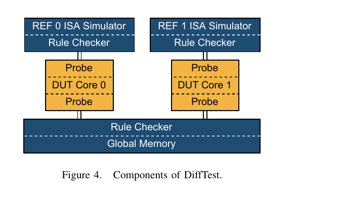

**先沿左边这一列读，相当于先看一个核心怎样验证。**

| 图中的部分              | 作用                                           |
| ----------------------- | ---------------------------------------------- |
| **DUT Core 0**          | 被验证的处理器核心                             |
| **Probe**               | 从 DUT 采集提交、异常、状态等信息              |
| **Rule Checker**        | 根据规则判断怎样推进 REF，以及哪些状态需要比较 |
| **REF 0 ISA Simulator** | 执行参考行为的指令集模拟器                     |

这里新出现的 **ISA Simulator（指令集模拟器）**，把之前抽象的 REF 具体化了：它是一种软件模型，按照指令集规定解释执行机器指令，并维护寄存器、PC 等状态。

它需要正确表达指令的功能，但**无需复刻 DUT 的流水线、发射队列和每条指令的周期耗时**。因此，双方可以用不同的内部实现执行同一个程序，再由框架协调比较。

**再对照 III-B1 的第二段，理解这个框架怎样运行。**

作者描述：探针每个周期获取 DUT 的信息并交给检查器。这里要区分：

- **采集信息可以逐周期进行。**
- **推进 REF、比较状态，要围绕提交和异常等事件进行对齐。**

所以，某个周期 DUT 没有提交指令，不代表 REF 必须执行一条；某个周期 DUT 提交多条，REF 也可能需要推进对应的多条指令。这与我们前面讲的“按执行进度比较”一致。

检查器面对两类情况：

| 情况                   | 处理方式                         |
| ---------------------- | -------------------------------- |
| 普通、确定性的指令行为 | 推进 REF，直接检查应当一致的结果 |
| 规则明确覆盖的合法差异 | 根据规则协调 REF，再检查后续状态 |

前面图 3 的缺页异常提示，就是第二类。**协调必须有规范和规则依据；普通计算错误仍然应当报错。**

原文还强调 **on-the-fly**，即可以在运行过程中调整 REF 对相关事件的处理方式。这减少了为每种 DUT 都详细重建微架构模型的成本。

**最后看右边一列和底部。**

右边是另一个核心及其对应的 **REF 1**。因此：

> 多核验证时，各个核心有自己的 REF 实例；不同设计又可以复用同一种 REF 实现。

这与前面的 **N-to-1** 并不冲突：那里强调模型实现的复用，这里展示运行时的多个实例。

底部的 **Global Memory** 是验证侧的共享内存模型。它根据 DUT 的访存信息辅助检查**多核**之间的数据行为。作者在 **III-B2b** 展开它怎样帮助单核 REF 应对其他核心的写入。

#### 3.2.2 **非确定性行为与差异规则**

##### 3.2.2.1 推测性虚拟地址转换

**内存屏障（memory barrier／fence）是一类为访存操作建立顺序约束的处理器指令。**它告诉 CPU：屏障两侧的某些操作，必须满足规定的**先后关系**。

为什么需要它？因为 CPU 有乱序执行、写缓冲等机制，**程序中写在前面的访存，不一定按同样的顺序对其他核心产生可观察的效果**。屏障用于明确哪些顺序必须保留。

例如，下面是示意：

```
写入 A
fence w, w
写入 B
```

`w` 表示写操作。这里的 `fence w, w` 为前后的写建立顺序约束：**把写 A 排在写 B 之前**。具体怎样实现这个约束，由 CPU 决定。[RISC-V 的 FENCE 说明](https://docs.riscv.org/reference/isa/unpriv/rv32.html)

不过，我们当前讨论的页表场景，需要区分两种指令：

| 指令             | 主要约束什么                                             |
| ---------------- | -------------------------------------------------------- |
| **`fence`**      | 普通内存读写、设备访问之间的顺序，具体范围由参数决定     |
| **`sfence.vma`** | 页表更新与后续地址翻译之间的同步，并使相关旧翻译缓存失效 |

所以，在当前例子中：

```
内核更新 PTE
      ↓
sfence.vma
      ↓
后续相关地址翻译正确衔接这次更新
```

**这里的“屏障”不是另一次写页表操作，而是对“页表已经更新，翻译硬件接下来应怎样使用它”作出同步要求。**`sfence.vma` 本身针对当前 hart；多核之间还需要另外协调。[RISC-V 的 SFENCE.VMA 说明](https://docs.riscv.org/reference/isa/priv/supervisor.html)

**先解释“为什么暂时不执行屏障”。**

这里真正需要同步的是**页表映射的更新**，物理页分配本身只是前面的准备动作。

以“旧 PTE 无效，新 PTE 建立了有效映射”为例，RISC-V **允许**软件延迟执行 `sfence.vma`。其思路可以理解为：

```
内核更新 PTE，建立新映射
           ↓
暂时不主动执行 sfence.vma
           ↓
后续访问该虚拟页
  ├─ 使用了新映射 → 正常完成
  └─ 仍使用旧的无效信息 → 缺页异常
                             ↓
                      内核补做翻译同步
                             ↓
                         重试访问
```

所以，“直到发生缺页异常”表达的是：**先尝试继续运行，确实因为旧翻译信息发生异常时，再补做同步**。如果访问直接成功，就省掉了这次主动同步。这种延迟处理是规范针对特定映射变化允许的策略。[RISC-V 特权规范中的延迟执行说明](https://docs.riscv.org/reference/isa/v1.11/_attachments/riscv-privileged.pdf)

**“指令冲刷”说的是可能付出的流水线代价。**

流水线冲刷可以理解为：让已经取出或推测进行的一部分指令工作作废，之后重新进行。作者想表达的是，**主动同步可能干扰流水线**，因此希望减少这种开销。

> [!TIP]
>
> **因为流水线依靠“多条指令重叠执行、提前做准备”提高速度，而同步会限制这些提前进行的工作，有些工作还需要取消或重做。**
>
> 看这个示意顺序：
>
> ```
> ① 写入新 PTE
> ② sfence.vma
> ③ 访问该 PTE 对应的虚拟页
> ```
>
> 程序虽然按这个顺序排列，但在②完成同步之前，处理器内部可能已经启动了相关的**推测性页表遍历**。如果①的更新尚未被它看到，它可能拿到了旧 PTE。
>
> 此时，处理器必须保证：**这些旧查询结果不能在同步完成后，又被当成有效的新结果使用或填回翻译缓存。**
>
> 为保证这一点，实现上可能需要：
>
> | 处理方式                               | 可能的性能代价                       |
> | -------------------------------------- | ------------------------------------ |
> | **等待**相关在途翻译结束，再处理其结果 | 部分后续工作需要暂停                 |
> | **取消**可能过期的翻译请求             | 已经做过的工作被丢弃，之后重新查询   |
> | 使相关翻译缓存项**失效**               | 后续访问可能需要重新查页表、回填缓存 |
>
> RISC-V 规范就明确讨论了：实现可以终止相关推测性遍历，或者等待其完成后，再使相应缓存结果失效。[RISC-V 官方规范](https://docs.riscv.org/reference/isa/priv/supervisor.html)
>
> 所以，“干扰流水线”指的是这些**等待、减少并行和重做工作的开销**。具体处理器也可能选择冲刷部分后续指令，但规范并不要求每次 `sfence.vma` 都清空整条流水线，因此用了“**可能**”这个词。

但这里需要准确区分：**`sfence.vma` 的规范作用是地址翻译同步；具体需要怎样等待、清理在途操作或重启流水线，由处理器实现决定**。不能把这句话理解成清空指令缓存，更不是删除内存中的程序代码。

论文的参考文献 52 对应的是 `vmalloc_fault` 这条特定缺页处理路径，代码会在其中执行 `local_flush_tlb_page(addr)`。[对应的 Linux 源码](https://raw.githubusercontent.com/torvalds/linux/bf587caae305ae3b4393077fb22c98478ee55755/arch/riscv/mm/fault.c)

而 Linux v5.2 的另一条页表更新路径 `update_mmu_cache()` 会主动执行同步，注释还说明这样可以减少额外异常。[Linux v5.2 页表更新代码](https://raw.githubusercontent.com/torvalds/linux/v5.2/arch/riscv/include/asm/pgtable.h)

因此，这句话适合用来理解**一种延迟同步的场景**，不能记成“Linux 每次建立新映射后都不执行屏障”。

**再看“TLB 访问内存”。**

**“TLB 访问内存”通常是在概括 TLB 缺失后，由页表遍历器读取内存中页表的过程**。前面那句“延迟执行屏障”，则需要加上具体场景的限定。

严格一点说，TLB 是**缓存翻译信息的结构**；实际读取内存中页表的，通常是 MMU 中的 **PTW（Page Table Walker，页表遍历器）**。

在香山中，典型过程是：

```
指令需要翻译虚拟地址
        ↓
查询一级 TLB
        ↓ miss
查询二级 TLB／页表缓存
        ↓ 仍然 miss
PTW 读取内存系统中的页表项
        ↓
得到翻译结果，或发现无效映射／权限问题
```

香山南湖文档明确写到：一级 TLB 缺失后请求二级 TLB，二级也缺失时，使用硬件页表遍历器访问内存中的页表。[香山 MMU 总体架构](https://docs.xiangshan.cc/projects/design/zh-cn/nanhu/memory/mmu/mmu/)

这里“读内存”也不表示每次都直读 DRAM；页表项的读取可以经过缓存层次。

你可以据此分清两个概念：

| 情况           | 含义                                                 |
| -------------- | ---------------------------------------------------- |
| **TLB miss**   | 没找到所需的缓存翻译，需要进一步查表                 |
| **Page fault** | 翻译过程中发现无效映射、权限不足等问题，需要异常处理 |

**TLB miss 本身不等于缺页异常**。完全可能只是翻译没缓存，查完有效页表后就正常访问了。

论文还讨论了**推测性页表遍历**：硬件可能提前查表并保存结果。因此，图 3 中旧的无效 PTE 信息，可以在真正使用它的访存指令到来之前就被取得。这正是后来内存中的 PTE 已更新，实际访问却仍可能触发缺页的原因。

##### 3.2.2.2 **缓存层次结构与多核场景**

**这一段新增的困难是：某个核心的 Load，可能读到另一个核心的 Store。**

图 4 中，每个核心都有对应的单核 REF。但 REF 主要跟随本核执行指令，两个核心却会通过**共享内存**交换数据。因此，仅仅把两个单核检查器放在一起，还需要**处理跨核写入**的影响。

原文提到 **RVWMO——RISC-V 弱内存序模型**：它规定多核程序允许出现**哪些**访存观察结果；存储缓冲、缓存和具体执行时序，决定本次运行出现其中哪一种结果。

**先把存储缓冲区的作用接上。**

 Store 提交后，写请求可能仍留在缓冲中。此时，**本核**后续的 Load 如果满足条件，可以直接从前面的**同地址** Store 取得数据，即 **Store-to-Load Forwarding，存储到加载的前递**。

所以，两个核心在接近的时间读取同一个位置，可能看到不同的值。

下面用一个简化时序说明。假设共享位置 `X` 初始为 `0`，只有核 0 写它，均使用普通、同宽且对齐的访存。

| 顺序 | DUT 中发生的事情                                    | 可以出现的结果             |
| ---- | --------------------------------------------------- | -------------------------- |
| ①    | 核 0 执行 `Store X=1`，指令已提交，写请求仍在缓冲中 | 其他核心尚未看到这次写入   |
| ②    | 核 0 随后读取 `X`                                   | 从自己的写缓冲前递得到 `1` |
| ③    | 核 1 此时读取 `X`                                   | 仍然读到 `0`               |
| ④    | 核 0 的写请求随后进入缓存层次                       | 验证端获得相应写入信息     |
| ⑤    | 假设核 1 后来某次读取已经观察到新值                 | DUT 读到 `1`               |

注意④只是论文所说的一个**跟踪事件**，不能据此认定所有核心立刻都能看到 `1`；⑤是我们选定的这次运行中的结果。

**REF 为什么可能跟不上⑤？**

- **REF 0** 已执行过本核的 `Store X=1`，其局部内存可以反映这个值，因此能解释核 0 自己读到 `1`。
- **REF 1** 没有执行核 0 的 Store，其简单的局部内存模型可能仍保存 `X=0`。

> [!TIP]
>
> 这里的“局部内存”指的是 **每个单核 REF 内部维护的、用来模拟内存的软件状态**。叫“REF 自己的模拟内存”会更直观。

于是，在⑤这个位置可能出现：

```
DUT 核 1：Load X，读到 1
REF 1：   Load X，读到 0
```

这次不一致，可能来自 **REF 1 尚未反映其他核心的写入**，而非 DUT 把 Load 算错了。

**这时，图 4 底部的 Global Memory 就派上用场。**

论文说，它记录 DUT 中**进入缓存层次结构的 Store 请求**，作为**跨核数据检查**的依据。

当单核 REF 与 DUT 的 Load 结果不同时，框架会：

1. 查询 Global Memory 中相应地址的信息。
2. 按规则检查 DUT 读到的值，是否可以由其他硬件线程的写入解释。
3. 如果满足这套规则，就更新该 REF 的**局部内存**和**本次 Load 的目标寄存器**，让后续检查继续进行。

在这个例子中，若相应检查通过：

```
REF 1 的局部内存：X 更新为 1
REF 1 本次 Load 的目标寄存器：更新为 1
随后继续执行、检查
```

这里更新目标寄存器也有必要，因为后续指令可能立即使用这个 Load 的结果。

这是**特定差异规则授权的处理**，不能推广为“任何值只要曾被某个核写过，就都可以接受”。

**这一小节最后还补充了缓存本身怎样检查。**

作者希望从缓存与核心之间的**事务**入手，减少对缓存内部实现细节的依赖，主要提出两类规则：

| 检查机制                                | 关注的问题                                                   |
| --------------------------------------- | ------------------------------------------------------------ |
| **总线协议规则**                        | 当前情况下收到的请求、响应或数据传输，是否符合协议允许的行为 |
| **权限记分牌（permission scoreboard）** | 跟踪各数据块的缓存权限，检查相关操作是否满足权限约束         |

因此，Global Memory 为 Load 的数据来源提供依据；事务规则检查协议行为；权限记分牌检查缓存权限。它们共同补充多核验证，各自承担不同的检查任务。

##### 3.2.2.3 其它非确定性来源

这一节重点是：**接受 DUT 报告的某些事件后，REF 怎样继续检查，以及这样做会留下哪些验证边界。**

作者先列出一些在**系统级 REF** 中省略或简化的细节：

- 大多数内存映射 I/O 设备的内部实现。
- 外部中断的产生来源。
- LR/SC 指令使用的保留集。
- 宏指令融合、性能计数器读取等。

这些行为可能受到外部输入或微架构时序影响。作者选择接受 DUT 提供的部分事件信息，让 REF 据此处理，再比较后续架构状态。

原文对此用了很直接的说法：

> the DUT is trusted to trigger the corresponding events

也就是：**在选定的事件上信任 DUT**。因此，要看清它信任了什么、仍然检查什么。

**论文用 SC 失败举例。先认识 LR/SC。**

它们是配合使用的**原子访存指令**：

| 指令                      | 作用                                                         |
| ------------------------- | ------------------------------------------------------------ |
| **LR：Load-Reserved**     | 读取数据，并建立覆盖目标数据的保留状态                       |
| **SC：Store-Conditional** | 尝试条件写入；成功返回 `0`，失败返回非零值，失败时本次不写入内存 |

其他核心仍然可以写这个位置，这类写入可能使保留失效。SC 也可能因实现相关原因失败，不能把失败直接等同于“另一个核修改了数据”。[RISC-V LR/SC 规范](https://docs.riscv.org/reference/isa/unpriv/a-st-ext.html)

下面是一个**递增共享数据**的示意。假设 `a0` 指向对齐的 64 位数据：

```
retry:
    lr.d  t0, (a0)       # 读取旧值，并建立保留
    addi  t1, t0, 1      # 计算新值
    sc.d  t2, t1, (a0)   # 尝试写入；t2 保存成功/失败状态
    bnez  t2, retry      # 失败则重新尝试
```

这里的 **SC 失败是指令正常返回失败码**，并不意味着处理器出了错误，也不是缺页异常。

**DUT 与 REF 的分歧发生在保留状态上。**

真实 DUT 需要维护这份状态。简单的 REF 如果没有复刻相同的内部机制，就可能作出不同选择。

论文举的具体情况是：**LR 与 SC 之间发生超时，DUT 上的 SC 因而失败，但 REF 原本可能成功**。这里的“超时”是作者举出的实现相关原因，不是说所有 RISC-V 处理器都有统一的超时周期数。

如果不协调，就可能出现：

| 本次 SC 的结果   | DUT          | REF 原本的行为 |
| ---------------- | ------------ | -------------- |
| 返回状态         | 失败，非零   | 成功，`0`      |
| 对目标内存的写入 | 本次不写入   | 写入新值       |
| 后续分支         | 返回 `retry` | 继续向下执行   |

后面的执行路径很快就不同了。

论文的处理方式是：**把 DUT 的这次 SC 失败通知 REF，让 REF 同样按照失败语义处理。**

“按照失败语义”包含两件事：

1. 产生相应的失败返回值。
2. 本次 SC 不执行目标内存写入。

然后再检查后续架构状态。仅仅修改返回寄存器、却保留 REF 成功写入的内存结果，是不够的。

**这里确实存在验证上的取舍。**

接受 DUT 的失败结果，省去了在系统级 REF 中精确重建保留机制的成本；但也意味着：**这项系统级检查不能独立确认 DUT 每一次保留失效都正确。**

例如，一个错误实现频繁让 SC 失败，如果 REF 每次都跟随失败，双方可能一直一致，程序却不断重试。

所以，紧接着的下一段补充了两项措施：

- **跟踪次数与程序位置**。对强制协调的缺页异常、SC 失败记录出现次数和位置，用断言检查反复出现的情况，降低漏报风险。本段没有展开具体阈值，不能据此推导出“SC 最多只能失败几次”的 ISA 规定。
- **增加模块级验证**。针对具体模块使用更细的规则。论文举的是 TLB：系统级允许某些合法缺页差异，模块级再依据 TLB 的设计规范进行更细致的检查。

另外，规范对满足条件的受约束 LR/SC 循环有前进保证；允许某次 SC 失败，并不等于允许在受保证的情形下一直无法前进。[RISC-V 前进保证说明](https://docs.riscv.org/reference/isa/unpriv/a-st-ext.html)

#### 3.2.3 信息探针

**这一节解决的是验证代码的维护成本。**

上一小节讨论：怎样让 REF 不必复刻全部微架构细节。现在的问题发生在 DUT 一侧——**设计经常变化，验证框架怎样持续取得正确的信息？**

作者描述的传统做法是：验证工程师了解检查需求，再进入设计中寻找信号，编写 monitor 或 adapter，也就是监视器或适配器。

例如，要报告一条指令是否提交，就必须找到真正表示提交的信号。设计改动后，信号名称、层级或组织方式可能变化，原来的连接便需要维护。

论文选择让**熟悉实现细节的设计人员负责定义并连接探针**。设计人员知道哪些信号具有需要的含义；检查器通过探针提供的统一格式获取信息。

**自动生成能够减少什么工作？**

原文接下来讲 Chisel 的代码生成功能：

1. 定义一个信号束，说明各字段的类型和方向。
2. 根据定义，自动生成可以实例化的探针模块。
3. 在设计中实例化探针，将 DUT 的实际信号连接进去。

回看图 3：

```
val diff = Module(new DifftestInstrCommit)
diff.io.valid := io.commits.valid(i)
```

第一行使用生成的探针模块；第二行将第 `i` 个提交槽位的有效信号连接到探针。

这里需要分清：**接口结构可以自动生成，字段含义、采样位置和连接是否正确，仍由设计人员负责。**

只要接口语义保持一致，检查器就能继续使用这种信息。DUT 内部重新组织后，设计人员可能需要调整连接，但不必因此重写整套检查逻辑。

**不同提交宽度，为什么可以使用同一种探针？**

看英文第 7 页以 **“To maintain the compatibility of probes…”** 开头的段落。

作者没有把指令提交探针设计成“某个固定宽度处理器的一整组提交信息”，而是让**一份基础探针描述一条指令的提交信息**。需要报告多条，就**重复实例化**。

下面用两个**假设**配置说明，数字不是论文给出的具体实验配置：

| 配置                | 提交探针实例数 | 某周期各槽位的 `valid` | 该周期实际提交 |
| ------------------- | -------------- | ---------------------- | -------------- |
| 最多每周期提交 2 条 | 2              | `1, 0`                 | 1 条           |
| 最多每周期提交 6 条 | 6              | `1, 1, 1, 0, 0, 0`     | 3 条           |

两种设计使用的是**同一种基础信息格式**，区别在实例数量和连接方式。

这也对应《**香山开源高性能 RISC-V 处理器设计与实现**》里学过的区别：**最大提交宽度与某个周期的实际提交数量不同**。框架还需要正确关联各槽位的提交顺序、所属核心等信息。

原文提到，探针的**函数调用数量**能够传递**提交宽度信息**。读这句话时，应当结合实例组织和有效性理解，不能把某一拍的**有效**事件数直接当成处理器的最大宽度。

**探针采集的信息，也可以用于调试。**

本节最后介绍 **ArchDB**：它使用 SQLite 存储和解析探针获得的信息，数据表可以依据探针定义生成，再用于筛选和可视化事件。

它与《**香山开源高性能 RISC-V 处理器设计与实现**》中第六章里读过的数据库式调试思路类似。例如，假设选择记录了访存事件的地址、数据和时间信息，就可以按地址筛选记录，追查某次错误之前发生过什么。

这里的自动化主要是让**记录结构与探针定义保持一致**；实际记录哪些事件，仍取决于采集配置和有效条件，**并不意味着每次仿真都会保存全部内部信息**。

### 3.3 LightSSS：按需调试

这一节要解决的是：**平时让仿真尽量快地运行，发现错误后，又能取得错误发生前的详细记录。**

**先读图 5，比较四种办法。**

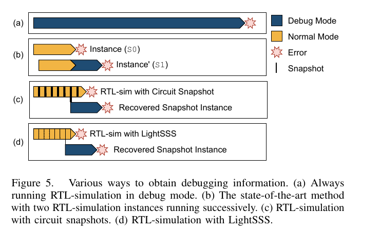

图例中，黄色是普通模式，蓝色是调试模式，红星是报错，竖线表示快照。

| 方案                   | 怎样获得错误附近的记录                                       | 主要成本                                     |
| ---------------------- | ------------------------------------------------------------ | -------------------------------------------- |
| **(a) 全程调试**       | 从开始就记录波形、日志                                       | 整段仿真都承受记录开销                       |
| **(b) 两个错开的实例** | 领先实例先发现错误，落后实例开启记录后继续运行，直到复现     | 持续运行两份仿真，计算资源需求大             |
| **(c) 电路状态快照**   | 定期保存状态，出错后恢复近期快照并**补录**（从快照重新运行，并在这次运行时开启波形、日志等详细记录） | 保存**完整状态**本身耗时，状态越大，负担越重 |
| **(d) LightSSS**       | 定期保留**轻量**进程快照，出错后从近期快照重放并记录         | 利用**共享和写时复制**，减少重复复制         |

图 5(b) 的正文存在 S0、S1 先后关系的标号矛盾。理解工作原理时，按“**领先实例发现错误，落后实例补录**”来看即可。

全程记录为什么代价大？论文举出的香山实验中：

- 开启波形后，仿真速度**降至**原来的 **约 8.5%**。
- 导出文本日志，仿真速度下降 **约 55%**，也就是剩下约 45%。

这些都是文中的实验结果。因此，作者希望只在需要分析的那段区间开启详细记录。

**普通电路快照为什么仍然不够轻？**

看 III-C2。作者自己的 SSS 方案保存：

- DUT 的**完整**电路状态；
- DiffTest 所需的验证状态，例如 REF 的**模拟内存**。

这两部分需要**一起恢复**：如果 DUT 回到了过去，而 REF 留在后来的状态，双方便无法继续正确对齐。

随着模拟内存从 256 MB 增大到 16 GB，反复保存完整状态，会带来更大的内存或 I/O 压力。作者报告，这种 SSS 方案的性能开销为 **17%**。

另外，仿真还可能连接外部 C/C++ 模型，例如内存时序模型。逐个为这些模型编写保存、恢复逻辑，也增加了维护工作。

**LightSSS 将整个仿真进程作为快照对象。**

这是 III-C3 的核心设计。

软件 RTL 仿真本身是运行在主机上的程序。被模拟的寄存器、缓存、内存及相关模型状态，都以软件数据的形式存在于仿真进程中。

因此，LightSSS 周期性调用主机 Linux 的 `fork()`，将**派生出的子进程**保留为快照。

这里要分清：**`fork()` 发生在仿真主机上，复制的是仿真程序的进程状态。**

Linux 的写时复制机制使父子进程最初共享物理内存页。当继续运行的进程修改某个共享页时，再为它产生**新的副本**：

```
快照保留旧页中的内容
继续运行的仿真进程使用修改后的新页
没有修改的页仍然共享
```

这样，相邻快照中**没有变化的大量内容就不必反复复制**。

`fork()` 仍需要复制主机进程的页表、建立进程管理结构；后续写时复制也有成本。它**省下的是立即复制整份私有内存内容的工作**。[Linux `fork()` 文档](https://man7.org/linux/man-pages/man2/fork.2.html)

这也解释了论文所说的 **circuit-agnostic，与电路细节无关**：对于进程地址空间中保存的 DUT、REF 和模型状态，可以利用同一种进程机制保留，减少逐个设计保存格式的需求。它并不等于保存了整个外部运行环境。

**为什么保留两个快照，并从较旧的一个重放？**

论文设定每隔 \(N\) 个模拟周期生成一次快照，只保留最近两个。

假设报错时有：

```
较旧快照 A                最新快照 B          报错
   2N ─────── N 周期 ─────── 3N ─── δ 周期 ─── 3N+δ
                                        0 ≤ δ < N
```

从较旧的 A 重放到报错点，需要：

$$
N+\delta \leq 2N
$$
选择较旧快照，是因为**最新快照可能离报错点太近，留下的错误前记录太短**。从较旧者开始，能够获得更长的前史，同时将重放范围限制在约 2N 个模拟周期内。

但这只是重放窗口的范围，不能保证真正根因一定在这段窗口中。《**香山开源高性能 RISC-V 处理器设计与实现**》里学过的数据库式历史追踪，仍然有它的用途。

**最后读 III-C4 和图 6，看作者怎样验证开销。**

作者主要检查两个问题：

1. 创建进程快照要花多少时间？
2. 后续修改内存、触发写时复制，会增加多少仿真时间？

文中报告，一次 `fork()` 耗时 **535 μs**，而创建一次前述完整 SSS 快照需要 **3.671 秒**。这里比较的是一次快照创建的耗时，不能直接当作整个仿真的加速倍数。

接着看图 6：

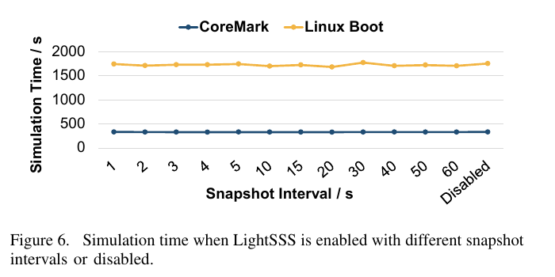

- 横轴：快照间隔，单位为**主机时间的秒**；`Disabled` 表示关闭快照。
- 纵轴：完成测试所需的仿真运行时间，单位也是秒。
- 蓝线：单核香山运行 CoreMark。
- 橙线：双核香山启动 SMP Linux。

在作者的 Ryzen 5950X、8 线程实验条件下，不同间隔和关闭快照时，两条曲线的变化都很小。这支持了作者的判断：**在这些测试中，LightSSS 的快照维护成本较低。**

注意，图 6 的“1～60 秒间隔”，与前面算法说明中的“\(N\) 个模拟周期”是不同计量口径，不能混用。

> [!TIP]
>
> 这里有两种不同的时间：**被模拟的 CPU 推进了多少周期，以及运行仿真的电脑实际经过了多少秒。** 注释 1
>
> | 表述                  | 数的是什么                    |
> | --------------------- | ----------------------------- |
> | 每隔 \(N\) 个模拟周期 | DUT 的模拟时钟推进了 \(N\) 次 |
> | 每隔 1 秒             | 主机实际运行了 1 秒           |
>
> RTL 仿真需要用软件计算电路状态，**主机运行一秒，不代表被模拟的 CPU 也运行了“一秒钟的周期数”。**
>
> 例如，按论文报告的仿真速度估算：
>
> - 单核测试约 **5.1 kHz**：主机每秒推进约 **5100 个模拟周期**。
> - 双核测试约 **2.4 kHz**：主机每秒推进约 **2400 个模拟周期**。
>
> 所以，同样是“每隔一个主机秒保存快照”，对应的模拟周期数可能不同；换算需要知道当时的**仿真速度**。

### 3.4 NEMU：用于性能评估的快速解释器

**NEMU 是一个按照指令集规则执行程序的软件模型。**

论文称它为 **instruction set interpreter，指令集解释器**。

以前我们说 REF“按照 RISC-V 指令语义执行”，NEMU 就可以承担这个角色。它在自己的进程中保存一套被模拟的状态，例如：

- PC：当前执行到哪个 RISC-V 指令地址；
- 通用寄存器：`x0`～`x31` 的值；
- CSR：异常、特权状态等相关寄存器；
- 模拟内存：程序指令和数据。

这些都是软件保存的数据。

以论文使用的 x86 主机为例，实际发生的是：

```
x86 CPU 执行 NEMU 程序
        ↓
NEMU 读取 RISC-V 机器指令
        ↓
根据指令含义，更新模拟的寄存器、PC、内存等状态
```

所以，一台 x86 电脑也能借助 NEMU 执行 RISC-V 程序。

**“解释一条指令”具体做什么？**

例如，用汇编表示的一条指令：

```
addi x5, x6, 1
```

NEMU 读到的是它的机器编码。译码后知道：

```
操作：加立即数
源寄存器：x6
立即数：1
目的寄存器：x5
```

随后读取**模拟的** `x6`，计算结果，再写入**模拟的** `x5`。假设这是普通 32 位指令、没有异常，PC 就前进到下一条。

因此，一个基本解释器可以按下面的循环工作：

```
根据 PC 取指令
    → 译码
    → 执行对应操作
    → 更新状态及 PC
    → 处理下一条指令
```

这里无需让这条 `addi` 真的经过香山的译码器、重命名、保留站、执行单元和 ROB。

**这正是 NEMU 与 RTL 仿真的主要区别。**

| 比较项         | NEMU 在这里的工作                  | 香山 RTL 仿真的工作                  |
| -------------- | ---------------------------------- | ------------------------------------ |
| 依据           | 指令集规定的**功能语义**           | 具体硬件设计的电路逻辑               |
| 推进方式       | 执行指令，更新模拟状态             | 随时钟推进电路状态                   |
| 需要表达的内容 | 指令结果、异常和相关架构状态       | 流水线、队列、缓存及其交互等实现行为 |
| 本篇中的用途   | 提供功能参考、快速执行和生成检查点 | 检查具体设计，并测量其周期行为       |

NEMU 可以省去大量**微架构细节**，因此有条件运行得很快。但它的解释执行速度，**不能直接当作香山处理器的 IPC、主频或程序运行时间**。

**III-D 开头说明了 NEMU 的两种用途。**

第一种是已经熟悉的：**作为 DiffTest 的 REF。**

```
同一个测试程序
    ├─ 在 DUT 的 RTL 仿真中执行
    └─ 在 NEMU 中执行
             ↓
      框架对齐事件、检查架构状态
```

NEMU 提供参考行为，DiffTest 负责协调、应用差异规则和检查。二者承担的任务不同，不能把整个验证框架都称为 NEMU。

第二种是：**帮助准备性能评估。**

在《**香山开源高性能 RISC-V 处理器设计与实现**》里已经读过检查点和 SimPoint。这里 NEMU 的作用是快速执行程序、收集执行特征，并**生成架构检查点**，供后续详细仿真使用。

大致流程是：

```
NEMU 快速执行、收集信息并生成检查点
                  ↓
        RTL 仿真恢复选定检查点
                  ↓
          进行微架构预热
                  ↓
        测量周期数等性能指标
```

需要预热，是因为**架构检查点不等于香山完整的微架构状态**。恢复寄存器和内存之后，缓存、分支预测器等还需要通过执行**逐步建立相应状态**。

这与刚读过的 LightSSS 也有区别：

- **LightSSS 的进程快照**保存某次具体仿真的相关状态，用于从附近重放错误。
- **这里的架构检查点**主要表达 **ISA 层面的程序状态**，服务于后续仿真和性能评估。

**理解这些用途后，再看作者为什么优化 NEMU。**

作为 REF，它会被验证框架频繁调用；作为检查点生成工具，它又可能需要执行很长的程序。解释器自身太慢，就会拖累这些工作。

即使省去了流水线模拟，基本解释循环仍然有成本：循环中的同一条指令，可能被反复取指、译码，再寻找执行它的代码。

图 7 接下来介绍的 **软件 uop cache 和 threaded code**，就是**为了减少这些重复工作**。

（插入实践1）

#### 3.4.1 NEMU设计

##### 3.4.1.1 使用 uop cache 优化取指与译码

**作者首先减少的是重复译码。**

你刚执行的这条指令：

```
addi t1, t0, 3
```

NEMU 译码之后，已经知道：

| 信息           | 内容                             |
| -------------- | -------------------------------- |
| 源寄存器位置   | 从模拟的 `t0` 读取               |
| 立即数         | `3`                              |
| 目的寄存器位置 | 写入模拟的 `t1`                  |
| 执行例程       | 使用实现“加立即数”操作的那段代码 |

假如程序进入循环，以后再次执行同一个地址的这条指令，只要指令和相关译码条件没有变化，这些信息就可以复用。

因此，论文中的 **uop cache 保存译码结果**，而普通指令缓存主要保存指令本身。

执行流程可以简化为：

```
第一次遇到这条指令：
取指 → 译码 → 保存译码结果 → 执行

再次遇到，且缓存有效并命中：
取得缓存中的译码结果 → 执行
```

**缓存的寄存器位置，与寄存器当前值要分清。**

对于上面的 `addi`，可以缓存“源是 `t0`，立即数是 3，目的为 `t1`”。但每次执行时，仍要读取 `t0` 的当前值。

如果以后 `t0` 变化了，结果也必须随之变化，不能一直复用第一次算出的 `8`。

图 7 中，缓存条目与 `CPU.GPR` 之间的连接，就体现了这种关系：**条目保存怎样执行这条指令的信息，`CPU.GPR` 保存不断变化的模拟寄存器值。**

> [!TIP]
>
> 如**真实 RISC-V CPU 中的 `x6`，由指令中的寄存器编号选中。**
>
> 但 NEMU 是软件，需要用变量保存“模拟的 `x6` 当前是多少”。例如，可以用数组表示：
>
> ```
> uint64_t GPR[32];   // 示意：保存32个模拟寄存器的值
> GPR[6] = 5;        // 模拟的 x6 当前为5
> ```
>
> 这个数组位于**运行 NEMU 的主机内存中**，所以：
>
> - `GPR[6]`：模拟的 `x6` 的值，这里是 `5`。
> - `&GPR[6]`：存放这个值的主机内存位置。`&` 表示取地址。
>
> 图7的addi例程中的两条指令就是先取位置，再取数值：
>
> ```
> mov 0x30(%rbx), %rcx   # 取得源寄存器变量的地址，例如 &GPR[6]
> mov (%rcx), %rcx       # 按这个地址读取内容，得到5
> ```
>
> 可以画成：
>
> ```
> uop条目的源操作数字段
>     保存：&GPR[6]
>              ↓ 指向
>     主机内存中的 GPR[6]
>              内容：5
> ```
>
> 目的寄存器也一样：先取得保存模拟目的寄存器值的位置，再把计算结果写进去。
>
> 因此，**`x6` 是被模拟的寄存器；`&GPR[6]` 是 NEMU 用来保存它的主机内存地址**。图 7 中的 `CPU.GPR` 就是这套软件状态。

我的实践版本中也能看到相同思路，在minjie/NEMU/src/cpu/cpu-exec.c:754源码里：

```
查询当前 PC 对应的译码缓存
    ├─ 未命中：取指、译码，并保存结果
    └─ 命中：使用已有译码结果
然后调用对应执行例程
```

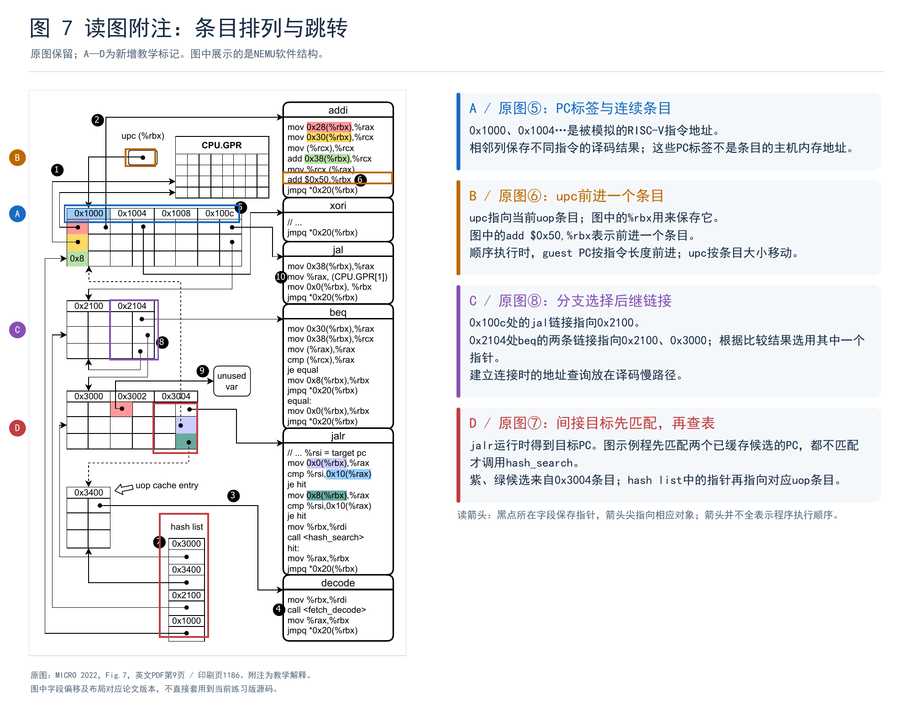

**先看 A、B，区分 PC 和 upc。**

蓝框中的 `0x1000、0x1004、0x1008、0x100c`，是被模拟的 **RISC-V 指令地址**。每一**列**则保存相应指令的**译码结果**。

> [!TIP]
>
>  `0x1000、0x1004、0x1008…` 是**被模拟指令的 PC 标签，不是 upc 自己的地址**。这两种地址前进的步长不同。
>
> 例如，假设这些条目在主机内存中从 `0x70000000` 开始存放：
>
> | 条目中记录的 RISC-V PC | 条目在主机中的地址，即 upc 可指向的位置 |
> | ---------------------- | --------------------------------------- |
> | `0x1000`               | `0x70000000`                            |
> | `0x1004`               | `0x70000050`                            |
> | `0x1008`               | `0x700000a0`                            |
> | `0x100c`               | `0x700000f0`                            |
>
> 右列地址是为了说明关系而设定的，并非论文给出的真实地址。
>
> - **左列每次加 4**：因为这几条 RISC-V 指令各占 4 字节。
> - **右列每次加 `0x50`，即 80**：因为图示实现中，一份译码条目的步长是 80 字节。
>
> **条目保存的内容，比原始指令编码多得多**。它包含 PC、源／目的寄存器指针、立即数、执行例程入口、后继条目链接等信息，因此不只是原来的 4 字节机器码。
>
> 所以，原文的：
>
> ```
> upc + 1
> ```
>
> 表示“前进一个条目”。类似 C 语言的结构体指针 `p++`：增加的字节数由结构体大小决定。
>
> **80 字节来自这份 NEMU 实现的数据结构布局，并非 RISC-V 规定**。图中的 `add $0x50, %rbx` 显示了这个条目步长；论文没有在图中完整列出全部字段，不能仅凭图逐项核算出其完整布局。

所以，NEMU 面对两种不同的位置：

- **guest PC**：程序执行到哪条 RISC-V 指令。
- **upc**：解释器当前使用哪个 uop cache 条目。

实践一中单步时，PC 每次增加 4，是因为测试里的指令都是 4 字节。图中还出现了 `0x3000 → 0x3002 → 0x3004`，说明客体指令地址也可能每次只前进 2 字节。

但是，**缓存条目按照自身的布局排列，并不跟着指令长度一起变大变小。**

原文所说的 `upc + 1`，应理解为：

```
当前条目 → 下一个条目
```

图右上角的：

```
add $0x50, %rbx
```

就是图示实现中“前进一个条目”的动作：`%rbx` 保存条目指针，增加 `0x50` 字节，也就是 80 字节。**这里的“加一项”与“字节地址加一”不同**。这个大小只对应图中的实现，不能直接套到当前练习版源码。

> [!TIP]
>
> **这里同时涉及两种指令集：被模拟的程序使用 RISC-V，运行 NEMU 的主机使用 x86。** 注释 1
>
> 图 7 右侧展示的是 **NEMU 执行例程在 x86 主机上的代码**：
>
> | 图中的内容                                | 属于哪一层                              |
> | ----------------------------------------- | --------------------------------------- |
> | `addi`、`beq`、`jalr`                     | 要模拟的 RISC-V 指令                    |
> | `mov`、`add`、`jmpq`，以及 `%rax`、`%rbx` | 主机执行 NEMU 时使用的 x86 指令和寄存器 |
>
> 例如，NEMU 中有一段代码负责实现 RISC-V `addi` 的行为。这段执行例程经过主机编译器编译，就形成图中的 x86 代码。运行时，NEMU 找到这段例程，让它更新**模拟的 RISC-V 寄存器状态**。
>
> 因此：
>
> ```
> add $0x50, %rbx
> ```
>
> 是在操作**主机的 `%rbx` 寄存器**。图示实现用它保存 `upc`，这条指令让指针前进一个缓存条目。
>
> ```
> RISC-V 指令：addi x5, x6, 1
>              ↓ 译码
> uop 缓存条目：
>   源寄存器 x6 在哪里
>   目的寄存器 x5 在哪里
>   立即数是多少
>   使用哪个执行例程
>              ↓
> x86 执行例程：
>   读取模拟的 x6 当前值
>   加上立即数
>   写入模拟的 x5
>   推进条目指针、继续执行
> ```
>
> 因此，对照图看：
>
> - **左边一列列的表项**：保存“这条指令要做什么、操作数在哪里、交给哪段代码执行”。
> - **右边标着 `addi`、`beq` 等名称的代码框**：实际完成这些操作的 x86 主机代码。
>
> 而 `add $0x50, %rbx` 属于例程中的**解释器管理工作——推进 `upc`**。
>
> addi例程中的前五条指令合起来，就是完成 RISC-V `addi` 的操作：读取源寄存器的值，加上立即数，再写入目的寄存器。
>
> 逐行看：
>
> | 指令                   | 在这里做什么                                        |
> | ---------------------- | --------------------------------------------------- |
> | `mov 0x28(%rbx), %rax` | 从条目中取出**目的寄存器的地址**，放进 `rax`        |
> | `mov 0x30(%rbx), %rcx` | 从条目中取出**源寄存器的地址**，放进 `rcx`          |
> | `mov (%rcx), %rcx`     | 按照这个地址，读取**源寄存器当前的值**，放进 `rcx`  |
> | `add 0x38(%rbx), %rcx` | 读取条目中保存的立即数，加到 `rcx` 中，得到结果     |
> | `mov %rcx, (%rax)`     | 将结果写到 `rax` 指向的位置，也就是模拟的目的寄存器 |
>
> `%rbx` 指向当前的 uop 缓存条目。`0x28(%rbx)` 表示**访问主机内存中 `rbx + 0x28` 这个位置的内容**；括号表示通过地址访问内存。

**为什么把条目连续排列？**

在一个基本块内部，指令通常顺序执行。NEMU 将相关译码条目连续组织后，执行完一条，可以直接移动到下一条，减少反复根据 PC 查找条目的工作。

但遇到跳转，就不能只向后移动一格了。

**再看 C：用指针直接连接后继条目。**

原文称这种办法为 **block chaining，基本块链接**。

对于已经建立并保持有效的连接，条目中可以保存后继条目的指针。运行时得到实际分支结果后，选择相应指针即可。

图中：

- `0x100c` 处的 `jal` 有一条指向 `0x2100` 条目的链接。
- `0x2104` 处的 `beq` 画出了两条后继链接，分别指向 `0x2100`、`0x3000`。

这里选择后继时，解释器已经比较了寄存器的实际值。**这是根据实际分支结果选择路径。**

建立这些连接时需要的查询，放在**译码的慢路径**中；连接建立以后，**重复执行**便能**直接**使用它们。

读图时要注意：原图主要说明数据结构，没有提供一份完整的可执行程序，不能仅凭这些地址和连线还原全部程序布局。

**最后看 D：间接跳转需要根据运行时目标查找。**

`jalr` 的目标来自运行时计算，可能每次不同。因此，需要将：

```
目标 RISC-V PC
      ↓ 查询
对应的 uop cache 条目位置
```

图中还做了一层优化：

1. 先比较两个已缓存候选条目中的 PC。
2. 如果某个候选与目标 PC 相同，直接使用该条目。
3. 两个都不匹配，再调用 `hash_search` 查询。

因此，正文说间接跳转使用散列表，而右侧代码又先做了两次比较，两者是一套流程中的不同步骤。

图里的箭头也要按这个含义读：**黑点所在字段保存指针，箭头尖指向对象**。它可能指向寄存器、执行例程或后继条目，并不全都表示程序执行顺序。

这一小节中的优化都在减少重复工作：缓存译码结果、顺序移动条目、复用已建立的链接。缓存容量用完或发生相关系统事件时，仍然可能需要清理、重新建立条目。

接下来两小节说明：**哪些工作可以提前在译码时完成，从而减少执行时的开销。**

##### 3.4.1.2 写入零寄存器

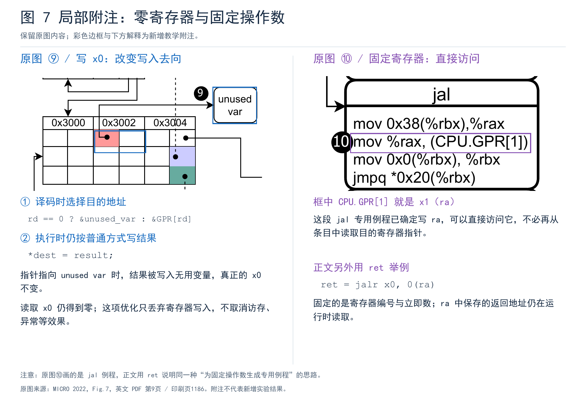

RISC-V 的 `x0` 有一个特殊规定：读取它永远得到零，写入它的结果会被丢弃。

解释器需要用软件实现这个规定。论文提到两种常见做法：每次写寄存器前判断目的寄存器是不是 `x0`，或者每条指令执行后都把 `x0` 恢复成零。这些操作很小，但解释器执行大量指令时，它们会**不断重复**。

NEMU 的处理方式是：**在译码时，就决定结果应该写到哪里。**

用简化的 C 代码表示：

```
// 译码时：保存目的位置的指针
dest = (rd == 0) ? &unused_var : &GPR[rd];

// 执行时：直接通过指针写结果
*dest = result;
```

这里的 `&` 表示“取地址”。如果目的寄存器是 `x0`，`dest` 就指向一个**无用变量**；否则，指向真正的目的寄存器。

所以图⑨中，红色字段里的指针指向了右侧的 **unused var**。结果照常计算、照常写入，只是写入的位置不会影响程序的寄存器状态。

这个变量即使被写成了 `123` 也无所谓：**读取 `x0` 时，仍然读取真正的恒零寄存器，不会读取这个无用变量。**

结合上一节的 uop cache，就能看出收益：译码结果被缓存以后，下次执行这条指令，可以**继续使用已经确定的目的指针**，执行例程里无需再判断一次 `rd == 0`。

还要注意，丢弃寄存器结果并不意味着可以跳过整条指令。例如：

```
ld x0, 0(t0)
```

它仍然需要执行访存，并保留可能发生的异常。

##### 3.4.1.3 伪指令与压缩指令

这里作者进一步利用的是：**有些指令的操作数，本来就已经固定了。**

正文举的例子是：

```
ret
```

它是下面这条指令的汇编简写：

```
jalr x0, 0(ra)
```

其中三个操作数都受到约束：

| 操作数          | 已经确定的信息                |
| --------------- | ----------------------------- |
| 目的寄存器 `rd` | 固定为 `x0`，丢弃**链接**地址 |
| 源寄存器 `rs1`  | 固定为 `ra`，即 `x1`          |
| 立即数 `imm`    | 固定为 `0`                    |

通用的 `jalr` 执行例程要适应各种目的寄存器、源寄存器和偏移。识别出 `ret` 后，NEMU 就可以选择一个专用例程，直接访问 `ra`，省去部分通用操作。

**固定的是“使用 ra 这个寄存器”，ra 中保存的返回地址仍然要在运行时读取。** 不同函数调用的返回地址可以不同。

这里也解释一下图⑩：**正文用 `ret` 举例，图中实际画的是一个目的寄存器固定为 `ra` 的 `jal` 专用例程。** 紫框中的：

```
mov %rax, (CPU.GPR[1])
```

表示将结果直接写入 `CPU.GPR[1]`，也就是 `ra`。它已经知道目的寄存器是谁，可以直接访问这个位置。

**压缩指令**也能采用类似方法：部分寄存器或操作数由编码**隐含确定**，专用例程可以利用这些约束。区别在于，`ret` 是汇编简写，而压缩指令有真实的 **16 位指令编码**。

##### 3.4.1.4 浮点指令

作者的思路是：**利用运行 NEMU 的主机本身具有的浮点运算能力。**

例如，被模拟的 RISC-V 程序执行：

```
fadd.s f0, f1, f2    # 单精度浮点加法：f0 = f1 + f2
```

NEMU 可以读取模拟寄存器 `f1`、`f2` 中的值，通过 C 语言的 `float` 加法计算，再更新模拟寄存器 `f0`。编译 NEMU 时，这段 C 运算会被编译成主机的浮点指令。

因此，实际发生的是：

**RISC-V 浮点指令 → NEMU 中的执行例程 → 主机浮点运算 → 更新模拟状态。**

对于更复杂的运算，作者举了调用数学库的例子：使用 `fma()` 实现融合乘加。融合乘加计算 `a×b+c`，中间的乘积不先单独舍入，最终结果统一舍入。实际模型还需要处理舍入模式、异常标志、NaN 等规则。[RISC-V 浮点规范](https://docs.riscv.org/reference/isa/v20260120/unpriv/f-st-ext.html)

当前的实践配置是 `FPU_NONE`，还没有启用浮点运算。

#### 3.4.2 评估

接下来，作者开始检验前面那些优化的实际效果。下面是放大并加注后的图 8：

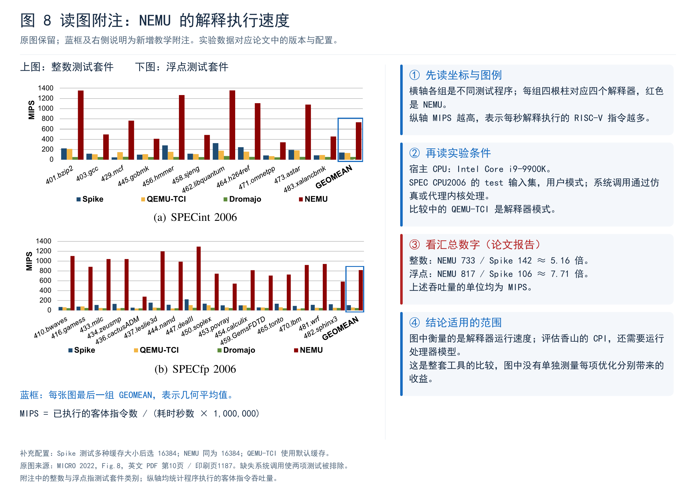

**读这张图，先认清它测量的对象：解释器执行 RISC-V 程序的速度。**

纵轴是 MIPS，即每秒执行多少百万条被模拟的指令：
$$
\mathrm{MIPS}=\frac{\text{执行的客体指令数}}{\text{耗时秒数}\times 10^6}
$$
例如，100 MIPS 表示解释器每秒执行约一亿条客体指令。这个数字描述 **NEMU 的运行吞吐量**；香山的 IPC、频率和执行周期，需要通过处理器模型获得。

图中的每组柱对应一个测试程序，四种颜色对应四个解释器。上图使用整数测试套件，下图使用浮点测试套件。**最后一组 GEOMEAN 是跨程序的几何平均值**，我用蓝框圈出了它。

> [!TIP]
>
> **几何平均值：n 个正数连乘积的 n 次方根**，一般只适用于正数；存在 0 或负数时通常无意义
>
> 简单几何平均：
> $$
> G=\sqrt[n]{x_1 \cdot x_2 \cdot \dots \cdot x_n}=\left(\prod_{i=1}^n x_i\right)^{\frac1n}
> $$
>

论文报告的汇总结果是：

| 测试套件     | Spike    | NEMU     | NEMU / Spike |
| ------------ | -------- | -------- | ------------ |
| SPECint 2006 | 142 MIPS | 733 MIPS | 约 5.16 倍   |
| SPECfp 2006  | 106 MIPS | 817 MIPS | 约 7.71 倍   |

这里的“浮点测试套件”描述程序类别，纵轴仍然统计整个程序执行的客体指令吞吐量。

理解结果时，也要读作者设置的实验条件：

- 四个解释器都运行在配备 **Intel Core i9-9900K** 的机器上。
- 使用 SPEC CPU2006 的 **test 输入集**，在用户模式下运行，系统调用通过仿真或代理内核处理。
- 比较中的 **QEMU-TCI 是 QEMU 的解释器模式**。
- Spike 尝试多种软件缓存大小后选择 16384，NEMU 的 uop cache 也采用 16384；部分缺少系统调用支持的测试被排除。

作者将浮点测试中较大的差距主要归因于：Spike 调用 SoftFloat 软件库，而 NEMU **利用了主机浮点运算**。不过，**图 8 比较的是整套解释器的最终效果**；要知道每项优化各自贡献多少，还需要逐项启用、关闭优化进行测量。

> [!TIP]
>
> **SoftFloat 是 John R. Hauser 编写、伯克利资助的开源 IEEE 754 浮点运算纯 C 软件库**，只用整数运算实现浮点数，**不依赖硬件 FPU**，是体系结构仿真、FPU 验证领域最经典的黄金参考模型。

#### 3.4.3 检查点的应用案例

这一段的核心是：**先用 NEMU 快速执行程序，保存某个位置的程序状态，再让处理器模型从这里继续执行。** 这样，研究人员就可以用较慢的 RTL 仿真重点测量感兴趣的程序片段。

沿用实践3中的循环：假设 NEMU 已经运行到 `t0=2000000`，我们希望 RTL 从这里继续。只修改 PC 还不够——`t0`、其他寄存器以及程序使用的内存，都必须对应这个执行位置。检查点保存的就是继续运行所需的这些状态。

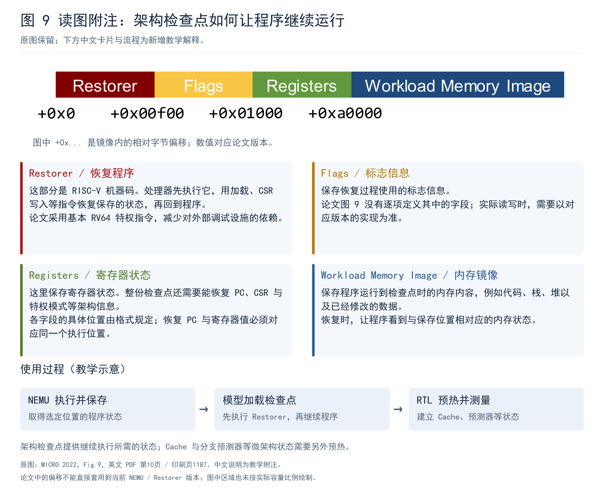

图中四个区域，可以从右往左理解。

**Workload Memory Image 是程序运行到检查点时的内存内容。** 其中包含程序代码，以及运行过程中形成的数据，例如栈、堆和已经修改的变量。它需要反映**保存时刻的状态。**

**Registers 保存寄存器状态。** 整份检查点还需要提供 PC、相关 CSR、特权模式等恢复信息。具体字段放在哪里，由对应的检查点格式规定。

**Flags 是恢复过程使用的标志信息。** 论文没有展开其中每个字段的定义，我们暂时理解它的用途即可。

**Restorer 是恢复程序，这一部分最值得注意。** 它本身是一段 RISC-V 机器码。目标处理器先执行这段程序，从检查点中读取保存的值，恢复寄存器和相关状态，然后回到原程序继续执行。

所以，实际过程是：

1. 仿真环境将检查点镜像加载到模拟内存。
2. 处理器开始执行 Restorer。
3. Restorer 恢复保存的架构状态。
4. 处理器转到保存的程序位置，继续执行。

作者强调，恢复过程采用**基本的 RV64 特权指令**，因此较早期、尚未提供外部调试功能的处理器，也能使用这种检查点。

> [!TIP]
>
> 意思是：**恢复检查点，可以让处理器自己执行一段“恢复程序”来完成，因此不必依赖专门的外部调试接口。**
>
> 恢复检查点时，需要把保存的寄存器值、PC 等状态重新放回处理器。作者采用的做法是，让 DUT 执行 Restorer，其中包含这样的操作：
>
> | 指令   | 在恢复过程中做什么                                 |
> | ------ | -------------------------------------------------- |
> | `ld`   | 从内存读取保存的值，恢复通用寄存器                 |
> | `csrw` | 写入需要恢复的控制与状态寄存器 CSR                 |
> | `mret` | 根据事先设置好的返回地址和特权状态，继续执行原程序 |
>
> 其中，`ld` 是普通加载指令；访问相关特权 CSR、执行 `mret` 则需要相应的特权级。
>
> “**外部调试功能**”指从处理器外部控制它、读写其内部状态的一套专门机制。这通常需要处理器设计额外提供调试模块和接口。开发早期，这些模块可能还没实现。
>
> 而作者的方法只要求处理器已经能够执行恢复程序所需的指令、访问内存，就能逐步恢复架构状态。因此，**调试模块还没做完，也可以开始利用检查点运行程序。**
>
> 这里的“早期处理器”指的是**处于开发早期阶段的处理器设计**。即使 DUT 是电脑上的 RTL 仿真模型，这个说法也成立：Restorer 由被模拟的 RISC-V 处理器执行。

图中的 `+0x0`、`+0x00f00` 等表示**镜像内部的相对字节偏移**。这些数值属于论文展示的版本；当前源码的布局已经有所变化。

这里需要和前面学过的 LightSSS 区分一下。**LightSSS 用 `fork` 保存仿真进程，用于之后复现错误；这里保存的是架构状态，用于让 NEMU 和处理器模型之间继续运行同一个程序。**

NEMU 没有香山的 Cache、分支预测器、ROB 等对应微架构状态。因此，恢复检查点后，处理器虽然能继续执行程序，**但 Cache 和预测器还需要通过执行一段指令来预热，然后再测量目标片段的周期。**

 **III-D3 的后两段**讲的是用 SimPoint 挑选有代表性的程序片段，让 RTL 仿真只详细测量这些片段，再**估计**整个程序的性能。

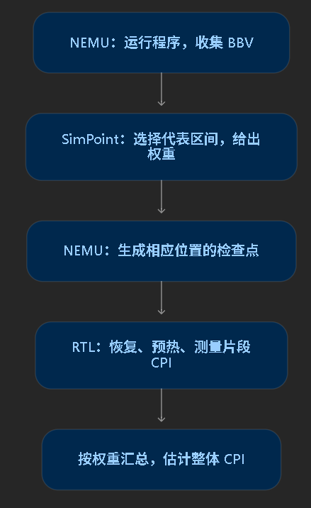

**SimPoint 根据 BBV 判断哪些区间的执行行为相近。**

BBV 是 Basic Block Vector，即基本块向量。基本块是一段**单入口、单出口**、内部**没有分支跳转**的指令序列。

收集时，先按**动态指令数**把执行过程划分为区间，例如每执行约 100 万条指令形成一个区间。然后**统计每个基本块在这个区间内贡献了多少条**执行指令：
$$
\text{某基本块的贡献}=\text{执行次数}\times\text{块内指令数}
$$
把各基本块的贡献排列起来，就得到了这个区间的 BBV。两个区间的 BBV 相似，意味着它们执行的代码构成相近，SimPoint 据此进行聚类。[SimPoint 原始论文](https://cse.ucsd.edu/~calder/papers/MOBS-05-SimPoint3.pdf)

注意分工：**SimPoint 负责选片段，片段的 CPI 仍需要通过处理器模型测量。**

用一组简单的教学数字说明权重。假设程序被分成 10 个等长区间，聚成三类，每类选一个代表：

| 行为类别 | 包含的区间数 | 代表权重 | 假设 RTL 测得的代表 CPI |
| -------- | ------------ | -------- | ----------------------- |
| A        | 6            | 0.6      | 1                       |
| B        | 3            | 0.3      | 2                       |
| C        | 1            | 0.1      | 4                       |

整体 CPI 的估计值就是：
$$
CPI_{\text{估计}}=0.6\times1+0.3\times2+0.1\times4=1.6
$$
权重表示这个代表片段所代表的**动态指令比例**。固定等长区间下，可以用该类区间数占总区间数的比例计算。若需要整体 IPC，可以先得到加权 CPI，再取倒数。[SimPoint 使用教程](https://cseweb.ucsd.edu/~calder/simpoint/sim-points-FAQ.htm)

这里仍然存在估计误差：代码构成相似，并不能保证数据访问、Cache 行为和 CPI 完全相同。所以论文同时强调了两个问题：**抽样是否有代表性，以及微架构状态是否充分预热。**

检查点通常需要取在正式测量片段之前。恢复后，先执行预热段，让 Cache、分支预测器等逐渐形成状态，再统计测量片段的周期。

接着看作者报告的实际资源和耗时：

| 实验设置                                           | 论文报告的耗时          |
| -------------------------------------------------- | ----------------------- |
| 5 台 128 核服务器，约 1000 个检查点，100% 聚类覆盖 | 三天内估计 SPEC CPU2006 |
| 聚类覆盖降到 80%                                   | 24 小时内得到初步结果   |
| 单块 FPGA，50 MHz，完整执行程序                    | 超过 150 小时           |

不同检查点可以交给多个 RTL 仿真实例并行运行，因此能利用这些服务器资源。结合 SimPoint 的工具定义，**100% 聚类覆盖仍然采用代表片段，也仍有估计误差**；论文在 IV-B 检验评估精度。

### 3.5 **工具集成**

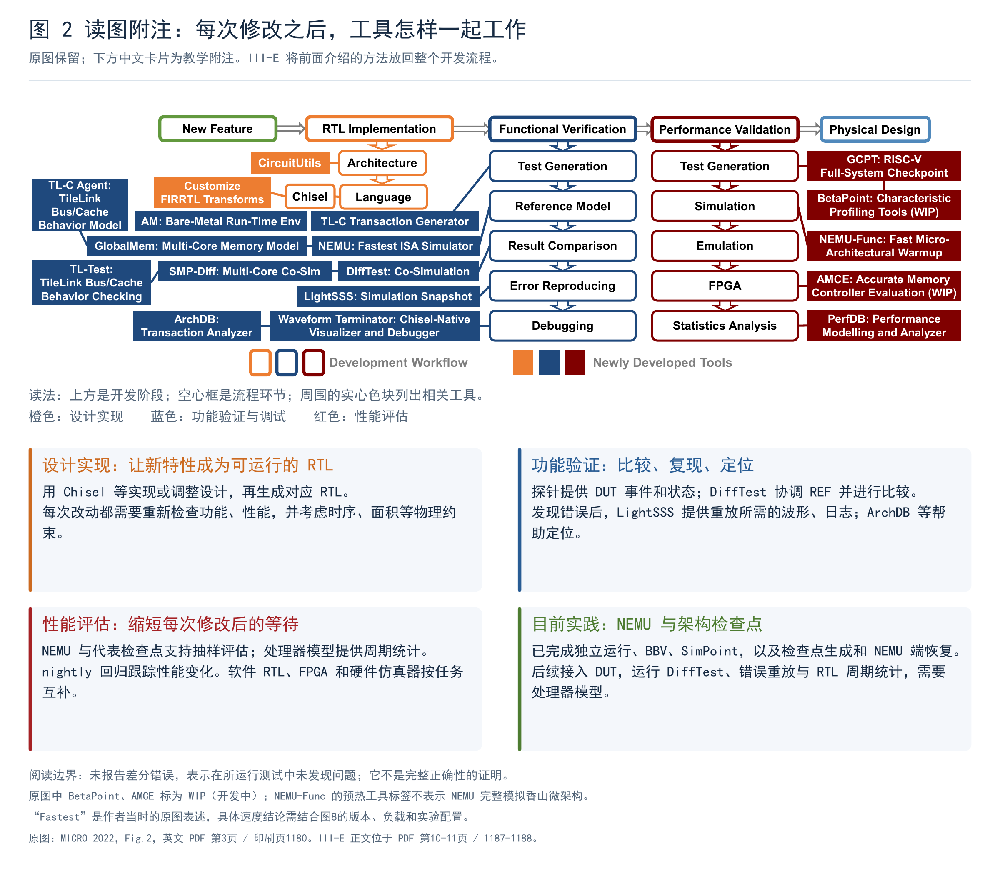

**这一节强调的是：每次修改处理器以后，怎样重复完成验证、调试和性能评估。**

先沿着图中**蓝色的功能验证流程**看。

开发者实现新特性、生成 RTL 后，启动已经**接好验证框架的仿真**。探针报告 DUT 的提交、异常和寄存器状态，DiffTest 协调 REF 执行并进行比较。

这里，论文说开发者“只需启动 RTL 仿真”，前提是探针、REF 接口及运行脚本已经接入工程。**平台把之后反复需要执行的工作自动化了。**

接下来有两种情况：

- **发现差分错误**：用 LightSSS 取得重放所需的波形和日志，再借助 ArchDB、Waveform Terminator 等工具定位原因。
- **相应用例没有报告差分错误**：继续分析性能结果。

注意原文的措辞范围：它说设计在**对应测试用例中很可能符合规范**，并没有把“DiffTest 无报错”当作整个处理器正确性的证明。

然后看右侧红色的性能评估流程。

作者把代表检查点纳入 **nightly performance regression，即每晚的性能回归**测试。意思是，持续在新版本上运行基准测试，与已有结果比较，及时发现**性能退步**。

实践5中已经演示了其中一项基础能力：快速执行程序，选择代表区间，保存中途状态，再恢复并继续运行。

接入 RTL 后，就可以在恢复、预热之后统计处理器周期，计算代表片段的 CPI，再按权重汇总。

因此，**NEMU 与检查点负责减少评估前的准备和重复执行开销，处理器模型负责提供需要评估的时序行为。**

图中还列出了软件仿真、硬件仿真器和 FPGA。作者明确说，当时 MINJIE 主要采用软件 RTL 仿真流程，并认为这些平台相互补充。图里列出的平台也不意味着每次修改都必须依次跑遍它们。

另外，图中的 **BetaPoint、AMCE 标有 WIP（Work In Progress），表示当时仍在开发中**。我们阅读总览时，应保留这些状态。

## 4 **构建开源高性能处理器**

### 4.1 微体系结构

前面第三节主要介绍方法和工具，第四节开始展示它们在香山项目中的应用。

看 **IV-A 和表 II**：

| 项目             | YQH         | NH          |
| ---------------- | ----------- | ----------- |
| ISA              | RV64GC      | RV64GCBK    |
| 工艺             | 28 nm       | 14 nm       |
| 频率配置         | 1.3 GHz     | 目标 2 GHz  |
| 核数             | 1           | 2           |
| 解码／重命名宽度 | 6           | 6           |
| ROB／LQ／SQ      | 192／64／48 | 256／80／64 |

这些是**论文所述两代设计的配置**。NH 在论文中仍以当时的流片计划和设计目标来描述，不能把它当作今天整个香山项目的状态。

这张表也能帮助理解敏捷验证的价值：ROB、队列容量等微**架构参数会不断调整**，验证框架应**尽量继续复用**；如果 ISA 新增了指令扩展，REF 仍然需要支持相应指令。

### 4.2 性能

这一节要回答的是：**前面介绍的 RTL 抽样评估，得到的性能结果与 FPGA、真实芯片有多接近？**

先看加了附注的图 12：


**先读纵轴：Score/GHz。**

SPEC 分数根据**程序运行时间与参考时间的比值**计算，套件汇总使用**几何平均值**。[SPEC 官方说明](https://www.spec.org/cpu2006/Docs/readme1st.html#Q13)

作者又将分数除以核心频率：
$$
\text{Score/GHz}=\frac{\text{SPEC 分数}}{\text{核心频率（GHz）}}
$$
例如，某处理器在 2 GHz 下得分为 16，归一化后就是 **8/GHz**。这样可以**比较单位频率下的性能**，但这个数值不能直接读成 IPC。

这也与前面的图 8 不同：图 8 测 **NEMU 每秒解释多少条指令**；图 12 测香山处理器**运行基准程序的性能**。

**再读图例：这里共有六组配置。**

| 图例                      | 含义                                   |
| ------------------------- | -------------------------------------- |
| YQH-RTL-Sim-DRAMsim       | YQH 的 RTL 仿真，配合 DRAM 时序模型    |
| YQH-FPGA-90C-AMAT         | YQH 的 FPGA 实现，采用 90 周期访存设置 |
| YQH-ASIC-DDR4-1600        | YQH 真实芯片，使用 DDR4-1600           |
| NH-6MBLLC-RTL-Sim-DRAMsim | NH 的 RTL 仿真，6 MB 末级缓存          |
| NH-4MBLLC-FPGA-250C-AMAT  | NH 的 FPGA 实现，4 MB 末级缓存         |
| NH-2MBLLC-FPGA-250C-AMAT  | NH 的 FPGA 实现，2 MB 末级缓存         |

LLC 是 **Last-Level Cache，末级缓存**。NH 在 FPGA 上采用较小的 LLC，是因为 FPGA 的**片上存储资源 BRAM 有限**。

上图是整数测试，下图是浮点测试。每张图最右侧的粗体名称对应套件汇总结果。

正文给出了几组明确的汇总值，单位都是 Score/GHz：

| 配置                            | SPECint 2006 | SPECfp 2006 |
| ------------------------------- | ------------ | ----------- |
| YQH 真实芯片                    | 7.03         | 7.00        |
| YQH FPGA，90 周期访存           | 6.87         | 7.23        |
| NH FPGA，4 MB LLC、250 周期访存 | 7.94         | 9.27        |

测试程序使用 `-O2` 编译；YQH 使用 RV64GC，NH 使用 RV64GCB。这些条件也属于结果的一部分。

**接下来是这一节最值得理解的问题：FPGA 上的性能为什么也可能失真？**

FPGA 上的 CPU 只有 **50 MHz**，而外部 DDR 仍然高速运行，CPU 与内存的**速度比例和真实芯片不同。**

50 MHz 下，一个 CPU 周期是 20 ns。假设一次**内存访问**需要 100 ns，它只相当于 5 个 CPU 周期；同样的 100 ns，在 2 GHz 下却相当于 200 个周期。这个简单换算就能看出：**相同的物理时间，在不同核心频率下代表的等待周期数差别很大。**

作者因此为 FPGA 的访存请求**人为增加等待周期**。但这仍然没有完整还原真实内存行为，因为：

- **延迟**：一条请求多久返回。
- **带宽**：连续发送大量请求时，单位时间能完成多少数据传输。

给每条请求增加固定等待时间，并不会同时重现真实内存的带宽限制、资源竞争和排队行为。论文认为，这使 FPGA 上的 SPECint 结果偏保守；这个判断针对其具体平台和负载。

**缓存容量也是另一项影响因素。**

作者在相同的 NH FPGA 平台上，比较了 4 MB 和 2 MB LLC：

- 4 MB 的整数性能提高 **8.9%**。
- 4 MB 的浮点性能提高 **5.4%**。

所以，当你看到 NH 的 RTL 仿真柱子高于 FPGA 时，不能直接把全部差距归因于评估方法：RTL 使用 6 MB LLC，FPGA 使用 4 MB 或 2 MB，内存行为也不同。

最后，作者使用 **RTL 仿真＋DDR4-2400 模型**，运行 III-D3 中介绍的检查点评估流程，并报告与 FPGA、芯片结果存在约 **5%–10% 的偏差**。

这里应当保留两层理解：

**作者认为这种精度足以支持开发中的性能评估；但这些比较的内存配置并不完全一致，因此它不能单独说明“SimPoint 抽样误差就是 5%–10%”。** 要测纯粹的抽样误差，需要在相同配置下，把抽样结果与完整运行结果比较。

### 4.3 **使用** **MINJIE** **调试**

作者用一个真实错误说明：**发现结果错误、重现错误、定位根因，是三个不同的工作环节。**

**先看错误怎样暴露。**

双核香山运行 Redis，仿真超过 **168 小时**、累计约 **30 亿个模拟周期**后，DiffTest 按照 III-B2b 的多核检查规则，发现 **DUT 与 Global Memory 的数据不一致**。

虽然 L2 Cache 已做过大量单元测试，这个问题仍然在系统级运行中暴露了。局部测试通过，并不意味着跨模块交互的所有时序组合都已经覆盖。

接下来，作者使用 LightSSS 保存的**倒数第二份仿真进程快照**重放。开启波形后，模拟最后 **30.8K 个周期只用了约 3 分钟**。

这里的 3 分钟指**重放并生成波形的**时间，不能理解成整个错误从发现到修复只用了 3 分钟。LightSSS 的价值，是避免调试时反复重跑漫长的前缀。

**然后才开始定位。**

ArchDB 记录了多级 Cache 的事务。作者发现：对于**同一个缓存块**，L2 向 L3 发出的 Acquire，与 L3 向 L2 发出的 Probe 出现了重叠。

可以用下面的教学示意理解事务方向：


Acquire、Probe、GrantData 都是 TileLink 协议消息，分别涉及缓存块申请、一致性探测，以及数据和权限的返回。[TileLink 规范](https://sifive-china.oss-cn-zhangjiakou.aliyuncs.com/TileLink/TileLink-TileLink%20Spec%201.7.1.pdf)

关键现象是：**L2 从 L3 收到了正确数据，却向 L1 返回了错误数据。**

进一步查看波形后，作者确认：L2 的 MSHR 没有正确处理 Probe 与 GrantData 在特定时间窗口内的重叠。论文将问题定位到了这一层，但没有给出完整逐拍波形和修复补丁。

所以，本案例中各工具的贡献是：

| 工具     | 提供的证据                       |
| -------- | -------------------------------- |
| DiffTest | 数据结果已经不一致               |
| LightSSS | 快速回到错误发生前，取得局部波形 |
| ArchDB   | 找到同一缓存块上的重叠事务       |
| 波形分析 | 确认 L2 MSHR 的处理问题          |

注意，这里使用的是 **LightSSS 的仿真进程快照**，包含 RTL 模型内部状态。

### 4.4 功能探索

作者在香山 RTL 上实现了一种名为 **PUBS（Prioritizing Unconfident Branch Slices）** 的发射策略，用它检验一个想法：让容易预测错的分支更早得到实际结果，能省下多少周期？

用两条指令就能看懂这里的 **branch slice（分支切片）**：

```
add t0, t1, t2
beq t0, x0, target
```

`beq` 要等 `add` 算出 `t0`，才能确认跳不跳。如果预测器对这个分支没把握，PUBS 会提高 `beq` 以及为它产生操作数的指令的发射优先级。比如，`add` 已经就绪，正和另一条指令争同一个发射端口，调度器就可以先选 `add`。这样分支有机会更早确认方向，万一预测错，处理器就能更早重定向取指。**优先级在就绪指令之间起作用，数据依赖仍需满足。**

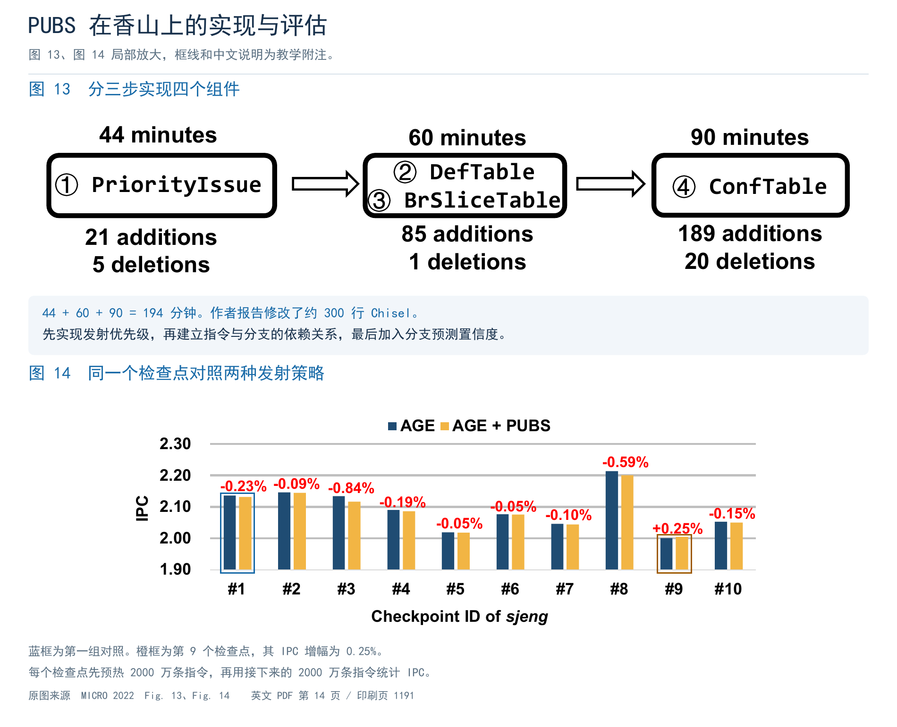

图 13 把四个组件分成三步实现。先做 **PriorityIssue**，让发射队列能按优先级选择指令。然后加入 **DefTable** 和 **BrSliceTable**，追踪操作数由谁产生，以及哪些指令与分支相关。最后加入 **ConfTable**，提供分支预测的置信度。图中三步合计 **194 分钟**，正文报告约 **300 行 Chisel 改动**。

图 14 的每一组柱子对应 `sjeng` 的**同一个检查点**。蓝色是 **AGE**，即**优先发射最老**的就绪指令。橙色在 AGE 基础上启用 PUBS。作者用 Verilator 仿真香山 RTL，每个检查点先执行 **2,000 万条指令预热**，再用接下来的 **2,000 万条指令**计算 IPC。

实测的 IPC 变化在 **−0.84% 到 +0.25%** 之间。10 个检查点中，只有第 9 个略有提升。作者提出了一个解释：香山的指令窗口更大、发射更宽，许多时候原来的调度策略就能选中分支所依赖的指令，PUBS 能改变发射顺序的机会有限。

用刚才的小例子检验这个解释。假设**同一队列有两个可用的发射位置，恰好只有两条就绪指令**，那么两条都能在这一拍发射，提高其中一条的优先级不会让它更早执行。

**图 15 解释了为什么 PUBS 在这组香山实验中收益很小。** 在 `sjeng` 的 10 个检查点上，作者报告，只有约 **12.8% 的周期**出现就绪候选超过两个发射名额的情况。即使出现竞争，也得有低置信度分支或它依赖的指令在等，PUBS 才有机会让分支更早得到结果。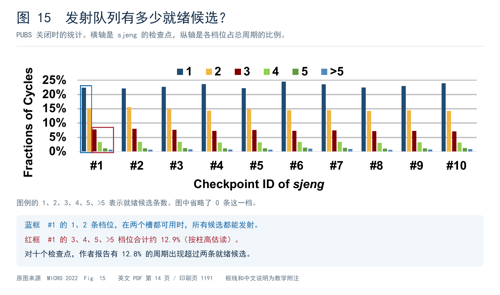

**先读第 1 组柱子。** 图例里的 `1、2、3、4、5、>5` 表示这一拍有多少条就绪候选，纵轴表示这类情况占总周期的比例。论文这里的两个发射名额是**单个分布式发射队列**的口径。

假设这个队列有两个可用的发射名额。蓝框里只有一两条候选，大家都能发射。红框里有三条或更多候选，至少有一条得等。按柱高估读，第 1 个检查点红框中的四根柱合计约为 **7.7% + 3.4% + 1.1% + 0.7% = 12.9%**。正文的 **12.8%** 则对应十个检查点的统计。

**有竞争，还要看谁在等。** 例如，AGE 会让两条较老的指令先发射。如果被留下的第三条恰好负责计算某个低置信度分支的操作数，PUBS 就可能让它提前一拍。它能省下多少时间，还取决于分支是否因此更早解析，以及这次预测是否需要纠正。

正文给出的 **5.9%** 是被标为高优先级的**指令比例**。作者结合平均阻塞条数等数据，粗略估计少于约 **1.3% 的指令有机会提前一拍**。图 14 给出的才是实际 IPC 对照，十个点的变化为 **−0.84% 到 +0.25%**。

IV-D 最后一段还提到，修改发射策略时曾触发断言，LightSSS 从近期快照重放并输出调试信息。修正功能问题后，代表性检查点让作者能在数小时内完成性能评估。到这里，论文已经用 PUBS 走完了一次**实现、验证、测量、解释结果**的迭代。

# 实践

## 1 NEMU 独立运行实验

### 1.1 版本与环境

- 官方代码：https://github.com/OpenXiangShan/NEMU

- 固定版本：`af9d4ce51fc2087156b09f26d64a8e1cfb83332f`

- 环境：本机 Ubuntu WSL2。

- 学习配置基于 `riscv64-nutshell_defconfig`：保留该版本必需的基本设备支持，关闭 MMIO 启动，从内存地址 `0x80000000` 启动；内存设为 128 MiB，关闭性能优化路径，便于初次观察。图形、键盘和音频设备均保持关闭。

  > [!TIP]
  >
  > 0x80000000 启动（RISC-V QEMU `virt` 平台）
  >
  > > 这是 **RISC-V QEMU virt 机器** 最经典的复位入口 / 物理 RAM 基地址，不是 RISC-V 架构强制规定，是 virt 板子约定
  >
  > - `0x80000000` = **2147483648 字节**
  > - = 2097152 KiB
  > - = 2048 MiB
  > - = **2 GiB**
  >
  > > 注意：这是**地址数值本身**，不是代表这块内存大小是 2GiB。 在 RISC-V QEMU virt 里它是 **DRAM 的起始物理地址**，意思是：物理内存从 2GiB 这个位置开始摆放。
  >
  > 补充：
  >
  > - 0x00000000 ~ 0x7FFFFFFF：前 2GiB 地址空间，分配给 MMIO
  > - 0x80000000 开始：DRAM

- 本地 `headless.mk` 在确认图形、键盘和音频都关闭后，移除上游构建中多余的 SDL 链接项；不修改上游源码或 Makefile。

  > [!TIP]
  >
  > **headless.mk 不是 GNU Make / QEMU / RISC-V 官方自带的标准文件**，是操作系统 / 裸机实验项目里**自定义的、被 include 进来的片段 Makefile**，名字里 headless = 无头模式，对应 QEMU `-nographic`，不弹出图形窗口、串口直接绑终端，适合 CI、命令行裸机调试（正好匹配前面 `0x80000000` RISC-V virt 裸机场景）
  >
  > SDL = Simple DirectMedia Layer；QEMU 的图形窗口后端就是 SDL2，**`-enable-sdl`** 编译 QEMU 时开启 SDL 界面支持，`-nographic`（headless）不使用 SDL

- 准备脚本不自动安装系统包，不修改上游源码，也不执行 Makefile 中的自动 Git 提交。
- 上游构建文件会按需下载检查点等辅助仓库，构建时需要联网。

### 1.2 安装依赖、编译

```
sudo apt-get install --no-install-recommends bison flex zlib1g-dev libreadline-dev

bash prepare_nemu.sh
```

prepare_nemu.sh:

```bash
#!/usr/bin/env bash
# Build a small standalone NEMU configuration for the first reading exercise.
set -euo pipefail

lesson_dir="$(dirname -- "$(realpath -- "${BASH_SOURCE[0]}")")"
export NEMU_HOME="$lesson_dir/NEMU"
expected_revision="af9d4ce51fc2087156b09f26d64a8e1cfb83332f"

missing=()
for command_name in gcc g++ make git python3 bison flex; do
  if ! command -v "$command_name" >/dev/null 2>&1; then
    missing+=("$command_name")
  fi
done
for package_name in zlib1g-dev libreadline-dev; do
  if [[ "$(dpkg-query -W -f='${Status}' "$package_name" 2>/dev/null || true)" != "install ok installed" ]]; then
    missing+=("$package_name")
  fi
done
if ((${#missing[@]})); then
  printf 'Missing build dependencies: %s\n' "${missing[*]}" >&2
  printf 'In Ubuntu, run: sudo apt-get install --no-install-recommends bison flex zlib1g-dev libreadline-dev\n' >&2
  exit 2
fi

actual_revision="$(git -C "$NEMU_HOME" rev-parse HEAD)"
if [[ "$actual_revision" != "$expected_revision" ]]; then
  printf 'Unexpected NEMU revision: %s\nExpected: %s\n' "$actual_revision" "$expected_revision" >&2
  exit 3
fi

python3 "$lesson_dir/create_images.py"
python3 - "$NEMU_HOME" <<'PY'
from pathlib import Path
import sys

root = Path(sys.argv[1])
source = root / 'configs/riscv64-nutshell_defconfig'
destination = root / 'configs/riscv64-minjie-learning_defconfig'
config = source.read_text(encoding='utf-8')
changes = {
    'CONFIG_RESET_FROM_MMIO=y': '# CONFIG_RESET_FROM_MMIO is not set',
    'CONFIG_MSIZE=0x80000000': 'CONFIG_MSIZE=0x08000000',
    'CONFIG_PERF_OPT=y': '# CONFIG_PERF_OPT is not set',
    'CONFIG_CC_AGGRESSIVE_INLINE=y': '# CONFIG_CC_AGGRESSIVE_INLINE is not set',
}
for before, after in changes.items():
    if config.count(before) != 1:
        raise SystemExit(f'Expected exactly one configuration entry: {before}')
    config = config.replace(before, after)
destination.write_text(config, encoding='utf-8')
print(f'Generated learning configuration: {destination}')
PY

# Explicitly override the upstream automatic-commit macro with an empty value.
# In this revision __NOT_DEFINED=1 ENABLES that macro; do not pass it.
make -C "$NEMU_HOME" git_commit= riscv64-minjie-learning_defconfig
# Keep the device infrastructure required by this revision. The local overlay
# removes only the unused SDL link option when all SDL-using devices are off.
make -C "$NEMU_HOME" -f Makefile -f "$lesson_dir/headless.mk" git_commit= -j2

printf '\nBuild finished. Run the register inspection exercise:\n'
printf 'bash "%s/run_nemu.sh"\n' "$lesson_dir"
printf 'At the (nemu) prompt: si 3, info r, si 1, info r, c\n'
```

脚本会生成学习配置和测试镜像，再用本机 GCC/G++ 编译 NEMU。测试镜像中的指令编码已经准备好，这次不需要安装 RISC-V 交叉编译器。

### 1.3 在 NEMU 中单步并查看寄存器

**编译成功后，启动 NEMU。**

```
bash run_nemu.sh
```

出现 `(nemu)` 提示符后，说明已经进入 NEMU 的交互监视器。接下来的命令在这里输入。

镜像包含这些指令，最后通过 NEMU 的专用退出约定结束：

```
addi a0, zero, 0
addi t0, zero, 5
addi t1, t0, 3
sub  t2, t1, t0
```

其中，`t0/t1/t2` 分别是 `x5/x6/x7` 的别名。

**先执行前三条，再查看寄存器：**

```
si 3
info r
```

`si 3` 表示执行 **3 条被模拟的 RISC-V 指令**，不是运行三个时钟周期。

得到：

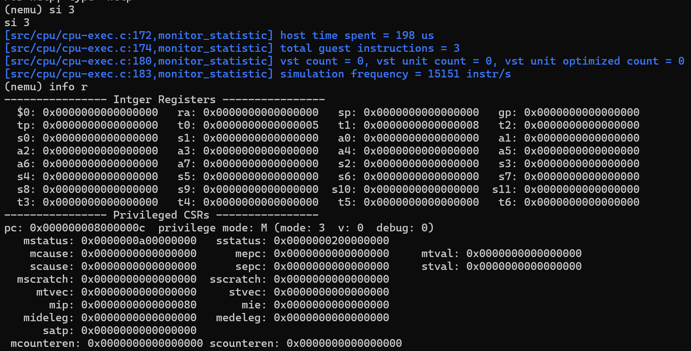

符合预期。

随后执行：

```
si 1
info r
```

这次执行的是减法，预期 `t2=3`，PC 前进到 `0x80000010`。

得到：

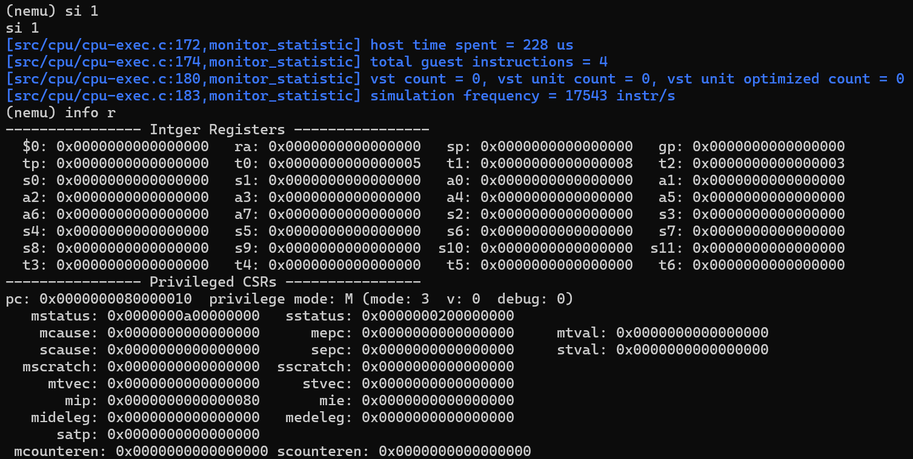

符合预期。

最后输入：

```
c
```

它会继续执行，预期显示 `HIT GOOD TRAP`。

> [!TIP]
>
> `0x0000006b` 是 NEMU 的仿真退出约定，不是标准 RISC-V 指令。
>
> `c` 是 continue，意思是“继续执行”。它是 `(nemu)` 监视器里的命令，从当前模拟 PC 继续运行，直到程序结束、出错或遇到其他停止条件。源码中也将它描述为“Continue the execution of the program”。
>
> **`HIT GOOD TRAP` 表示：执行到了 NEMU 约定的结束标记，并且退出码表示成功。**
>
> 我们的镜像最后放了编码为 `0x0000006b` 的专用指令，用来通知 NEMU 结束测试。它不是标准 RISC-V 的退出指令，也不是前面讨论的缺页异常。
>
> 在本例的退出流程中，NEMU 读取 `a0` 作为退出码：
>
> ```
> a0 = 0 → HIT GOOD TRAP：报告成功
> a0 = 1 → HIT BAD TRAP：报告失败
> ```
>
> **这段小程序预先将 `a0` 设为了 `0`，没有自动检查 `t2` 是否等于 `3`**。因此，我们仍要通过 `info r` 核对计算结果；仅看到 `HIT GOOD TRAP`，还不能说明算术结果已经被检查过。

得到：

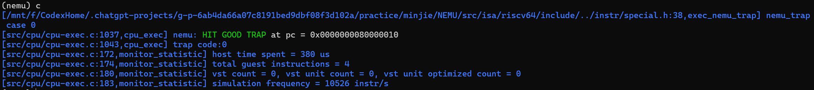

此时观察到的是 **NEMU 保存的模拟寄存器状态**。这个实验尚未接入香山 DUT 或 DiffTest，正常退出只是说明这段测试程序报告成功。

> [!TIP]
>
> 日志还有两个值得说明的地方：
>
> - **最后计数仍为 4**：当前版本的这条执行路径中，退出处理会直接跳出执行流程，跳过后面的普通计数自增。因此，退出指令确实执行了，但没有计入这个计数。对应[执行循环 (line 779)](https://github.com/OpenXiangShan/NEMU/blob/af9d4ce51fc2087156b09f26d64a8e1cfb83332f/src/cpu/cpu-exec.c#L779)和[退出处理 (line 51)](https://github.com/OpenXiangShan/NEMU/blob/af9d4ce51fc2087156b09f26d64a8e1cfb83332f/src/isa/riscv64/instr/special.h#L51)。
> - **`simulation frequency` 是解释器吞吐统计**：由累计客体指令数除以累计主机执行时间得到。这次只有几条指令，又是单步执行，不能用它衡量论文中的长程序性能。

## 2 写入零寄存器与伪指令源码

在 Ubuntu 终端执行：

```
cd /path/to/minjie/NEMU

sed -n '27,42p' src/isa/riscv64/instr/rvi/decode.h

sed -n '61,65p' src/isa/riscv64/instr/pseudo.h
```

得到：

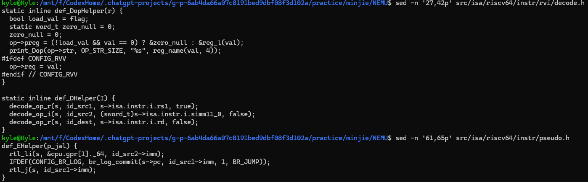

第一段重点看这一行：

```
op->preg = (!load_val && val == 0) ? &zero_null : &reg_l(val);
```

在这里，`val` 是寄存器编号；`load_val=false` 对应作为写入目标处理。因此，这行就是：**如果要写 `x0`，将目的指针改为 `&zero_null`。** `zero_null` 对应论文图中的 `unused var`。

第二段重点看：

```
rtl_li(s, &cpu.gpr[1]._64, id_src2->imm);
```

应该能认出：它直接指定了 `cpu.gpr[1]`，对应图⑩中固定访问 `ra` 的做法。

## 3 MIPS测量

```python
#!/usr/bin/env python3
"""Measure the existing NEMU binary on a tiny, repeatable integer loop.

This is a learning workload, not a reproduction of the paper's SPEC results.
Run inside Ubuntu/WSL: python3 measure_nemu.py
"""

from pathlib import Path
import re
import struct
import subprocess
import sys


LESSON = Path(__file__).resolve().parent
BINARY = LESSON / "NEMU/build/riscv64-nemu-interpreter"
IMAGE = LESSON / "images/throughput-loop.bin"
ITERATIONS = 1 << 22
RUNS = 3

# Little-endian RV64I instructions; no cross compiler is needed.
PROGRAM = [
    0x00400337,  # lui  t1, 0x400       : t1 = 4,194,304
    0x00000293,  # addi t0, zero, 0
    0x00128293,  # addi t0, t0, 1       : loop begins here
    0xFE62CEE3,  # blt  t0, t1, -4      : repeat until t0 == t1
    0x00000513,  # addi a0, zero, 0     : success code
    0x0000006B,  # NEMU-specific exit instruction
]

# For this learning build, the NEMU exit instruction leaves through longjmp
# before the normal instruction counter increment, so it is not counted.
EXPECTED_INSTRUCTIONS = 2 + 2 * ITERATIONS + 1


def number_from_log(pattern, log):
    matches = re.findall(pattern, log)
    if not matches:
        raise RuntimeError(f"Cannot find {pattern!r} in NEMU output:\n{log}")
    return int(matches[-1].replace(",", ""))


def main():
    if not BINARY.is_file():
        raise RuntimeError(f"NEMU binary is missing: {BINARY}")
    IMAGE.parent.mkdir(parents=True, exist_ok=True)
    IMAGE.write_bytes(struct.pack("<6I", *PROGRAM))

    print(f"Loop iterations: {ITERATIONS:,}")
    print(f"Expected counted guest instructions per run: {EXPECTED_INSTRUCTIONS:,}")
    print("MIPS = guest instructions / NEMU host time in microseconds")
    for run in range(1, RUNS + 1):
        result = subprocess.run(
            [str(BINARY), "-b", str(IMAGE)],
            stdout=subprocess.PIPE,
            stderr=subprocess.STDOUT,
            text=True,
            errors="replace",
            timeout=60,
        )
        log = result.stdout
        if result.returncode != 0 or "HIT GOOD TRAP" not in log:
            raise RuntimeError(f"NEMU run failed (exit {result.returncode}):\n{log}")
        count = number_from_log(r"total guest instructions\s*=\s*([0-9,]+)", log)
        time_us = number_from_log(r"host time spent\s*=\s*([0-9,]+)\s*us", log)
        if count != EXPECTED_INSTRUCTIONS or time_us <= 0:
            raise RuntimeError(f"Unexpected count/time: {count} instructions, {time_us} us\n{log}")
        print(
            f"Run {run}: GOOD TRAP, exit=0, instructions={count:,}, "
            f"host_time={time_us:,} us, MIPS={count / time_us:.2f}"
        )


if __name__ == "__main__":
    try:
        main()
    except (OSError, RuntimeError, subprocess.TimeoutExpired) as error:
        print(error, file=sys.stderr)
        sys.exit(1)

```

以上脚本会自动生成一个整数循环，并以批处理模式运行三次。无需重新编译，在 Ubuntu 执行：

```
cd /path/to/minjie

python3 measure_nemu.py
```

循环主体只有两条指令：

```
loop:
    addi t0, t0, 1
    blt  t0, t1, loop
```

脚本让它循环 **4,194,304 次**。加上初始化和退出前的指令，当前版本实际计数应为 **8,388,611 条**。

得到：

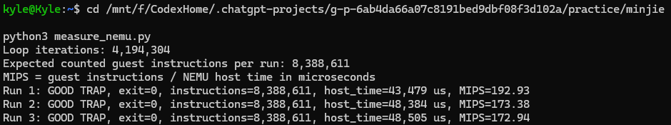

符合预期。这个整数循环用于学习吞吐量测量；负载、主机和配置都与论文实验不同，测出的数值无需接近论文图中的 733 MIPS。

## 4 Restorer 实际怎样恢复寄存器

在 Ubuntu 执行：

```
cd /path/to/minjie/NEMU

sed -n '204,239p' resource/gcpt_restore/src/restore.S
```

会看到一串这样的指令：

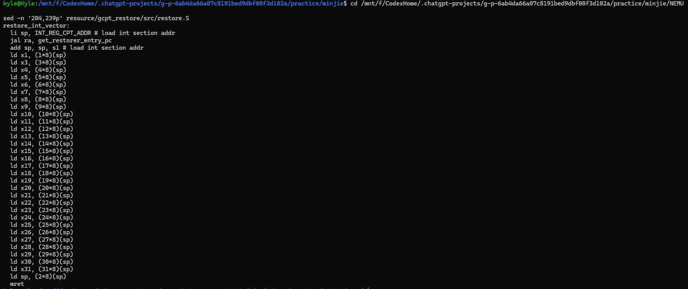

这里，`sp` 暂时用于指向保存寄存器值的内存区域。例如：

```
ld x5, (5*8)(sp)
```

就是从 `sp+40` 处读取保存的值，恢复到 `x5`。

最后两条是：

```
ld sp, (2*8)(sp)
mret
```

`sp` 留到最后恢复，因为前面的加载一直需要用它作为地址基准。随后，`mret` 根据此前配置好的返回地址和特权状态，恢复原程序的执行。

这段代码让我们直接看到了论文所说的恢复方法：**处理器执行加载和特权指令，逐步恢复保存的状态。**

## 5 BBV、SimPoint和检查点

采集脚本：

```python
#!/usr/bin/env python3
"""Collect real SimPoint BBVs using the separate profiling NEMU build."""
from pathlib import Path
import gzip
import re
import struct
import subprocess
import sys


LESSON = Path(__file__).resolve().parent
BINARY = LESSON / 'NEMU-profile/build/riscv64-nemu-interpreter'
OUTPUT = LESSON / 'results/simpoint-learning/profile-opt'
INTERVAL = 1_000_000


def main():
    if not BINARY.is_file():
        raise RuntimeError('First run in Ubuntu: bash prepare_profile_nemu.sh')
    OUTPUT.mkdir(parents=True, exist_ok=True)
    image = LESSON / 'images/throughput-loop.bin'
    if not image.is_file():
        image = OUTPUT / 'throughput-loop.bin'
        image.write_bytes(struct.pack('<6I', 0x00400337, 0x00000293,
                                      0x00128293, 0xFE62CEE3,
                                      0x00000513, 0x0000006B))
    args = [str(BINARY), '-b', str(image), '--simpoint-profile',
            '--dont-skip-boot', '--cpt-interval', str(INTERVAL),
            '-D', str(OUTPUT), '-C', 'profile', '-w', 'throughput-loop']
    result = subprocess.run(args, stdout=subprocess.PIPE, stderr=subprocess.STDOUT,
                            text=True, errors='replace', timeout=30)
    (OUTPUT / 'nemu-profile.log').write_text(result.stdout, encoding='utf-8')
    if result.returncode != 0 or 'HIT GOOD TRAP' not in result.stdout:
        raise RuntimeError(f'NEMU did not finish normally (exit={result.returncode}). '
                           f'Read {OUTPUT / "nemu-profile.log"}')
    bbv = OUTPUT / 'profile/throughput-loop/simpoint_bbv.gz'
    if not bbv.is_file():
        raise RuntimeError(f'NEMU did not create {bbv}')
    with gzip.open(bbv, 'rt') as stream:
        rows = [line.strip() for line in stream if line.strip()]
    if not rows:
        raise RuntimeError('The BBV file is empty; the profiling callback did not run.')
    for row in rows:
        if not re.fullmatch(r'T(?:\s*:\d+:\d+\s*)+', row):
            raise RuntimeError(f'Unexpected simplified BBV row: {row}')
    print(f'NEMU: GOOD TRAP, process exit={result.returncode}')
    print(f'Nominal interval: {INTERVAL:,} guest instructions')
    print(f'BBV file: {bbv.relative_to(LESSON)}')
    print(f'BBV rows: {len(rows)}')
    for index, row in enumerate(rows[:2], 1):
        print(f'Row {index}: {row}')
    print('Each :block_id:count pair records dynamic instruction contributions,')
    print('not the number of times the block was entered.')
    print('Only complete profiling intervals are written; the final short tail may be omitted.')


if __name__ == '__main__':
    try:
        main()
    except (OSError, RuntimeError, subprocess.TimeoutExpired) as error:
        print(error, file=sys.stderr)
        sys.exit(1)

```

使用独立的 `NEMU-profile` 版本，启用了采集所需的执行路径。

在 Ubuntu 执行：

```
cd /path/to/minjie

python3 profile_nemu.py
```

它继续使用前面实践的那个整数循环。已验证的输出包含：

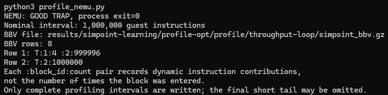

这个格式读起来很直接：

- `T`：一条区间记录。
- `:1:4`：基本块 1 贡献了 4 条动态指令。
- `:2:999996`：基本块 2 贡献了 999,996 条动态指令。

第一行两项相加正好是 100 万。第二行表示，这个区间的 100 万条指令全部来自基本块 2。**这里统计的是指令贡献量，不是基本块进入次数。**

这个负载一直重复同一个循环，所以后续区间的 BBV 相似，符合预期。程序末尾不足一个完整区间的短尾暂未输出。

BBV 采集这一步完成了。现在实际运行 SimPoint，把这 8 个区间转换成“代表区间＋权重”。

运行脚本：

```python
#!/usr/bin/env python3
"""Run the real SimPoint tool on the BBV from the single-loop exercise."""
from pathlib import Path
import gzip
import math
import shlex
import subprocess
import sys

from profile_nemu import INTERVAL


LESSON = Path(__file__).resolve().parent
BINARY = LESSON / 'tools/SimPoint-3.2-e51a936/bin/simpoint'
BBV = LESSON / 'results/simpoint-learning/profile-opt/profile/throughput-loop/simpoint_bbv.gz'
OUTPUT = LESSON / 'results/simpoint-learning/cluster-loop'


def read_pairs(path, value_type):
    entries = {}
    for line in path.read_text(encoding='utf-8').splitlines():
        fields = line.split()
        if len(fields) != 2:
            raise RuntimeError(f'Invalid result row in {path}: {line!r}')
        value, cluster_id = value_type(fields[0]), int(fields[1])
        if cluster_id < 0 or cluster_id in entries:
            raise RuntimeError(f'Invalid or repeated cluster ID in {path}')
        entries[cluster_id] = value
    return entries


def main():
    if not BINARY.is_file():
        raise RuntimeError('First run in Ubuntu: bash prepare_simpoint.sh')
    if not BBV.is_file():
        raise RuntimeError('First run: python3 profile_nemu.py')
    with gzip.open(BBV, 'rt') as stream:
        rows = [line for line in stream if line.strip()]
    if not rows:
        raise RuntimeError('The BBV is empty. Run profile_nemu.py again.')

    OUTPUT.mkdir(parents=True, exist_ok=True)
    points_file, weights_file = OUTPUT / 'simpoints0', OUTPUT / 'weights0'
    # Remove only this exercise's old result files: some invalid SimPoint
    # command lines return zero without creating results.
    for path in (points_file, weights_file):
        path.unlink(missing_ok=True)

    args = [str(BINARY), '-loadFVFile', str(BBV), '-inputVectorsGzipped',
            '-k', '1', '-numInitSeeds', '1', '-iters', '1000',
            '-seedkm', '42', '-seedproj', '43',
            '-saveSimpoints', str(points_file),
            '-saveSimpointWeights', str(weights_file)]
    # Use seeds > 1: this dependency's Random constructor does not initialize
    # its state correctly for seed=1. No tool source patch is needed.
    result = subprocess.run(args, stdout=subprocess.PIPE, stderr=subprocess.STDOUT,
                            text=True, errors='replace', timeout=30)
    log_file = OUTPUT / 'simpoint.log'
    log_file.write_text('Command: ' + shlex.join(args) + '\n' + result.stdout,
                        encoding='utf-8')
    if result.returncode != 0 or not points_file.is_file() or not weights_file.is_file():
        raise RuntimeError(f'SimPoint failed (exit={result.returncode}). Read {log_file}')
    points, weights = read_pairs(points_file, int), read_pairs(weights_file, float)
    if len(points) != 1 or points.keys() != weights.keys():
        raise RuntimeError('Expected one representative with a matching weight/cluster ID.')
    for cluster_id, index in points.items():
        weight = weights[cluster_id]
        if not 0 <= index < len(rows):
            raise RuntimeError(f'Representative interval {index} is outside the input BBV.')
        if not math.isfinite(weight) or not 0 <= weight <= 1:
            raise RuntimeError(f'Invalid weight: {weight}')
    if not math.isclose(sum(weights.values()), 1.0, rel_tol=0, abs_tol=1e-8):
        raise RuntimeError('Representative weights do not sum to one.')

    print('SimPoint: process exit=0')
    print(f'Input BBV intervals: {len(rows)}')
    print('Clusters requested: 1 (-k 1, explicitly configured for this loop)')
    print('simpoints0 (interval_index cluster_id):')
    print(points_file.read_text(encoding='utf-8').strip())
    print('weights0 (weight cluster_id):')
    print(weights_file.read_text(encoding='utf-8').strip())
    for cluster_id, index in points.items():
        print(f'Cluster {cluster_id}: interval index={index} (zero-based), '
              f'weight={weights[cluster_id]:.6f}')
        print(f'Measurement start: {index * INTERVAL:,} counted guest instructions; '
              f'interval length: {INTERVAL:,}')
    print(f'Results: {OUTPUT.relative_to(LESSON)}')
    print('Weights describe the provided BBV intervals; the omitted short tail is not included.')
    print('This step selects intervals; it does not create a checkpoint or measure CPU cycles.')


if __name__ == '__main__':
    try:
        main()
    except (OSError, RuntimeError, ValueError, subprocess.TimeoutExpired) as error:
        print(error, file=sys.stderr)
        sys.exit(1)

```

在 Ubuntu 执行：

```
cd /path/to/minjie

python3 cluster_simpoint.py
```

脚本调用真正的 SimPoint 可执行文件，读取你刚生成的 `simpoint_bbv.gz`。本次使用 **`-k 1`，明确指定聚成一类**，先用这个简单循环学习工具接口。

实测得到：

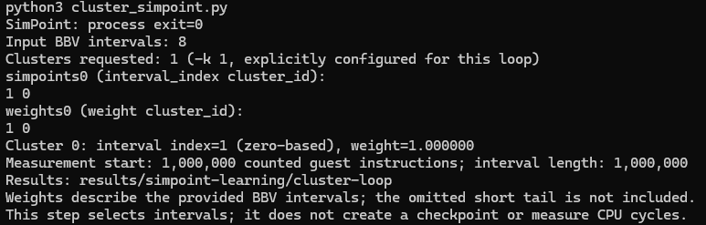

**两个文件恰好都写着 `1 0`，但含义不同。**

| 文件         | 第一列 `1`                           | 第二列 `0` |
| ------------ | ------------------------------------ | ---------- |
| `simpoints0` | 选中区间编号 1，即 BBV 的第 **2 行** | 聚类编号 0 |
| `weights0`   | 这个代表区间的权重为 **1，即 100%**  | 聚类编号 0 |

两份文件通过聚类编号对应起来。区间编号从 **0** 开始，这是 SimPoint 的文件格式规定。[官方格式说明](https://cseweb.ucsd.edu/~calder/simpoint/software-FAQ.htm)

所以，这次结果的意思是：用第 2 个区间，代表输入 BBV 中的全部 8 个区间。

这里的“区间编号”指 BBV 的行；上一轮 `:1:4` 中的 `1` 则是基本块编号，注意它们各自对应的对象。

接着，把区间编号换算成程序的执行进度。我们的区间长度是 100 万条指令，因此：
$$
\text{代表区间起点}=1\times1{,}000{,}000=1{,}000{,}000
$$
也就是：**从 profiling 起点开始，先执行 100 万条指令，再测量后面的 100 万条。** 这是动态执行进度，不是 PC 地址。

权重 `1` 的范围也要看清楚：本次输入只有 **8 个完整区间，共 800 万条指令**，程序末尾未写入 BBV 的短尾没有参与聚类。

另外，本轮是我们指定了 `-k 1`。因此，这个结果用于认识文件接口，不能据此说“算法自动发现程序只有一种行为”。之后换成包含多个执行阶段的负载，再观察聚类选择会更有意义。

结果保存在：

```
practice/minjie/results/simpoint-learning/cluster-loop/
├── simpoints0
├── weights0
└── simpoint.log
```

`simpoint.log` 中保留了实际命令和完整工具输出。

接下来完成检查点的生成与恢复。

实验脚本：

```python
#!/usr/bin/env python3
"""Run a real NEMU architectural checkpoint generation/recovery exercise."""
from pathlib import Path
import gzip
import json
import re
import shlex
import struct
import subprocess
import sys

ROOT = Path(__file__).resolve().parent
NEMU = ROOT / 'NEMU-profile/build/riscv64-nemu-interpreter'
SIMPOINT = ROOT / 'tools/SimPoint-3.2-e51a936/bin/simpoint'
TOOLS = ROOT / 'tools/riscv-binutils/bin'
SRC = ROOT / 'checkpoint_demo'
OUT = ROOT / 'results/checkpoint-learning'
BUILD = OUT / 'build'
INTERVAL = 1_000_000
WARMUP = 100_000
ITERATIONS = 1 << 20
EXPECTED_SUM = ITERATIONS * (ITERATIONS + 1) // 2
MEMORY_BASE = 0x80000000


def run(args, log, stdin=None):
    result = subprocess.run([str(x) for x in args], input=stdin,
                            stdout=subprocess.PIPE, stderr=subprocess.STDOUT,
                            text=True, errors='replace', timeout=30)
    log.parent.mkdir(parents=True, exist_ok=True)
    output = re.sub(r'\x1b\[[0-9;]*m', '', result.stdout)
    log.write_text('Command: '+shlex.join([str(x) for x in args])+'\n'+output,
                   encoding='utf-8')
    if result.returncode:
        raise RuntimeError(f'Command failed (exit={result.returncode}); read {log}')
    return output


def binutil(name):
    return TOOLS / ('riscv64-linux-gnu-'+name)


def build():
    BUILD.mkdir(parents=True, exist_ok=True)
    if not binutil('as').is_file():
        raise RuntimeError('First run: bash prepare_riscv_binutils.sh')
    for path in (NEMU, SIMPOINT):
        if not path.is_file():
            raise RuntimeError(f'Missing prerequisite tool: {path}')
    run([binutil('as'), '-march=rv64imac_zicsr', '-mabi=lp64',
         SRC/'payload.S', '-o', BUILD/'payload.o'], BUILD/'assemble-payload.log')
    run([binutil('ld'), '-T', SRC/'payload.ld', BUILD/'payload.o', '-o', BUILD/'payload.elf'],
        BUILD/'link-payload.log')
    run([binutil('objcopy'), '-O', 'binary', BUILD/'payload.elf', BUILD/'payload.bin'],
        BUILD/'objcopy-payload.log')
    symbols = run([binutil('nm'), '-n', BUILD/'payload.elf'], BUILD/'symbols.log')
    names = {}
    for line in symbols.splitlines():
        fields = line.split()
        if len(fields) == 3:
            names[fields[2]] = int(fields[0], 16)
    restorer = ROOT/'NEMU-profile/resource/gcpt_restore'
    run(['gcc', '-E', '-P', '-x', 'assembler-with-cpp', '-DCPU_NUTSHELL',
         '-D__riscv_xlen=64', '-I'+str(restorer/'src'),
         '-I'+str(ROOT/'NEMU-profile/include/generated'),
         '-DGCPT_PAYLOAD_PATH="'+str(BUILD/'payload.bin')+'"',
         restorer/'src/restore.S', '-o', BUILD/'restore.s'], BUILD/'preprocess-restorer.log')
    run([binutil('as'), '-march=rv64imac_zicsr', '-mabi=lp64', BUILD/'restore.s',
         '-o', BUILD/'restore.o'], BUILD/'assemble-restorer.log')
    run([binutil('ld'), '-T', restorer/'restore.lds', BUILD/'restore.o',
         '-o', BUILD/'workload.elf'], BUILD/'link-restorer.log')
    run([binutil('objcopy'), '-O', 'binary', BUILD/'workload.elf', BUILD/'workload.bin'],
        BUILD/'objcopy-restorer.log')
    return names


def verify_finished(log, names):
    match = re.search(r'HIT GOOD TRAP at pc = (0x[0-9a-fA-F]+)', log)
    if not match or int(match[1], 16) != names['good_trap']:
        raise RuntimeError('The workload did not reach its checked success instruction.')
    if 'privilege mode: U' not in log:
        raise RuntimeError('Expected U-mode completion.')
    values = {}
    for reg in ('t0', 't1', 't2', 's1', 'a1'):
        match = re.search(r'\b'+reg+r': (0x[0-9a-fA-F]+)', log)
        if not match:
            raise RuntimeError(f'Missing final register {reg}')
        values[reg] = int(match[1], 16)
    if values != {'t0': ITERATIONS, 't1': ITERATIONS, 't2': EXPECTED_SUM,
                  's1': EXPECTED_SUM, 'a1': 0x435054}:
        raise RuntimeError(f'Unexpected final state: {values}')
    return values


def counted_instructions(log):
    matches = re.findall(r'total guest instructions = ([0-9,]+)', log)
    if not matches:
        raise RuntimeError('Missing NEMU guest instruction count.')
    return int(matches[-1].replace(',', ''))


def main():
    names = build()
    image = BUILD/'workload.bin'
    monitor_input = 'c\ninfo r\nq\n'
    baseline_log = run([NEMU, image], OUT/'baseline.log', monitor_input)
    baseline = verify_finished(baseline_log, names)
    profile_log = run([NEMU, '-b', image, '--simpoint-profile', '--dont-skip-boot',
                       '--cpt-interval', str(INTERVAL), '-D', OUT, '-C', 'profile',
                       '-w', 'u-loop'], OUT/'profile.log')
    if 'HIT GOOD TRAP' not in profile_log:
        raise RuntimeError('Profiling did not finish normally.')
    bbv = OUT/'profile/u-loop/simpoint_bbv.gz'
    with gzip.open(bbv, 'rt') as f:
        rows = [line for line in f if line.strip()]
    cluster = OUT/'cluster/u-loop'
    cluster.mkdir(parents=True, exist_ok=True)
    for name in ('simpoints0', 'weights0'):
        (cluster/name).unlink(missing_ok=True)
    run([SIMPOINT, '-loadFVFile', bbv, '-inputVectorsGzipped', '-k', '1',
         '-numInitSeeds', '1', '-iters', '1000', '-seedkm', '42', '-seedproj', '43',
         '-saveSimpoints', cluster/'simpoints0', '-saveSimpointWeights', cluster/'weights0'],
        OUT/'cluster.log')
    point, cluster_id = map(int, (cluster/'simpoints0').read_text().split())
    weight_text, weight_id = (cluster/'weights0').read_text().split()
    if int(weight_id) != cluster_id or not 0 <= point < len(rows) or point == 0:
        raise RuntimeError(f'Need a valid nonzero representative interval, got {point}')
    cpt_start = point*INTERVAL-WARMUP
    if cpt_start <= 0:
        raise RuntimeError('Expected a checkpoint after bootstrap.')
    generation_log = run([NEMU, image, '-S', OUT/'cluster', '--dont-skip-boot',
                          '--cpt-interval', str(INTERVAL), '--warmup-interval', str(WARMUP),
                          '--checkpoint-format', 'gz', '-D', OUT, '-C', 'checkpoints',
                          '-w', 'u-loop'], OUT/'generate.log', monitor_input)
    verify_finished(generation_log, names)
    if f'Taking checkpoint @ instruction count {cpt_start}' not in generation_log:
        raise RuntimeError('NEMU did not report taking the expected checkpoint this run.')
    checkpoint_files = list((OUT/'checkpoints/u-loop'/str(point)).glob('*_memory_.gz'))
    if len(checkpoint_files) != 1:
        raise RuntimeError(f'Expected one checkpoint, got {checkpoint_files}')
    checkpoint = checkpoint_files[0]
    with gzip.open(checkpoint, 'rb') as f:
        data = f.read()
    # Read this version's actual layout constants, not the offsets in paper Fig.9.
    header = (ROOT/'NEMU-profile/resource/gcpt_restore/src/restore_rom_addr.h').read_text()
    def macro(name):
        return int(re.search(r'^#define\s+'+name+r'\s+(0x[0-9a-fA-F]+)', header, re.M)[1], 16)
    def u64(offset):
        return struct.unpack_from('<Q', data, offset)[0]
    reg_base = macro('INT_REG_CPT_ADDR')
    saved = {'pc': u64(macro('PC_CPT_ADDR')), 'mode': u64(macro('MODE_CPT_ADDR')),
             't0': u64(reg_base+5*8), 's1': u64(reg_base+9*8),
             'memory_sum': u64(names['memory_sum']-MEMORY_BASE)}
    if u64(macro('BOOT_FLAG_ADDR')) != 0xbeef or saved['pc'] != names['loop']:
        raise RuntimeError('Checkpoint flags/PC do not identify the expected restore state.')
    if saved['mode'] != 0 or not 0 < saved['t0'] < ITERATIONS or saved['s1'] <= 0:
        raise RuntimeError(f'Checkpoint is not a mid-loop U-mode state: {saved}')
    if saved['s1'] != saved['memory_sum']:
        raise RuntimeError('Saved checksum register and memory do not agree.')
    if saved['s1'] != saved['t0']*(saved['t0']+1)//2:
        raise RuntimeError('Saved checksum does not match the saved loop progress.')
    restored_log = run([NEMU, checkpoint], OUT/'restore.log', monitor_input)
    restored = verify_finished(restored_log, names)
    if baseline != restored:
        raise RuntimeError('Restored final registers differ from uninterrupted execution.')
    counts = {'baseline': counted_instructions(baseline_log),
              'restored': counted_instructions(restored_log)}
    if not counts['baseline']-counts['restored'] > cpt_start//2:
        raise RuntimeError('Resume did not skip a substantial part of the original execution.')
    report = {'representative_index': point, 'weight': float(weight_text),
              'nominal_checkpoint_start': cpt_start, 'saved': saved,
              'final': baseline, 'instruction_counts': counts,
              'checkpoint_file': str(checkpoint.relative_to(ROOT)),
              'payload_symbols': names}
    (OUT/'report.json').write_text(json.dumps(report, indent=2)+'\n')
    print('Uninterrupted workload: checked GOOD TRAP, U mode')
    print(f'New workload BBV: {len(rows)} intervals; representative={point}, weight={weight_text}')
    print(f'Checkpoint: PC=0x{saved["pc"]:x}, mode=U, t0={saved["t0"]:,}')
    print(f'Saved checksum: s1={saved["s1"]:,}, memory={saved["memory_sum"]:,}')
    print('Restored workload: checked GOOD TRAP, U mode')
    print(f'Final t0={baseline["t0"]:,}, checksum={baseline["s1"]:,}; states match')
    print(f'Guest instructions: baseline={counts["baseline"]:,}, restored={counts["restored"]:,}')
    print(f'Results: {OUT.relative_to(ROOT)}')


if __name__ == '__main__':
    try:
        main()
    except (OSError, RuntimeError, ValueError, subprocess.TimeoutExpired) as error:
        print(error, file=sys.stderr)
        sys.exit(1)

```

先说明本次负载的变化：当前恢复器支持用户态恢复，前面的短循环运行在机器态。因此，本次使用一个匹配的用户态程序，并为它**重新采集 BBV、重新运行 SimPoint**。采样结果必须对应同一份程序。

这个程序计算：
$$
1+2+\cdots+1{,}048{,}576=549{,}756{,}338{,}176
$$
循环每轮从内存读取旧的累加值，更新后写回；最后检查计数器、寄存器中的和、内存中的和是否正确。因此，后续结果确实依赖保存的寄存器和内存状态。

脚本会依次完成：

1. **从头执行一次**，取得正确结果作为对照。
2. 为新负载生成 BBV，并运行 SimPoint。
3. 重新运行 NEMU，在选定位置保存检查点。
4. 启动一个**新的 NEMU 进程**，加载检查点并恢复执行。
5. 对比两次运行所检查的应用寄存器和内存结果。

其中 profiling、聚类、再次执行并生成检查点的顺序，与[香山官方工具文档](https://docs.xiangshan.cc/zh-cn/latest/tools/simpoint/#simpoint-checkpoint)一致。

得到：

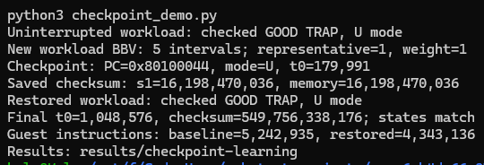

新负载实测生成了 5 个完整区间，代表编号仍为 1。区间长度为 100 万条指令，提前保留的预热长度设为 10 万条，因此取点位置是：
$$
1\times1{,}000{,}000-100{,}000=900{,}000
$$
即在已执行 **90 万条指令**时保存。这是指令计数；循环每轮有 5 条指令，所以并非已经循环了 90 万次。

实际读到的检查点内容是：

```
PC = 0x80100044
运行模式 = U
计数器 t0 = 179,991
寄存器中的累加和 = 16,198,470,036
内存中的累加和   = 16,198,470,036
```

这些非零值表明，保存的是循环中途的状态。

恢复后，程序继续计算，实测对比如下：

| 检查项     | 从头执行        | 从检查点恢复    |
| ---------- | --------------- | --------------- |
| 最终计数器 | 1,048,576       | 1,048,576       |
| 最终累加和 | 549,756,338,176 | 549,756,338,176 |
| 程序结果   | GOOD TRAP       | GOOD TRAP       |
| 执行指令数 | 5,242,935       | 4,343,136       |

恢复运行少执行了 **899,799 条指令**。它跳过了保存位置之前的执行过程，同时额外执行了恢复程序，所以减少的数量略小于 90 万条。

这比单看 `GOOD TRAP` 更有说服力：**检查点里有中途状态，恢复后结果正确，而且没有把整个循环重新跑一遍。**

生成的检查点是：

```
results/checkpoint-learning/checkpoints/u-loop/1/_1_1.000000_memory_.gz
```

各阶段日志和状态报告都在：

```
results/checkpoint-learning/
```

其中 `report.json` 汇总保存值和最终结果，`restore.log` 记录恢复运行。

本轮恢复端也使用 NEMU，验证的是架构检查点和恢复程序。接入 RTL 后，才会进一步涉及微架构预热和 CPI 测量。

## 6 差分验证

工具链：NutShell RTL → Verilator 仿真程序 → 官方 DiffTest → NEMU 参考模型

这项实操先掌握**单核提交级差分检查**。论文中的多核 Cache 错误，仍以上面的原文案例来分析。

在 Ubuntu 执行实验脚本 `difftest_demo.py`：

```
cd /path/to/minjie

python3 difftest_demo.py
```

它会运行两个独立版本：

- **正常 RTL**：应通过比较，得到 `GOOD TRAP`。
- **错误 RTL**：仅对 `SUB` 运算翻转结果最低位，检查 DiffTest 是否捕获错误。

测试程序和 REF 完全相同。对于 `8−5`，正确结果为 3，错误版本会向 `t2` 写入 2。

实际得到：

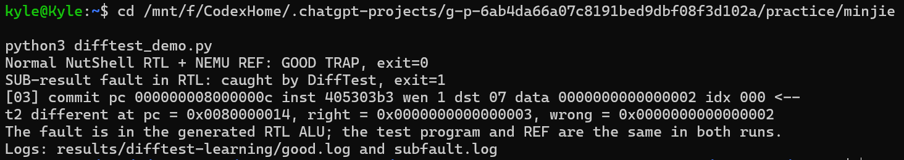

错误日志还给出了提交记录：

```
commit pc 000000008000000c inst 405303b3
wen 1 dst 07 data 0000000000000002
```

它表示：地址 `0x8000000c` 的指令提交时，向寄存器 `x7`，也就是 `t2`，写入了 **2**。随后比较报告显示参考值为 **3**、DUT 值为 **2**。

程序退出前加入了几条 `nop`，让最后的被测运算完成提交和比较。错误版本被拦截是这次实验的预期结果；脚本整体成功，表示“正常版本通过、注入错误被捕获”这两项都成立。

> [!TIP]
>
> 日志里的两个 PC 对应不同的记录。`0x8000000c` 来自 **Commit Instr Trace**，是写出错误值的 `sub t2, t1, t0` 的地址。`wen 1 dst 07 data ...0002` 表示这条指令确实向 `x7`（`t2`）写了 2。`0x80000014` 是检查器打印差异和结束仿真时使用的 DUT 上下文地址。
