# 香山开源高性能 RISC-V 处理器设计与实现

[阅读论文 PDF（完整 18 页）](paper.pdf "香山开源高性能 RISC-V 处理器设计与实现；原论文 PDF")

## 1 香山设计总览

### 1.1 研究对象：ISA 与微架构

参数、结构和实现状态均以这篇 2023 年论文为准，不代表当前香山版本。论文发表时，雁栖湖已回片验证，南湖仍处于流片前的优化阶段。

香山是采用 RISC-V 指令集的超标量乱序处理器，由 Chisel 硬件描述语言实现。理解它需要区分三个层面：

| 概念 | 含义 | 不应混淆的边界 |
| --- | --- | --- |
| 指令集架构（ISA） | 规定软件可见的指令语义、寄存器和异常等行为 | 不规定必须有多少执行单元、采用多大的 ROB |
| 超标量（Superscalar） | 每周期可以并行处理多条指令 | 标称宽度不等于每周期实际完成数量 |
| 乱序执行（OoO） | 在依赖和资源条件允许时，让已就绪的指令提前执行 | 真实数据依赖仍须满足，投机结果须经过检查 |

**微架构**是实现 ISA 的具体组织方式，包括流水线、分支预测、寄存器重命名、队列和缓存等。香山允许内部乱序执行，通过按序提交与出错恢复维持正确的体系结构行为；执行完成和提交是不同事件。

#### 1.1.1 指令集标记怎样读

论文表 1 中，雁栖湖支持 `RV64GC`，南湖支持 `RV64GCBK`。这些标记可以分解为：

| 标记 | 含义 |
| --- | --- |
| `RV64` | 64 位 RISC-V 基础架构，整数寄存器宽度 `XLEN=64` |
| `G` | 通用指令集组合：`I + M + A + F + D + Zicsr + Zifencei` |
| `C` | 压缩指令扩展，为常见操作提供 16 位编码，可与 32 位指令混用 |
| `B` | 位操作扩展，提供更丰富的旋转、位计数、单比特操作和地址生成等指令 |
| `K` | 论文对标量密码运算扩展的标记 |

`I` 是基础整数指令集；`M` 提供整数乘除法；`A` 提供原子访存；`F/D` 提供单精度/双精度浮点；`Zicsr` 提供控制与状态寄存器访问；`Zifencei` 提供取指同步。[RISC-V 规范](https://docs.riscv.org/reference/isa/v20240411/_attachments/riscv-unprivileged.pdf)

`XLEN=64` 描述整数寄存器宽度，不能直接用来断言实现支持 64 位虚拟地址或物理地址。论文采用的 Sv39 分页机制另见第 4 章。

位操作和密码指令以更专门的操作减少相关算法所需的指令数。密码指令家族包含 AES、SHA、SM3、SM4 等算法所需的运算，但论文的 `B/K` 标记不能据此推导完整的子扩展清单。规范使用 `Zba`、`Zbb`、`Zbs` 及 `Zk*` 等名称精确描述扩展组合；本笔记保留论文标记，不将后来标准的全部能力直接套入南湖。[位操作规范](https://docs.riscv.org/reference/isa/v20240411/unpriv/b-st-ext.html) [RISC-V 规范](https://docs.riscv.org/reference/isa/v20240411/_attachments/riscv-unprivileged.pdf)

`FENCE` 与 `FENCE.I` 也应区分：前者约束指定类别的访存和 I/O 的可观察顺序；后者同步本核此前可见的存储与随后取指。它们不能统一理解为“所有指令都不得跨过的执行栅栏”。

### 1.2 两代结构与参数

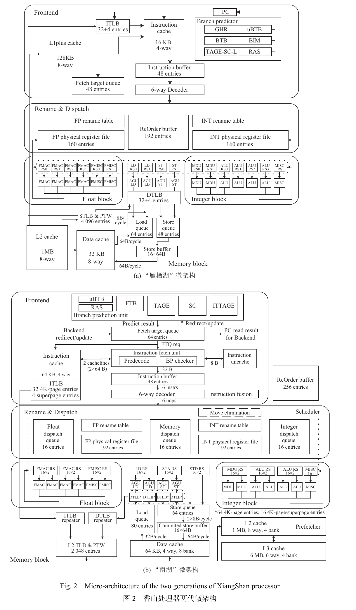

*图 1-1：论文图 2，两代香山微架构。来源：PDF 第 4 页，期刊第 479 页。*

阅读总体结构时，可以沿着指令流划分四部分：

1. **前端供指**：预测后续控制流，取指、预译码并存入指令缓冲。
2. **乱序执行**：译码、重命名、分派；调度就绪指令进入执行单元，完成后等待按序提交。
3. **访存子系统**：计算访存地址、翻译地址、检查访问权限和内存依赖，执行 load/store。
4. **缓存子系统**：保存指令与数据的副本，降低访存延迟，并协调各缓存间的一致性。

雁栖湖采用紧耦合的四级前端，配置分离的整数与浮点寄存器堆、分布式保留站、两条 load 与两条 store 流水线。单核流片版本使用 L2，并在指令侧增加 L1+，缓解较小 L1 指令缓存带来的容量不足。南湖沿用整体框架，改为解耦前端、双核与三级缓存。

#### 1.2.1 两代流片参数

下表转录论文表 1。数值表示该论文版本的配置；“—”对应原表空项。频率及流片状态应结合论文发表时点理解。[论文表 1：两代参数（PDF 第 3 页）](paper.pdf#nameddest=Table1 "期刊第 478 页；表 1：两代香山处理器流片参数对比")（[页码备用](paper.pdf#page=3 "期刊第 478 页；表 1：两代香山处理器流片参数对比；书签不受支持时按页码打开")）

| 参数 | 雁栖湖 | 南湖 |
| --- | --- | --- |
| 指令集 | RV64GC | RV64GCBK |
| 流片工艺 | 28 nm | 14 nm |
| 频率 | 1.3 GHz | 2 GHz |
| 处理器核数 | 1 | 2 |
| 取指宽度 | 8×4 B/周期 | 8×4 B/周期 |
| 译码与重命名宽度 | 6 | 6 |
| ROB/LQ/SQ 项数 | 192/64/48 | 256/80/64 |
| 整数/浮点物理寄存器堆项数 | 160/160 | 192/192 |
| uBTB 项数 | 32 | 32 |
| BTB 项数 | 2048 | 4096 |
| 其他分支预测器 | TAGE-SC-L、RAS | TAGE-SC、RAS、ITTAGE |
| L1 指令缓存 | 16 KiB，4 路 | 64 KiB，4 路 |
| L1 数据缓存 | 32 KiB，8 路 | 64 KiB，4 路 |
| L1+ 缓存 | 128 KiB，8 路 | — |
| L2 缓存 | 1 MiB，8 路，包含式 | 1 MiB，8 路，非包含式 |
| L3 缓存 | — | 6 MiB，6 路，非包含式 |
| ITLB 项数 | 32+4 | 32+4 |
| DTLB 项数 | 32+4 | 64+16 |
| 共享 TLB 项数 | 4096 | 2048 |

*表 1-1：论文表 1，两代流片参数对比。来源：PDF 第 3 页，期刊第 478 页；原表 KB/MB 容量按缓存惯例规范写为 KiB/MiB。*

南湖中，每核拥有自己的 L1 和私有 L2，两个核心共享 6 MiB L3。因此表中的 1 MiB L2 不能理解成两个核心共同使用的总容量。共享 TLB 则是核内指令侧与数据侧共享的翻译结构，不是两个核心共用一个 TLB。

### 1.3 宽度、容量与 IPC

**带宽、每周期处理宽度和队列容量描述不同的限制，不能相互替代。**

| 参数 | 单位 | 解释 |
| --- | --- | --- |
| 取指宽度 | B/周期 | 每周期最多供给多少字节的指令流 |
| 译码、重命名、分派宽度 | 条/周期 | 对应流水级每周期最多处理多少条指令 |
| 提交宽度 | 条/周期 | 每周期最多按序退休多少条指令 |
| ROB/LQ/SQ 容量 | 项 | 最多跟踪多少个尚未完成生命周期的指令或访存操作 |
| 物理寄存器堆容量 | 项 | 可保存多少个物理寄存器值，整数堆与浮点堆分别计数 |
| IPC | 指令/周期 | 实际平均每周期退休的指令数量 |

两代的取指带宽均为 `8×4 B = 32 B/周期`。若全部是 32 位指令，相当于 8 条指令的数据；混入 16 位压缩指令后，字节数对应的指令数量会改变，因此不能固定记成“每周期取 8 条”。

论文描述译码、重命名、分派每级最多处理 6 条指令，ROB 每周期最多接收和提交 6 条。取指与后端之间有指令缓冲，前端先积累供给，后端再按资源状态消费；两者的瞬时带宽不必相等。不过缓冲只能吸收波动，不能消除长期供给不足。

南湖的 ROB 有 256 项，表示可跟踪的未提交指令窗口容量，不代表每周期执行 256 条。更大的窗口有机会找到更多独立指令，但实际并行度仍受保留站、物理寄存器、执行单元和访存资源限制。LQ/SQ 分别跟踪 load/store 的状态，不能把其项数当作 load/store 流水线条数或每周期访问次数。

本笔记用提交口径理解 IPC：

$$
\mathrm{IPC}=\frac{\text{退休指令数}}{\text{时钟周期数}}.
$$

标称“6 发射”不能理解成实际 IPC 恒为 6。分支预测错误、数据依赖、缓存未命中及资源冲突都会降低吞吐。频率表示每秒有多少周期；固定动态指令数时，执行时间可近似写为“指令数 ÷（IPC × 频率）”。因此比较性能要同时考虑 IPC 和频率。

### 1.4 南湖的主要演进

南湖的变化围绕供指、执行和数据供给展开，而非简单地放大全部参数：

| 方向 | 相对雁栖湖的变化 | 目的 |
| --- | --- | --- |
| 前端 | 分支预测与取指解耦；扩大 BTB，引入 ITTAGE | 减少供指停顿，提高预测准确率与吞吐 |
| 执行 | 新增位操作、标量密码指令；改进兼容 IEEE-754 的浮点部件 | 扩展功能并提高相关运算效率 |
| 乱序资源 | 扩大 ROB、LQ/SQ 和物理寄存器堆 | 增加可跟踪的在途工作与并行机会 |
| 访存 | 增加物理内存保护、可配置物理内存属性，调整流水线 | 完善访问检查，改善时序和并行处理 |
| 缓存 | 增大 L1；采用非包含式 L2/L3；双核共享 L3 | 改善有效容量、并发度和访存延迟 |

这些改动的具体机制分别在第 2–5 章展开。缓存容量、相联度或队列项数的变化，本身不能直接证明某项程序性能提高多少。

### 1.5 设计取舍

论文将高性能处理器设计概括为两个层面的平衡。[宏观平衡（PDF 第 3 页）](paper.pdf#page=3 "期刊第 478 页；第 1 节末段：1）宏观上，前端、乱序执行与访存数据供给的平衡")；[微观平衡（PDF 第 5 页）](paper.pdf#page=5 "期刊第 480 页；页首续段：2）微观上，各流水级功能与时序的平衡")

- **宏观平衡**：前端供指、后端乱序执行和访存数据供给需要匹配。某一部分持续阻塞，会限制其他部分资源的利用率；扩大 ROB 无法自动解决缓存或预测瓶颈。
- **微观平衡**：各流水级的逻辑复杂度和时序需要协调。把更多工作压入一级可能减少周期数，却降低可达到的频率；增加流水级可能提高频率，却增加依赖链延迟。

据此，优化有两条主要路径：**增加可并行的工作**，例如挖掘指令级、访存级并行；**降低串行路径的延迟**，例如改善数据通路，使用推测并在之后核验。判断设计收益，需要同时观察程序性能、面积、功耗和时序，而不能只比较单个参数的大小。

## 2 前端供指单元

前端由取指单元和分支预测器组成，负责取得指令，并决定接下来沿哪条路径取指。高性能处理器每周期可以执行多条指令，因此前端既要提高取指吞吐，也要尽早预测控制流，减少后端等待指令的时间。[论文 §2：前端供指单元（PDF 第 5 页）](paper.pdf#nameddest=s02 "期刊第 480 页；第 2 节首段：取指单元、分支预测器与并行高吞吐供指")（[页码备用](paper.pdf#page=5 "期刊第 480 页；第 2 节首段：取指单元、分支预测器与并行高吞吐供指；书签不受支持时按页码打开")）

### 2.1 分支预测：方向与目标

条件分支的真实结果要等源操作数就绪、指令进入执行单元后才能确定。如果前端一直等待，每次遇到分支都可能中断供指。分支预测让前端先沿预测路径取指，执行阶段再核验结果；预测错误时，处理器作废错误路径上的投机指令并重定向。

以 `beq x1, x2, target` 为例，前端需要解决两个问题：

| 问题 | 含义 | 相关部件 |
|---|---|---|
| 方向：跳不跳 | 条件分支是 Taken（T）还是 Not Taken（N） | BIM、TAGE、SC、循环预测器；uBTB 也提供早期方向预测 |
| 目标：跳到哪里 | 预测跳转后的指令地址 | BTB、FTB；RAS 预测返回目标，ITTAGE 预测间接跳转目标 |

直接跳转的目标可以从指令 PC 和立即数计算，但早期预测时指令内容可能尚未返回，BTB 仍能帮助前端提前取得目标。间接跳转的目标来自寄存器，通常要到执行时才能精确计算。**方向预测和目标预测是不同任务，一个部件也可能同时提供两类信息。**

### 2.2 雁栖湖：紧耦合前端

#### 2.2.1 四级取指流水线与三级预测结果

雁栖湖最大取指宽度为每周期 32 B，对应最多 8 条 4 B 普通指令或 16 条 2 B 压缩指令；译码宽度为每周期 6 条。这里的 32 B 是一批取指数据的规模，不能据此把每条指令或整个缓存行都理解为 32 B。取回的数据经过切分、检查后，送入指令缓冲（IBuffer）。[论文 §2.1：取指宽度与四级流水线（PDF 第 5 页）](paper.pdf#nameddest=s02.01 "期刊第 480 页；第 2.1 节开头及 F1–F4 流水级说明")（[页码备用](paper.pdf#page=5 "期刊第 480 页；第 2.1 节开头及 F1–F4 流水级说明；书签不受支持时按页码打开")）；[论文表 1：译码与重命名宽度（PDF 第 3 页）](paper.pdf#nameddest=Table1 "期刊第 478 页；表 1：取指宽度、译码与重命名宽度")（[页码备用](paper.pdf#page=3 "期刊第 478 页；表 1：取指宽度、译码与重命名宽度；书签不受支持时按页码打开")）

| 前端流水级 | 取指及检查工作 | 同一请求的预测结果 |
|---|---|---|
| F1 | 选择请求 PC，并行访问 L1 指令缓存和分支预测器 | 发起预测 |
| F2 | 接收早期跳转方向和目标 | BP1：uBTB，延迟 1 周期 |
| F3 | 接收 32 B 指令数据，切分指令并预译码 | BP2：BTB+BIM，延迟 2 周期 |
| F4 | 利用预译码信息计算直接跳转、条件分支的目标；检查预测；选出最早预测 Taken 的指令；将指令打包送入 IBuffer | BP3：TAGE-SC-L；RAS 利用已取得的预译码信息预测返回目标 |

F1～F4 是前端的流水级，BP1～BP3 是预测结果的覆盖层次。表中的 1、2、3 周期描述同一请求不同结果的可用时间，不能相加成 6 周期，也不能将两组名称相加成 7 级流水线。

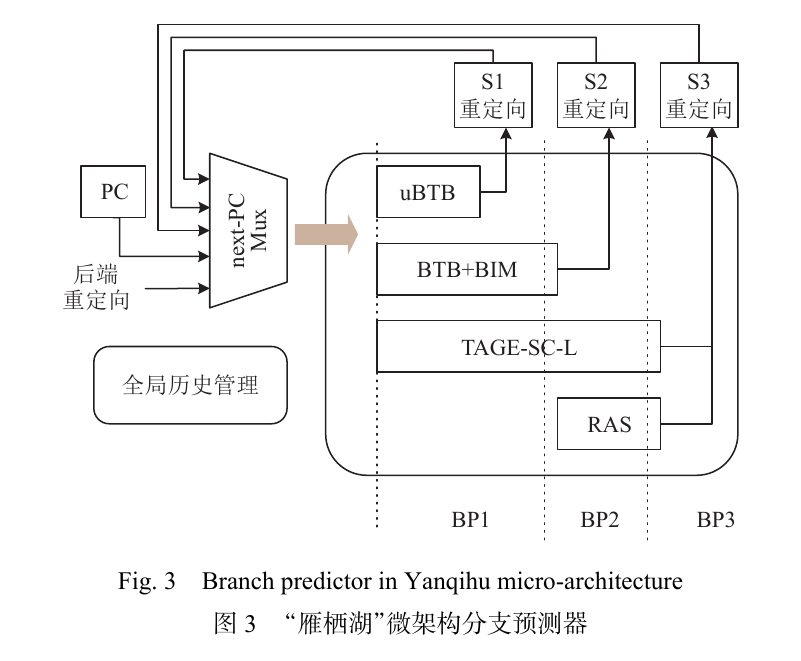

*图 2-1　论文图 3，PDF 第 5 页、期刊第 480 页。较晚产生的预测结果通过重定向路径参与 next-PC 选择。*

选择 next-PC 时，前端综合顺序地址、预测目标以及前后端重定向等候选输入，选出一个请求地址。单周期 uBTB 结果能够参与后续请求地址的选择：在资源可用、预测无需覆盖时，可以提供无气泡的预测流。不能把“F2 得到结果”额外解释成“先固定发出顺序请求，再等一个周期才能发出目标请求”；雁栖湖实现中，F2 的一级预测结果直接参与同期 F1 的地址选择。[雁栖湖前端源码](https://github.com/OpenXiangShan/XiangShan/blob/yanqihu/src/main/scala/xiangshan/frontend/IFU.scala)

#### 2.2.2 后级覆盖早期结果

准确率较高的预测器往往更复杂，产生结果也较晚。雁栖湖采用论文所称的“前向覆盖”：先使用快速预测，再在后级比较较复杂预测器的结果；不一致时，采用后级结果，冲刷受影响的较年轻前端请求并更新取指地址。

例如，同一条件分支的预测依次为：

| 结果层次 | 预测 | 前端处理 |
|---|---|---|
| BP1 | Taken，目标 A | 先沿 A 继续取指 |
| BP2 | Not Taken | 覆盖 BP1，转向顺序路径，清除受影响的 A 路径请求 |
| BP3 | Not Taken | 与 BP2 一致，继续使用顺序路径 |

若 BP3 又与 BP2 不一致，还会再次覆盖。后级覆盖能减少错误路径进入后端的机会，但它本身仍是预测结果，不能保证一定正确。最终的条件分支方向仍由执行结果核验；前端的预译码不能直接知道 `x1`、`x2` 是否相等。

#### 2.2.3 子预测器的职责与实现

| 子预测器 | 主要作用 | 雁栖湖的实现与延迟 |
|---|---|---|
| uBTB | 快速提供分支目标和条件分支方向 | 寄存器实现的小容量全相联结构；1 周期；方向使用两位饱和计数器 |
| BTB | 提供更大容量的目标记录 | SRAM 实现，2 路组相联；2 周期 |
| BIM | 提供条件分支方向预测 | SRAM 实现，2 路组相联；与 BTB 在 2 周期给出结果 |
| TAGE-SC-L | 利用分支历史提高方向预测准确率 | 64 b 分支历史和指令 PC 参与索引，6 张历史表；结合统计纠正器 SC 和循环预测器；3 周期 |
| RAS | 预测函数返回地址 | 返回地址栈；自身可在 1 周期给出结果，但须先识别调用、返回指令 |

TAGE-SC-L 先利用不同长度的历史得到方向预测，SC 对预测进行统计纠正，循环预测器帮助判断循环退出。这里记录的是论文中雁栖湖的简化实现，具体规模和延迟不应套用后来其他代际的香山设计。[TAGE-SC-L 实现（PDF 第 6 页）](paper.pdf#page=6 "期刊第 481 页；页首续段：3 周期、64 位历史、6 个历史表、SC 和循环预测器")；[TAGE-SC-L 起始说明（PDF 第 5 页）](paper.pdf#page=5 "期刊第 480 页；第 2.1 节末：3）TAGE-SC-L 的起始说明，跨页续至 PDF 第 6 页")

uBTB 用部分 PC 信息匹配表项，保存的目标低位与当前 PC 高位拼接成预测地址。论文使用“PC 低位索引”的说法，同时明确它是全相联结构；不能据此把它改画成按索引只读取一个固定表项的直接映射表。

uBTB 命中表示找到了与当前查询匹配的历史控制流记录，不等于完整译码已经确认当前指令类型，也不保证目标正确。部分地址匹配和目标截断可能产生误预测，后级检查与执行核验负责恢复。uBTB 中的方向计数器也只是目标表项的一部分，不能把整个 uBTB 简化成方向计数器。

#### 2.2.4 两位饱和计数器：保留跳转倾向

| 状态值 | 名称 | 预测 |
|---:|---|---|
| 0 | 强不跳转 | N |
| 1 | 弱不跳转 | N |
| 2 | 弱跳转 | T |
| 3 | 强跳转 | T |

先按当前状态预测，再用真实结果更新：实际 T 时加一，最大为 3；实际 N 时减一，最小为 0。达到边界后不再改变，所以称为“饱和”。从强跳转变成预测不跳转，需要连续两次 N，体现了对单次反常结果的滞后性。

设同一循环末尾分支的实际序列为 `T T T T T T T N`，计数器初态明确设为 1：

| 次数 | 预测前状态 | 预测 | 实际 | 是否正确 | 更新后状态 |
|---:|---:|---|---|---|---:|
| 1 | 1 | N | T | 错误 | 2 |
| 2 | 2 | T | T | 正确 | 3 |
| 3 | 3 | T | T | 正确 | 3 |
| 4 | 3 | T | T | 正确 | 3 |
| 5 | 3 | T | T | 正确 | 3 |
| 6 | 3 | T | T | 正确 | 3 |
| 7 | 3 | T | T | 正确 | 3 |
| 8 | 3 | T | N | 错误 | 2 |

本轮正确 6 次、错误 2 次：首次 T 是冷启动误预测，最后 N 是循环退出误预测。若下一轮仍是同一序列，且期间没有其他更新或表项替换，初态会是 2，通常只有退出时错误。不能在初态 1 的例子中写成“只错最后一次”。

这个例子只展示通用计数器规律，不规定香山表项的实际初始化策略。对于 `T N T N` 之类的交替模式，单个计数器缺少识别序列的能力，其表现还取决于初态；更丰富的分支历史能帮助预测有相关性的模式。

#### 2.2.5 预译码与返回地址栈

预译码先识别与取指相关的信息：指令长度、条件分支、直接或间接跳转、调用和返回等。完整译码则继续生成运算类型、源/目的寄存器和执行控制信息。F4 可以利用指令立即数核验直接目标，或者发现无条件跳转被预测为不跳转；条件分支真实方向仍须等待执行。

RAS 利用函数调用与返回通常成对嵌套的规律。在识别调用后，把“调用后的下一条指令地址”压入预测栈；遇到返回时，用栈顶预测目标并弹栈。例如：

```asm
# 假设该调用指令位于 0x1000，长度为 4 B
jal  x1, foo       # 链接地址为 0x1004，RAS 记录此返回地址
# 调用后的其他指令省略
foo:
    # 函数体省略
    ret           # 伪指令：jalr x0, 0(x1)
```

这里压入的是 `0x1004`，而非调用指令本身的 `0x1000`。普通 32 位调用的返回地址为 `pc+4`，适用的压缩调用指令为 `pc+2`。[RISC-V 规范](https://docs.riscv.org/reference/isa/v20240411/_attachments/riscv-unprivileged.pdf)

雁栖湖须等预译码识别调用/返回后才能使用 RAS，因此“RAS 自身 1 周期”不表示从 F1 发起时即可取得返回预测。RAS 是前端的投机预测结构，不是软件栈，也不会等函数调用在后端执行完才开始预测。

#### 2.2.6 多批 PC 与流水吞吐

假设没有分支、重定向或阻塞，从对齐地址 `0x1000` 开始，每批顺序取 32 B。记 A=`0x1000`、B=`0x1020`、C=`0x1040`、D=`0x1060`：

| 周期 | F1 | F2 | F3 | F4 |
|---|---|---|---|---|
| N | A | — | — | — |
| N+1 | B | A | — | — |
| N+2 | C | B | A | — |
| N+3 | D | C | B | A |

A 移动到 F3 时，F1 已在处理 C，但 A 的 PC 仍随该批请求保存在流水信息中。处理器中同时存在多个不同批次的 PC，不能把整个前端理解为只有一个不断变化的地址。

单批请求经过多个流水级，流水线填满后仍可每周期启动一批请求。**延迟描述一批请求多久完成，吞吐描述单位时间完成多少批。** IBuffer 暂存已经取回的指令；当缓存缺失或重定向短暂打断取指时，它还能利用已有内容继续供给译码，但缓冲耗尽后也会等待。

### 2.3 南湖：解耦前端

#### 2.3.1 FTQ 与取指单元的生产者—消费者关系

紧耦合前端把预测与取指放在同一推进链路中，缓存等待和前端冲刷容易影响后续预测。南湖从流水线逻辑上将二者解耦：分支预测器产生未来取指块的信息，取指目标队列（FTQ）暂存这些信息，取指单元按队列内容请求指令。

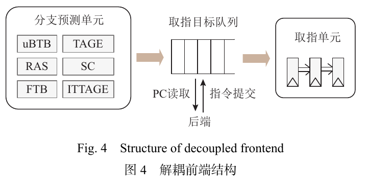

*图 2-2　论文图 4，PDF 第 6 页、期刊第 481 页。FTQ 连接预测、取指和后端反馈。*

只要 FTQ 还有空闲项，取指单元因缓存等待而阻塞时，预测器仍可向前预测。队列中的超前指令流还可以指导指令缓存预取，提前准备可能需要的数据。队列容量有限，满后预测仍会受阻；解耦减少的是部分供指等待，并未消除缓存缺失本身的取数延迟。

论文表 2 已列出雁栖湖的 48 项 FTQ，南湖为 64 项。因此，两代差别应表述为 **FTQ 在南湖承担预测与取指之间的解耦接口**，不能写成“雁栖湖完全没有 FTQ”。

| 缓冲结构 | 所处边界 | 主要保存内容 |
|---|---|---|
| FTQ | 分支预测器与取指单元之间 | 待取指块的地址、范围及关联预测信息 |
| IBuffer | 取指与译码之间 | 已经取回、经过前端处理的指令 |

南湖 FTQ 还保存用于训练预测器、恢复 RAS/分支历史的预测信息，并向后端提供 PC。取指单元读取一项，不代表该项全部信息立即释放；对应预测块的有效指令提交完成后，相关信息才用于训练并释放。预译码或后端发现预测问题时，FTQ 参与重定向和状态恢复。[南湖 FTQ 文档](https://docs.xiangshan.cc/projects/design/zh-cn/nanhu/frontend/ftq/)

#### 2.3.2 FTB：按预测块组织目标信息

南湖用取指目标缓冲（FTB）替代传统 BTB。论文将预测块定义为**长度不超过 32 B、最多包含两条分支指令的指令块**。FTB 记录块内分支与起始地址相关信息，并预测块的结束地址，帮助确定本次取指范围和后续地址。[论文 §2.2：FTB 与预测块（PDF 第 6 页）](paper.pdf#nameddest=s02.01_1 "期刊第 481 页；第 2.2 节中以“此外”开头的分支预测器优化段：预测块不超过 32 B、最多含 2 条分支")（[页码备用](paper.pdf#page=6 "期刊第 481 页；第 2.2 节中以“此外”开头的分支预测器优化段：预测块不超过 32 B、最多含 2 条分支；书签不受支持时按页码打开")）

预测块是前端组织预测请求的单位，其长度和边界由预测信息决定。它不等于“永远取满的对齐 32 B 数据块”，也不能直接等同编译器意义上的基本块：基本块强调中间没有控制流分支，而论文中的预测块允许包含多条分支。

#### 2.3.3 ITTAGE 与间接跳转

直接跳转 `jal x1, foo` 的目标由当前 PC 和立即数计算；函数指针调用则可能使用：

```asm
jalr x1, 0(x10)    # x10 保存运行时的函数地址；x1 保存返回地址
```

同一条调用指令在不同运行上下文中可能跳到不同函数，单纯记住上次目标未必足够。南湖新增 ITTAGE，利用历史信息预测间接跳转目标；函数返回则优先利用 RAS 所反映的调用嵌套关系。

普通 32 位 `jalr rd, imm(rs1)` 的指令语义为：目标地址取 `rs1` 与符号扩展立即数的和，再清零最低位；同时将 `pc+4` 写入 rd。若 rd=x0，仅表示丢弃本次新生成的链接地址，不代表“之后不会返回”。`ret` 自身就是 rd=x0 的 JALR。[RISC-V 规范](https://docs.riscv.org/reference/isa/v20240411/_attachments/riscv-unprivileged.pdf)

x1、x5 是 RISC-V 的常用/备用链接寄存器，其编码提供 RAS 提示。`jalr x0,0(x5)` 会提示返回操作，因此不适合拿来展示与 RAS 无关的普通函数指针跳转；这里改用 x10 保存目标。

### 2.4 两代演进与性能指标

下表按论文表 2 整理。BTB/FTB 容量沿用论文的“条分支”口径，不自行改写成相同数量的预测块条目。

| 功能点 | 雁栖湖 | 南湖 |
|---|---|---|
| 前端组织 | 紧耦合 | 预测与取指解耦 |
| BTB/FTB 分支容量与组织 | 2048 条，2 路 | 4096 条，4 路；FTB 按预测块组织 |
| TAGE 延迟 | 3 周期 | 2 周期 |
| 分支历史 | 压缩，64 b | 准确，119 b |
| 专门的间接跳转预测 | 未配置 ITTAGE | 新增 ITTAGE |
| RAS 容量 | 16 项 | 32 项 |
| FTQ 容量 | 48 项 | 64 项 |

表中的“压缩/准确”沿用论文描述，表示两代分支历史记录方式的变化，不能把 119 b 仅解释成由 64 b 机械增加位宽，或把它当作预测准确率。

MPKI（Mispredictions Per Kilo Instructions）表示每千条程序指令的误预测次数：

$$
\mathrm{MPKI}=\frac{\text{统计范围内的误预测次数}}{\text{程序指令数}}\times1000
$$

“条件分支 MPKI”的分子仅计条件分支误预测，分母仍是程序指令数，不是条件分支数。例如，执行 100 万条指令，其中条件分支误预测 2000 次，对应 MPKI 为 2；误预测降至 1600 次，MPKI 为 1.6，相对降低 20%。

论文针对 **SPEC CPU2006** 报告：南湖解耦前端使取指气泡平均降低约 50%，条件分支 MPKI 降低 20% 以上；新增 ITTAGE 也使间接跳转误预测次数明显降低。这些是特定测试集上的前端指标，不能直接写成所有程序或整个处理器性能提升 20%/50%。[解耦前端实验结果（PDF 第 6 页）](paper.pdf#page=6 "期刊第 481 页；第 2.2 节表 2 前段末：SPEC CPU2006 取指气泡与条件分支误预测改进")

## 3 乱序执行单元

乱序执行单元解决两个相互联系的问题：怎样让已经具备执行条件的指令尽早计算，以及怎样保证这些计算最终形成正确的程序状态。寄存器重命名消除名字复用带来的伪依赖，保留站动态选择可执行指令，ROB 则保持提交顺序。设计目标是在面积、时序和布线约束下，提高并行度并缩短依赖链的等待时间。[论文 §3：乱序执行单元（PDF 第 6 页）](paper.pdf#nameddest=s04 "期刊第 481 页；第 3 节首段：重命名、动态调度、并行度与计算延迟")（[页码备用](paper.pdf#page=6 "期刊第 481 页；第 3 节首段：重命名、动态调度、并行度与计算延迟；书签不受支持时按页码打开")）；[ROB 与按序提交（PDF 第 7 页）](paper.pdf#page=7 "期刊第 482 页；第 3.1 节以“为实现指令按序提交”开头的 ROB 段")

本章参数对应论文中的雁栖湖与南湖。指令、物理寄存器编号及周期图用于解释机制；教学假设与论文给出的配置分别注明。

### 3.1 总体路径：执行与提交并行跟踪

香山将乱序执行单元划分为控制、整型和浮点三个模块。控制模块包括译码、重命名和分派：译码将前端指令转换成结构化信息；重命名确定源操作数的物理位置，并为目的寄存器建立新版本；分派再将指令送入适合的调度结构。[论文 §3.1：模块划分与控制流程（PDF 第 6 页）](paper.pdf#nameddest=s04.01 "期刊第 481 页；第 3.1 节前三段：控制、整型、浮点模块及译码、重命名、分派")（[页码备用](paper.pdf#page=6 "期刊第 481 页；第 3.1 节前三段：控制、整型、浮点模块及译码、重命名、分派；书签不受支持时按页码打开")）

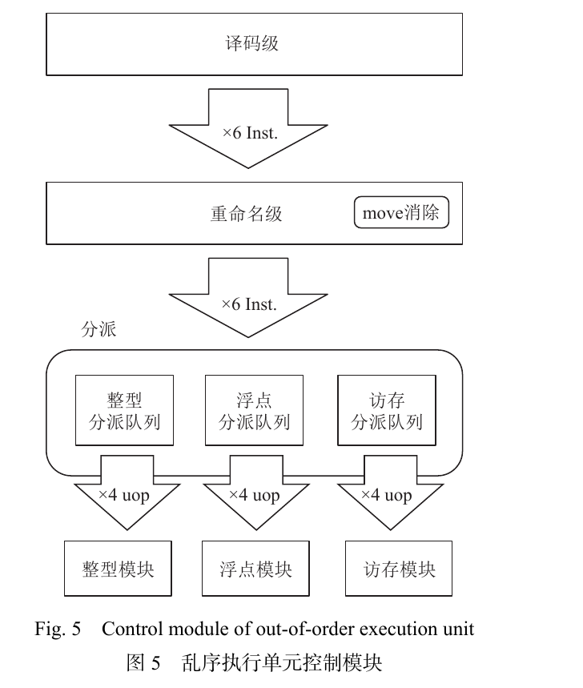

*论文图 5，PDF 第 7 页／期刊第 482 页。每类分派队列的输出带宽与全局译码宽度是不同参数。*

图 5 的分派分为两级：第一级按整型、浮点和访存类型进入各自的分派队列，第二级按具体操作类型送往保留站。队列将前面的供给与后面的执行解耦；某类执行部件暂时忙碌时，可以先保存待处理指令。论文还指出，部分重命名工作移到分派阶段，以减轻重命名阶段的时序压力。

**ROB 项在分派阶段就按程序顺序分配。** 指令随后可能等待、乱序发射和乱序完成，但 ROB 从开始就知道它们的年龄关系。执行完成后的写回更新已有 ROB 项的完成状态，不是这时才第一次进入 ROB。

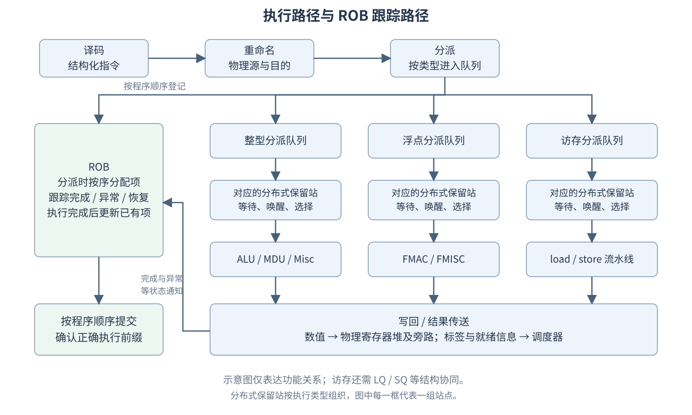

*功能关系示意：分派时并行登记 ROB；数值写回物理寄存器与旁路，完成信息更新 ROB。每个调度框代表对应类型的一组分布式保留站。*

沿这张图，需要区分三个时刻：

| 时刻 | 含义 | 是否已成为提交后的程序状态 |
| --- | --- | --- |
| 发射 | 调度器选择指令，将它送入功能部件 | 否 |
| 完成／写回 | 得到结果，传送数值和完成、异常等信息 | 通常还没有 |
| 提交 | 老指令的处理满足要求，按程序顺序确认本指令 | 是 |

对于使用统一物理寄存器堆重命名的寄存器运算，物理寄存器保存数值，ROB 主要用于跟踪程序顺序、完成状态与恢复信息。不能把所有数值都理解成先存在 ROB、提交时再统一复制出来。访存指令还需要访存队列协同；尤其是 store 提交与最终写入数据缓存，也不是同一个时刻，见第 4 章。

### 3.2 依赖、重命名与物理寄存器回收

**寄存器依赖有三类。** 以下按程序顺序排列两条指令：

| 依赖 | 短例子 | 必须保持的关系 | 重命名的作用 |
| --- | --- | --- | --- |
| RAW，写后读 | `add x5,x1,x2`；`sub x6,x5,x3` | 后者必须读取前者产生的新 x5 | 真实数据依赖仍然存在 |
| WAR，读后写 | `add x6,x1,x2`；`sub x1,x3,x4` | 前者读取旧 x1，不能被后者提前覆盖 | 让读取与新写入使用不同物理版本 |
| WAW，写后写 | `add x5,x1,x2`；`sub x5,x3,x4` | 程序最后应看到后者写入的 x5 | 为两次写入建立不同物理目的 |

RAW 是生产者向消费者传递数值的真依赖；WAR、WAW 由体系结构寄存器名字被复用而产生，可以通过寄存器重命名消除。这里讨论寄存器依赖，不能把这一结论直接用于地址尚未确定的内存访问。

**源寄存器查现有映射，目的寄存器建立新映射。** 假设进入重命名时有 `x1→P1`、`x2→P2`、`x3→P3`、`x5→P5`，随后出现：

```asm
I1: add x5, x1, x2
I2: sub x6, x5, x3
I3: xor x5, x8, x9
```

按程序顺序重命名，可以得到：

| 指令 | 捕获的物理源 | 新分配的物理目的 | 重命名后的相关映射 |
| --- | --- | --- | --- |
| I1 | P1、P2 | P32 | x5→P32 |
| I2 | P32、P3 | P33 | x6→P33 |
| I3 | x8、x9 当前对应的物理源 | P34 | x5→P34 |

I2 在重命名时已经捕获 P32。即使 I3 随后将映射表中的 x5 改成 P34，I2 也不会重新查表、改读 P34。因此 I1→P32→I2 的真实依赖保留下来，而 I1 与 I3 的两次写 x5 不再争抢同一存储位置。映射表描述新进入指令应使用的版本，已重命名指令则保存自己的源编号。

论文称这一方式为“统一物理寄存器堆重命名”。这里的“统一”描述重命名组织方式，不意味着整数与浮点共用一个寄存器堆。表 1 中，雁栖湖整数和浮点物理寄存器堆各有 160 项，南湖各有 192 项；上面的 P32 等都是假设编号。[统一物理寄存器堆重命名（PDF 第 6 页）](paper.pdf#page=6 "期刊第 481 页；第 3.1 节第二段：映射表及物理寄存器分配、释放")；[论文表 1：物理寄存器堆容量（PDF 第 3 页）](paper.pdf#nameddest=Table1 "期刊第 478 页；表 1：整型／浮点物理寄存器堆项数")（[页码备用](paper.pdf#page=3 "期刊第 478 页；表 1：整型／浮点物理寄存器堆项数；书签不受支持时按页码打开")）

**Move 消除通过共享映射避免复制。** `mv x5,x6` 是表达寄存器复制的伪指令，常对应 `addi x5,x6,0`。若 x6 当前映射 P20，普通执行可以为 x5 分配 P32，再复制 P20 的数值；论文中的优化则可让 x5 直接映射 P20。此时 x5、x6 暂时使用同一物理版本，省去一次额外的执行单元复制。[RISC-V 规范](https://docs.riscv.org/reference/isa/v20240411/_attachments/riscv-unprivileged.pdf)、[Move 消除（PDF 第 6 页）](paper.pdf#page=6 "期刊第 481 页；第 3.1 节第二段末：通过改变寄存器映射关系消除 move 指令")

“零延迟”表示这条 move 不额外增加复制运算的延迟。如果 P20 的生产者还未完成，使用 x5 的指令仍须等待 P20；move 也仍然受程序顺序、提交和恢复约束。以后某条指令改写 x5 时，为 x5 建立新版本即可，x6 可以继续引用 P20。

**分配、提交和回收需要配合。** 在没有共享映射的简化例子中，`x5→P5` 被 I1 改成 `x5→P32`：重命名时拿出空闲 P32，但不能立即回收 P5。更老的指令可能仍需旧值，投机恢复也可能需要旧映射。I1 安全提交后，在这一简单条件下，P5 才可以归还空闲资源池，而 P32 作为当前有效版本继续保存。

存在 move 消除时，必须增加条件：旧物理寄存器不再被其他有效映射或操作引用，且不再需要用于恢复，才能回收。例如 x5、x6 同指 P20，即使改写 x5 的指令已提交，也不能把 x6 仍引用的 P20 释放。论文没有展开共享映射的引用管理算法，不据此假定具体计数器或释放实现。

雁栖湖每周期最多分配、释放各 6 个物理寄存器，这是峰值带宽。并非每条指令都需要新物理目的：普通分支、store 没有通用寄存器目的，目的为 x0 的整数结果不必保存，符合条件的 move 也可复用映射。因此六条指令通过重命名，不等于固定分配六项。

### 3.3 分派、保留站与功能部件

分派负责将指令放进合适的结构；保留站负责等待依赖满足，并参与唤醒、选择和发射。雁栖湖采用发射前读寄存器堆与完全分布式保留站，结合物理寄存器堆读写口限制组织执行部件。论文给出的整数保留站为 7 个，每个 16 项，与功能部件一一对应；浮点模块有 6 个保留站，组织方式类似。[整数与浮点保留站配置（PDF 第 7 页）](paper.pdf#page=7 "期刊第 482 页；第 3.1 节：7 个整数保留站、每站 16 项，以及 6 个浮点保留站")

| 模块 | 功能部件数量 | 运算与实现 |
| --- | --- | --- |
| 整型 | 4 ALU | 基本整数算术、逻辑；可提前唤醒，支持背靠背执行 |
| 整型 | 2 MDU | 乘除法；乘法为三级流水华莱士树，除法采用 SRT4 |
| 整型 | 1 Misc | 跳转、CSR 等 |
| 浮点 | 4 FMAC | 浮点乘法、加法、乘累加；固定四周期延迟 |
| 浮点 | 2 FMISC | 浮点除法、开方等；采用 SRT4 |

保留站“16 项”指可容纳的待处理操作数量，不表示每周期发射 16 条，也不等于功能部件有 16 路。并行能力还受发射口、功能部件、读端口和旁路资源限制。

假设 `I1: mul x5,x1,x2`、`I2: add x6,x5,x3`、`I3: add x7,x8,x9` 的源寄存器除 x5 外均已就绪。I2 等待 I1 产生 x5；I3 与这一依赖链无关，资源允许时可以先执行。保留站不要求始终从最前面的指令发射，因而能够利用独立工作覆盖长延迟等待。

**提前唤醒需要数据路径配合。** 对固定延迟 ALU，处理器可以提前通知保留站：某个物理源在消费者使用时将可用。消费者据此进入选择过程，并通过及时的寄存器读取或旁路取得实际数值。提前唤醒改变的是调度时机，不能凭空产生还没算出的结果，也不能把“预计可用”理解成数值已经写进寄存器堆。

以一周期整数 ALU 依赖链作为教学假设：

```text
                    周期 N     周期 N+1    周期 N+2
I1: add x5,x1,x2     执行
I2: sub x6,x5,x3                执行
I3: xor x7,x6,x4                            执行
```

若唤醒、选择和供数路径能够衔接，相关指令可以连续周期执行，即“背靠背”。图表表达这一目标，不是论文给出的所有部件逐级时序。长延迟除法、缓存缺失等不能直接套用这条固定延迟示意。

雁栖湖浮点部件基于 HardFloat 开源实现做了改进和时序优化，浮点寄存器堆使用 Recode 内部格式：将指数扩展一位，以简化运算和舍入逻辑。这是内部表示，不能理解为改变程序中的浮点数据格式。论文指出其扩展位宽不利于添加向量部件，因此南湖不再采用该格式。[HardFloat 与 Recode（PDF 第 7 页）](paper.pdf#page=7 "期刊第 482 页；第 3.1 节浮点模块段：Hardfloat 实现、Recode 指数扩展及南湖不再采用")

### 3.4 ROB：写回、提交与精确异常

ROB 按程序顺序跟踪在途指令，而功能部件可以乱序完成。雁栖湖 ROB 每周期最多接收分派来的 6 条指令，也最多提交 6 条指令；表 1 给出的容量为 192 项，南湖为 256 项。接收宽度、提交宽度与总容量是不同参数。[ROB 接收与提交宽度（PDF 第 7 页）](paper.pdf#page=7 "期刊第 482 页；第 3.1 节 ROB 段：每周期最多接收、提交各 6 条指令")；[论文表 1：ROB 容量（PDF 第 3 页）](paper.pdf#nameddest=Table1 "期刊第 478 页；表 1：ROB/LQ/SQ 项数，雁栖湖 ROB 192 项、南湖 256 项")（[页码备用](paper.pdf#page=3 "期刊第 478 页；表 1：ROB/LQ/SQ 项数，雁栖湖 ROB 192 项、南湖 256 项；书签不受支持时按页码打开")）

假设 I1 是尚未完成的除法，I2、I3 是独立整数运算，已经算出结果：

```text
ROB 头 → I1：未完成
         I2：已完成，未提交
         I3：已完成，未提交 ← ROB 尾
```

I2、I3 可以将结果提供给允许投机执行的消费者，但不能越过 I1 提交。处理器只推进满足提交条件的程序顺序前缀，遇到尚未完成或需要处理异常的指令就不能继续越过它。因此“算出来”与“正式确认”必须分开理解。

写回传送结果及完成信息；提交确认这条指令在顺序语义中的地位。对于物理寄存器方案，提交不必被理解成把数值再复制到另一个体系结构寄存器堆。ROB 也不能仅凭一个完成标志无条件提交，还要结合异常、恢复以及相应指令的特殊约束。

**精确异常让软件看到明确的程序边界。** 以分页开启、访问普通内存为条件：

| 程序顺序 | 行为 |
| --- | --- |
| I1、I2 | 可以正常完成的老指令 |
| I3 | `lw x5,0(x10)`，地址翻译发现无效页表项 |
| I4、I5 | 不依赖 I3，可能已经投机完成 |

I3 产生 load 页故障。处理器记录异常信息；等 I1、I2 提交、I3 到达 ROB 头部时，再进入异常处理。I3 不提交正常读取结果，年轻的 I4、I5 不把投机结果变成已提交状态，取指转向异常处理入口。进入处理程序时，原程序的状态等价于执行完 I1、I2，而尚未完成 I3 的正常效果。

“作废年轻指令”不撤销已经提交的老指令。异常处理会建立异常原因、故障 PC 等控制状态，所以这里描述的是出错程序的正常执行结果边界，而不是声称进入处理程序时所有寄存器都毫无变化。[特权架构规范](https://docs.riscv.org/reference/isa/v20240411/_attachments/riscv-privileged.pdf)

整数 `DIV` 除零不适合作为这类异常例子：RISC-V 规定商全为 1，`REM` 的余数等于被除数，本身不因除零触发异常。除法仍可用于说明长延迟造成的提交等待，但不能把“计算很慢”与“会发生异常”混为一谈。[RISC-V 规范](https://docs.riscv.org/reference/isa/v20240411/_attachments/riscv-unprivileged.pdf)

### 3.5 冲刷与回滚：撤销年轻的错误路径

分支误预测时，处理器要停止使用错误路径上的年轻指令，并恢复供后续正确指令使用的重命名状态。论文明确描述：ROB 从尾部回滚，根据记录的重命名信息恢复映射表，并配合流水线冲刷与前端重新取指。具体日志字段、每周期回滚多少项以及是否还有其他恢复优化，本文没有展开。[ROB 回滚与映射恢复（PDF 第 7 页）](paper.pdf#page=7 "期刊第 482 页；第 3.2 节之前的 ROB 段末：冲刷流水线、重新取指、从尾部回滚并恢复映射表")

假设程序顺序为 I1、I2、I3、I4、I5、I6，其中 I2 是预测错误的条件分支，I3–I6 来自错误路径。需要保留 I1 与 I2，撤销比 I2 年轻的错误路径指令。恢复边界是有效分支 I2 之后，不是把分支本身也当成无效指令。若跳转指令还产生了有效链接地址，其自身结果同样不能因目标预测错误而无条件丢弃。

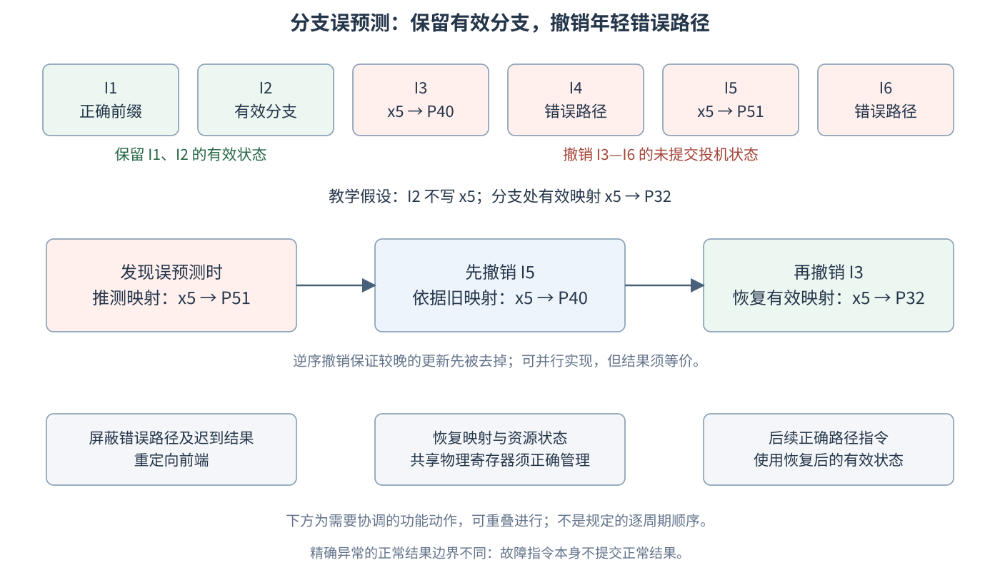

*教学示意：保留有效分支 I2，撤销 I3—I6；逆序恢复映射与屏蔽错误路径等功能需协调，图不规定逐周期先后。*

**用两次写 x5 解释逆序恢复。** 假设在 I2 处，x5 的正确映射为 P32；错路径上的 I3、I5 改写 x5：

```text
原有效映射：             x5→P32
I3 重命名：              x5→P40，保存旧映射 P32
I5 重命名：              x5→P51，保存旧映射 P40
发现 I2 误预测时：       x5→P51
```

可以概念性地把日志看成 `(目的名字, 旧物理编号, 新物理编号)`，这里是解释机制的抽象，不断言 ROB 中实际字段一定如此。恢复时，按年轻到老的逻辑顺序处理：撤销 I5，将 x5 从 P51 恢复为 P40；再撤销 I3，从 P40 恢复为 P32。I4、I6 若不写 x5，就不改变这条映射恢复链。

逆序的原因是后一笔更新覆盖了前一笔。若先撤销 I3，恢复到 P32，随后又按 I5 的旧映射恢复到 P40，反而留下一个错误路径版本。硬件可以同时处理多项，但并行结果必须与这个正确的逆序撤销关系一致，不能据此规定“一周期只能撤销一条”。

被撤销指令新分配的物理资源，在确认不再被有效状态引用后可以回收；正确路径的 P32 仍需保留。此例假设 P40、P51 没有通过 move 消除形成额外共享，真实资源管理仍须满足 3.2 的回收条件。

冲刷与映射恢复各有作用：前者使错误路径在分派队列、保留站、执行及访存结构中的操作失效，后者让新进入的正确路径指令重新使用正确版本。还要防止已撤销操作的迟到写回被当成有效结果。这些是需要协调的功能动作，不能把“回滚完→清空流水线→最后才重定向”作为论文已经证实的严格时间顺序；实际实现可让部分工作重叠。

分支误预测、异常和访存违例都可能触发恢复，但恢复边界不同：误预测通常保留有效分支；异常不提交故障指令的正常结果；访存违例可能要求重新执行相关 load 及其后续指令。统一理解是按具体事件保留正确前缀，撤销必须重做的未提交操作。

### 3.6 南湖演进：少占资源、缩短延迟、提高利用率

南湖整体沿用雁栖湖框架，优化可以归纳为三组，但需要区分软件执行的 ISA 指令与硬件内部操作。[论文 §3.2：南湖乱序执行单元演进（PDF 第 7 页）](paper.pdf#nameddest=s04.02 "期刊第 482 页；第 3.2 节：指令扩展与融合、运算延迟、发射策略及保留站合并")（[页码备用](paper.pdf#page=7 "期刊第 482 页；第 3.2 节：指令扩展与融合、运算延迟、发射策略及保留站合并；书签不受支持时按页码打开")）

| 优化 | 主要收益 | 需要保留的边界 |
| --- | --- | --- |
| RVB、RVK 扩展 | 用更少 ISA 指令表达部分位操作、密码计算 | 程序需要实际使用扩展；论文的指令数下降 10% 以上针对部分程序 |
| 常见指令组合融合 | 减少内部处理和队列占用，扩大有效指令窗口 | 不一般性改变同一程序的体系结构指令数；具体结构占用依融合实现而定 |
| 浮点与 SRT16 | 缩短相关运算的依赖链延迟 | 并非所有指令、所有输入都得到相同加速 |
| 最老优先、部分保留站合并 | 提高调度效率和资源利用率 | 仍受就绪条件、执行类型、端口与时序约束 |

**位操作扩展改变可用的指令表达。** 例如 RV64 中把 a0 循环右移固定 13 位，基础指令可写为：

```asm
srli t0, a0, 13
slli t1, a0, 51
or   a1, t0, t1
```

使用相应位操作扩展可写为 `rori a1,a0,13`；`andn` 则可直接表达 `a & ~b`。固定 13 的例子避免将变量移位误写成立即数指令，也避开移位量 64 的边界。新指令能够降低取指、译码、重命名和队列的工作量，但“一条指令”不保证“一周期”，实际延迟仍由部件实现决定。[位操作规范](https://docs.riscv.org/reference/isa/v20240411/unpriv/b-st-ext.html)

**融合主要改变内部处理方式。** 两条 ISA 指令仍是原程序的一部分，但处理器可以在某些阶段将其作为一个组合操作管理。论文未列出完整融合组合和各级条目规则，因此不能保证 ROB、RS 和所有队列必然同时从两项变一项。准确收益是减少相关结构的占用，让同样容量覆盖更多原程序指令。

例如假设某个队列容量为 256 个内部条目，一部分相邻组合可合用一个条目，那么它能容纳超过 256 条原始指令。窗口扩大后，前面的 load 等待数据时，更有机会找到后面的独立操作。这是容量效应的教学假设，不把每种队列都视为相同结构，也不把融合后的内部操作数代入体系结构动态指令数。

性能关系 `CPU 时间 = 动态指令数 × 平均 CPI × 时钟周期` 中，动态指令数通常按体系结构指令统计。ISA 扩展可能改变指令数；融合可能改善平均 CPI 和内部资源占用。若比较结果采用内部操作数，必须重新说明计数口径，不能把两者混用。

**更快的运算部件缩短依赖链。** 南湖采用兼容 IEEE 754 的浮点部件，通过双通路浮点加法器、级联式乘加单元降低浮点乘法和加法延迟；整数、浮点除法由 SRT4 升级为 SRT16。提高基数可以让每轮推进更多商位，减少完成除法所需的迭代轮数，但每轮逻辑也更复杂。论文报告除法延迟大多时候降低一半，不能推成所有输入固定减半，或把开方的全部实现也一并断言为同样升级。[浮点运算与 SRT16 延迟优化（PDF 第 7 页）](paper.pdf#page=7 "期刊第 482 页；第 3.2 节以“其次”开头的段落：双通路浮点加法、级联式乘加及 SRT16 除法")

增加运算部件主要增加并行处理机会；降低除法延迟则让依赖其结果的指令更早继续。吞吐和延迟是不同指标：充分流水化部件可以接收新操作而前一条尚未结束，也可能存在迭代部件长时间占用资源的情况，不能只由“有几个部件”推算每周期吞吐。

**最老优先仍然允许乱序。** 假设 I10、I12、I13 已就绪，I11 未就绪，且只有一个匹配的发射机会，应优先选 I10；I11 的依赖未满足时，不会仅因较老就阻止后面的就绪指令。这里的年龄优先在当前满足发射条件的候选之间比较，不是按程序顺序逐条执行。

老指令更早完成，通常有利于推进 ROB 提交、释放资源；但并非每次选择都保证立刻消除提交阻塞，真正挡在头部的可能仍是缓存缺失或更老的未就绪指令。发射策略同时要满足功能部件匹配和端口可用条件。

**合并部分保留站缓解容量碎片化。** 用两个兼容 ALU 的教学场景说明：各自 16 项的 RS0 已满、RS1 只占两项时，系统总计还有 14 个空位，却未必能给已经选择发往 RS0、不能直接转往 RS1 的操作使用。若将容量适当共享，就能从较大的候选集合调度，减少局部满、另一处空的浪费。

这不说明雁栖湖实际分派必然失衡，也不保证两站简单相加就是南湖的真实配置。共享程度增加还会扩大唤醒、选择、读端口与旁路布线的压力；论文确认的是合并部分保留站、提升利用率，并在支持背靠背执行的前提下改善效率与时序。具体合并哪些部件，不能由这一例子自行补出。

## 4 访存子系统

访存子系统接收保留站发出的 load/store 请求，完成地址计算、翻译、数据访问及依赖检查。论文中的雁栖湖有两条 load 流水线和两条 store 流水线，最多支持四条访存指令并行执行；通过投机执行、检查与恢复满足 RVWMO 内存模型。执行顺序可以变化，提交仍按程序顺序进行。〔论文 §4，PDF 第 7—9 页〕

### 4.1 乱序访存、队列与前递

#### 4.1.1 访存依赖需要根据地址判断

寄存器 RAW 依赖可以从源、目的寄存器关系识别；内存依赖还要判断访问的物理字节是否重叠。下面两条指令即使使用不同地址寄存器，也可能访问同一位置：

```asm
I1: sw x5, 0(x10)
I2: lw x6, 0(x11)
```

本节的 store–load 示例假设访问普通可缓存内存、地址对齐、读写宽度相同，且没有其他核心写入；load–load 的跨核示例另列条件。若两条指令最终访问 A，`x5=9`，则 I2 应取得较老 I1 写入的 `9`。寄存器重命名不能消除这种真实内存依赖。

| 较老 store 的状态 | 较年轻 load 的处理 |
|---|---|
| 地址已知，与 load 不重叠 | 不受这条 store 的依赖限制，可以提前执行 |
| 地址已知、重叠，数据已就绪 | 可以从 store 保存的数据中前递 |
| 地址已知、重叠，数据未就绪 | 等待或重放，不能把缓存旧值作为正确结果 |
| 地址尚未确定 | 可以保守等待；也可以推测无冲突，随后检查 |

同一核的单一地址示例中，若多个较老 store 都写 A，load 应取得程序顺序上最近的较老 store 的值。一般的不同宽度访问还需逐字节判断覆盖关系。

#### 4.1.2 LQ、SQ 与已提交存储缓冲

| 结构 | 跟踪内容 | 主要作用 |
|---|---|---|
| Load Queue，LQ | load 的顺序、地址、执行及缺失状态 | 支持访存违例检查、缺失重填后的处理 |
| Store Queue，SQ | store 的顺序、地址、数据和就绪状态 | 保存待处理写入，支持依赖检查与前递 |
| Committed Store Buffer，sbuffer | 已提交但尚未完成写入数据缓存的内容 | 按缓存行合并写入，缓解缓存写端口压力 |

雁栖湖 LQ 为 64 项、SQ 为 48 项；两者每周期分别最多接收六条对应类型指令。LQ 接收两条 load 流水线的执行结果；缓存行重填会广播到 LQ，唤醒等待该行的 load。缺失重填后的写回与正常访存共享写回端口，每周期最多写回两条。〔论文 §4.1〕

访存指令同时在 ROB 和 LQ/SQ 中保留信息：ROB 管理全局程序顺序与提交，访存队列管理地址、数据及访存状态。

SQ 中的 store 不一定已经提交；已提交的 store 也可能等待移交 sbuffer。sbuffer 则只接收已提交写入。其状态边界是：

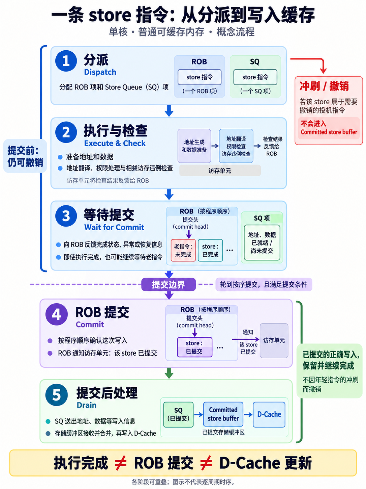

*概念流程图：执行完成、提交和数据缓存更新是不同事件，各阶段可重叠。*

假设缓存行覆盖 `0x1000—0x103F`，两条已提交 store 分别向 `0x1000`、`0x1004` 写四字节，它们可以合并到同一缓冲项。该项保存行地址、数据及逐字节有效掩码；只更新被掩码覆盖的字节，无须凑满一行。较新的同址写入覆盖缓冲项中相应字节。南湖实现中，合并还受条目是否已发起缓存写请求等状态限制。[南湖 sbuffer 文档](https://docs.xiangshan.cc/projects/design/zh-cn/nanhu/memory/lsq/committed_store_buffer/)

雁栖湖按缓存行合并，缓冲项数超过阈值时按 PLRU 选出换出项，每周期至多向数据缓存写入一行。〔论文 §4.1〕

已经提交的 sbuffer 写入必须继续完成；后续分支误预测可以撤销错误路径上的未提交 store，不能撤销这些已提交写入。

#### 4.1.3 Store-to-load forwarding 与访存违例

store 的新数据可能在 SQ，也可能已经进入 sbuffer。load 可以从这些结构取得数据，不必等 DCache 先更新：

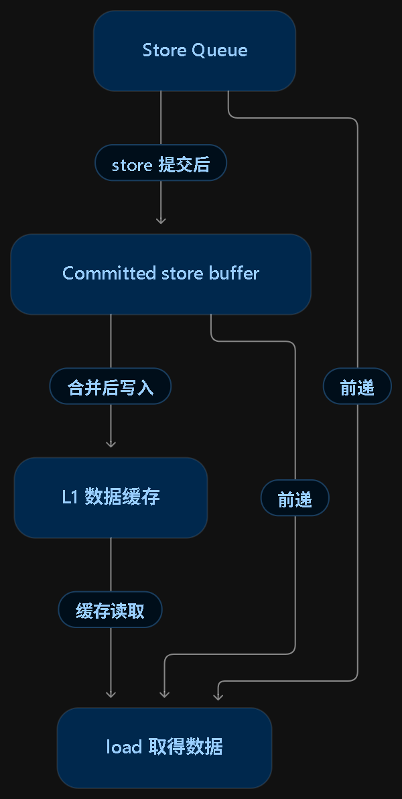

*数据来源示意：SQ、sbuffer 和 DCache 分别提供可能的数据，最终需按依赖顺序和字节覆盖选择。*

沿用 I1/I2：若 I1 的地址未就绪，I2 先从缓存读到旧值 `3`；后来 I1 确定也要向 A 写入 `9`，就发现了 store–load 违例。需要作废 I2 及受影响的后续投机执行，再重新执行 I2。

按序提交提供撤销错误结果的条件，但不会自动更改 I2 已经读出的 `3`。必须由地址和依赖检查逻辑发现问题、通知恢复。访存违例通常是硬件内部恢复事件，不是软件收到的一种“访存违例异常”。

load–load 检查与核间一致性有关。假设 A 初值为 0，核 1 仅将 A 改成 1；核 0 按程序顺序执行两个同址 load，中间没有 store。若年轻 load 先读到 0，核间更新变得可见后，老 load 才读到 1，就可能形成程序顺序中的“先新、后旧”。

| 老 load 的结果 | 年轻 load 的结果 | 在上述假设下 |
|---:|---:|---|
| 0 | 0 | 允许，两次看到旧版本 |
| 0 | 1 | 允许，跨过更新 |
| 1 | 1 | 允许，两次看到新版本 |
| 1 | 0 | 不允许，同址读取观察到版本倒退 |

这里比较的是写入版本顺序，不是数值大小。硬件可结合 LQ 记录与一致性事件识别风险并重放；具体检测路径属于实现问题。符合 RVWMO 的乱序执行本身并不构成违例。[RVWMO 规范](https://docs.riscv.org/reference/isa/v20240411/unpriv/rvwmo.html)

较年轻 store 可以提前准备地址和数据，但不能提前形成违反顺序的可见写入。限制其提交与缓存写入时机，可以避免它覆盖较老 load 应读取的值。

雁栖湖还使用 **load wait table** 预测易发生违例的 load：对被预测的 load，保留站阻塞其发射，直到所有较老 store 都已发射。预测器减少恢复次数，检查机制负责正确性。〔论文 §4.1〕

### 4.2 雁栖湖访存流水线

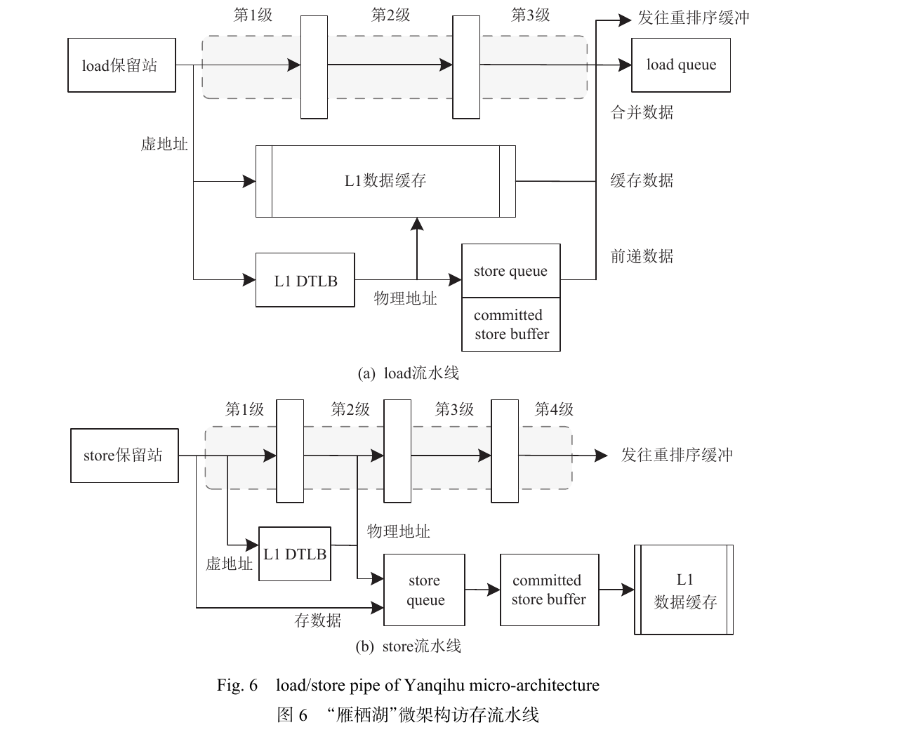

*论文图 6，PDF 第 8 页／期刊第 483 页。图中的写回箭头表示状态和结果通路，不表示指令执行完才首次进入 ROB。*

#### 4.2.1 Load：三阶段与数据合并

| 流水级 | 主要工作 |
|---|---|
| 第一级 | 计算虚拟地址；查询 DTLB；同时用虚拟地址索引 DCache |
| 第二级 | 用翻译后的物理地址比较缓存标签，查询 store 前递，反馈命中信息以唤醒后续指令 |
| 第三级 | 选择、合并缓存与前递数据，写回结果，更新 LQ 状态 |

虚拟索引只负责选出候选组，物理标签比较才确认是否命中。雁栖湖 L1D 为 32 KiB、八路；假设 64 B 缓存行，索引位 `[11:6]` 完全位于 4 KiB 页内偏移中，可以与 TLB 查询并行。更大的 VIPT 缓存可能用到虚拟页号位，详见第 5.1.2 节。

前递与缓存数据可以按字节合并。例如 load 从 A 读取四字节，较老 store 只修改 A+1：

| 地址 | DCache 旧数据 | store 前递 | 最终读取 |
|---|---|---|---|
| A | `0x11` | 无 | `0x11` |
| A+1 | `0x22` | `0xAA` | `0xAA` |
| A+2 | `0x33` | 无 | `0x33` |
| A+3 | `0x44` | 无 | `0x44` |

用字节掩码标记前递覆盖范围；缺失时可保留前递数据和掩码，等待缓存重填后完成合并。〔南湖实现补充：[load 流水线文档](https://docs.xiangshan.cc/projects/design/zh-cn/nanhu/memory/fu/load_pipeline/)〕

load 完成时，不同接收者使用不同信息：目的物理寄存器保存结果；保留站接收唤醒／旁路信息；ROB 更新完成、异常等状态；LQ 更新访存记录。实际数值不应被理解为主要保存在 ROB 中。

#### 4.2.2 Store：地址处理、违例检查与后续写入

| 流水级 | 主要工作 |
|---|---|
| 第一级 | 计算地址，访问 TLB 和数据缓存 |
| 第二级 | 将物理地址写入 SQ，开始检查访存违例 |
| 第三、四级 | 继续检查，向 ROB 报告结果 |

这条四级流水线完成地址处理与检查，不保证第四级结束时数据已经写入 DCache。之后还有按序提交、移交 sbuffer 和缓存写入过程。〔论文 §4.2〕

### 4.3 内存管理单元 MMU

MMU 将虚拟地址翻译为物理地址，并检查页权限。香山支持 Sv39 的 4 KiB、2 MiB、1 GiB 页，采用硬件页表遍历；翻译过程中页内偏移保持不变。

| 结构 | 保存／处理什么 |
|---|---|
| 数据缓存 | 程序的数据字节 |
| TLB | 地址映射和相关权限信息 |
| 页表 | 内存中的页表项，由操作系统维护 |
| PTW | 在缺少缓存页表项时，按需访问内存中的页表 |


*简化翻译路径：取指使用 ITLB，load/store 使用 DTLB；两者共享 L2 TLB，缺少必要页表项时由 PTW 继续查询。*

雁栖湖 ITLB、DTLB 各含 32 项 4 KiB 页条目和 4 项大页条目，采用全相联结构；L2 TLB 缓存 Sv39 各级页表项，包括中间级条目。因此，**两级 TLB** 与 **三级页表**是两种不同层次。论文还介绍 repeater：缓冲两级 TLB 间的请求并过滤重复请求，以适应较远的物理布局。〔论文 §4.3〕

| 事件 | 含义 | 后续处理 |
|---|---|---|
| TLB miss | 翻译缓存没有所需条目 | 查询下级 TLB 或页表，仍可能正常完成 |
| 数据缓存 miss | 本层没有所需数据 | 向更低层缓存或内存取数 |
| Page fault | 地址或页表检查不允许正常完成访问 | 进入异常处理，如无效映射或页权限不符 |

缺页异常不限于“数据未在内存”；例如向只读页写入，即使数据已在物理内存中，也可能触发 store page fault。[特权架构规范](https://docs.riscv.org/reference/isa/v20240411/_attachments/riscv-privileged.pdf)

### 4.4 南湖访存子系统改进

#### 4.4.1 MMU：容量、并行度和保护

| 改进 | 论文中的实现及意义 |
|---|---|
| DTLB | 16 项全相联与 64 项直接映射并行查询，增大有效容量；替换策略从随机改为 PLRU |
| L2 TLB | 为面积和时序缩减容量 |
| PTW | 拆成前两级页表、末级页表两个状态机；末级访存并行度从 1 提升至 8 |
| PMA、PMP | 增强 PMA 可编程性，并增加兼容规范的 PMP |

“1→8”指末级页表访问并行度，不是每周期完成八次完整翻译。直接映射部分没有同组多路替换选择，不能把 PLRU 理解为用于其中的多路淘汰。

PMA 描述物理区域支持的访问类型、缓存属性等；PMP 提供物理区域读／写／执行权限保护。它们与页表权限检查共同参与访问合法性判断。〔论文 §4.4；[特权架构规范](https://docs.riscv.org/reference/isa/v20240411/_attachments/riscv-privileged.pdf)〕

#### 4.4.2 Store 地址与数据分离

`sw x5,0(x10)` 的地址依赖 x10，数据依赖 x5。雁栖湖等待两者就绪再发射；南湖将两条四级 store 流水线拆成两条两级地址流水线和两条两级数据流水线，让两部分分别在就绪时执行。

地址较早确定，能更早判断后续 load 是否依赖这条 store，减少无谓等待和违例恢复。完整写入仍需要地址与数据齐备。南湖同时将访存违例预测算法改为 **store set**，提高预测准确率。〔论文 §4.4〕

#### 4.4.3 Load：四级流水与依赖访问优化

南湖将 load 流水线从三级加深为四级，以缩短每一级关键路径、提高主频；代价是依赖访问的周期延迟可能增加。因此需同时考察周期数、周期长度和可重叠的工作。

指针追逐属于 load-to-load 依赖：

```asm
A: ld x5, 0(x10)   # 读取指针 p
B: ld x6, 0(x5)    # 使用 p 继续读取
```

论文通过推测缓存标签来优化该场景；推测成功时，load-to-load 延迟从四周期降为三周期。真实数据依赖仍然存在，并非预测完整指针值。〔论文 §4.4〕

以下是结合南湖 v2.0 快速旁路的无阻塞教学时序，假设 DTLB、DCache 命中且快速路径条件成立：

| 周期 | 1 | 2 | 3 | 4 | 5 |
|---|---|---|---|---|---|
| A | S0 | S1 | S2 | S3 | — |
| B，普通路径 | 等待 | 等待 | 等待 | 等待 | S0 |
| B，快速路径 | 等待 | 等待 | 等待 | 提前 S0 | S1 |

A、B 的访问启动间隔由四周期变成三周期。快速路径让 A 最后阶段已有的数据提前参与 B 的地址查询，与 A 的结果处理重叠。

**对应版本实现补充：**v2.0 为 64 位 `ld` 指针访问提供快速旁路，先做低六位偏移相加并提前查询；下一阶段要求 `imm[11:6]` 为零、低六位相加没有进位、地址八字节对齐、操作为 `ld` 且依赖配对有效等。条件不成立就取消提前查询，回到正常路径；因此仅“不跨缓存行”还不充分。这是特定版本说明，不作为所有香山版本的统一规则。[南湖 v2.0 LoadUnit](https://github.com/OpenXiangShan/XiangShan/blob/v2.0/src/main/scala/xiangshan/mem/pipeline/LoadUnit.scala#L494-L563)

#### 4.4.4 虚地址前递、物理地址检查

南湖先用虚拟地址比较 load 与较老 store，提前选择前递数据；随后用物理地址检查是否匹配。这样减少 DTLB 翻译进入前递关键路径的延迟。若前递判断不正确，按恢复机制重新执行。〔论文 §4.4〕

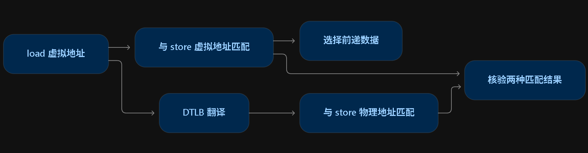

*机制示意：地址比较与翻译检查重叠进行；有效前递最终必须满足物理地址与字节覆盖要求。*

虚拟地址不同也可能映射到同一物理位置，因而单独的虚地址比较不足以保证正确性。SQ 与 sbuffer 都可参与查询；按缓存行组织的 sbuffer 仍通过行内偏移和字节掩码定位需要前递的字节。

## 5 缓存子系统

缓存利用时间局部性（近期访问的内容可能再次访问）和空间局部性（附近位置可能随后被访问），减少向较低层取数的等待。缓存行是保存、填入和传输数据的基本单位；一次 load 只取几个字节，缺失后通常引入一整行。相邻访问是否共享一次填入，要看是否落在同一缓存行中。〔论文 §5，PDF 第 9—11 页〕

### 5.1 层次结构、VIPT 与一致性

#### 5.1.1 两代缓存层次

| 部件 | 雁栖湖 | 南湖 |
|---|---|---|
| 核心数 | 1 | 2 |
| 每核 L1I | 16 KiB、四路 | 64 KiB、四路 |
| 每核 L1D | 32 KiB、八路 | 64 KiB、四路 |
| L1+ | 指令侧 128 KiB、八路，位于 L1I 与 L2 之间 | 论文表 1 未配置 |
| L2 | 1 MiB、八路、包含式 | 每核私有 1 MiB、八路、非包含式 |
| L3 | 未配置 | 双核共享 6 MiB、六路、非包含式 |

*容量与路数来自论文表 1；本笔记将其 KB/MB 容量按缓存常用二进制单位写为 KiB/MiB。*

雁栖湖以 L1+ 缓解 L1I 偏小导致的损失，L1+ 服务指令侧。南湖提高 L1 容量，并采用私有 L2、共享 L3 的三级结构：

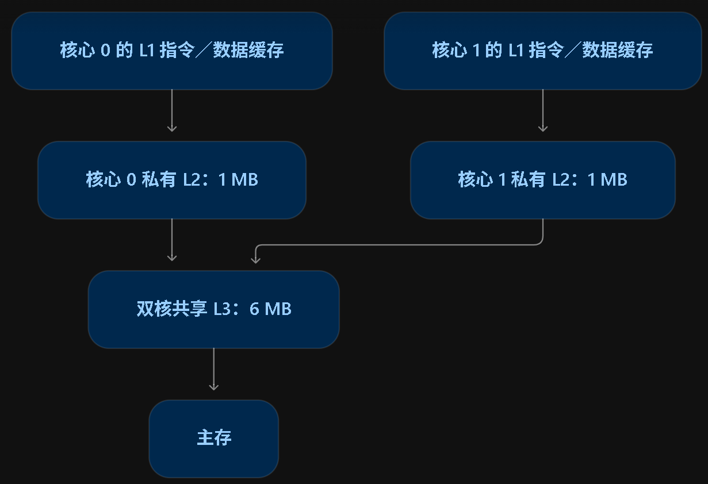

*层次图：每核 L1I/L1D 共用本核私有 L2，两个 L2 接入共享 L3。参数以 2023 年论文版本为准。*

硬件维护核间数据一致性，并支持南湖指令侧与数据侧的一致性。共享 L3 本身不自动完成这些工作，仍需要目录和协议协调副本的持有权限。

#### 5.1.2 VIPT：选组与确认身份

VIPT（Virtual Index, Physical Tag）先用虚拟地址索引选择候选组，与 TLB 翻译并行；随后用物理标签确认该组中的条目是否匹配，并完成权限等检查。

分页与缓存采用两种不同划分：

```text
分页：    页号 | 页内偏移
缓存：    标签 | 组索引 | 行内偏移
```

对于 4 KiB 页，地址翻译保持低 12 位页内偏移不变。假设缓存行大小 64 B，行内偏移为低六位；组数及索引位为：

$$
\text{组数}=\frac{\text{容量}}{\text{路数}\times\text{缓存行大小}}
$$

| 配置 | 组数 | 组索引 | 行内偏移 | 是否全部位于 4 KiB 页内偏移 |
|---|---:|---|---|---|
| 雁栖湖 L1D：32 KiB、八路 | 64 | `[11:6]` | `[5:0]` | 是 |
| 南湖 L1D：64 KiB、四路 | 256 | `[13:6]` | `[5:0]` | 否，多出 `[13:12]` |

雁栖湖这个配置下，虚实地址选出的组相同；例如地址低位 `0xABC` 对应组号 42、行内偏移 60。南湖索引用到了虚拟页号中的两位，它们翻译后不保证与物理地址相同，因此需要处理别名。

组相联规定组内有几个候选位置，索引方式规定组号取自哪种地址。物理索引下，同一物理块固定映射一组；VIPT 下，每个虚拟地址固定选组，但同一物理块的两个虚拟别名可能选中不同组。物理标签只核验已选组内的各路，不会自动搜索其他组。具体交接见第 5.3.3 节。

#### 5.1.3 包含式与非包含式

包含式要求下层覆盖上层持有的缓存块；非包含式取消这个强制关系，允许某块只保存在上层，也允许上下层同时保存。非包含式不等于严格互斥式，也不取消一致性维护。

只看只读块的容量示例：L1 保存 A，L2 只有两个块的位置。包含式 L2 需要覆盖 A，另一个位置可存 B；非包含式允许 L1 存 A、L2 存 B/C。它减少了必需重复占用的机会，但实际有效容量仍受映射、替换和工作负载影响，不能简单把所有容量相加当作保证。

雁栖湖使用 InclusiveCache；论文指出其下游 snoop 支持、频率提升与配置灵活性受到限制。南湖开发 HuanCun，模块支持多种包含关系与替换策略，论文流片配置的 L2/L3 使用非包含式和 PLRU。HuanCun 的数据非包含，而目录包含上层持有信息。〔论文 §5.1、§5.2；[目录设计](https://docs.xiangshan.cc/projects/design/zh-cn/nanhu/huancun/directory/)〕

#### 5.1.4 代码写入与取指同步

机器指令在内存中也是字节。JIT 生成代码或内核修改代码后，数据存储路径已经写入新字节，取指路径却可能保留旧缓存行或已提前取得的指令。

教学示例：A 原来是一条 `addi x7,x0,1`；把其机器码改成 `addi x7,x0,2` 后，期望执行 A 得到 `x7=2`。假设目标内存允许相应写入和执行、地址对齐，并从另一处执行以下代码：

```asm
# x10 指向 A，x5 保存 addi x7,x0,2 的机器码
sw    x5, 0(x10)
fence.i
jalr  x0, 0(x10)
```

`sw` 写入机器码，`fence.i` 同步本核此前已可见的存储与随后取指，`jalr` 跳到 A 开始执行。新数据不必先写回主存；硬件必须让后续取指满足同步语义。[FENCE.I 规范](https://docs.riscv.org/reference/isa/v20240411/unpriv/zifencei.html)

多核情况下，写入核执行 `fence.i` 只保证它自己的取指。若核 1 执行核 0 生成的新代码，需要建立写入与通知的先后关系，再由核 1 完成自身取指同步：

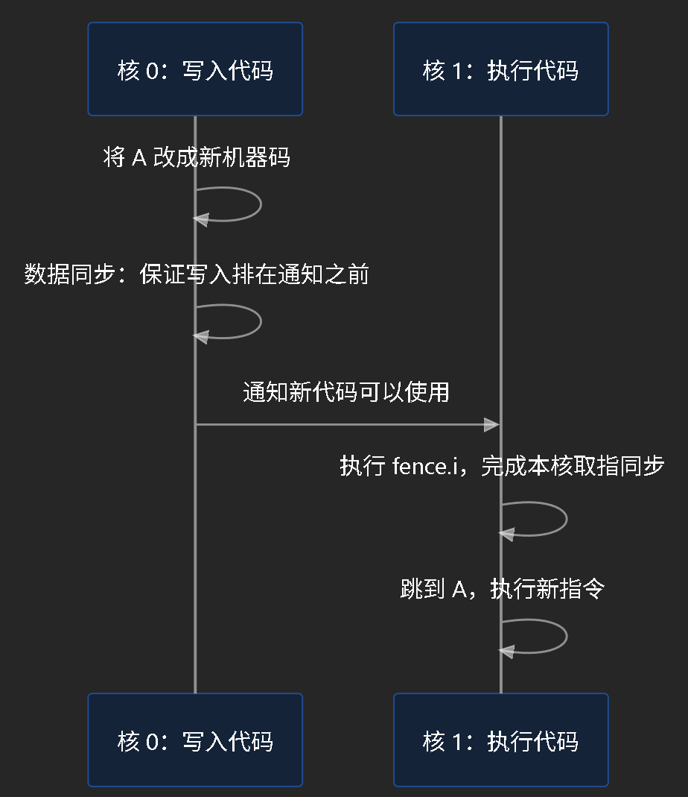

*逻辑示意：假设接收核收到通知并完成同步后，才进入新代码；数据 FENCE 的具体类别依发布／通知机制确定。*

数据同步用于发布新内容，取指同步用于后续取得新指令。不能把“数据已对核 1 可见”自动等同于“核 1 的取指流水线已经同步”。

| 实现 | 论文与对应版本说明 |
|---|---|
| 雁栖湖 | 硬件不自动维护指令缓存一致性，软件显式执行 `fence.i`；对应源码使 L1I 与 L1+ 有效状态失效 |
| 南湖 | 硬件支持 I/D 一致性；论文说明执行 `fence.i` 后无需冲刷指令缓存，软件仍遵守取指同步规则 |

“失效”表示旧条目不能再用于有效命中，字节内容未必清零。南湖可通过针对缓存块的一致性处理保留无关指令行，避免每次同步都作废整个缓存；论文没有在此段给出完整取指流水线动作。〔论文 §5.1；[雁栖湖 ICache](https://github.com/OpenXiangShan/XiangShan/blob/2c8b80c95095d89c3bd164f29d6a744c5925ed2d/src/main/scala/xiangshan/cache/ICache.scala#L508-L559)、[L1+](https://github.com/OpenXiangShan/XiangShan/blob/2c8b80c95095d89c3bd164f29d6a744c5925ed2d/src/main/scala/xiangshan/cache/L1plusCache.scala#L263-L267)、[南湖 ICache](https://docs.xiangshan.cc/projects/design/zh-cn/nanhu/frontend/icache/)〕

### 5.2 HuanCun 的组成与并行处理

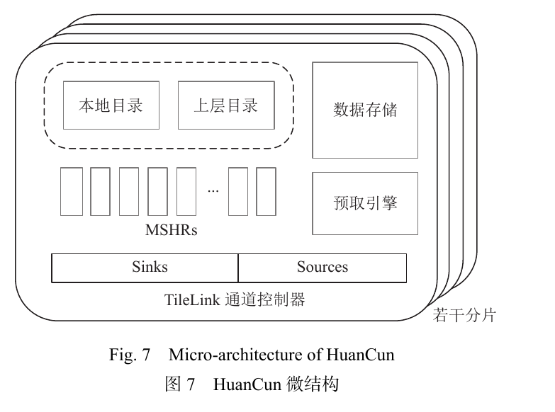

*论文图 7，PDF 第 10 页／期刊第 485 页。每个分片包含独立的请求管理逻辑，数据阵列也可分 bank。*

#### 5.2.1 目录、数据与 MSHR

| 部件 | 作用 |
|---|---|
| 目录 | 保存块身份、权限、脏位及上层持有情况等元数据 |
| 数据存储 | 保存实际字节，可配置 bank 提高读写并行度 |
| MSHR | 跟踪未完成请求，调度其子请求并等待相关应答 |
| 通道控制器 | 在内部请求与 TileLink 消息之间转换、传输 |
| 预取引擎 | 根据访问规律，提前取得可能需要的缓存行 |

目录回答“谁持有、有什么权限”，数据存储保存“具体内容”。非包含式缓存即使没有某块的数据，也可能通过上层目录知道 L1 仍持有它。

HuanCun 总体流程是接收总线请求、仲裁并分配 MSHR、调度数据读写及上下层交互、完成全部必要操作后释放 MSHR。名字中有 miss，不表示它只处理纯粹的缓存缺失；命中请求也可能需要权限协调。MSHR 项数限制同时在途的事务数量，但不等于每周期完成数量。〔论文 §5.2；[MSHR 设计](https://docs.xiangshan.cc/projects/design/zh-cn/nanhu/huancun/mshr/)〕

TileLink 是片上互连协议，HuanCun 使用其一致性通道交换请求、数据和权限消息。通道规则为避免死锁提供条件，具体缓存仍须正确安排优先级和资源，不能理解为接入总线就天然不会死锁。

#### 5.2.2 Bank、通道、仲裁与 slice

| 资源 | 限制／提高的能力 | 教学示例 |
|---|---|---|
| bank | 数据存储独立读写的机会 | 四个单端口 bank，两个请求同访 bank 0 时仍需分时 |
| 总线通道 | 请求与数据传输带宽 | 64 B 行经每周期 16 B 的数据口，无停顿也需四周期 |
| 仲裁 | 共享资源分给哪个请求 | 同一出口每周期只选一个；不同出口可并行 |
| slice | 同一级缓存的地址与请求管理分片 | 不同地址可交给独立目录、MSHR 和数据资源处理 |

valid/ready 握手使接收端能够背压发送端：当前无法接收时，发送端必须等待。多个 MSHR 可以同时在途，但仍可能等待 bank、通道或仲裁。

slice 与 bank 不同：前者划分缓存及事务管理，后者划分数据阵列；一个 slice 内还可有多个 bank。假设有四个 slice，示意映射 `slice = 缓存行号 mod 4`，行 100/101/102/103 分别进入四个分片，100/104 共享分片 0。先去掉行内字节偏移再取分片位；这个数量与取位规则不是论文给出的实际配置。〔论文 §5.2；[TileLink 规范](https://sifive-china.oss-cn-zhangjiakou.aliyuncs.com/TileLink/TileLink-TileLink%20Spec%201.7.1.pdf)〕

#### 5.2.3 预取：BOP 与 SMS

预取使取数与已有工作重叠，争取在真正 load 到来前准备好数据。论文点名 BOP、SMS，算法原理可用以下示例理解：

| 算法 | 学习的信息 | 示例 |
|---|---|---|
| BOP，Best-Offset Prefetcher | 有效的缓存行地址偏移 O | 访问 X 时尝试预取 X+O；学习适合当前访问行为的偏移 |
| SMS，Spatial Memory Streaming | 区域内的空间访问位图 | 新区域出现相同触发特征时，复用历史位置模式 |

BOP 会为候选偏移评分。对于 `100,102,104,106…`，步长是 2，但为覆盖更长取数延迟，偏移 4 也可能更有效，不能直接把相邻访问差当作最佳偏移。[BOP 原始设计](https://comparch-conf.gatech.edu/dpc2/resource/dpc2_michaud.pdf)

SMS 的教学示例用八行区域和位图 `1 0 1 0 0 1 1 0`，表示访问过区域内 0、2、5、6 号行。原始算法用触发指令 PC 与区域内偏移关联模式；在新区域遇到相同特征时，可以预取对应位置。位图不规定访问顺序。[SMS 原始论文](https://users.ece.cmu.edu/~ssomogyi/publ/isca2006.pdf)

上述区域大小、候选偏移都只是示例，论文未给出南湖在此处的具体配置及两种算法的组合方式。预取也消耗带宽、MSHR 和缓存容量；预测错误可能引入无用数据，预测正确但过晚也难以隐藏等待。

### 5.3 三个正确性与实现难题

#### 5.3.1 死锁：保证解除等待的请求能推进

简化示例：A 占用最后一个普通 MSHR，完成 A 先要处理嵌套请求 B；B 又需要同一资源。于是 A 等 B、B 等空闲资源，而资源要等 A 完成才释放。


*资源依赖示意，不是论文给出的某条实际总线请求链。*

HuanCun 调整分配策略，设置处理嵌套请求的专用 MSHR，并引入请求打断与跨层处理。南湖文档进一步说明，高优先级请求与低优先级事务冲突时可以使用专用 MSHR。增加普通 MSHR 数量只能缓解资源紧张，解除等待的事务仍需有推进机会。〔论文 §5.2；[分配设计](https://docs.xiangshan.cc/projects/design/zh-cn/nanhu/huancun/misc/)〕

#### 5.3.2 状态爆炸：按事件记录进度

一个事务可能同时等数据、等一致性应答、等目录更新，而且完成顺序不固定。若有 n 个独立二值条件，理论组合最多有 $2^n$ 种；这个公式用于说明复杂性，不是论文的状态数量。

HuanCun 用若干标志寄存器联合记录待发送子请求、待接收应答等事件，全部必要事件完成后释放 MSHR，并通过抽象解耦控制过程。这减少逐一枚举庞大命名状态的负担，但组合状态和并发正确性问题仍需验证。〔论文 §5.2；[MSHR 事件进度](https://docs.xiangshan.cc/projects/design/zh-cn/nanhu/huancun/mshr/)〕

#### 5.3.3 VIPT 别名：以物理身份协调虚拟位置

沿用第 5.1.2 节的南湖示意配置：64 KiB、四路、64 B 行，共 256 组。假设两个 4 KiB 虚拟页映射到同一物理页：

| 虚拟地址 | 物理地址 | VIPT 选组 | 若用物理地址选组 | 别名位 `[13:12]` |
|---|---|---:|---:|---|
| A：`0x40000040` | `0x80000040` | 1 | 1 | `00` |
| B：`0x40001040` | `0x80000040` | 65 | 1 | `01` |

低 12 位页内偏移相同，但索引中的虚拟页号位不同。先通过 A 将物理块 P 装入组 1，再通过 B 查询组 65，如果没有额外处理，就可能再次装入 P。两个副本若独立更新，可能出现一份为 9、另一份仍为 3 的错误。

南湖在 L2 上层目录记录 L1 的别名位，按物理块身份发现潜在重复。可以按功能把交接拆成：

1. L1 通过 A 保存 P；L2 记录“本核 L1D 持有 P，别名 `00`”。
2. 通过 B 查询组 65 未命中，翻译后请求仍指向 P，并携带新别名 `01`。
3. L2 比较旧、新别名，向 L1 发出针对 P、旧别名 `00` 的 Probe。
4. L1 结合页内索引位与旧别名定位组 1，处理旧副本并使其失效；必要时返回已修改数据。
5. 协调完成后，新请求取得正确内容并装入组 65，目录记录改为 `01`。

| 完成时刻 | L1 组 1 | L1 组 65 | L2 的 L1D 别名记录 |
|---|---|---|---|
| A 装入后 | P 有效 | 没有 P | `00` |
| B 交接后 | 旧副本失效 | P 有效 | `01` |

这个表是逻辑交接，不是逐周期时序。若组 1 已修改为 9，而较低层仍是 3，必须保住最新数据 9，不能失效后给组 65 填入旧值。最新数据可在缓存层级中传递，不必先落到主存。再次通过 A 访问，可能反向切换别名，频繁切换会增加开销。〔论文 §5.2；[南湖抗别名机制](https://docs.xiangshan.cc/projects/design/zh-cn/nanhu/huancun/cache_alias/)〕

“一个副本”指同一物理块在某一个 L1 内只保留一种有效虚拟索引；其他核心的 L1 可以使用不同别名同时持有可读副本。核间写权限和副本有效性由一致性协议协调。

南湖每核私有 L2，所以目录按层级记录：

| 目录 | 管理的上层对象 | 对 P 的概念性记录 |
|---|---|---|
| 核 0 私有 L2 | 核 0 的 L1I/L1D | L1D 是否持有、权限、别名，如 `00` |
| 核 1 私有 L2 | 核 1 的 L1I/L1D | 同上，别名可以是 `01` |
| 共享 L3 | 两个 L2 所代表的缓存分支 | 哪些分支持有 P、各自权限 |

即使 P 的数据只在某个 L1 中，上层目录仍使较低层知道该缓存分支持有它。L1 的具体别名由本核 L2 协调；L3 通过物理块及分支权限协调跨核请求，无需直接记录每个 L1 的组号。[南湖目录设计](https://docs.xiangshan.cc/projects/design/zh-cn/nanhu/huancun/directory/)、[MSHR 权限控制](https://docs.xiangshan.cc/projects/design/zh-cn/nanhu/huancun/mshr/)

### 5.4 降低延迟与提高吞吐

| 优化 | 作用 |
|---|---|
| 通道控制流水线 | 尽早释放资源，减少占用时间 |
| refill buffer，重填缓冲 | 暂存返回数据并旁路给上级，减少等待先写入本层存储的延迟 |
| request buffer，请求缓冲 | 暂存被阻塞的请求，缓解总线阻塞 |
| MSHR 到通道控制器的仲裁 | 让独立通道尽可能并行工作 |

非阻塞缓存需要同时考虑数据保存容量、在途事务容量和实际服务带宽。更多 MSHR、bank 或 slice 能提供并行机会，能否转化为性能取决于访问分布、依赖和其他共享资源。

论文报告：**针对部分敏感程序片段，HuanCun 相比 InclusiveCache 性能提升约 30%**。这是特定片段的比较结果，不能当作整核、所有软件或 SPEC 分数的平均提升。〔论文 §5.2 末尾，PDF 第 11 页／期刊第 486 页〕

## 6 敏捷设计验证方法与性能评估

### 6.1 基于 **Chisel** 语言的敏捷设计

**先理解 Chisel 在开发流程中的位置：它帮助开发者构造硬件电路。**

Chisel 嵌入在 Scala 语言中。开发者可以用程序描述模块、寄存器、连接关系，再由工具生成 Verilog 等硬件描述，进入仿真、综合和物理实现流程。[Chisel 官方介绍](https://www.chisel-lang.org/docs)、[硬件描述生成说明](https://www.chisel-lang.org/docs/resources/faqs)

> [!TIP]
>
> **Scala 是一门通用编程语言**，主要运行在 Java 虚拟机（JVM）上，可以使用大量 Java 库。它同时支持面向对象编程和函数式编程，方便组织模块、复用代码和处理复杂结构。
>
> 在香山项目里，可以这样理解它与 Chisel 的关系：
>
> - **Scala** 提供变量、函数、类、循环等编程能力。
> - **Chisel** 建立在 Scala 之上，提供寄存器、连线、选择器等硬件构造能力。
> - 开发者用它们编写**参数化描述**，再由工具生成 Verilog 等电路描述。
>
> 例如，用 Scala 的循环可以生成多个相似的硬件模块；这些模块在最终电路中可以**并行工作**。

可以把这个过程理解为：Chisel 描述与配置 → 构造电路 → 生成硬件描述 → 验证和物理实现 → 芯片

Scala 程序在开发阶段运行，负责构造电路；最终处理器运行的是 RISC-V 指令。

这对香山有什么帮助？可以接回前面讲过的队列。

例如，设计一个包含多项的访存队列，需要描述：

- 每项保存哪些字段；
- 怎样分配和释放条目；
- 怎样比较地址；
- 怎样组织读写端口。

如果队列容量从 48 项变成另一种配置，参数化描述可以让相关结构随参数一起生成，减少重复修改。

**因此，论文把香山称为“处理器生成器”。**

论文给出一个具体例子：修改一个参数，就可以把六发射改为四发射，并通过各种测试。核心数量、队列大小等也可以配置。

这里的参数在**生成硬件时**生效：选择不同配置，会得到相应的电路结构。每种配置仍然需要评估正确性、性能、面积和时序。

论文写作时，南湖已有超过 **6 万行 Chisel 代码**、超过 **3 万行验证代码**。作者根据此前研究中的代码密度，估算其设计规模约相当于 **30 万行 Verilog**。

这个数字用来说明描述的紧凑程度。论文引用的面积和延迟优势，也来自团队的具体比较；实际电路表现仍取决于结构设计和工具优化。

**图 8 的重点，是微架构、时序和工具一起推进。**

图 8“香山开发时间轴”覆盖了 2020 年 6 月至 2022 年 10 月，展示了四条线：

| 研发活动     | 怎样理解                             |
| ------------ | ------------------------------------ |
| 代码提交     | 不断实现、修正和整合设计             |
| 微架构演进   | 增加预测器、缓存、流水线等改进       |
| 时序优化     | 检查电路能否在目标时钟周期内完成工作 |
| 开发工具建设 | 改善验证、调试和性能分析效率         |

截至南湖代码冻结，累计有 **7,498 次提交**，峰值达到每周 **169 次**。

尤其要留意第三条：团队在设计早期就进行时序评估，并让评估结果指导结构修改。上一节讲过的 load 流水线从三级调整到四级，就能帮助理解这种协作——流水线设计要同时考虑执行延迟与可实现的主频。

### 6.2 敏捷验证方法 

**论文指出：设计变快了，验证成为新的瓶颈。**

一个很有分量的例子是：雁栖湖在三个月内成功在仿真环境中启动 Linux，之后仍额外投入八个月和大量人力，才完成更全面的验证。

启动 Linux 已经覆盖许多功能，但复杂处理器还存在大量边界情况：访存请求相互交错、分支回滚遇到异常、缓存替换遇到一致性请求……这些情况需要继续验证。

论文把验证组织成一个循环：发现错误 → 保存和复现现场 → 定位并修复 → 再次验证

三个工具分别改善其中的不同环节。

**Difftest 负责尽早发现不符合规则的执行结果。**

它连接两个对象：

- **DUT，待测设计**：香山硬件的 RTL 仿真。
- **REF，参考模型**：按照指令集语义执行程序的模拟器。

Difftest 捕捉指令提交和其他状态更新，驱动参考模拟器执行对应指令，再按规则比较状态。

这里可以接回前面反复讲过的“执行”和“提交”。

```
addi x5, x0, 3
addi x6, x0, 4
add  x7, x5, x6
```

前两条相互独立，香山内部可以先完成第二条，也可以先完成第一条。参考模拟器可以用更简单的方式执行。

但在对齐的提交进度上，结果应该是：

| 提交到的位置 | 应有的结果 |
| ------------ | ---------- |
| 第一条       | `x5 = 3`   |
| 第二条       | `x6 = 4`   |
| 第三条       | `x7 = 7`   |

如果硬件最终让第三条提交了 `x7 = 8`，差分检查就能发现异常。

**比较的重点是软件可见的架构行为，内部流水线和执行顺序可以不同。**

这也解释了它为什么适合快速迭代：改变 ROB 容量、队列组织或流水线结构时，只要指令语义没有改变，参考模型就有机会继续复用。

论文还强调“合法规则匹配”，并支持多核验证。联系之前的 RVWMO，可以理解为：多核可能存在**不同但合法**的执行交错，验证需要区分规范允许的差异与真正的一致性错误。

**LightSSS 负责降低保存和复现错误现场的成本。**

假设仿真已经运行很久，才出现一个错误。开发者需要查看错误附近的详细记录。

全程记录大量波形会占用空间；从头重新运行，又会重复等待很长时间。

LightSSS 的做法是：

1. 仿真过程中**定期保留快照**。
2. 出错后恢复一个较近的快照。
3. 从那里重新运行，并开启详细调试记录。

官方说明也描述了这种从近期快照重跑、生成波形和日志的流程。[LightSSS 官方说明](https://github.com/OpenXiangShan/difftest#lightsss-a-lightweight-simulation-snapshot-mechanism)

它利用主机操作系统的 `fork` 和**写时复制**机制：快照进程与继续运行的进程最初共享内存页，后续某页被修改时，再复制那一页，从而降低快照成本。

这里保存的是**运行在主机上的仿真进程状态**，其中包含被模拟处理器的寄存器、缓存及其他状态。

**ChiselDB 负责帮助开发者追查错误怎样形成。**

差分检查指出的出错位置，**可能晚于**真正的错误起点。

例如，一条 load 读出了错误数据，原因可能是更早的一次缓存失效处理或目录更新出了问题。只看 load 附近的几个周期，未必能发现原因。

论文中的 ChiselDB 允许开发者**指定要记录的数据结构**，在仿真过程中收集信息并导入数据库，之后通过查询分析历史。

例如，记录中包含相应字段后，就可以追查：

- 某个物理缓存块经历了哪些请求；
- 某项 MSHR 何时分配、等待和释放；
- 目录权限或脏位何时改变；
- 哪次事件之后，状态开始偏离预期。

数据库便于整理较长的事件历史；需要检查某个周期的信号细节时，仍然可以结合波形分析。

把三个工具连起来看，就是：**Difftest 指出哪里出现了不符合规则的结果，LightSSS 帮助从附近重新运行，ChiselDB 帮助追查此前发生的内部事件。**

### 6.3 性能评估

这一节回答：**完整程序的硬件仿真很慢，怎样较快地判断一次设计改动有没有提升性能？**

上次的 Difftest 主要检查“执行结果是否正确”。这次关注完成程序需要多少周期、最终性能怎样。

**论文采用的办法，是详细仿真少量有代表性的程序片段，再估计整个程序。**

一个程序运行过程中，行为会变化：某些阶段反复执行计算循环，某些阶段频繁访问内存，还有些阶段包含较多分支。

如果几个阶段的行为很相似，就有机会选出其中一个作为代表。论文的流程是：

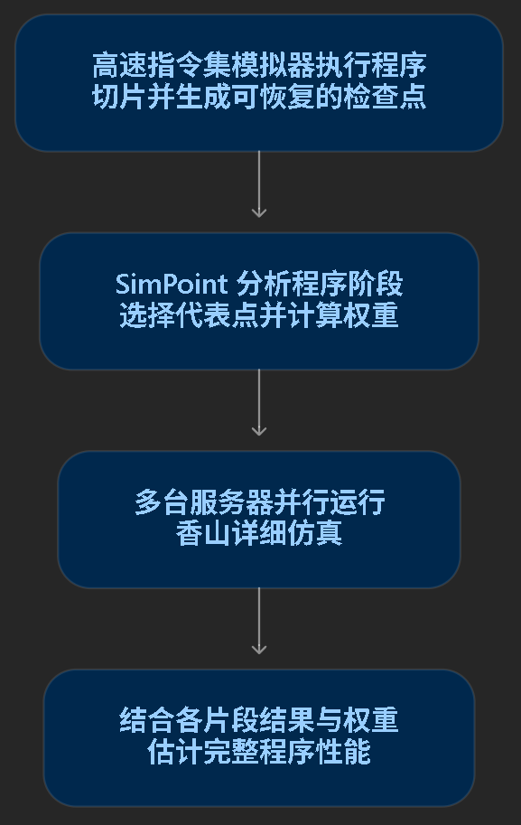

这里的**检查点**让仿真能够从程序中间的某个状态继续执行，省去从头进行详细仿真的成本。

联系上次的 LightSSS：LightSSS 用快照帮助复现错误；这一节的检查点，则服务于代表性程序片段的性能评估。

服务器上的并行发生在评估工作中：不同服务器分别运行不同片段。后面图 10 报告的仍然是南湖的**单核性能**。

**SimPoint 选择的是能代表某类执行行为的片段。**

SimPoint 可以根据程序基本块的执行频率等特征，把相似区间聚成一类，再选择代表点。

每个代表点还有一个权重，表示它代表了整个程序中多大比例的**动态指令**。某个片段自身很短，也可能代表大量相似的**执行区间**。

用一组假设数据理解加权：

| 代表片段 | 代表的指令比例 | 每条指令平均耗费周期，CPI |
| -------- | -------------- | ------------------------- |
| A        | 80%            | 1                         |
| B        | 20%            | 4                         |

估计整个程序的平均 CPI：
$$
CPI = 0.8\times1+0.2\times4=1.6
$$
也就是平均每条指令耗费 1.6 个周期，相应的 IPC 为：
$$
IPC=\frac{1}{1.6}=0.625
$$
这里有一个关键细节：**按指令比例加权时，可以直接加权 CPI；计算 IPC 时，要先加权 CPI，再取倒数。** SimPoint 作者的教程专门说明了这一点。[SimPoint 加权计算说明](https://cseweb.ucsd.edu/~calder/simpoint/sim-points-FAQ.htm)

同时，20% 的指令不一定只占 20% 的运行时间。上面 B 片段每条指令耗费的周期更多，所以对总时间的影响也更大。

**接下来先理解 SPEC 分数，再读图。**

这篇论文使用 SPEC CPU2006，其中包括整数测试套件和浮点测试套件。

对单个测试程序，其分数基本形式是：
$$
\text{分数}=\frac{\text{规定的参考运行时间}}{\text{被测系统运行时间}}
$$
完成同样任务越快，分数越高。套件总分则使用各测试程序分数的**几何平均**。这些测试的结果共同受到处理器、内存系统和编译器影响。[SPEC CPU2006 指标说明](https://www.spec.org/cpu2006/docs/readme1st.html)

因此，图中的“分数”表示相对于参考系统的性能比例，不能直接当作 IPC。

**图 9 用雁栖湖真实芯片，检查仿真评估是否可信。**

图 9“雁栖湖微架构仿真与真实芯片性能对比”中：

- 上半部分是 SPECint，下半部分是 SPECfp。
- 每个测试项目都有两根柱，分别对应仿真和真实芯片。
- 图例标出了仿真的 DRAM 模型，以及真实芯片的 DDR4_1600 配置。
- 纵轴是归一化后的“每 GHz 分数”。

读这张图时，先比较**同一个项目的一对柱子**。

例如，`429.mcf` 的仿真柱明显高于实测柱，说明这个项目存在较明显的评估偏差。其他一些项目，两根柱子则十分接近。

论文报告：

- 在团队当时的并行评估条件下，约 **3—5 天**可以完成雁栖湖的 SPEC 分值评估。
- 与硅后测试相比，报告的**平均误差为 5%—10%**。
- 部分误差来自真实 DRAM 与仿真模型的差异。

“平均误差”描述的是整体评估表现，各个测试项目仍可能有更大的偏差。

这张图的价值在于：团队已经拿真实芯片结果校验过这套评估方法，因此可以据此判断后续仿真结果的可信程度。

**图 10 则展示论文写作时南湖的单核仿真结果。**

当时南湖尚未投片，论文报告：

| 指标        | 每 GHz 分数 | 按文中 2 GHz 口径换算 |
| ----------- | ----------- | --------------------- |
| SPECint2006 | 9.550       | 19.100                |
| SPECfp2006  | 11.085      | 22.170                |

“每 GHz 分数”就是将分数除以主频，便于观察单位频率下的表现。但实际改变主频后，内存相对于处理器的等待周期等因素也会变化，所以不能默认分数始终随主频严格线性增长。

图 10 各项目的柱子差异很大。例如整数测试中：

- `462.libquantum`：18.494 分/GHz；
- `401.bzip2`：5.675 分/GHz。

它们各自相对于对应参考运行时间归一化，因此这些数值用于观察不同测试项目的表现，不能解释成各自每周期执行了多少条指令。

**正文中的“2 GHz 下总分 20.844”，也可以核算其口径。**

SPEC CPU2006 包含 12 个整数项目和 17 个浮点项目。把两套结果按项目数量合并取几何平均，可以算出：
$$
2\times9.550^{12/29}\times11.085^{17/29} \approx20.844
$$

> [!TIP]
>
> 这里是把 12 个整数项目和 17 个浮点项目，共 **29 个单项分数一起取几何平均**。
>
> 几何平均的算法是：**把所有数相乘，再开与数量相同次数的根。** 例如：
> $$
> G(2,8)=\sqrt{2\times8}=4
> $$
> 关键在于，`9.550` 和 `11.085` 已经分别是两组的几何平均。
>
> 设 12 个整数项目分数为
> $$
> a_1,\ldots,a_{12}
> $$
> ，则：
>
>  
> $$
> 9.550=\sqrt[12]{a_1a_2\cdots a_{12}}
> $$
> 所以，**12 个整数项目的分数乘积**就是：
> $$
> a_1a_2\cdots a_{12}=9.550^{12}
> $$
> 同理，17 个浮点项目的分数乘积是 
> $$
> 11.085^{17}
> $$
> 。
>
> 把这两个乘积相乘，再开 29 次根，就得到全部项目的几何平均：
> $$
> \begin{aligned} G &=\sqrt[29]{9.550^{12}\times11.085^{17}}\\ &=9.550^{12/29}\times11.085^{17/29}\\ &\approx10.422\text{ 分/GHz} \end{aligned}
> $$
> 因此，指数里的 **\(12/29\)、\(17/29\)**，来自两组各自占据的项目数量比例。
>
> 最后，原始数值是“每 GHz 分数”，按论文的 **2 GHz** 口径还原：
> $$
> 2\times10.422\approx20.844
> $$
> 前面的 **2 表示主频 2 GHz，与核心数量无关**。
>
> 这套算法能复现文中的 `20.844`

数值与正文吻合。**这是依据数值作出的口径推断，正文没有展开这个公式；SPECint、SPECfp 本身仍是分别报告的指标。**

**本节最后的 RVB 实验，展示了这套方法怎样帮助选择设计方案。**

论文报告，在 **GCC 10.2.0、文中默认配置**下，开启 RVB 位操作扩展后：

- SPECint 性能提升 **10.8%**；
- SPECfp 基本保持不变。

作者给出的解释是：部分操作可以使用 RVB 指令实现，替代原先需要的分支，从而减少分支预测错误和回滚开销。

这能接回前面的分支预测：提升性能既可以依靠预测器更准确，也可以通过指令与编译优化，减少需要预测的分支。

因此，性能评估工具支持的是一个反复迭代的过程：修改设计或编译配置，运行代表性片段，比较各项目及汇总结果，再决定是否保留改动。

## 7.物理实现

这一节把前面的微架构设计，接到了真实电路的时间、面积和功耗约束上。 

**先对齐本节“前端”和“后端”的含义。**

| 本节术语     | 含义                                                         |
| ------------ | ------------------------------------------------------------ |
| 前端设计     | 微架构设计、RTL 实现与验证等工作                             |
| 后端物理实现 | 将电路落实为实际单元、布局、连线和时钟网络，并满足**时序**等约束 |

这里讨论的是芯片开发分工。此前“取指前端”则是处理器内部的一个功能模块。

从开发流程看，大致是：

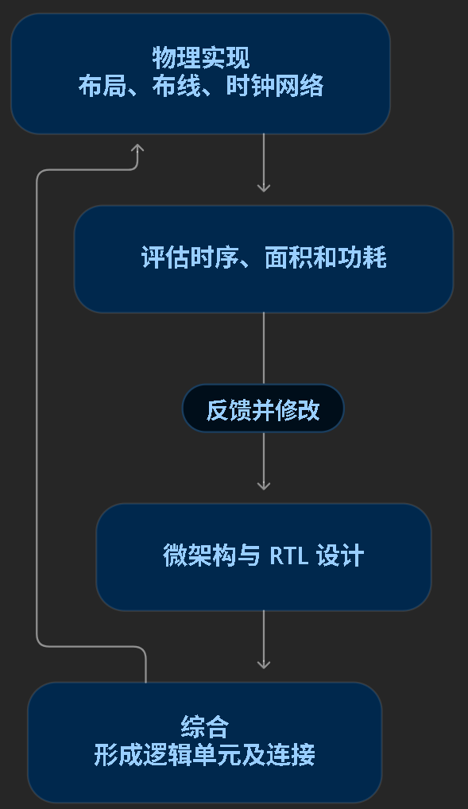

论文强调的，就是让这个反馈循环尽早运行起来。

**南湖的目标主频是 2 GHz，对应每个周期只有 0.5 纳秒。**
$$
T=\frac{1}{f}=\frac{1}{2\times10^9} =0.5\text{ ns}
$$
看一条常见的寄存器到寄存器路径：寄存器 A 输出 → 组合逻辑与连线 → 寄存器 B 接收

数据必须及时到达 B，并在采样前稳定下来。

因此，0.5 纳秒这个完整周期中，还要容纳寄存器输出延迟、接收端的建立时间，以及时钟相关裕量。**组合逻辑和连线实际能使用的时间，比 0.5 纳秒更短。**

如果一条要求单周期完成的路径总共需要 0.7 纳秒，就需要优化电路或调整结构，才能满足这个频率目标。

论文随后列出的三个问题，都可以沿着这条路径理解。

### 7.3 问题一：扇入过大、逻辑级数过长。

这里可以把“寄存器扇入过大”理解为：到达这个寄存器之前，需要汇总、比较或选择的信息太多。

例如，一个结果需要经历：读取多个候选 → 比较条件 → 判断优先级 → 选择数据 → 写入寄存器

这些工作如果串在同一个周期里，就可能形成很长的组合逻辑路径。

论文提出的办法包括：

- 重新组织时序紧张模块的流水线；
- 对大容量队列等部件采用数据预读取策略。

理解“预读取”时，可以想成：较早准备后面需要的数据，减少后续关键路径上必须串行完成的工作。

这也接回了前面南湖把 load 流水线从三级调整为四级的设计：将工作拆开，有机会提高主频，但也可能增加依赖指令的等待周期。

所以还要回到上一节的性能评估：
$$
\text{执行时间}\approx\frac{\text{执行周期数}}{\text{主频}}
$$
最终收益由周期数和主频共同决定。

### 7.2 问题二：扇出过大，一个信号需要驱动很多负载

例如，一条控制信号需要送到**大量**队列项。接收端和连线带来的**电容负载**，会影响信号**变化的速度**。

常用处理方式包括：

- 将负载分组，分级驱动；
- 插入合适的缓冲器；
- 复制部分寄存器，让不同副本服务不同区域。

缓冲器虽然自身也有延迟，但通过减轻驱动负担、分段驱动长线，可能降低整条路径的延迟。OpenROAD 的设计修复文档也将缓冲用于处理大扇出、大电容和长线延迟问题。[OpenROAD 设计修复说明](https://openroad.readthedocs.io/en/latest/main/src/rsz/README.html#repair-design)

论文进一步提出，在设计阶段**分离控制流和数据流**，减少大范围驱动带来的压力。这里的“控制流”是电路中的控制信号组织，与程序的分支控制流属于不同语境。

这些措施也有面积、功耗和布线成本，因此需要结合具体路径选择。

### 7.3 问题三：模块间耦合过深、信号布线距离过长

RTL 中，两个模块可以通过一条连接关联起来。物理实现时，这条连接必须成为芯片上的实际金属线。

实际连线具有电阻和电容，会产生延迟。模块相距较远，或者连接必须绕过其他区域，都会影响路径时序。

因此，优化不能只看一个模块内部的逻辑，还要看：

- 它频繁与哪些模块交换信号；
- 这些模块放在哪里；
- 信号需要跨越多远；
- 调整布局后，其他路径和布线拥塞是否受到影响。

论文提出降低模块间功能耦合，并结合布局进行跨模块优化，原因就在这里。

### 7.4 图 11 

图 11“南湖微架构最新版图设计”让前面讲过的功能模块有了物理位置，展示的是论文写作时的布局设计：

- 左图上方是两个香山核；
- 中间分别配置各核的 L2 缓存；
- 下方是共享 L3 缓存；
- 右图放大一个核心，标出浮点、控制、取指、整数、访存和页表遍历器等模块。

现在可以把它与之前的结构图联系起来：结构图表达模块怎样协作，布局图进一步呈现这些功能在芯片平面上怎样分布。

论文说，南湖当时已经进行了 **40 余次后端迭代**，从较粗的模块摆放逐步进入细节调整；与此同时，逻辑设计团队也修改了后端难以优化的关键路径。

这就是“协同优化”的具体过程：物理评估发现问题，设计团队调整结构，再进行下一轮实现。

### 7.4 表 3 

注意它属于雁栖湖，南湖的布局和目标频率是另一组信息。

| 指标          | 论文报告值 |
| ------------- | ---------- |
| 芯片面积      | 8.6 mm²    |
| 标准单元数量  | 5,053,679  |
| 标准单元面积  | 4.27 mm²   |
| SRAM 单元数量 | 261        |
| SRAM 单元面积 | 1.7 mm²    |
| 密度          | 66%        |
| 功耗          | 5 W        |
| 频率          | 1.3 GHz    |

标准单元是库中预设计的逻辑门、触发器、缓冲器等**电路块**。这里的 SRAM 数量按存储模块实例统计；总容量还需要结合各模块的宽度和深度计算。

“密度”与**布局利用程度**有关，但这一段没有展开其具体统计口径。功耗 5 W 也应作为作者报告值理解，表中没有给出完整的负载、电压和温度条件。

**表中的 ULVT、LVT、SVT、HVT，体现了速度与漏电之间的取舍。**

这些名称中的 Vt 指晶体管的**阈值电压**：

- 较低阈值的单元通常更快，但漏电更高；
- 较高阈值的单元通常漏电更低，但速度慢一些。

因此，可以在时序紧张的路径上选择更快的单元，在其他路径上使用漏电较低的单元。[Synopsys 阈值电压选项说明](https://www.synopsys.com/articles/using-foundation-ip.html)

这也解释了物理实现为什么要同时关注 **PPA：功耗、性能和面积**。缩短一条路径时，需要评估新增单元和连接带来的其他成本。

**论文所说的“左移”，就是让这些约束更早进入设计决策。**

例如，考虑增加一个队列的容量时，就尽早评估它对读取、选择、信号驱动和布局的影响；发现单周期路径过长时，及时考虑流水线和模块接口调整。

论文还记录了团队在相同条件下对 BOOM 得到约 1 GHz 的评估结果。它反映的是作者当时那组实现条件下的比较，也用来强调微架构与物理时序协作的重要性。

本节最后提出的方向包括：积累并开放协同优化流程、建设贯通前后端的工具链，以及进一步提高跨层优化的自动化程度。

